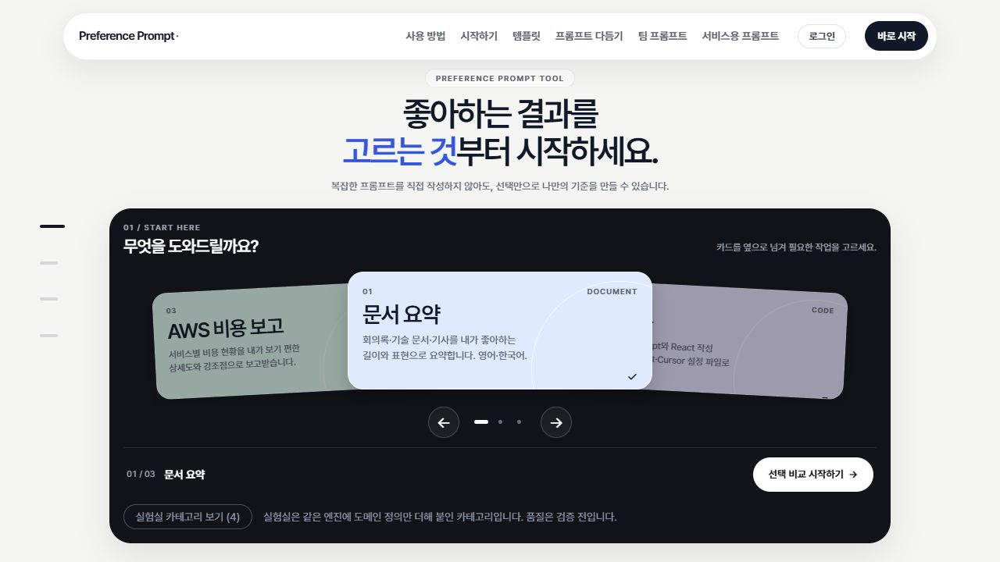
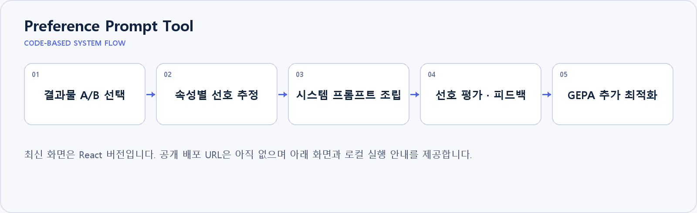

# Preference Prompt Tool

**사용자의 선택을 선호 추정과 재사용 가능한 프롬프트로 변환**

두 결과물 중 더 나은 쪽을 고르면, 선택 이력에서 속성별 선호를 추정해 새 입력에도 쓸 수 있는 시스템 프롬프트를 만듭니다.

2026.09 - 진행 중 | 3인 팀장 | 선호 반영 구조 기획·개발 · 평가 방식 개선  
`Python · React · TypeScript/JavaScript · Bradley-Terry · GEPA · LiteLLM · SQLite`

_최신 master의 React UI - 로컬에서 직접 캡처_

[구성도 SVG 원본](docs/portfolio/architecture.svg)

## 본인 기여

선택 기반 프롬프트 생성 도구를 기획하고, 선호를 반영하는 구조와 평가 방식 개선을 맡았습니다. 기능 구현과 품질 개선 실험을 구분해 기록했습니다.

## 기술 구조

| 구성 | 구현 내용 |
|---|---|
| 쌍대 비교 기반 추정 | 한 번에 한 속성만 다른 후보를 비교하고 Bradley-Terry 방식으로 효용을 갱신합니다. 무승부와 선호가 정해지지 않은 축도 구분하며, 내부 확신도는 사용자 선호의 확률로 표시하지 않습니다. |
| 비교 흐름과 확장 구조 | 불확실한 축을 우선 비교하고 사람용 화면에서는 중복 질문을 피합니다. 최대 8회 이내로 프롬프트를 조립하며 도메인 속성·검사 함수와 공통 엔진을 분리했습니다. |
| 평가 피드백과 GEPA | 속성별 검사 점수와 자연어 위반 피드백을 평가 함수로 만듭니다. GEPA 최적화는 선택 단계이며, 기본 프롬프트 조립 실험의 성과와 섞어 해석하지 않습니다. |
| 측정과 비교군 개선 | 표현 겹침만으로 요약을 판단하지 않고 길이·추출성을 함께 점검했습니다. 선호를 배운 문서와 평가 문서를 나누고 일반 지침 및 정답 선호를 아는 강한 비교군과 비교했습니다. |

## 구현 결과와 확인 범위

프롬프트 생성·재사용 흐름과 React UI를 구현했습니다. Qwen의 30개 페르소나 비교에서 강한 비교군 대비 ROUGE-L 평균차 +0.0047, p=0.3616으로 유의한 우위는 확인하지 못했습니다.

언어모델 자체를 학습하는 프로젝트가 아닙니다. 페르소나 기반 실험이며 실제 사용자 만족도 향상이나 비교군과의 동등성을 입증한 결과로 해석하지 않습니다.

## 코드와 실행

[선호 추정](engine/estimator.py) · [후보 선택](engine/selector.py) · [평가 함수](engine/metric_builder.py) · [제품 서비스](service.py) · [실험 기록](docs/length_v2_preregistration.md)

React 실행: `npm ci --prefix frontend`, `npm --prefix frontend run dev`. API 서버·데모 모드와 전체 실험 실행은 [기술 문서](README_DETAILS.md)를 참고합니다. 실시간 생성에는 별도 API 연결이 필요합니다.

화면·구성도는 설명을 위한 자료이며, 구성도는 현재 코드의 처리 흐름을 정리한 것입니다. 실험 수치와 본인 기여 범위는 위에 명시한 기준으로 해석합니다.
