# Preference Prompt Tool

## 사용자 선호 기반 맞춤형 프롬프트 자동 생성 도구

**마음에 드는 결과를 고르고, 내 답변 방식을 프롬프트로 만들어 다음 작업에 다시 사용합니다.**

AI에게 매번 “짧게 설명해 줘”, “코드는 역할별로 나눠 줘”라고 반복해서 말하는 대신,
예시를 비교하거나 원하는 방식을 선택해 나만의 지침을 만듭니다.
개인은 만든 지침을 보관하고 재사용하며, 팀은 공통 기준과 다른 항목을 확인하고
작업 맥락·자료·사용한 프롬프트를 다음 담당자에게 전달할 수 있습니다.

**현재 검증의 중심(2026-11-10): 문서 요약의 조건 준수와 내용 보존.** 일반 요청·조건을 잘 적은 수동 프롬프트·서비스가 조립한 프롬프트를 같은 원문에서 비교합니다. MACSum 영어 원문과 독립 Codex 보조 에이전트를 사용하며 유료 모델 API는 호출하지 않습니다. [실험 조건·결과·재현 자료](benchmarks/summary_agent_pilot/README.md). 개인 선호를 정확히 찾아낸다거나 사람의 시간·노력을 줄인다는 주장은 하지 않습니다.

기본 요약 지침은 핵심 사건·결과/목적·중요 수치·불확실성을 먼저 보존하도록 보완했습니다.
표현 겹침의 불필요한 상한을 없애고 완전 발췌를 원문 문장과 대조합니다.
[사용하지 않았던 원문에서 수동·수정 전·수정 후 비교](benchmarks/summary_agent_revision/README.md)에 근거와 한계를 기록합니다.

[실패 성찰 후보의 분리 평가](benchmarks/summary_reflection/README.md)는 관찰한 원문 18개를 개선용으로만 쓰고,
새 후보 확인용 6개·최종 평가용 18개를 구분했습니다. 보충 지침 후보는 최종 평가에서 현재 지침보다 핵심 명제
1개를 더 보존했지만 후보 확인에서는 1개가 줄어 기본 지침을 교체하지 않았습니다. 유료 API·실제 GEPA 실행 없이
보조 에이전트로 비교한 결과이며, GEPA 필수화나 사람의 선호·편의성 개선 근거로 사용하지 않습니다.

[실제 GEPA 후속 비교](benchmarks/summary_gepa_offline/README.md)는 설치된 GEPA 탐색과 독립 보조 에이전트를 연결해
유료 모델 API 없이 실행했습니다. 이전 원문을 제외한 개선 6개·후보 선택 6개·최종 평가 9개를 분리했습니다.
GEPA는 현재 지침을 유지했습니다. 새 원문에서 현재본과 비채택 GEPA 후보는 조건을 모두 통과했고 핵심 명제는
각각 22/27·20/27, 사실 문제 표시는 1/9·0/9였습니다(두 익명 검토자 동일). 일반적인 우위나 필수화 근거로
해석하지 않으며 자동 문장 수 검사의 약어 오인과 의미 검토 결과를 분리해 기록했습니다.

이후 [평가 오류·조건 충돌 수정 비교](benchmarks/summary_contract_revision/README.md)에서 약어 문장 구분을 v3로 보완하고,
요약 완료 화면에 **이번 원문의 조건 충돌 확인**을 추가했습니다. 짧은 완전 발췌에 선택 문장이 너무 많으면
분량 확대·재서술·일부 생략 중 사용자가 고른 부분만 바꾸며, 선택 전에는 새 작업용 지침을 만들지 않습니다.
새 원문 9개에서 수동·현재·수정본 모두 조건 9/9, 핵심 명제 25/27로 동률이었습니다(두 독립 검토자 동일).
모든 방식에 같은 보존 대상과 해결된 조건을 제공한 제한된 비교이며 수정본의 우위로 해석하지 않습니다.
기본 지침은 유지하고, 확인한 작업용 지침은 별도로 복사합니다. 유료 모델 API는 호출하지 않았습니다.

코딩 도움의 `AI 답변 방식 설정`과 `React 코드 스타일 비교`는 유지합니다. 코딩은 지정한 답변 조건의 전달·재사용·검증을 확인하는 확장 사례입니다. [코딩 목표·완료 기준](docs/coding-verifiable-goal.md), [검증 지침 프로토타입](benchmarks/coding_contract_v1/README.md). 사람의 편의성 평가는 [선택적 후속 계획](docs/coding-preference-usability-plan.md)으로 남깁니다.
기존 일부 과제 검사가 현재 코딩 전체의 정확도를 입증하지는 않습니다. [코딩 검증 범위 재점검](docs/history/coding-validation-audit-2026-11-10.md)에서 현재 제품·프로토타입·과거 실험을 구분합니다.

[현재 TypeScript/React 지침의 새 과제 비교](benchmarks/coding_react_current/README.md)(2026-11-12)는 실제 4항목 지침을
일반 요청·같은 조건의 수동 지침과 비교했습니다. 새 합성 과제 8개씩, 첫 응답 24개 모두 strict 타입 검사와
React/JSDOM 동작 검사(방식별 69/69)를 통과했습니다. 네 답변 조건 모두 일치는 일반 0/8·수동 8/8·제품 8/8로
두 독립 검토자가 일치했습니다. 일반 요청에는 해당 선호를 주지 않았으며 수동보다 우수하거나 기능 정확도가
향상됐다는 결과는 아닙니다. 수동·제품 응답 각 1개의 일본어 주석도 따로 기록했습니다.
유료 모델 API 없이 진행했으며 별도 React 코드 스타일 비교·사람의 편의성·수정 시간은 이 결과에 포함하지 않습니다.

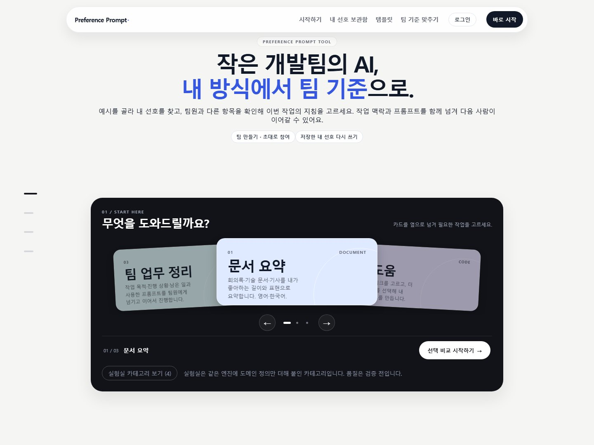

현재 브랜치의 실제 로컬 화면입니다. 아래 캡처는 **2026-11-04, 격리된 예시 계정과 예시 작업**으로 촬영했습니다.
문서 요약·코딩·보관함·팀 비교/조합·템플릿·요청문 점검·업무 지침·인수인계 화면을 담았습니다.
캡처를 위해 유료 AI 생성이나 GEPA 개선을 실행하지 않았습니다. 답변 직접 확인 화면에는 시연용이라고 표시한 예시 답변을 사용했습니다.

## 해결하려는 문제

| 사용자가 겪는 문제 | 이 도구의 접근 |
|---|---|
| 원하는 답변을 말로 설명하기 어렵다 | 같은 작업의 두 결과를 비교하면서 선호를 선택한다 |
| 새 대화마다 같은 요구를 반복한다 | 답변 방식을 프롬프트로 보관하고 실제 작업 요청과 함께 복사한다 |
| 개인 취향과 팀의 작업 기준이 다르다 | 차이를 확인하고 이번 작업에서 따를 기준을 항목별로 고른다 |
| 담당자가 바뀌면 맥락과 자료를 다시 설명한다 | 목적·진행 상황·남은 일·참고 자료·사용 지침을 함께 넘긴다 |

개인적으로 AI를 자주 사용하는 사람, 학생·사이드 프로젝트 구성원, 소규모 개발팀과 다음 담당자를 대상으로 합니다.
시간 절감과 협업 효과는 앞으로 사용자에게 확인할 가설이며, 기능 구현만으로 입증됐다고 설명하지 않습니다.

## 사용하는 흐름

1. **내 방식 찾기**: 문서 요약 예시나 코드 A/B를 비교합니다. 코딩은 언어·프레임워크와 답변 방식을 직접 고를 수도 있습니다.
2. **프롬프트 만들기**: 고른 방식과 AI에게 붙여넣을 실제 지시문을 구분해 확인합니다.
3. **보관하고 다시 쓰기**: 이름을 붙여 내 선호 보관함에 저장하고 새 작업에 사용합니다.
4. **팀 기준과 연결하기**: 지원하는 분류에서 개인용·팀용을 비교하거나 항목별 작업용을 조합합니다.
5. **다음 사람에게 넘기기**: 진행 상태·자료·지침을 저장하고 받을 계정을 지정해 인수인계합니다.

문서 요약의 원문은 공백 포함 12,000자까지 입력합니다. 초과 내용을 자동으로 자르지 않고,
입력란에 남겨 직접 줄이거나 나누도록 안내합니다. 완료 화면의 **이번 원문의 조건 충돌 확인**은
원문 문장 부족·보존할 문장과 분량 상한의 충돌을 확인하고, 사용자가 바꿀 조건을 고른 뒤 지침을 만듭니다.
이 조건 확인에는 AI 호출이 없습니다. [길이 정책·충돌 처리 및 검증 범위](docs/history/2026-11-12_summary_length_policy.md)를 참고하세요.

새 코딩 결과와 저장한 코딩 지침에서도 **팀 기준 연결 → 도구 적용 → 실제 작업 비교**를 열 수 있습니다.
설명·주석·구성·출력의 네 항목으로 새 팀을 만들고, 팀장이 정한 기본값·필수 규칙과 개인 선택을 비교합니다.
다른 항목은 따를 쪽을 직접 고르고, 조합과 당시 출처를 새 개인 항목으로 보관합니다.
문서 요약·기존 TypeScript/React의 투표 기반 팀 기록은 별도로 유지합니다.

- **도구 적용**: AGENTS.md, CLAUDE.md, Copilot, Cursor, Markdown 파일을 미리 보고 내려받습니다. 기존 내용을 붙이면 표시한 생성 영역만 교체하는 차이를 확인합니다. 자동 설치·덮어쓰기는 하지 않으며, Cursor의 기존 적용 범위는 자동 병합하지 않습니다.
- **실제 작업 비교**: 같은 과제·도구·모델·기준 커밋에서 일반 지침과 선택한 지침을 비교합니다. 준비·응답 대기와 수정·검사 시간, 기능 통과/실패/미확인/진행 불가, 선호 이유를 독립적으로 기록합니다. TypeScript/React 버그 수정·기능 추가의 검사 안내를 제공합니다.
- **기록과 한계**: 계정별 SQLite에 지침·작업·시간·직접 확인 근거를 보관하고 JSON으로 내려받습니다. 타이머는 창을 닫아도 계속되므로 자리 비움 전에 멈춥니다. 최초 선호 선택 시간은 제외하며, 기능 결과는 사용자 확인 기록이고 자동 실행 점수가 아닙니다. 이 세 기능에는 모델 호출이 없습니다. 평소 AI 도구를 별도로 실행할 때의 비용은 그 도구의 요금에 따릅니다.

구현 범위와 실사용 측정 절차: [2026-11-09 연결 기록](docs/history/2026-11-09_coding_workflow.md).

## 실제 화면과 기능

### 문서 요약의 길이와 표현 선택

한국어·영어 문서의 원문을 넣고, 같은 내용의 두 요약 중 더 편한 쪽을 고릅니다.
분량과 원문 표현을 어느 정도 유지할지 선택하면 다음 문서에도 쓸 수 있는 요약 지침을 만듭니다.
비교는 **최대 8회**이며 선택에 따라 더 구분할 쌍이 없으면 자동으로 끝납니다. 현재 기본 요약은 비교 가능한 쌍이 최대 6개라 그보다 짧게 끝날 수 있습니다.
결과에는 실제 비교 횟수와 종료 이유를 표시합니다. 비교 상한 도달·비슷함만 선택한 경우를 선호 확정으로 표현하지 않습니다.
아래는 출시 회의록을 입력한 **무료 규칙 기반 데모**이며 실제 AI 생성 결과와 구분합니다.

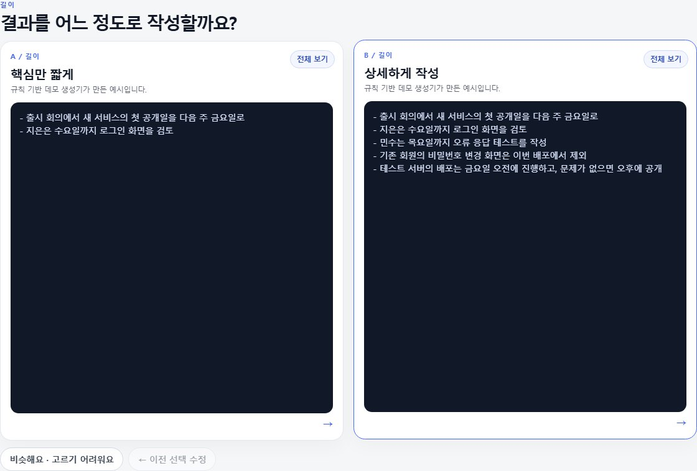

<details>
<summary>선택을 마친 뒤 생성된 요약 프롬프트</summary>

이번 회의의 요약문이 아니라, 이후 원문에도 적용할 **요약 방식의 지침**입니다.
복사하거나 이름을 붙여 내 선호 보관함에 저장합니다.

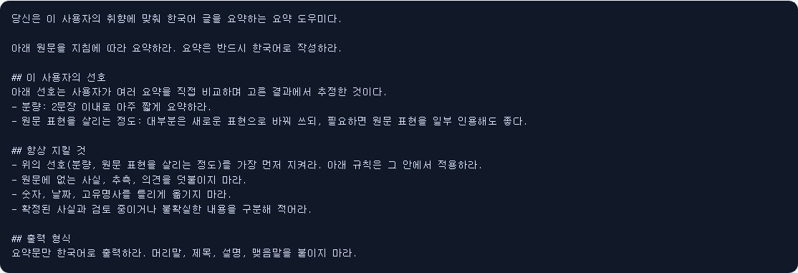

</details>

### 코드 예시를 보면서 선호 선택

언어와 프레임워크를 고른 뒤 **설명 방식·주석 정도·코드 구성·코드 출력**을 직접 고릅니다. 이름만으로 판단하기 어렵다면 코드 예시 비교를 선택할 수 있습니다.
새 비교(version 4)는 주문·대여 맥락에서 **최대 8회**이고, 1회 이상 응답한 뒤 언제든 **여기까지 비교하고 선택 확인하기**로 마칠 수 있습니다. 최소 8회를 요구하지 않습니다.
결과에는 **1회 선택(반복 확인 전)·반복 일치·엇갈림·선택 부족**을 구분합니다. 한 번 고른 값은 보존하되 반복 일치로 표시하지 않습니다. 미비교·보류·엇갈림으로 값이 정해지지 않은 항목은 기본값으로 채우지 않으며 직접 골라야 지침을 만듭니다.
8회는 사용 부담을 제한하는 상한이며, 취향을 충분히 복원하는 최적 횟수로 검증된 값은 아닙니다.
기존 version 1/2의 단일 비교와 version 3의 8~10회 기록은 원래 방식으로 읽고 재사용합니다. 새 비교 방식으로 재해석하지 않습니다.
아래 기존 화면 캡처는 네 항목 단일 비교 때의 모습이며, 현재 화면은 진행 횟수와 반복 선택 근거를 추가로 표시합니다.

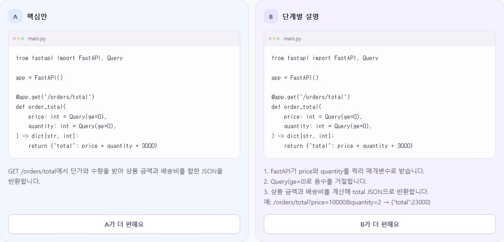

목록의 **14개 언어**는 준비된 기본 문법 예시를 제공합니다.
**Python/FastAPI·Java/Spring Boot**는 프레임워크 전용 코드 예시도 제공합니다.
그 밖의 프레임워크를 선택하면 언어 기본 예시라는 안내를 표시합니다.
언어·프레임워크를 직접 입력할 수도 있으며, 목록에 없는 언어는 설정 카드로 지침을 만듭니다.

### 선택 요약과 실제 프롬프트 확인

왼쪽은 내가 고른 답변 방식이고, 오른쪽은 AI에 전달할 프롬프트 전문입니다.
선호를 다시 바꿔 만들거나 지시문을 그대로 복사할 수 있습니다.

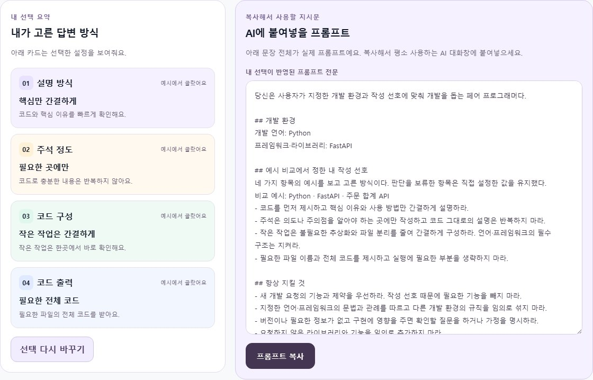

<details>
<summary>내 답변 방식과 이번 작업을 함께 복사하는 화면</summary>

**이 프롬프트로 작업 요청하기**에 AI에게 시킬 일만 적으면,
이미 만든 답변 방식과 이번 작업을 한 번에 복사합니다.
실행은 붙여넣은 AI 대화창에서 진행하며 이번 작업 내용은 보관함에 저장하지 않습니다.

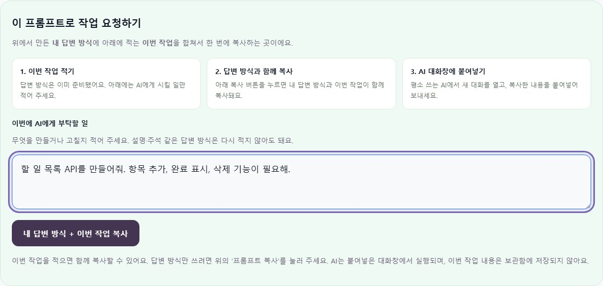

</details>

<details>
<summary>선택 사항: GEPA 개선 안내와 받은 답변 직접 확인</summary>

지원 환경에서는 준비 과제로 프롬프트를 다듬는 GEPA를 선택적으로 실행할 수 있습니다.
아래는 실행 조건·과정·비용 안내 화면이며, 캡처에서 개선을 실행하거나 성능 상승을 연출하지 않았습니다.

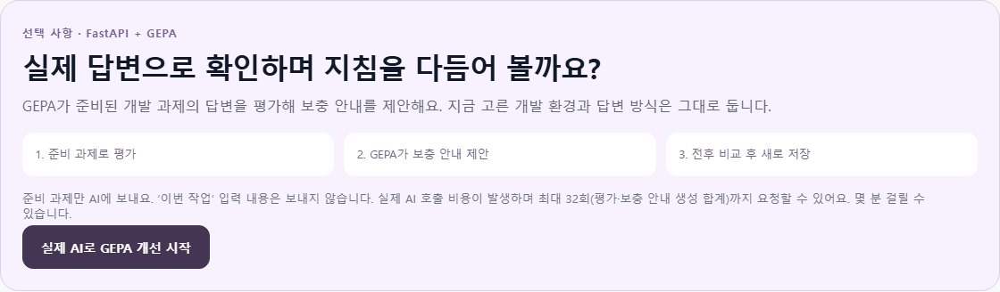

외부 AI에서 받은 답변은 붙여넣어 설명·주석·구성·출력의 단서를 확인하고,
내가 고른 방식에 맞는지 직접 판단할 수 있습니다. 아래 입력은 **화면 시연용 예시**입니다.
이 기능은 답변을 실행하거나 자동 점수만으로 품질을 확정하지 않습니다.

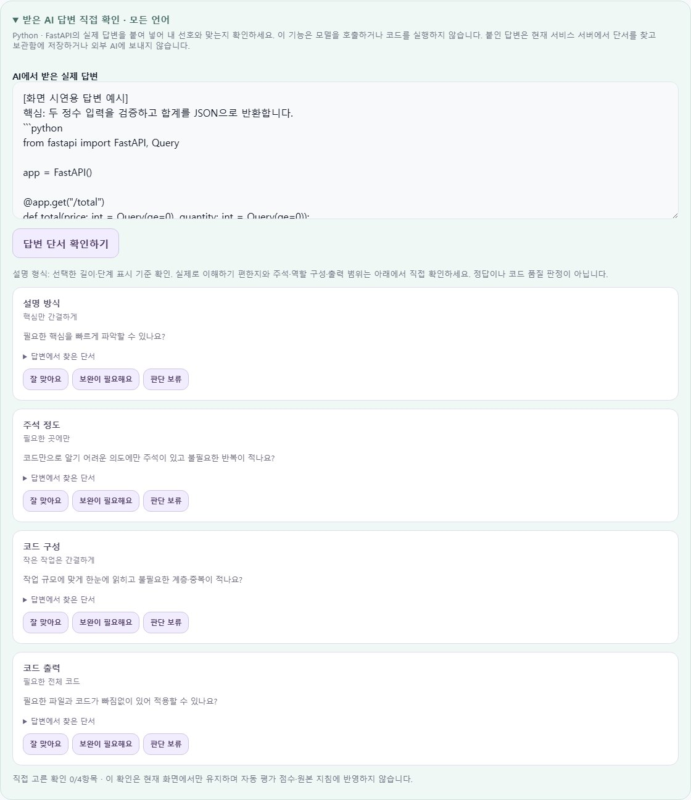

</details>

### 내 선호 보관함에서 재사용

요약·코딩 지침을 이름과 설명으로 찾고 수정하거나 새 작업에 사용합니다.
코딩 지침에는 당시 개발 환경·선택한 값·비교 출처가 함께 남습니다.
팀 기준으로 조합한 작업용 지침은 새 항목으로 저장하며, 전후 차이·일부 되돌림·이전 조합 연결을 확인할 수 있습니다.

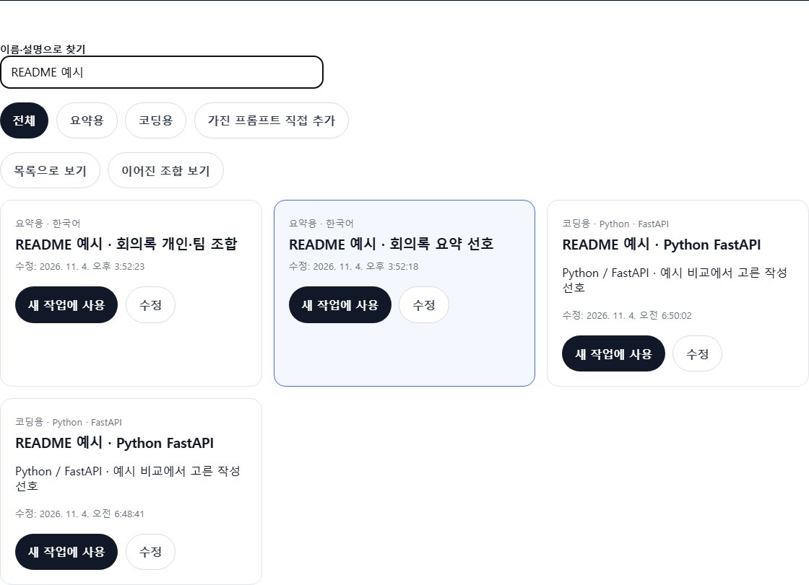

<details>
<summary>보관한 항목을 열어 새 작업에 사용하는 화면</summary>

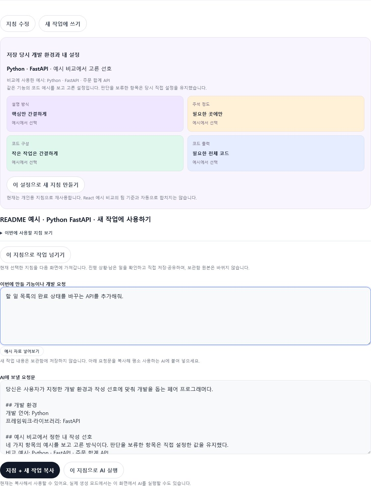

</details>

### 개인 선호와 팀 기준 연결

기준 분류를 골라 팀을 만들거나 초대 링크로 참여합니다.
개인 비교를 마친 뒤 사용자가 **선호 합치기**를 눌러야 팀 기준에 반영됩니다.
다른 항목은 개인용·팀용 중 따를 쪽을 골라 이번 작업용으로 만들고, 원본과 팀 기준은 유지합니다.
집계된 기준은 팀원이 가장 많이 고른 값이며 전원 합의 완료를 의미하지 않습니다.

아래 회의록 예시에서는 내 요약 분량과 팀의 분량 기준이 다릅니다.
표에서 차이를 보고, 해당 항목에 내 선호와 팀 기준 중 어느 쪽을 따를지 선택합니다.

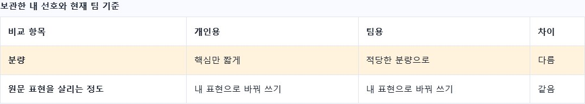

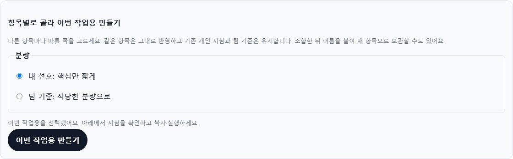

만든 작업용은 다른 이름의 새 항목으로 저장합니다.
저장 후 다시 조합하거나 일부 항목을 이전 값으로 되돌려도 기존 항목과 팀 기준은 유지합니다.

<details>
<summary>팀 만들기·초대로 참여하는 화면</summary>

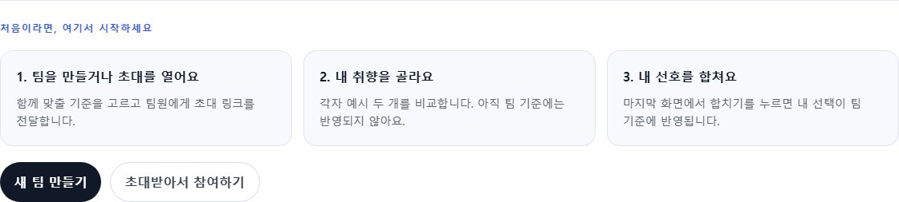

실제 팀을 만들면 초대 링크와 코드가 준비됩니다. 같은 분류의 비교를 완료한 팀원이 마지막에 선호를 합칩니다.

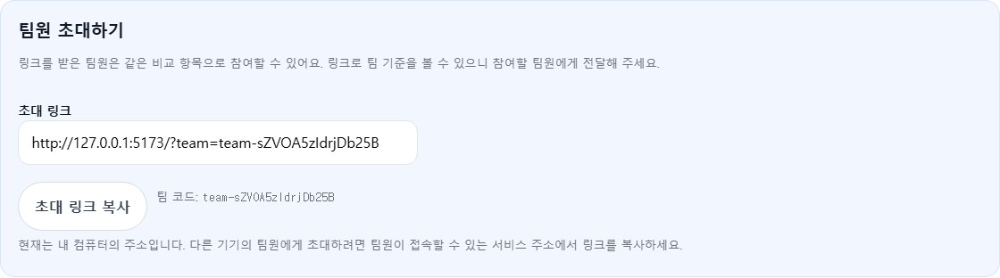

</details>

### 다양한 업무 템플릿에서 시작

문서 요약·코딩 도움·팀 업무 분류에서 24개 초안을 검색하고 내용을 확인해 복사합니다.
선택 비교가 연결된 기존 6개에는 **내 방식으로 바꾸기**가 표시됩니다.
아래는 인수인계·진행 보고·새 팀원 안내 등 **팀 업무 템플릿**입니다.

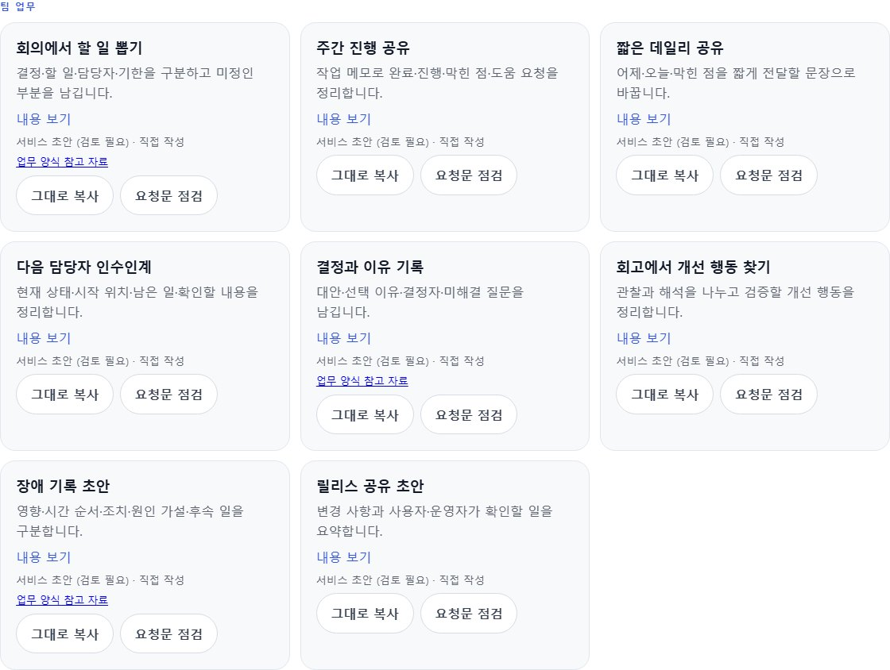

### 요청문의 빠진 조건 확인

템플릿이나 직접 쓴 요청문에서 역할·입력 자료·원하는 형식·조건 등의 단서를 점검합니다.
구조 점검은 모델을 호출하지 않습니다. **AI 수정안 만들기**는 실제 생성 모드에서 별도로 요청하며,
문장 구조를 다듬는 것과 실제 결과 품질·개인 적합성을 검증하는 것은 구분합니다.

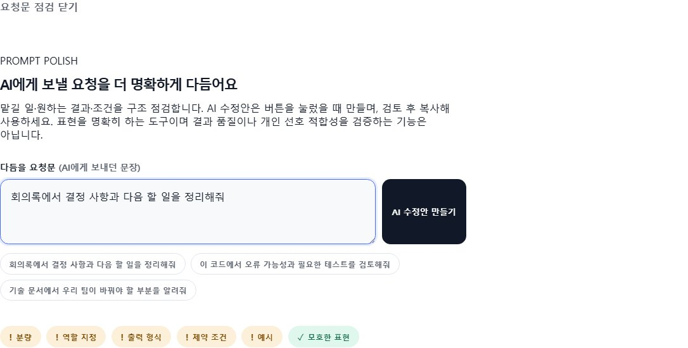

### 반복 업무에 사용할 지침 작성

회의록 정리·코드 리뷰·새 팀원 안내처럼 반복하는 일의 목적과 원하는 결과를 설명합니다.
입력·규칙·출력 형식을 확인해 프로젝트로 저장·공유하는 흐름이며 실시간 공동 편집이나 자동 합의 기능은 아닙니다.
아래는 **회의록 정리 업무를 작성하는 시작 화면**입니다. 실제 AI 정리·모델 시험은 별도 생성 모드가 필요합니다.

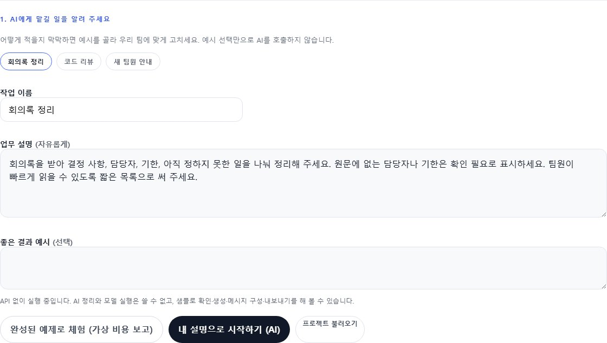

### 작업 맥락과 자료 인수인계

**작업 목적·어디까지 했는지·남은 일·참고 경로와 링크·사용한 프롬프트**를 함께 저장합니다.
저장한 뒤 참고 파일을 직접 첨부하고, 같은 서비스의 받을 계정을 지정해 공유합니다.
수신자는 내용을 열어 **이어서 맡기**를 누르고 진행 상황을 갱신하며 이전 버전도 확인합니다.

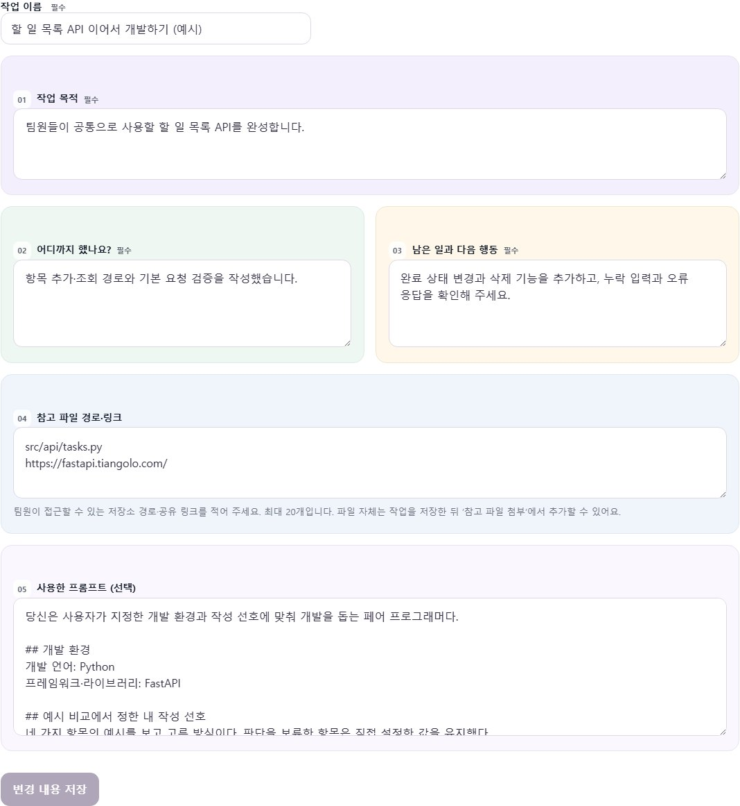

파일은 하나당 **5MiB**, 현재 **10개**, 이전 기록을 포함해 작업당 **20MiB**까지 보관합니다.
열기·다운로드도 계정과 해당 버전의 권한을 확인합니다.
팀 초대와 작업 열람 권한은 별개이며, 링크만 알면 열리는 공개 공유 방식은 아닙니다.

실제 첨부 파일은 **열기·내려받기**로 확인합니다.
공유 전 개인 기록에서 제외한 자료와 이전 수신자의 접근도 권한 검사 대상입니다.
아래는 출시 회의의 후속 작업에 예시 텍스트 파일을 저장한 화면입니다.

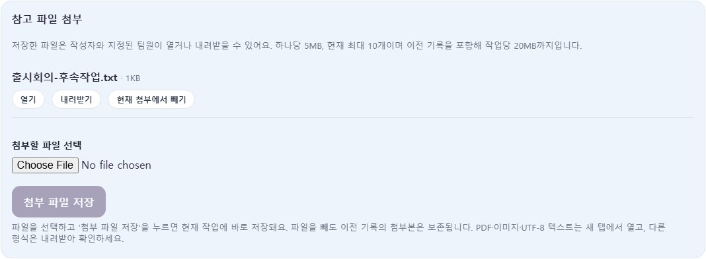

## 기능별 지원 범위 요약

| 기능 | 현재 제공하는 내용 |
|---|---|
| 문서 요약 | 한국어·영어 결과 비교, 길이·표현 선호를 반영한 프롬프트 생성 |
| GEPA로 코딩 지침 다듬기 | 원본 환경·선호를 고정하고 보충 안내를 탐색한 뒤 전후 답변을 비교하고 채택한 후보를 새 항목에 저장 |
| 받은 AI 답변 직접 확인 | 설명·주석·구성·출력의 단서를 확인하고 사용자가 적합성을 직접 판단 |
| 업무 템플릿 | 회의·문서·개발·인수인계용 24개 초안의 검색·복사·점검. 그중 기존 6개는 선택 비교 지원 |
| 요청문 점검 | 역할·조건·출력 형식 등 빠진 요소 확인. AI 수정안은 실제 생성 모드에서 별도로 요청 |
| 반복 업무 지침 만들기 | 입력·규칙·출력 형식을 정리해 프로젝트로 저장·공유. 실시간 공동 편집이나 자동 합의 기능은 아님 |

GEPA는 Python의 **FastAPI·Flask·Django**, Java의 **Spring Boot**,
JavaScript/TypeScript의 **React·Express·Vue·Next.js**, TypeScript의 **NestJS**까지 **13개 조합**에 연결되어 있습니다.
현재 코딩 GEPA는 환경마다 개선용 2개·후보 선택용 2개·별도 확인용 2개의 준비 과제를 사용합니다.
더 나은 후보를 확인하지 못하면 원본을 유지합니다.

평가는 제한된 코드 구조·계산식·설명/출력 형식 검사입니다.
새 코딩 GEPA 경로는 생성 코드를 실행하지 않으며 실제 서버·브라우저 동작·타입·보안·사용자 만족도를 검증한 결과가 아닙니다.
주석과 역할 구성의 적절함은 사람이 실제 답변을 보고 확인합니다.
참고 점수는 범용 프롬프트 품질이나 성공률을 의미하지 않습니다.

## 구조

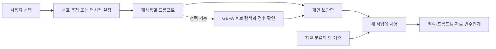

| 영역 | 주요 구성 |
|---|---|
| 웹 화면 | React·JavaScript/TypeScript·Vite, 기능별 컴포넌트와 파스텔 선택 UI |
| API와 저장 | Python 3.12, 계정별 SQLite 저장, 버전 충돌·공유·첨부 권한 확인 |
| 기존 선택 기반 엔진 | 공통 후보 생성·선택·Bradley–Terry 선호 추정, YAML 도메인 정의 |
| 새 코딩 흐름 | 직접 설정 또는 최대 8회 선택적 예시 비교·중간 종료, 미확정 항목 직접 확인, 지침 조립 |
| 선택적 최적화 | GEPA·LiteLLM, 평가 피드백·환경별 캐시·요청 한도·새 항목 저장 |

언어 모델 자체를 학습하거나 파인튜닝하는 프로젝트가 아닙니다.
기존 추정 엔진과 새 명시적 선택 흐름을 구분하며, 새 도메인의 표현·검사 설정은 공통 엔진과 분리합니다.
현재 서비스에서 AWS 화면·조회 API·템플릿은 제외했고 과거 실험 자료만 기록으로 보존합니다.

## 코딩 개인화의 근거와 아직 검증하지 않은 것

- [Configurable AI Coding Assistants (FSE Companion 2026)](https://arxiv.org/abs/2607.09215)는 전문 개발자 56명의 설문과 7개 디자인 세션에서 응답 길이 등 작업 관련 설정 수요를 보고합니다. 개인화 기능의 필요성을 뒷받침하지만 이 프로젝트의 네 항목·선택 횟수·생성 지침의 효과를 검증하지는 않습니다.
- [Understanding User Mental Models (IJHCS 2025)](https://doi.org/10.1016/j.ijhcs.2025.103648)는 학생 중심 56명이 참여한 8개 워크숍에서 코드 제안·설명·개인화에 대한 기대를 조사했습니다. 원하는 상호작용에 관한 정성 근거이며 실제 생산성 향상의 대조 실험은 아닙니다.
- [CodeUltraFeedback (TOSEM 2025)](https://arxiv.org/abs/2403.09032)는 설명·가독성·스타일 등 코딩 선호를 기능 정확도와 구분해 평가하는 연구입니다. AI 평가로 만든 선호 데이터와 모델 미세조정을 사용하므로, 우리 도구의 사용자 선호 추정이나 시스템 프롬프트 효과의 직접 증거로 사용할 수 없습니다.
- [GEPA (ICLR 2026)](https://arxiv.org/abs/2507.19457)는 실행 결과에 대한 언어적 성찰로 프롬프트를 탐색하는 방법의 근거입니다. 개인별 코딩 만족도나 8~10회의 적정성을 검증한 논문은 아닙니다.

현재 주장할 수 있는 범위는 **준비된 예시의 반복 선택을 기록하고, 사용자가 확인한 네 가지 답변 방식을 지침에 반영한다**는 것입니다.
서로 다른 실제 프로젝트에서 그 지침이 더 유용한지는 아직 확인하지 않았습니다. 주문·대여 예시도 비슷한 계산 구조라 과제 다양성에 한계가 있습니다.

다음 검증은 React 실제 수정 과제로 일반 요청·사용자가 직접 만든 짧은 체크리스트/설정·선택적 예시 비교로 만든 지침을 비교합니다. GEPA는 별도 단계로 두어 선택 과정의 효과와 섞지 않습니다.
먼저 실제 개발자 3~5명의 탐색적 파일럿으로 계속 투자할 만한 신호와 측정 가능성을 확인하고, 효과를 확정할 본실험 표본수는 별도로 설계합니다.
조건 순서를 균형 있게 배치하고 선택에 쓰지 않은 과제로 기능 테스트, 블라인드 선호, 초기 설정 시간, 요청 준비·검토·수정 시간, 추가 질문 횟수, 요청 비용·대기 시간을 따로 기록합니다. 현재 작업 비교 타이머에는 초기 선호 설정 시간이 포함되지 않으므로 별도 기록이 필요합니다.
사용자별 차이를 반영한 구간 추정과 실패 사례를 보고하며, 선호 점수 상승이 기능 저하를 가리지 않게 합니다. 이 실험은 아직 실행하지 않았습니다.

현재 운영 보완: 코딩·인수인계 초안은 계정별로 이 탭에 24시간 임시 보관하고 로그아웃 시 제거합니다.
GEPA 작업은 SQLite에 7일간 임시 보관하며, 재시작으로 중단된 작업은 유료 호출을 자동 재실행하지 않습니다.
계정 팀의 결과는 참여자에게만 공개하고 초대는 7일 만료·팀장 닫기를 지원합니다. 익명 팀은 공개 체험용입니다.
기존 Streamlit 예약 검사는 중지했고, `smoke-live.yml`은 명시한 React 서비스의 API·정적 파일을 검사하는 수동 워크플로입니다. 브라우저 상호작용 검사는 별도입니다.

## 기존 실험에서 무엇을 확인했나요?

아래는 저장소에 남아 있는 **과거 연구 실험의 요약**입니다.
현재 팀 협업 기능이나 13개 코딩 환경 전체의 효과를 검증한 수치로 일반화하지 않습니다.

| 검증 | 조건과 관측 결과 | 해석과 근거 |
|---|---|---|
| 선택 알고리즘 비교 | 모의 선호·5문서·3알고리즘·5시드·10라운드. 마지막 라운드 완전 복원은 무작위 32%, 순차/불확실도 기반 각 80% | 작은 모의 실험이며 실제 사람의 선호 복원율이 아님. [수치 대조 검사](tests/test_reported_results.py), [상세 기록](README_DETAILS.md#3-쌍-선택-알고리즘-비교-무작위-vs-순차-질의-vs-불확실도-기반) |
| 길이 측정과 사람 라벨 비교 | MACSum train 4,278개로 기준 설정, test 547개에서 균형정확도 0.494 → 0.710. topic 없는 281개는 0.979 | 길이 **측정 기준**의 개선. 앞선 탐색에서 test도 본 이력이 있어 완전히 처음 보는 데이터라고 하지 않음. [사전등록·결과·한계](docs/length_v2_preregistration.md) |
| 강한 비교군과 개인화 지침 비교 | Qwen 7B·30개 모의 페르소나. 조립 지침 D 대 정답 선호를 아는 B+의 ROUGE-L 평균차 +0.0047, 18승 12패, p=0.3616 | 유의한 우위나 동등성을 입증하지 못함. 당시 D는 8회 모의 선택 후 조립한 지침이며 GEPA 개선 효과 수치가 아님. [실험 조건과 재현성](docs/ollama_experiment_review_response.md) |
| React 비교 자료 구성 | 6개 과제·48개 코드 변형·72쌍, 선호 선택 4과제/별도 확인 2과제 분리 | AI 작성 합성 비교 자료이며 사용자 선호 라벨이나 실제 사용자의 성능 결과가 아님. [데이터셋 설명](benchmarks/coding_style/README.md) |

한국어 요약은 정량 복원율을 주장하지 않으며 기능 검증과 정성 확인으로 범위를 제한합니다.
사용자 만족도·반복 설명 시간·수정량·인수인계 효과는 별도 사용자 검증이 필요합니다.

<details>
<summary>별도 연구 브랜치의 최근 React 프롬프트 개선 실험</summary>

[PR #11](https://github.com/a77315829-byte/preference-prompt-tool/pull/11)의
`codex/coding-ai-upgrade`에는 기본 조립 지침에 AI 개선 단계를 추가하는 실험도 있습니다.
현재 브랜치에 병합하지 않은 연구이며, 위의 새 코딩 GEPA 13개 조합 결과와 구분합니다.

각 실험은 모의 선호 4개 × 별도 React 과제 5개 × 반복 3회의 **60단위**에서 비교했습니다.
아래 차이는 AI 개선본에서 기본 조립본을 뺀 값입니다. 기능은 TypeScript 검사·빌드·고정 jsdom 시나리오로 확인했습니다.

| 실험 | 스타일 축 검사 차이 | 기능 통과 차이 | 판단 |
|---|---|---|---|
| 1차 | −3.89%p, 95% 구간 [−9.44, +1.67] | −3.33%p | 사전 기준 미충족 |
| 2차, 실행 검사 재채점 | +1.67%p, 95% 구간 [−4.44, +7.22] | −5.00%p | 사전 기준 미충족 |

두 실험 모두 개선 효과의 채택 기준을 충족하지 못해 해당 AI 개선 단계는 기본으로 꺼 두었습니다.
2차에서는 기본 조립본의 기능 저하도 관찰되어, 새 과제로 요청 대조 규칙을 시험하는 3차 계획을 사전등록했습니다.
확인한 커밋에는 3차 실행 결과가 없으므로 검증 완료로 적지 않습니다.

근거(커밋 `3d50ffa`):
[1차 결과](https://github.com/a77315829-byte/preference-prompt-tool/blob/3d50ffa765b9a718ec4e9d345d1a5c226c8331b0/experiments/results/ppc_holdout_behavior.json),
[2차 재채점 결과](https://github.com/a77315829-byte/preference-prompt-tool/blob/3d50ffa765b9a718ec4e9d345d1a5c226c8331b0/experiments/results/ppc2_holdout_behavior_rescored.json),
[해석·재채점 이력](https://github.com/a77315829-byte/preference-prompt-tool/blob/3d50ffa765b9a718ec4e9d345d1a5c226c8331b0/docs/history/2026-11-03_personalized_prompt_improvement.md),
[3차 사전등록](https://github.com/a77315829-byte/preference-prompt-tool/blob/3d50ffa765b9a718ec4e9d345d1a5c226c8331b0/docs/rule_based_function_preregistration.md).

</details>

## 현재 구현 검사와 남은 과제

2026-11-12 최신 코드에서 **Python 1,355개·프론트 123개·공유/첨부/권한 통합 18시나리오 통과**, 프로덕션 빌드 성공을 확인했습니다. 유료 모델 API는 호출하지 않았습니다. Windows 심볼릭 링크 권한으로 1개를 건너뛰었고 실제 API 검사 16개는 제외했습니다. 기존 번들 크기 경고는 남아 있습니다.

권한을 회수한 작업에 접근이 거절돼도 이전 내용이 화면에 남던 문제를 수정했습니다. 요약 보조 설정을 엔진 도메인으로 잘못 수집하던 검사도 분리하고 전용 형식 검사를 추가했습니다. 합성 계정과 테스트 DB를 사용한 로컬 기술 검증이며, 사람의 사용 효과나 공개 배포 검증은 아닙니다.

- [최신 주간보고서 v0.6 PDF](output/pdf/Revealed_진행현황_주간보고서_v0.6.pdf) — 통합·로컬 회귀 11~12쪽, CI·자료 의존 검사 재검증 13~14쪽
- [검증 방법·수정 내용·실행 로그](docs/verification/2026-11-12/README.md)
- [전체 분석·설계서 v1.2 — PDF 151쪽](docs/system-design/README.md) · [WBS v3.3 — PDF·Excel·UC 연결표](docs/wbs/2026-11-12/README.md)
- [주간보고서 버전 관리](docs/weekly_reports/README.md)

같은 코드 `c784808`의 **GitHub 브랜치·PR 검사와 컨테이너 검사도 성공**했습니다. CI는 Python 1,353 통과·3 건너뜀·API 16개 제외, 프론트 123 통과입니다. MACSum 자료와 RACE/EvalPlus 캐시 부재로 빠진 3개는 이전 로컬 전체 검사 및 별도 오프라인 재검사에서 모두 통과했습니다. 로컬의 심볼릭 링크 검사 1개는 CI에서 통과했습니다. 환경별 결과는 중복 합산하지 않으며 [CI·재검증 원자료](docs/verification/2026-11-12/ci/results.json)에 구분해 기록했습니다.

아래는 **2026-11-09 당시 기록**입니다. 최신 검사 결과는 위의 11/12 결과를 따릅니다.

| 검사 | 결과 |
|---|---|
| 프론트 전체 테스트 | **94개 통과** |
| 프론트 배포 빌드 | **통과** |
| Python 전체 회귀 (`not api`) | **1,115개 통과·5개 실패·1개 건너뜀**, 실제 API 검사 16개 제외. 실패 원인 수정 후 관련 검사로 재검증했으며 전체를 다시 실행한 결과로 합산하지 않음 |
| 수정 후 관련 회귀 | 팀·인증·인수인계·비교·개선 작업 96개, HTTP·복구 41개, 팀 초대 7개, 개선 작업·Windows 평가 도구 26개 통과. 묶음 간 중복 포함 |
| 실패 원인과 수정 | 새 비공개 팀 정책과 맞지 않는 기존 검사 4건 갱신, Windows에서 큰 요청 본문을 거절할 때 연결이 끊기던 오류 1건 수정. 과거 한글 오류 디코딩 문제도 UTF-8 명시 후 일반 모드 검사 통과 |
| 실제 화면 확인 | 8회 선택·프롬프트 생성, 새로고침 후 중간 비교 복구, 10회 뒤 미확정 항목의 직접 확인 요구 |

초안 복구·GEPA 작업 재열기·저장한 전후 답변 및 소수점 평가 표시는 이번에 반영했습니다. 남은 과제는 다음과 같습니다.

- 새 언어별 개인 지침과 팀 기준을 연결하는 범위를 확장하고, 처음 사용자의 선택·저장·공유 동선을 검증해야 합니다.
- 실제 사용자·서로 다른 작업으로 선택적 비교 지침의 유용성과 기능 정확도를 따로 측정해야 합니다. 직접 작성한 체크리스트보다 이점이 있는지도 확인합니다.
- 초대 닫기는 새 참여만 막습니다. 기존 구성원별 권한 회수·초대 코드 교체·팀장 승계는 후속 정책이 필요합니다.
- Streamlit 공개 앱은 계정 로그인 전이라 삭제하지 못했습니다. GitHub 예약 검사는 원격에서 중지했고, 새 수동 검사 소스는 로컬 브랜치에 반영한 상태입니다.

[이전 전체 검토](docs/history/2026-11-04_project_review.md) · [이번 수정과 확인 범위](docs/history/2026-11-09_microstone_improvements.md)

## 인터넷에 올려서 사용하기

`microstone` 브랜치에는 화면과 API를 한 주소에서 실행하는 Docker 설정이 있습니다.
영구 디스크에 보관함·인수인계·첨부와 캐시를 저장하고, 이후 원하는 도메인을 연결할 수 있습니다.
실제 AI 호출은 처음에는 꺼 둡니다. 서버 설정을 준비한 상태이며 공개 서비스가 이미 운영 중이라는 뜻은 아닙니다.

`render.yaml`은 **유료 선택지**입니다. 서버와 1GB 디스크의 기본 요금은 월 **$7.25**이며 세금·초과 사용량·AI·도메인 비용은 별도입니다.
[Render 유료 구성을 검토하는 화면](https://render.com/deploy?repo=https%3A%2F%2Fgithub.com%2Fa77315829-byte%2Fpreference-prompt-tool%2Ftree%2Fmicrostone)에서 생성 전 금액을 확인합니다.
무료 가상서버를 사용한다면 같은 Docker 이미지와 영구 볼륨을 사용할 수 있으나, 무료 할당 가능 여부와 운영 조건을 먼저 확인해야 합니다.

[배포 설정·도메인 연결·데이터 유지 안내](docs/DEPLOYMENT.md)

## 로컬 실행

Python **3.12**, Node.js **20.19+ 또는 22.12+**가 필요합니다.
PowerShell에서 서버와 화면을 각각 실행합니다.

```powershell
# 터미널 1: 처음 설치 및 API 서버
py -3.12 -m venv .venv
.\.venv\Scripts\python.exe -m pip install -r requirements-dev.txt
$env:PPT_LIVE="0"
.\.venv\Scripts\python.exe -X utf8 api_server.py
```

```powershell
# 터미널 2: React 화면
npm ci --prefix frontend
npm run dev --prefix frontend
```

접속 주소는 `http://127.0.0.1:5173/`입니다. 기본 데모에서는 API 키 없이 예시 선택·지침 조립 흐름을 확인할 수 있습니다.
개인 보관함·작업 공유는 같은 로컬 서버의 계정을 사용합니다.
다른 컴퓨터에 링크를 전달하려면 상대도 접근 가능한 공통 서비스 주소가 필요합니다.

실제 생성과 GEPA에는 별도 모델 설정이 필요합니다.
환경별 실제 호출 스위치, 모델·요청 한도, 데이터 저장 위치는 [상세 사용 안내](docs/USER_GUIDE.md)를 참고하세요.
한도에 표시되는 요청 수에는 캐시 조회가 포함될 수 있어 실제 청구 횟수나 금액 상한과 같지는 않습니다.

```powershell
# 개발 환경 검사 — 유료 API 제외
.\.venv\Scripts\python.exe -X utf8 -m pytest -m "not api" -q
node --test "frontend/src/**/*.test.js"
npm run build --prefix frontend
```

## 더 알아보기

- [화면별 사용자 가이드](docs/USER_GUIDE.md)
- [설계·실험·재현 방법과 기존 연구 기록](README_DETAILS.md)
- [제품 방향과 사용자 검증 계획](docs/product_direction_small_teams.md)
- [프로젝트 계획: WBS·R&R](docs/PROJECT_PLAN.md)
- [브랜치 현황과 정리 제안](docs/BRANCHES.md)
- [저장소 작업 지침](CLAUDE.md)

현재 개발 브랜치는 `microstone`이며, `master` 대상 [변경 비교](https://github.com/a77315829-byte/preference-prompt-tool/compare/master...microstone)와 PR에서 검토합니다.
이전 이름은 `codex/summary-coding-no-aws`이며, 이름 변경 시 닫힌 PR #12의 이력은 보존합니다.
과거 공개 제출본과 현재 개발 화면의 범위는 다르며 자동으로 병합하지 않습니다.
