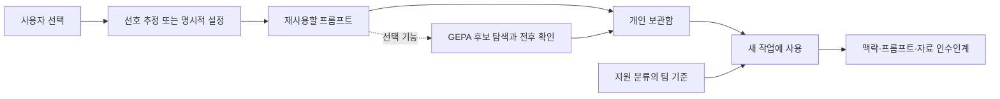

# Preference Prompt Tool

## 사용자 선호 기반 맞춤형 프롬프트 자동 생성 도구

**마음에 드는 결과를 고르고, 내 답변 방식을 프롬프트로 만들어 다음 작업에 다시 사용합니다.**

AI에게 매번 “짧게 설명해 줘”, “코드는 역할별로 나눠 줘”라고 반복해서 말하는 대신,
예시를 비교하거나 원하는 방식을 선택해 나만의 지침을 만듭니다.
개인은 만든 지침을 보관하고 재사용하며, 팀은 공통 기준과 다른 항목을 확인하고
작업 맥락·자료·사용한 프롬프트를 다음 담당자에게 전달할 수 있습니다.


현재 브랜치의 실제 로컬 화면입니다. 아래 캡처는 **2026-11-04, 격리된 예시 계정과 예시 작업**으로 촬영했습니다.
캡처를 위해 유료 AI 생성이나 GEPA 개선을 실행하지 않았습니다.

## 해결하려는 문제

| 사용자가 겪는 문제 | 이 도구의 접근 |
|---|---|
| 원하는 답변을 말로 설명하기 어렵다 | 같은 작업의 두 결과를 비교하면서 선호를 선택한다 |
| 새 대화마다 같은 요구를 반복한다 | 답변 방식을 프롬프트로 보관하고 실제 작업 요청과 함께 복사한다 |
| 개인 취향과 팀의 작업 기준이 다르다 | 차이를 확인하고 이번 작업에서 따를 기준을 항목별로 고른다 |
| 담당자가 바뀌면 맥락과 자료를 다시 설명한다 | 목적·진행 상황·남은 일·참고 자료·사용 지침을 함께 넘긴다 |

개인적으로 AI를 자주 사용하는 사람, 학생·사이드 프로젝트 구성원, 소규모 개발팀과 다음 담당자를 대상으로 합니다.
시간 절감과 협업 효과는 앞으로 사용자에게 확인할 가설이며, 기능 구현만으로 입증됐다고 설명하지 않습니다.

## 사용하는 흐름

1. **내 방식 찾기**: 문서 요약 예시나 코드 A/B를 비교합니다. 코딩은 언어·프레임워크와 답변 방식을 직접 고를 수도 있습니다.
2. **프롬프트 만들기**: 고른 방식과 AI에게 붙여넣을 실제 지시문을 구분해 확인합니다.
3. **보관하고 다시 쓰기**: 이름을 붙여 내 선호 보관함에 저장하고 새 작업에 사용합니다.
4. **팀 기준과 연결하기**: 지원하는 분류에서 개인용·팀용을 비교하거나 항목별 작업용을 조합합니다.
5. **다음 사람에게 넘기기**: 진행 상태·자료·지침을 저장하고 받을 계정을 지정해 인수인계합니다.

현재 팀 기준 비교·조합은 **문서 요약과 기존 TypeScript/React 비교 흐름**에 연결되어 있습니다.
새 언어·프레임워크로 만든 코딩 지침은 개인용 저장·재사용을 지원하며, 기존 React 팀 기준과 자동으로 합치지 않습니다.

## 실제 화면과 기능

### 코드 예시를 보면서 선호 선택

언어와 프레임워크를 고른 뒤 **설명 방식·주석 정도·코드 구성·코드 출력**의 네 항목을 선택합니다.
A/B 중 더 편한 쪽을 고르거나 판단을 보류하고 설정 카드에서 직접 정할 수 있습니다.
처음에는 기본값으로 선택을 채우지 않으며, 선택이 끝나야 프롬프트를 만듭니다.


목록의 **14개 언어**는 준비된 기본 문법 예시를 제공합니다.
**Python/FastAPI·Java/Spring Boot**는 프레임워크 전용 코드 예시도 제공합니다.
그 밖의 프레임워크를 선택하면 언어 기본 예시라는 안내를 표시합니다.
언어·프레임워크를 직접 입력할 수도 있으며, 목록에 없는 언어는 설정 카드로 지침을 만듭니다.

### 선택 요약과 실제 프롬프트 확인

왼쪽은 내가 고른 답변 방식이고, 오른쪽은 AI에 전달할 프롬프트 전문입니다.
선호를 다시 바꿔 만들거나 지시문을 그대로 복사할 수 있습니다.


<details>
<summary>내 답변 방식과 이번 작업을 함께 복사하는 화면</summary>

**이 프롬프트로 작업 요청하기**에 AI에게 시킬 일만 적으면,
이미 만든 답변 방식과 이번 작업을 한 번에 복사합니다.
실행은 붙여넣은 AI 대화창에서 진행하며 이번 작업 내용은 보관함에 저장하지 않습니다.


</details>

### 내 선호 보관함에서 재사용

요약·코딩 지침을 이름과 설명으로 찾고 수정하거나 새 작업에 사용합니다.
코딩 지침에는 당시 개발 환경·선택한 값·비교 출처가 함께 남습니다.
팀 기준으로 조합한 작업용 지침은 새 항목으로 저장하며, 전후 차이·일부 되돌림·이전 조합 연결을 확인할 수 있습니다.


### 개인 선호와 팀 기준 연결

기준 분류를 골라 팀을 만들거나 초대 링크로 참여합니다.
개인 비교를 마친 뒤 사용자가 **선호 합치기**를 눌러야 팀 기준에 반영됩니다.
다른 항목은 개인용·팀용 중 따를 쪽을 골라 이번 작업용으로 만들고, 원본과 팀 기준은 유지합니다.
집계된 기준은 팀원이 가장 많이 고른 값이며 전원 합의 완료를 의미하지 않습니다.

<details>
<summary>팀 만들기·초대로 참여하는 화면</summary>


</details>

### 작업 맥락과 자료 인수인계

**작업 목적·어디까지 했는지·남은 일·참고 경로와 링크·사용한 프롬프트**를 함께 저장합니다.
저장한 뒤 참고 파일을 직접 첨부하고, 같은 서비스의 받을 계정을 지정해 공유합니다.
수신자는 내용을 열어 **이어서 맡기**를 누르고 진행 상황을 갱신하며 이전 버전도 확인합니다.


파일은 하나당 **5MiB**, 현재 **10개**, 이전 기록을 포함해 작업당 **20MiB**까지 보관합니다.
열기·다운로드도 계정과 해당 버전의 권한을 확인합니다.
팀 초대와 작업 열람 권한은 별개이며, 링크만 알면 열리는 공개 공유 방식은 아닙니다.

## 그 밖의 기능

| 기능 | 현재 제공하는 내용 |
|---|---|
| 문서 요약 | 한국어·영어 결과 비교, 길이·표현 선호를 반영한 프롬프트 생성 |
| GEPA로 코딩 지침 다듬기 | 원본 환경·선호를 고정하고 보충 안내를 탐색한 뒤 전후 답변을 비교하고 채택한 후보를 새 항목에 저장 |
| 받은 AI 답변 직접 확인 | 설명·주석·구성·출력의 단서를 확인하고 사용자가 적합성을 직접 판단 |
| 업무 템플릿 | 회의·문서·개발·인수인계용 24개 초안의 검색·복사·점검. 그중 기존 6개는 선택 비교 지원 |
| 요청문 점검 | 역할·조건·출력 형식 등 빠진 요소 확인. AI 수정안은 실제 생성 모드에서 별도로 요청 |
| 반복 업무 지침 만들기 | 입력·규칙·출력 형식을 정리해 프로젝트로 저장·공유. 실시간 공동 편집이나 자동 합의 기능은 아님 |

GEPA는 Python의 **FastAPI·Flask·Django**, Java의 **Spring Boot**,
JavaScript/TypeScript의 **React·Express·Vue·Next.js**, TypeScript의 **NestJS**까지 **13개 조합**에 연결되어 있습니다.
현재 코딩 GEPA는 환경마다 개선용 2개·후보 선택용 2개·별도 확인용 2개의 준비 과제를 사용합니다.
더 나은 후보를 확인하지 못하면 원본을 유지합니다.

평가는 제한된 코드 구조·계산식·설명/출력 형식 검사입니다.
새 코딩 GEPA 경로는 생성 코드를 실행하지 않으며 실제 서버·브라우저 동작·타입·보안·사용자 만족도를 검증한 결과가 아닙니다.
주석과 역할 구성의 적절함은 사람이 실제 답변을 보고 확인합니다.
참고 점수는 범용 프롬프트 품질이나 성공률을 의미하지 않습니다.

## 구조



| 영역 | 주요 구성 |
|---|---|
| 웹 화면 | React·JavaScript/TypeScript·Vite, 기능별 컴포넌트와 파스텔 선택 UI |
| API와 저장 | Python 3.12, 계정별 SQLite 저장, 버전 충돌·공유·첨부 권한 확인 |
| 기존 선택 기반 엔진 | 공통 후보 생성·선택·Bradley–Terry 선호 추정, YAML 도메인 정의 |
| 새 코딩 흐름 | 언어·프레임워크별 준비 예시, 네 가지 명시적 선호, 지침 조립 |
| 선택적 최적화 | GEPA·LiteLLM, 평가 피드백·환경별 캐시·요청 한도·새 항목 저장 |

언어 모델 자체를 학습하거나 파인튜닝하는 프로젝트가 아닙니다.
기존 추정 엔진과 새 명시적 선택 흐름을 구분하며, 새 도메인의 표현·검사 설정은 공통 엔진과 분리합니다.
현재 서비스에서 AWS 화면·조회 API·템플릿은 제외했고 과거 실험 자료만 기록으로 보존합니다.

## 기존 실험에서 무엇을 확인했나요?

아래는 저장소에 남아 있는 **과거 연구 실험의 요약**입니다.
현재 팀 협업 기능이나 13개 코딩 환경 전체의 효과를 검증한 수치로 일반화하지 않습니다.

| 검증 | 조건과 관측 결과 | 해석과 근거 |
|---|---|---|
| 선택 알고리즘 비교 | 모의 선호·5문서·3알고리즘·5시드·10라운드. 마지막 라운드 완전 복원은 무작위 32%, 순차/불확실도 기반 각 80% | 작은 모의 실험이며 실제 사람의 선호 복원율이 아님. [수치 대조 검사](tests/test_reported_results.py), [상세 기록](README_DETAILS.md#3-쌍-선택-알고리즘-비교-무작위-vs-순차-질의-vs-불확실도-기반) |
| 길이 측정과 사람 라벨 비교 | MACSum train 4,278개로 기준 설정, test 547개에서 균형정확도 0.494 → 0.710. topic 없는 281개는 0.979 | 길이 **측정 기준**의 개선. 앞선 탐색에서 test도 본 이력이 있어 완전히 처음 보는 데이터라고 하지 않음. [사전등록·결과·한계](docs/length_v2_preregistration.md) |
| 강한 비교군과 개인화 지침 비교 | Qwen 7B·30개 모의 페르소나. 조립 지침 D 대 정답 선호를 아는 B+의 ROUGE-L 평균차 +0.0047, 18승 12패, p=0.3616 | 유의한 우위나 동등성을 입증하지 못함. 당시 D는 8회 모의 선택 후 조립한 지침이며 GEPA 개선 효과 수치가 아님. [실험 조건과 재현성](docs/ollama_experiment_review_response.md) |
| React 비교 자료 구성 | 6개 과제·48개 코드 변형·72쌍, 선호 선택 4과제/별도 확인 2과제 분리 | AI 작성 합성 비교 자료이며 사용자 선호 라벨이나 실제 사용자의 성능 결과가 아님. [데이터셋 설명](benchmarks/coding_style/README.md) |

한국어 요약은 정량 복원율을 주장하지 않으며 기능 검증과 정성 확인으로 범위를 제한합니다.
사용자 만족도·반복 설명 시간·수정량·인수인계 효과는 별도 사용자 검증이 필요합니다.

<details>
<summary>별도 연구 브랜치의 최근 React 프롬프트 개선 실험</summary>

[PR #11](https://github.com/a77315829-byte/preference-prompt-tool/pull/11)의
`codex/coding-ai-upgrade`에는 기본 조립 지침에 AI 개선 단계를 추가하는 실험도 있습니다.
현재 브랜치에 병합하지 않은 연구이며, 위의 새 코딩 GEPA 13개 조합 결과와 구분합니다.

각 실험은 모의 선호 4개 × 별도 React 과제 5개 × 반복 3회의 **60단위**에서 비교했습니다.
아래 차이는 AI 개선본에서 기본 조립본을 뺀 값입니다. 기능은 TypeScript 검사·빌드·고정 jsdom 시나리오로 확인했습니다.

| 실험 | 스타일 축 검사 차이 | 기능 통과 차이 | 판단 |
|---|---|---|---|
| 1차 | −3.89%p, 95% 구간 [−9.44, +1.67] | −3.33%p | 사전 기준 미충족 |
| 2차, 실행 검사 재채점 | +1.67%p, 95% 구간 [−4.44, +7.22] | −5.00%p | 사전 기준 미충족 |

두 실험 모두 개선 효과의 채택 기준을 충족하지 못해 해당 AI 개선 단계는 기본으로 꺼 두었습니다.
2차에서는 기본 조립본의 기능 저하도 관찰되어, 새 과제로 요청 대조 규칙을 시험하는 3차 계획을 사전등록했습니다.
확인한 커밋에는 3차 실행 결과가 없으므로 검증 완료로 적지 않습니다.

근거(커밋 `3d50ffa`):
[1차 결과](https://github.com/a77315829-byte/preference-prompt-tool/blob/3d50ffa765b9a718ec4e9d345d1a5c226c8331b0/experiments/results/ppc_holdout_behavior.json),
[2차 재채점 결과](https://github.com/a77315829-byte/preference-prompt-tool/blob/3d50ffa765b9a718ec4e9d345d1a5c226c8331b0/experiments/results/ppc2_holdout_behavior_rescored.json),
[해석·재채점 이력](https://github.com/a77315829-byte/preference-prompt-tool/blob/3d50ffa765b9a718ec4e9d345d1a5c226c8331b0/docs/history/2026-11-03_personalized_prompt_improvement.md),
[3차 사전등록](https://github.com/a77315829-byte/preference-prompt-tool/blob/3d50ffa765b9a718ec4e9d345d1a5c226c8331b0/docs/rule_based_function_preregistration.md).

</details>

## 현재 구현 검사와 남은 과제

2026-11-04 작업 트리 기준이며 유료 모델 API를 호출하지 않은 검사입니다.

| 검사 | 결과 |
|---|---|
| 프론트 전체 테스트 | **86개 통과** |
| 프론트 배포 빌드 | **통과** |
| Python 전체 회귀 (`not api`) | **1,083개 통과·1개 실패**, 실제 API 검사 16개 제외 |
| 실패 원인 확인 | 기존 React 평가 도구에서 Node의 한글 오류를 Windows CP949로 읽다 중단. 해당 1개는 Python UTF-8 모드 재검사 통과 |
| 추가 화면 상태 재현 | 상단 이동 시 초안 소실, GEPA 작업 복귀, 저장한 GEPA 비교 근거 표시의 보완점을 확인 |

아직 해결할 부분은 다음과 같습니다.

- 상단 메뉴로 이동할 때 코딩 선택·작업 요청·저장 전 인수인계 내용을 보존하거나 이동 전에 알려야 합니다.
- GEPA 작업 번호와 진행/완료 결과를 화면 복귀 후 다시 찾을 수 있어야 합니다.
- 보관함에서도 GEPA 전후의 실제 답변과 세부 평가를 다시 보고 작은 점수 차이도 확인할 수 있어야 합니다.
- 새 언어별 개인 지침과 팀 기준을 연결하는 범위를 확장하고, 처음 사용자의 선택·저장·공유 동선을 검증해야 합니다.

[전체 검토 기록과 재현 방법](docs/history/2026-11-04_project_review.md)

## 로컬 실행

Python **3.12**, Node.js **20.19+ 또는 22.12+**가 필요합니다.
PowerShell에서 서버와 화면을 각각 실행합니다.

```powershell
# 터미널 1: 처음 설치 및 API 서버
py -3.12 -m venv .venv
.\.venv\Scripts\python.exe -m pip install -r requirements-dev.txt
$env:PPT_LIVE="0"
.\.venv\Scripts\python.exe -X utf8 api_server.py
```

```powershell
# 터미널 2: React 화면
npm ci --prefix frontend
npm run dev --prefix frontend
```

접속 주소는 `http://127.0.0.1:5173/`입니다. 기본 데모에서는 API 키 없이 예시 선택·지침 조립 흐름을 확인할 수 있습니다.
개인 보관함·작업 공유는 같은 로컬 서버의 계정을 사용합니다.
다른 컴퓨터에 링크를 전달하려면 상대도 접근 가능한 공통 서비스 주소가 필요합니다.

실제 생성과 GEPA에는 별도 모델 설정이 필요합니다.
환경별 실제 호출 스위치, 모델·요청 한도, 데이터 저장 위치는 [상세 사용 안내](docs/USER_GUIDE.md)를 참고하세요.
한도에 표시되는 요청 수에는 캐시 조회가 포함될 수 있어 실제 청구 횟수나 금액 상한과 같지는 않습니다.

```powershell
# 개발 환경 검사 — 유료 API 제외
.\.venv\Scripts\python.exe -X utf8 -m pytest -m "not api" -q
node --test "frontend/src/**/*.test.js"
npm run build --prefix frontend
```

## 더 알아보기

- [화면별 사용자 가이드](docs/USER_GUIDE.md)
- [설계·실험·재현 방법과 기존 연구 기록](README_DETAILS.md)
- [제품 방향과 사용자 검증 계획](docs/product_direction_small_teams.md)
- [프로젝트 계획: WBS·R&R](docs/PROJECT_PLAN.md)
- [브랜치 현황과 정리 제안](docs/BRANCHES.md)
- [저장소 작업 지침](CLAUDE.md)

현재 개발 브랜치는 `codex/summary-coding-no-aws`이며, `master` 대상 [PR #12](https://github.com/a77315829-byte/preference-prompt-tool/pull/12)에서 검토합니다.
과거 공개 제출본과 현재 개발 화면의 범위는 다르며 자동으로 병합하지 않습니다.
