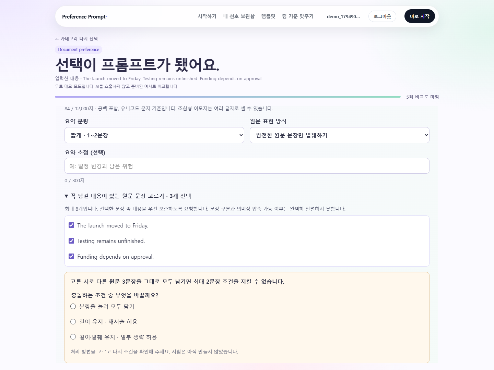
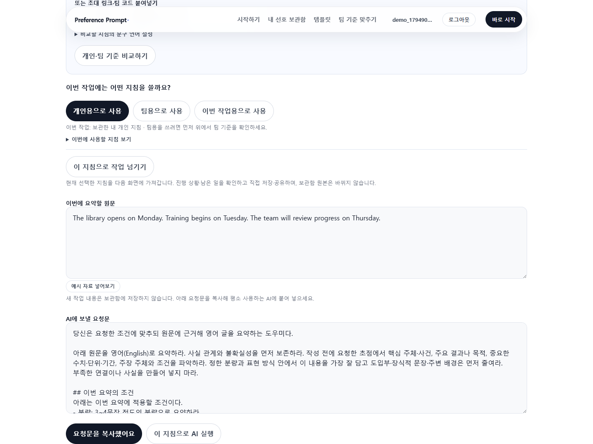

# 1. 개발 목적과 현재 결론

Revealed는 사용자가 원하는 요약 결과의 조건을 확인하고, 이를 반복해서 사용할 수 있는 지침으로 만드는 웹 서비스다. 매 작업마다 길이·표현 방식·보존할 내용을 처음부터 적는 대신 조건을 고르고 충돌을 확인한 뒤 지침을 저장하고 다음 작업에 조합한다. 문서 요약을 중심으로 검증하고, AI 코딩 답변 방식 설정과 React 코드 스타일 비교는 별도 확장 기능으로 유지한다.

현재 기술 목표는 “확인한 조건이 출력 지침에 전달되는가, 그 지침을 새 과제에 적용했을 때 조건을 지키며 필요한 내용을 보존하는가”이다. 숨은 개인 취향을 정확히 추정하거나 사람의 시간을 줄였다고 주장하는 목표와 구별한다. 실제 사용자 연구를 확보하지 못한 상황에서 평가 가능한 범위로 목표를 정했다.

| 구분 | 현재 판단 |
|---|---|
| 구현한 가치 | 조건 확인, 충돌 처리, 지침 저장·재사용과 팀 작업 연결 |
| 최신 출력 비교 | 수동·제품 모두 요약 조건 6/6·핵심 사실 17/18, React 타입 8/8·동작 40/40·세 축 8/8 |
| 확인하지 못한 우위 | 수동 대비 품질 향상, 사람의 편의·수정 시간·선호 추정 정확도 |
| 제출 상태 | 기술 근거와 문서 준비본 확보. 팀 리허설과 공식 제출 요건 확인은 남음 |

조건을 잘 적은 수동 지침과 관측 결과가 같다는 사실을 제품 실패 또는 통계적 동등성으로 단정하지 않는다. 현재 제품은 조건을 구조화하고 다시 사용하게 하는 작업 흐름을 구현했다. 그 흐름의 편의상 가치가 실제로 얼마나 큰지는 후속 사용자 연구가 필요하다.

본 준비본은 코드 0bbff80, 11/17 검증 원자료, 11/18 문서 발행을 기준으로 작성했다. 향후 발표 날짜나 공식 양식을 미리 확정한 문서는 아니다.

# 2. 사용자와 사용 범위

주 사용자는 자신의 요약 조건을 반복 적용하려는 개인과 공통 지침을 정리할 전담 인력이 부족한 학생·소규모 프로젝트 팀이다. 조직에 이미 문서 규칙이나 AGENTS.md 등이 있다면 그 규칙을 대체하는 것이 아니라 작업에 맞는 조건과 함께 확인하는 보조 도구로 사용한다. 회사마다 실제 채택할지는 인터뷰나 관찰 없이 단정하지 않는다.

| 상황 | 사용 흐름 | 기대하지만 미측정인 효과 |
|---|---|---|
| 반복 요약 | 길이·표현 조건을 저장하고 새 원문과 조합 | 반복 입력 부담 감소 |
| 조건 충돌 | 짧은 완전 발췌에 여러 필수 문장을 넣으려는 요청을 확인 | 불가능한 요구의 조기 발견 |
| 팀 작업 | 개인 지침과 팀 기준을 조합하고 출처를 확인 | 기준 설명과 인계 부담 감소 |
| 코딩 도움 | 설명·주석·구성·출력 또는 React 스타일을 별도로 설정 | 원하는 답변 방식의 일관성 |

지원 범위는 명시된 조건의 조립과 제한된 출력 검증이다. 모든 분야의 사실성을 판정하거나 새 원문의 중요 내용을 자동으로 완전히 알아내는 시스템은 아니다. 저장된 지침을 적용했다고 해서 새 원문의 핵심 정보가 자동 보장되는 것도 아니다.

실제 모델 생성에는 별도 설정과 비용이 가능하다. 이번 검증·시연은 유료 모델 API를 사용하지 않는다. 준비 예시를 보여 주는 무료 데모와 실제 모델 생성 결과를 구분해 표시한다. 보조 에이전트 검증은 Codex 사용량을 소비하며 무제한 무료 운영을 뜻하지 않는다.

# 3. 요구사항과 완료 조건

| 요구 | 구현·확인 기준 | 연결 |
|---|---|---|
| 원문 입력 | 요약 시작·조건 확인 모두 공백 포함 12,000 코드 포인트 상한; 초과 입력 보존 | UC-02·05 |
| 비교·확인 | 최대 8회, 더 구분할 쌍이 없으면 종료; 미정 항목과 종료 이유 구분 | UC-03·04 |
| 충돌 처리 | 상한·하한 충돌 시 지침 차단, 사용자가 해결 방법 명시 선택 | UC-05 |
| 재사용 | 조건 확인 결과의 현재 언어 지침만 저장; 작업 원문 제외 | UC-09·10 |
| 두 코딩 기능 | 답변 방식 4항목과 React 스타일 3축을 독립 유지 | UC-06~08 |
| 소유권 | 비교 세션 소유자·고정 TTL·로그아웃·계정 전환 검사 | UC-01~03 |
| 팀 협업 | 팀 기준 조합·출처·인수인계·첨부 접근 권한 | UC-11~18 |
| 운영 복구 | 일관된 SQLite 백업, 해시·무결성 검사, 새 저장소 복원 | 공통 운영 |

이번 단계의 완료 기준은 제품 흐름이 구현되고, 명시 조건과 기능 동작을 분리한 검증 근거 및 실행 안내를 제공하는 것이다. 실제 사람의 만족도와 시간 절감, 공개 배포, 광범위한 보안 인증은 기술 완료의 증거로 대신 주장하지 않는다.

전체 요구·예외·하위 기능은 분석·설계서 v1.3에 있다. 상위 UC 24개와 하위 UC 79개, 기능별 명세와 처리 흐름을 유지한다. 이 보고서는 그 상세 명세를 줄여 대체하지 않고 개발 결과와 판단을 설명한다.

# 4. 시스템 구성과 설계 원칙

웹 UI는 React, 서버·조건 검사와 생성 흐름은 Python으로 구성한다. 저장소는 SQLite와 파일 캐시를 사용한다. 공통 엔진은 축의 개수와 값만 다루며 요약·코딩의 축 이름·지침·검사 함수는 도메인 정의에서 읽는다. 도메인 추가 시 공통 엔진에 특정 업무 분기를 늘리지 않는 구조다.

| 구성 | 책임 | 경계 |
|---|---|---|
| 화면 | 입력, 비교, 조건 확인, 저장·재사용 | 데모·실제 생성 구분 |
| API | 인증·소유권·입력 검증, 작업 처리 | 비인가 세션·첨부 접근 거절 |
| 도메인·검사 | 조건별 지침과 평가 규칙 | 표현 조건과 의미 보존 분리 |
| 생성·개선 | 준비 예시 또는 설정된 모델, 선택적 GEPA | 비용·실패·캐시 경로 구분 |
| 저장 | 계정·지침·팀·인수인계·첨부 | 비교 임시 상태와 장기 보관 분리 |
| 운영 | 백업·무결성·복원·CI | 기존 저장소 덮어쓰기 금지 |

API 응답 캐시는 같은 원문·축 조합의 재호출을 줄이기 위한 것이다. API 키나 사용자 DB는 공개 문서·예시·저장소에 넣지 않는다. 새로운 평가 모듈은 고정된 과거 실험과 분리하여 기존 결과를 소급 변경하지 않는다.

상세 클래스·컴포넌트·API·테이블 그림은 분석·설계서 4~8장에 연결한다. 문서에 쓰인 90개 GET/POST 경로와 16개 테이블은 명세 목록이며, 경로 개수가 사용성이나 보안 완성도를 의미하지 않는다.

# 5. 요약 조건 선택과 충돌 처리

비교 선택은 원하는 조건을 생각하도록 돕는 입력 방식이다. 횟수를 채웠다는 이유로 선호를 정확히 알아냈다고 판정하지 않는다. 요약은 최대 8회 안에서 비교하고 선택기가 더 구분할 쌍을 찾지 못하면 종료한다. 코딩의 예시 비교도 상한을 두지만 직접 설정을 기본으로 제공한다.

길이와 완전 발췌가 충돌하면 사용자 선택 이전에 지침 생성을 차단한다. 예를 들어 세 문장을 반드시 남기겠다고 고른 뒤 1~2문장 완전 발췌를 요구하면 둘을 동시에 지킬 수 없다. 원문을 임의로 잘라 성공처럼 표시하지 않는다.

| 충돌 | 사용자가 선택할 처리 | 남는 한계 |
|---|---|---|
| 선택한 완전 문장이 상한 초과 | 분량 확대·재서술·일부 생략 | 재서술의 의미 보존은 별도 검토 |
| 원문 문장이 최소 분량보다 부족 | 가능한 분량 축소·재서술 | 반복으로 분량을 채우지 않음 |
| 원문이 12,000자 초과 | 원문 유지 상태로 직접 수정 | 자동 축약·자동 절단 없음 |

처리는 사용자가 선택한 항목만 바꾼다. 일부 생략을 허용한 사례의 누락을 전체 보존 의무 위반과 혼동하지 않되, 누락 수치 자체는 보고한다. 이 구분은 평가 기준과 실제 지시문을 맞추기 위한 것이다.

# 6. 저장·새 작업 재사용과 계정 경계

조건 확인 결과 영역에서 현재 언어의 재사용 지침을 보관함에 명시적으로 저장한다. 비교 예시에서 얻은 기본 지침의 저장 버튼과 대상을 나누었다. 작업용 원문과 선택 문장은 함께 복사할 요청문에만 포함하고 재사용 지침 본문에 자동 저장하지 않는다.

사용자가 원문이나 조건을 바꾸면 앞선 확인 결과는 무효화된다. 보관함의 새 작업 입력은 지침과 임시로 합쳐 복사하며 저장 원본과 revision을 바꾸지 않는다. 새 원문의 보존 요청이나 길이가 다르면 다시 확인해야 한다.

비교 세션은 만든 로그인 세션 또는 HttpOnly 게스트 쿠키에 귀속되고 생성 후 고정 TTL 12시간을 적용한다. 같은 익명 브라우저가 로그인하는 경우에만 이전한다. 다른 계정·브라우저, 만료·로그아웃 후에는 읽기와 변경을 거절한다. 늦게 끝난 비동기 결과로 폐기된 세션이 살아나지 않게 한다.

이 구조는 확인한 접근 경계를 강화한 것이다. 공개 운영 환경 전반의 침투 테스트나 모든 공격에 대한 안전성을 보증한 결과는 아니다.

# 7. 유지한 코딩 기능과 협업 기능

AI 답변 방식 설정은 설명·주석·구성·출력의 네 항목을 고르는 기능이다. React 코드 스타일 비교는 코드 구성·스타일 관리·타입 작성의 세 축을 다룬다. 다른 목표를 다루므로 같은 카테고리에서 선택하더라도 결과와 저장 기록을 하나로 합치지 않는다.

React v2 지침은 한·영의 기능 우선 원칙, 한 파일·역할별 분리 범위, 빈 배열·null·유니언·CSS·이벤트의 필요한 타입 예외를 맞췄다. 기존 도메인 파일과 이미 저장한 프롬프트 본문은 보존했다. 이번 새 과제 비교는 현재 v2 영어 지침을 사용하므로 한국어 생성 결과까지 동일하게 검증했다고 확대하지 않는다.

팀 기능은 공통 기준, 개인 지침과의 조합, 출처 확인, 작업 인수인계와 첨부를 제공한다. 두 계정의 공유·첨부·수신자 권한을 합성 자료로 확인했다. 실제 팀원이 사용해 더 편하다고 평가한 연구는 별도다.

| 기능군 | 제품 상태 | 평가 주의 |
|---|---|---|
| 답변 방식 4항목 | 유지·저장 가능 | React 3축 점수와 혼합 금지 |
| React 3축 | v2 한·영 의미 정렬 | 제한된 새 TS/React 과제 결과 |
| 팀·인수인계 | 공유·이어받기·첨부 접근 검사 | 사람 협업 효율은 미측정 |

# 8. 검증 방법과 자료 분리

일반 요청, 조건을 잘 적은 수동 프롬프트, 서비스가 생성한 프롬프트를 구분했다. 일반 요청은 조건을 명시하지 않은 참고선이다. 그 요청에 주지 않은 취향과 다르다고 해서 지시 위반으로 부르지 않는다. 공정한 핵심 대조는 같은 과제·확정 조건을 받은 수동과 제품이다.

고정된 원문·지침·첫 응답을 보존하고, 코드로 측정 가능한 길이·타입·동작은 자동 검사한다. 의미 보존처럼 기계 규칙만으로 충분하지 않은 부분은 생성자와 다른 독립 AI 검토자가 익명 결과를 검토한다. 이는 사람 평가를 대신한 증거가 아니라 제한된 보조 평가다.

| 원칙 | 적용 |
|---|---|
| 학습과 평가 분리 | 개선에 본 원문을 새 최종 평가로 재사용하지 않음 |
| 첫 응답 유지 | 정답에 맞게 고친 응답으로 첫 결과를 대체하지 않음 |
| 평가 계약 일치 | 일부 생략 허용과 전체 보존 의무를 따로 평가 |
| 생성 코드 안전 확인 | 검토 후 strict 타입·React/JSDOM 동작 실행 |
| 비용 제한 | 이번 비교는 유료 모델 API 0회; Codex 사용량은 별도 |

MACSum은 영어 원문과 조건 평가의 맥락을 제공한다. MACSum을 사용했다는 사실만으로 제품의 취향 추정이나 모든 내용 보존이 입증되는 것은 아니다. 한국어에는 정량 복원율 답안지가 없어 동일한 복원율을 산출하지 않는다.

RACE·EvalPlus 자료와 정적 도구 검사는 참고 검증으로 유지한다. 지금 제품의 React 기능이나 요약 조건 확인 흐름을 이 데이터셋의 이름만으로 검증 완료라고 부르지 않는다.

# 9. 최신 새 원문·과제 비교 결과

2026-11-17 비교는 이전 로컬 실험과 겹치지 않는 MACSum 영어 원문 6개와 새 합성 React 과제 8개를 사용했다. 수동·제품 각각 14개, 총 28개 첫 응답을 보존했다. 서로 다른 생성자 두 명과 생성자가 아닌 익명 AI 검토자 두 명을 사용했다.

| 지표 | 수동 | 제품 | 해석 |
|---|---|---|---|
| 요약 분량·표현 조건 | 6/6 | 6/6 | 명시 조건 전달 |
| 핵심 사실·선택 정보 | 17/18 | 17/18 | 일부 생략 허용 사례의 같은 1개 누락 |
| 전체 보존 요청 사례 | 5/5 | 5/5 | 그 의무가 있는 사례만 집계 |
| React strict 타입 | 8/8 | 8/8 | 타입 검사 범위 |
| React/JSDOM 동작 | 40/40 | 40/40 | 정의된 개별 동작 검사 |
| React 세 축 동시 일치 | 8/8 | 8/8 | 두 독립 검토 일치 |

결과는 관측 동률이다. 표본이 작고 과제·모델·평가 방식이 제한되어 통계적 동등성이나 수동 대비 우위라고 해석할 수 없다. 제품 응답의 설명에 일본어 한 단어가 섞인 사례도 따로 기록했으며 타입·동작 통과가 설명 전체의 품질을 보증하지 않는다.

핵심 사실 17/18을 100% 보존으로 바꾸어 보고하지 않는다. 빠진 1개는 양쪽 모두 같은 일부 생략 허용 사례였고, 전체 보존 의무 위반 수치와 구분했다. 두 지표를 함께 제시해야 짧은 출력과 내용 보존 사이의 선택이 드러난다.

[원문 목록·지침·첫 응답·검사·익명 검토 원자료](../../../benchmarks/weekly_validation_2026_11_17/README.md)

# 10. 기존 실험과 GEPA의 판단

기존 세 방식 실험과 최신 두 방식 재비교는 서로 다른 표본·지침 버전이다. 수치를 더해 하나의 거대한 실험처럼 보고하지 않는다.

| 실험 | 범위 | 관측 결과 |
|---|---|---|
| 코딩 답변 방식 | 새 8과제 × 일반·수동·제품 | 각각 타입 8/8, 동작 69/69; 네 조건 0/8·8/8·8/8 |
| React 스타일 | 새 8과제 × 일반·수동·제품 | 각각 타입 8/8, 동작 56/56; 세 축 1/8·8/8·8/8 |
| 요약 계약 수정 | 새 9원문, 세 지침 | 동률 결과와 조건 충돌 처리 범위 보존 |
| 실제 GEPA 오프라인 | 개선 6·선택 6·최종 9원문 분리 | 두 성찰 후보를 채택하지 않고 현재 지침 유지 |

일반 요청의 낮은 조건 일치 수치는 주지 않은 선호와의 차이이다. 수동·제품 동률은 수동보다 낫다는 주장을 뒷받침하지 않는다. 코딩의 일반 정확도가 높아졌다는 결론도 내리지 않는다.

GEPA는 설치된 실제 탐색기를 독립 Codex 응답과 연결한 오프라인 연구를 수행했다. 후보 선택 점수가 원본보다 낮아 현재 지침을 유지했다. 비채택 후보를 사후에 유리하게 골라 최종 결과로 바꾸지 않았다. 이 연구용 내용 보존 평가는 운영 최적화 점수와 다르다.

따라서 GEPA는 선택적 기능으로 유지한다. 항상 실행하도록 바꾸려면 별도 새 최종 원문에서 안정된 이득과 비용·대기시간을 함께 확인해야 한다. 이번에는 유료 API나 새 탐색 실험을 실행하지 않았다.

[코딩 답변 방식](../../../benchmarks/coding_react_current/README.md) · [React 스타일](../../../benchmarks/react_style_current/README.md) · [실제 GEPA](../../../benchmarks/summary_gepa_offline/README.md)

# 11. 기능·권한·운영 검증

코드 0bbff80과 일치하는 최신 로컬 소스에서 Python 1440개 통과, Windows 심볼릭 링크 권한 관련 1개 건너뜀, 실제 모델 API 관련 16개 제외를 기록했다. 프론트는 137개 통과했고 빌드에 성공했다. 스냅샷 단위 검사 7개는 Python 수치에 이미 포함되므로 더하지 않는다.

| 계층 | 결과 | 범위 |
|---|---|---|
| Python | 1440 통과·1 skip·16 API 제외 | 로컬 의존 자료 포함 |
| 프론트 | 137 통과·빌드 성공 | 기존 번들 크기 경고는 남음 |
| 실제 HTTP 리허설 | 10항목 통과 | 저장·재시작·백업·새 DB 복원 |
| Chromium UI | 6항목 통과 | 요약 충돌·저장·재사용·두 코딩·로그아웃 |
| GitHub Tests | 1438 통과·3 skip | CI에 MACSum·RACE/EvalPlus 캐시 없음 |
| Hosted container | 성공 | Linux 새 설치·빌드·HTTP·재시작·복원 |

CI의 3개 skip은 MACSum 의존 2개와 RACE/EvalPlus 캐시 의존 1개다. 이 세 검사는 최신 소스의 로컬 자료로 3/3 재검증했다. 로컬 Windows의 1개 skip과는 다른 항목이다. 제외한 유료 API 검사 16개를 통과했다고 쓰지 않는다.

화면과 HTTP 검사는 합성 계정·원문만 사용했다. 자동 검사 수가 많다는 사실은 모든 사용자 환경, 모든 공격, 사람의 사용성을 다 확인했다는 뜻이 아니다. 제품 코드를 바꾸면 해당 범위와 전체 회귀를 다시 확인해야 한다.

[검증 기록과 소스 해시](../../verification/2026-11-17-readiness/README.md) · [기준 커밋의 Tests](https://github.com/a77315829-byte/preference-prompt-tool/actions/runs/44039302073) · [Hosted container](https://github.com/a77315829-byte/preference-prompt-tool/actions/runs/44039325736)

# 12. 백업·복원과 무료 시연

온라인 백업은 Python 표준 라이브러리의 SQLite backup API를 사용하여 WAL 내용을 포함한 일관된 사본을 만든다. 파일 목록·SHA256·SQLite quick_check·행 수를 기록한다. 필요할 때 응답 캐시를 명시적으로 포함한다. 복원은 아직 존재하지 않는 별도 디렉터리에만 수행한다.

| 단계 | 확인 | 금지·주의 |
|---|---|---|
| 백업 | DB 연결 상태의 일관된 사본 | 운영 DB 단순 복사로 대체하지 않음 |
| 검증 | 해시·파일 목록·DB 무결성 | 해시는 암호화·전자서명이 아님 |
| 복원 | 새 대상과 새 DB 경로 | 기존 저장소에 덮어쓰지 않음 |
| 서비스 확인 | 로그인·저장·인수인계·첨부 접근 | 메모리 비교 세션은 복원되지 않음 |

무료 시연 서버는 .env를 읽지 않고 live 플래그와 모델 키를 제거하며 외부 TCP를 차단한다. 저장소 tmp 아래의 합성 DB로 실행한다. 영상은 실제 UI를 자동 조작한 기록이며 사람이 사용한 편의성 실험도 실제 모델 생성 영상도 아니다.

시연 순서: 요약 비교 → 짧은 완전 발췌 충돌 → 분량 확대 선택 → 현재 언어 지침 저장 → 새 원문과 임시 조합 → 두 코딩 기능 → 로그아웃 접근 차단. 라이브 생성 버튼이 비활성인 점도 설명한다.

[실행 명령·5~7분 대본·실패 시 조치](../../verification/2026-11-17-readiness/DEMO.md)

# 13. 일정과 최종 인계 조건

WBS v3.4는 기존 5단계·16개 주요 작업, 시작·종료 계획일, 선행 관계, UC 번호를 유지한다. 계획보다 먼저 수행한 일은 상태와 비고에 반영하며 과거 계획일을 실제 완료일처럼 바꾸지 않는다. 진행 중인 작업의 진행률은 임의 숫자로 추정하지 않는다.

| WBS | 현재 | 종료에 필요한 확인 |
|---|---|---|
| 2.1~2.3 설계 | 최신 정책 반영·v1.3 발행 | 후속 코드 변경 시 동기화 |
| 3.1~3.4 구현 | 정의한 기술 범위 완료 | 새 범위 요청은 별도 관리 |
| 4.1~4.2 검증 | 현재 범위 완료 | 코드 변경 시 재검사 |
| 4.3 오류 대응 | 진행 중 | 인계 전 잔여 오류 확인 |
| 5.1 운영·시연 | 자동 검증·시연 자료 확보 | 팀원 PC 실행·참석 리허설 |
| 5.2 보고·발표 | 준비본 작성 | 팀 검토·공식 양식 반영 |
| 5.3 제출·인계 | 예정 | 제출물·채널·기한 확인, 최종 버전 합의 |

공식 수업 제출 요건과 발표 시간을 확인한 뒤 준비본을 확정한다. 계획상의 12/18 종료일이 확인된 교수자 제출 마감이라는 뜻은 아니다. 현재 PR이 열린 상태이므로 병합·배포·최종 태그를 완료로 표시하지 않는다.

사용자가 이후에 해야 할 일은 팀원 실행 환경에서 시연을 한번 진행하고, 제출 형식·분량·발표 시간·파일명을 확인하며, 자료의 설명과 결과 범위를 팀과 합의하는 것이다. 그 확인 후 문서 확정과 인계를 진행한다.

# 14. 한계와 후속 개선 기준

제품의 핵심 남은 불확실성은 “좋은 수동 프롬프트를 쓰는 것보다 선택·확인·보관 흐름이 실제로 편한가”이다. 현재 결과는 그 답을 주지 않는다. 사람을 확보할 수 없다면 기술 검증과 제한된 출력 비교를 최종 범위로 명확히 적는 편이 타당하다.

| 한계 | 후속 확인 방법 |
|---|---|
| 사람 효과 없음 | 실제 사용자 과제에서 설정 시간·수정 시간·선호를 별도 측정 |
| 소표본·합성 React | 더 다양한 실제 작업과 새 원문을 사전 고정 |
| AI 의미 판정 | 근거 구절·불일치 공개, 가능하면 사람 교차 검토 |
| 모델·언어 제한 | 같은 조건을 새 모델·한국어에서 별도 평가 |
| 운영 조건 제한 | 팀원 PC·실제 호스팅·비용과 지연 확인 |

후속 개선은 실패 원인에서 시작한다. 평가 코드 오류이면 먼저 평가기를 고치고, 지시문과 판정 계약이 다르면 계약을 정렬한다. 프롬프트를 수정한다면 개선 자료와 최종 자료를 나누고 첫 응답을 다시 고정한다. 점수가 올랐다는 이유만으로 다른 조건이나 내용 보존이 나빠진 사실을 숨기지 않는다.

필수화를 판단할 기능은 추가 비용·시간·실패 가능성까지 포함해 평가한다. GEPA의 일관된 이득이 아직 없으므로 필수 실행으로 바꾸지 않는다. 검증 표본에서 관측된 동률을 근거로 불필요한 새 기능을 늘리기보다 저장·재사용·명확한 충돌 처리의 안정성을 유지한다.

# 15. 예상 질문과 답변

| 질문 | 답변 |
|---|---|
| 프롬프트를 직접 쓰면 되지 않나요? | 좋은 수동 지침도 이번 조건을 전달했습니다. 제품은 조건 선택·충돌 확인·저장·재사용 흐름을 제공합니다. 그 편의 우위는 아직 미측정입니다. |
| 개인화를 증명한 건가요? | 숨은 취향 추정은 증명하지 않았습니다. 사용자가 확인한 조건을 전달하는 기술 범위를 확인했습니다. |
| 8회가 과학적으로 충분한가요? | 비교 부담을 제한하는 상한입니다. 충분성을 입증한 횟수가 아니며 더 구분할 쌍이 없으면 먼저 끝납니다. |
| 내용 보존은 100%인가요? | 최신 비교는 양쪽 17/18입니다. 일부 생략 허용 사례의 같은 사실 하나가 빠졌으며 전체 보존 요청 사례는 양쪽 5/5였습니다. |
| 수동과 같다면 의미가 없나요? | 기술적으로 조건을 전달하는 대체 입력 흐름을 구현했다는 의미가 있습니다. 사용 가치의 우위까지 말하려면 사람 연구가 필요합니다. |
| 왜 두 코딩 기능이 있나요? | AI 답변 설명·전달 방식과 React 코드의 구조·스타일·타입은 다른 대상이므로 별도로 둡니다. |
| GEPA는 실제로 돌렸나요? | 설치된 실제 탐색기를 독립 Codex 응답과 연결해 실행했습니다. 후보가 선택 기준에서 개선되지 않아 원본을 유지했습니다. |
| 유료 API 없이 검증했나요? | 이번 검증과 시연은 유료 모델 API 0회입니다. Codex 사용량은 소비했고 실제 운영 모델 비용은 별도입니다. |
| CI skip이 있는데 완료인가요? | CI 자료 부족 3개는 최신 소스로 로컬 3/3 통과했습니다. 별도의 실제 API 16개 제외와 Windows 1개 skip도 공개했습니다. |
| 지금 모두 제출 가능한가요? | 자료는 준비본입니다. 팀원 PC 시연·공식 제출 요건·발표 시간과 최종 버전 합의가 남아 있습니다. |

# 16. 자료 위치와 재현 안내

저장소: [a77315829-byte/preference-prompt-tool](https://github.com/a77315829-byte/preference-prompt-tool)

현재 공개 작업: [PR #14](https://github.com/a77315829-byte/preference-prompt-tool/pull/14), 게시 브랜치 docs/wbs-v3.2. 이 브랜치 이름은 WBS 산출물의 최신 판본 번호와 다르다. 다운로드할 파일명과 문서 목차의 v3.4 표기를 기준으로 구별한다.

| 위치 | 내용 |
|---|---|
| docs/system-design/ | 전체 분석·설계서 v1.3 PDF, 장별 원고, UC·그림·API·DB 명세 |
| docs/wbs/2026-11-18/ | WBS v3.4 자료·생성 코드·검사 |
| docs/final/2026-11-18/ | 이 보고서 원고·발표 대본·시연·제출 준비 안내 |
| docs/verification/2026-11-17-readiness/ | 최신 기능·운영 검증, 무료 실행 안내 |
| benchmarks/weekly_validation_2026_11_17/ | 새 6원문·8과제의 첫 응답과 평가 |
| docs/weekly_reports/2026-11-20/ | 주간보고서 v0.10 원고와 생성·검사 자료 |

데모는 기존 의존성·lockfile로 설치하고 프론트 빌드 후 readiness의 offline.py server로 시작한다. 세부 OS별 명령과 백업·복원 절차는 DEMO.md를 따른다. .env, 사용자 DB, 쿠키 파일, 비공개 첨부는 전달하지 않는다.

문서 숫자는 각 원자료의 실험 범위를 유지한다. 인계 후 자료가 수정되면 코드 기준·검증 날짜·문서 판본을 함께 갱신하고 이전 결과를 새 평가처럼 쓰지 않는다.
