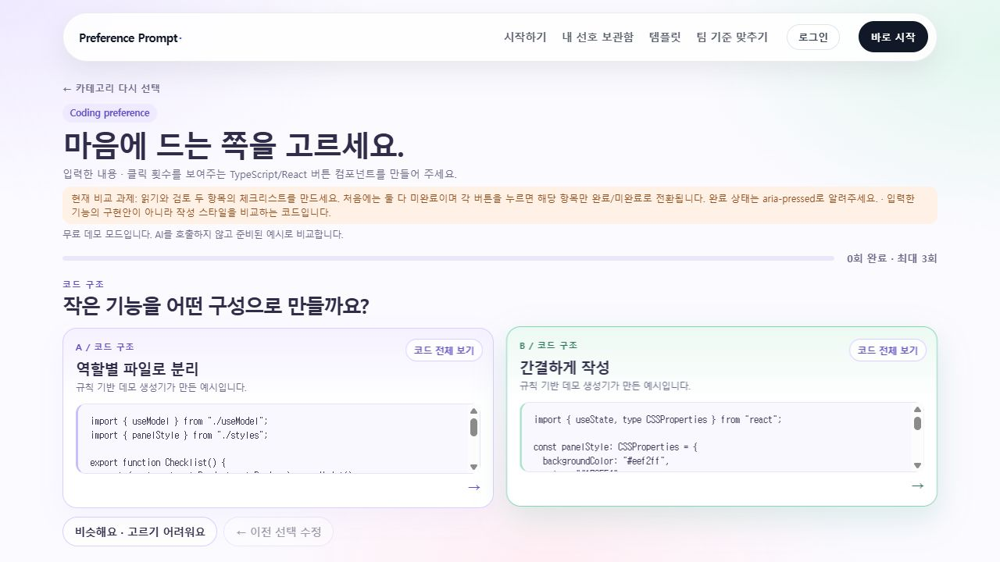
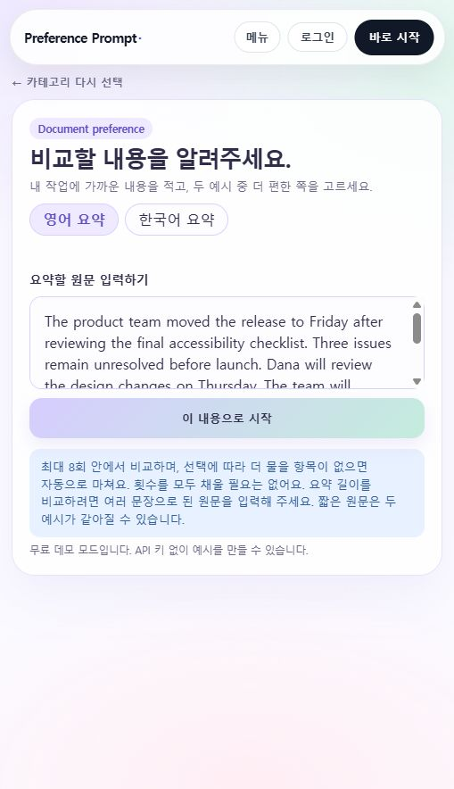
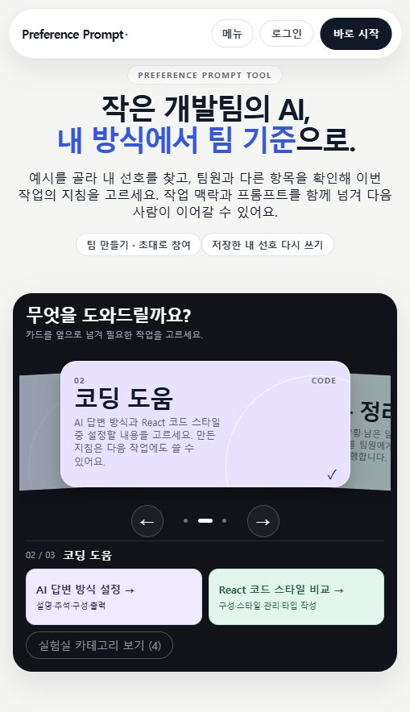

# 선호 설정·재사용 목표 확정과 친구 브랜치 UI 확인

2026-11-10 · `microstone`, 검사 시작 기준 `def4d7c`.

## 결정한 목표

사용자가 이번 단계의 목표로 **선호 설정·재사용의 편의성**을 선택했다. 개발자가 원하는 AI 답변 방식을 직접 정하거나 예시로 확인하고, 만든 지침을 다음 작업에도 전달하도록 돕는다.

기능 정확도는 보호 조건으로 두며, 일반 프롬프트보다 코드가 항상 더 정확해지는 것을 필수 성공 조건으로 삼지 않는다. 사용자 가치의 핵심 지표는 첫 설정·재사용 완료 여부, 도움 요청, 시간, 본인이 이해한 선택과 실제 지침의 일치다. 기존 보조 에이전트의 코드 수정 시간을 사람의 편의성 수치로 쓰지 않는다.

현재 기준과 빈 관찰 기록지는 [코딩 선호 설정·재사용 계획](../coding-preference-usability-plan.md)에 정리했다. 기존 3항목 React 사용자 평가 문서는 과거 결과를 유지하고 새 계획으로 가는 범위 안내를 추가했다. 실제 참여자 평가는 미실시다.

## 사진과 실행 화면이 달라 보인 이유

- `git fetch origin` 후 친구 브랜치 `origin/codex/coding-ai-upgrade`의 최신은 `e5d78af`였다. 2026-11-09의 파스텔 변경이며 CSS만 209줄 추가한 커밋이다.
- 같은 파스텔 블록이 이미 microstone에 `eac8598`로 반영돼 있다. 원격 CSS의 파스텔 블록 전체가 현재 소스에 포함되는 것을 문자열로 대조했다. 다른 미병합 기능을 임의로 합치지 않았다.
- 사진 속 화면은 기존 **TypeScript/React의 코드 구성·스타일 관리·타입 작성 3항목** 비교다. 현재 기본 코딩 화면은 **설명·주석·구성·출력 4항목**을 선택하는 별도 화면이다.
- 사진의 화면은 **시작하기 → 코딩 도움 → 내 코딩 지침 만들기 → 아래의 ‘React 예시 비교로 취향 찾기’**로 연다.
- 실제 브라우저에서 파스텔 입력 화면 → A/B 카드 → 코드 전체 보기 → 결과 화면까지 대조했다. 입력창·연보라/민트 카드·밝은 코드창·그라데이션 버튼과 진행 막대가 확인됐다. 현재 코드의 다른 안내와 메뉴는 사진보다 후속 변경이 있으므로 전체 화면이 픽셀 단위로 같다는 뜻은 아니다.
- 점검 당시 꺼져 있던 로컬 서버를 `127.0.0.1:8000`에서 데모 모드로 다시 켰다. 기존 브라우저 탭이 연결 오류 화면에 남아 있어 새 확인 탭에서 정상 페이지를 열었다. 이는 확인 당시의 상태이며 어제 사용자가 본 화면이 다른 원인이라고 단정하지 않는다.

## 이번에 수정한 안내

- 개발 환경 단계의 ‘다음에는 코드 두 개를 고른다’는 문구를, 직접 설정 후 필요한 경우 예시를 볼 수 있다는 안내로 수정했다.
- 기존 React 진입부를 팀 전용처럼 읽히는 질문에서 React 스타일 비교 설명으로 바꾸고, 두 경로가 서로 다른 선택 기록임을 표시했다.
- 친구가 바꾼 파스텔 CSS와 선택 로직은 유지했다. 수정은 안내 문구와 그 안내를 확인하는 기존 테스트에 한정했다.

관련 프론트 검사 19개 중 18개는 즉시 통과했다. 1개는 바뀌기 전 안내 문장을 정규식으로 찾던 검사여서 새 의미에 맞게 수정했고 해당 경로 재검사도 통과했다. 빌드 통과(기존 500KB 초과 주 번들 경고 유지). 빌드 후 실제 브라우저에서 새 안내 문구를 확인했다.

## 목표에 맞춰 추가한 독립 검사

새 보조 에이전트가 실제 Python 지침 조립·저장·내보내기 함수와 격리된 SQLite를 검사했다. 5개 환경(Python/FastAPI, JavaScript/React, TypeScript/React, Python/Flask, Java/Spring Boot), 네 항목의 16개 조합, 직접 설정/4회 비교/8회 비교를 사용했다.

| 검사 | 통과 사례 | 의미 |
|---|---:|---|
| 세 경로의 선택 값·네 선호 규칙 대조 | 240 | 동일 최종 선택이 동일 규칙으로 조립됨 |
| 저장·DB 재개·작업 내용 분리 | 240 | 저장된 지침 보존, 검사한 일시 작업 필드 혼입 없음 |
| 한 항목 변경 → 다른 항목으로 새 저장 | 960 | 나머지 규칙·원본 보존, 변경한 출처만 직접 설정 처리 |
| 도구 5종 내보내기 | 1,200 | 지침·검사한 기존 파일 내용·원본 보존 |
| 선택/비교 횟수에 따른 출처 안정성 | 160 | 같은 환경의 예시 출처 유지 |
| 다른 환경의 비교 출처 거절 | 20 | 언어·프레임워크가 다른 기록을 수용하지 않음 |

합계 2,820은 **프로그램 동작을 대조한 사례 수**다. 독립 사용자·코드 과제 수나 선호 추정 정확도의 표본 수가 아니다. 준비 예시가 언어 기본 예시인지 프레임워크 전용인지도 그대로 구분했다. React라고 지정했다고 실제 React 예시 비교를 검증한 것으로 바꾸지 않는다.

추가로 실제 React App을 JSDOM에 렌더링하고, fetch 응답을 자식 Python 프로세스의 실제 함수·임시 DB에 연결했다. Python/FastAPI 4회, JavaScript/React 직접 설정, TypeScript/React 8회의 세 시나리오에서 지침 생성 → 요청 A/B 교체 복사 → 지침만 저장 → 보관함 재사용 → 주석 한 항목 변경 → 별도 새 저장이 통과했다.

이 연결 검사는 실제 HTTP·로그인/재로그인·OS 클립보드 검사가 아니다. 브라우저에서 별도로 한 UI 대조와도 범위를 구분한다. 기존 설치 패키지만 사용했고 제품의 유료 모델 API 호출은 0회다. Codex 자체 사용량이나 청구액은 측정하지 않았다.

새 감사에서 제품 결함은 발견하지 않았다. 스크립트·검사 대상 파일 해시·원자료는 [재사용 감사 자료](../../benchmarks/preference_reuse/README.md)에 보존한다. 실제 사람의 편의성과 신규 과제의 AI 출력 효과는 이번 자동 검사 결과로 주장하지 않는다.

## 후속 수정: 문서 요약에도 파스텔 테마 적용

사용자가 다시 보낸 화면은 `Document preference`의 문서 요약 입력이었다. 친구 브랜치의 원래 CSS는 `.is-coding`으로 범위를 제한했으므로 요약에는 적용되지 않았다. 앞선 확인은 코딩 화면 기준이었다.

코딩·영어 요약·한국어 요약이 `has-pastel-theme`을 공유하도록 바꿨다. 기존 코딩 전용 반응형 배치는 유지하고 테마 블록의 적용 범위만 넓혔다. 요약 언어 버튼과 원문 안내도 같은 색상으로 맞췄다. 요약 선택·추정·자동 종료 로직은 수정하지 않았다.

관련 기존 테스트 6개와 프론트 빌드가 통과했다. 실제 좁은 브라우저 화면에서 영어/한국어 입력, 한국어 A/B 비교, 전체 보기, 5회 선택 후 자동 종료한 결과를 확인했다. 최종 탭은 새 영어 요약 입력 화면으로 돌려 놓았다. 준비된 데모 입력을 사용했고 모델 API는 호출하지 않았다.

## 후속 결정: 두 코딩 기능과 실사용자 없이 가능한 목표

사용자가 두 코딩 기능을 따로 제공하는 방향에 동의했다. 시작 화면에서 코딩 도움을 고르면 **AI 답변 방식 설정 / React 코드 스타일 비교** 두 버튼과 서로 다른 항목을 바로 보여 준다. 실제 좁은 브라우저에서 각 버튼의 진입·복귀를 확인했다. 관련 기존 테스트를 확장한 묶음 18개와 빌드가 통과했다. 기존 선택·저장 데이터는 변환하지 않았다.

이어 사용자가 ‘실사용자 결과를 확보하지 못함’을 조건으로 최종 목표와 검증 가능한 프롬프트를 요청했다. [새 목표](../coding-verifiable-goal.md)는 명시한 답변 조건의 전달·재사용·검증이다. 앞선 사용자 편의성 계획은 선택적 후속 연구로 보존한다.

IFEval·CodeIF·RACE·EvalPlus의 원문/공식 저장소에서 평가 방향을 확인했다. `benchmarks/coding_contract_v1`에 설명 3종×전달 2종의 지침 조립·오프라인 검사 프로토타입과 실제 생성한 예시 지침을 추가했다. 정상/위반 사례 12개 테스트가 통과했고, 생성 코드는 실행하지 않았다. 기능 없는 버튼이 형식 검사에 통과해도 기능을 미검증으로 남기는 검사를 포함했다. 실제 생성 비교·타입/기능 실행·기본 UI 연결은 아직 완료되지 않았다. 제품의 모델 API 호출은 0회다.

