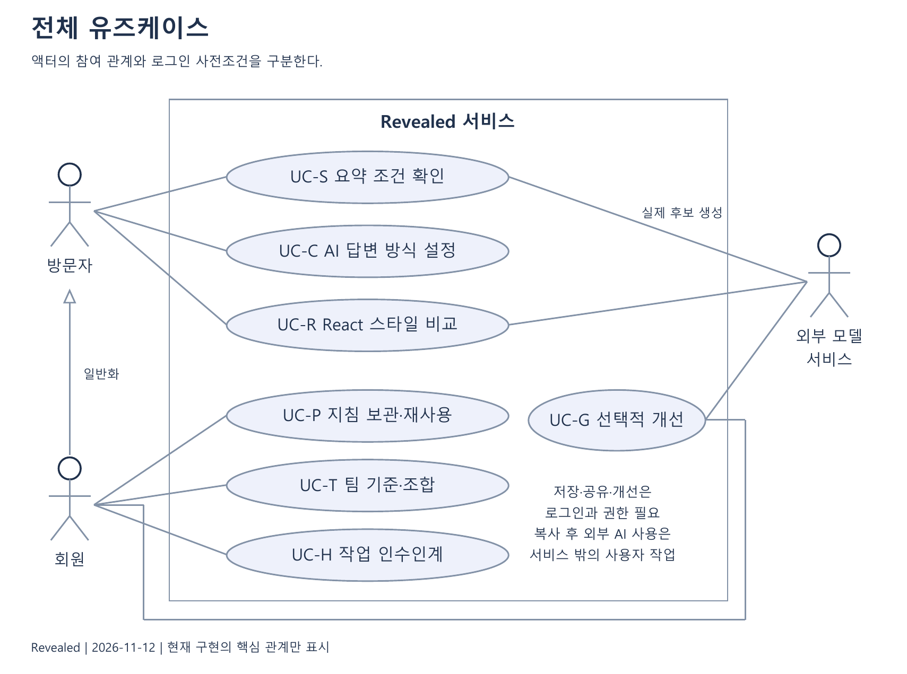
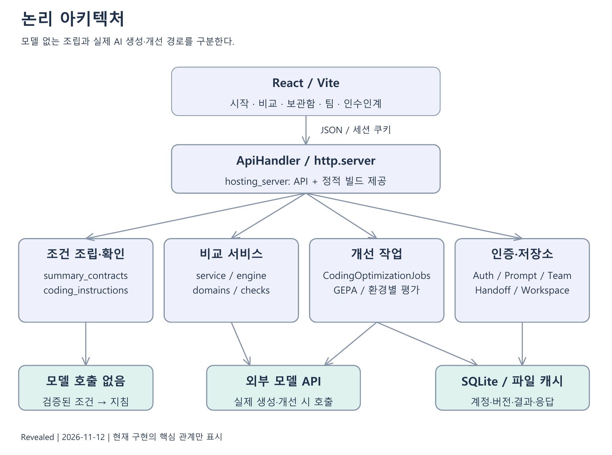
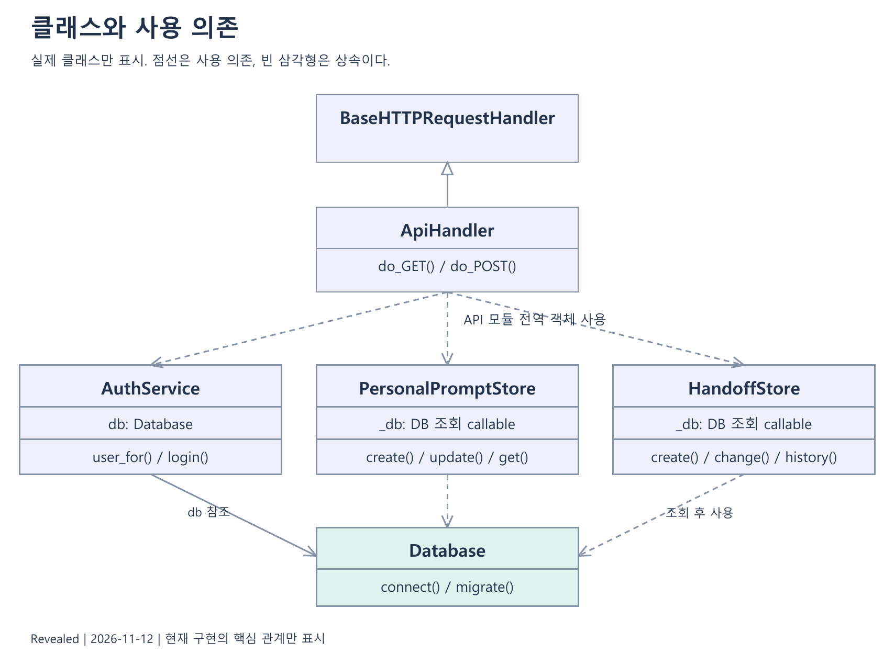
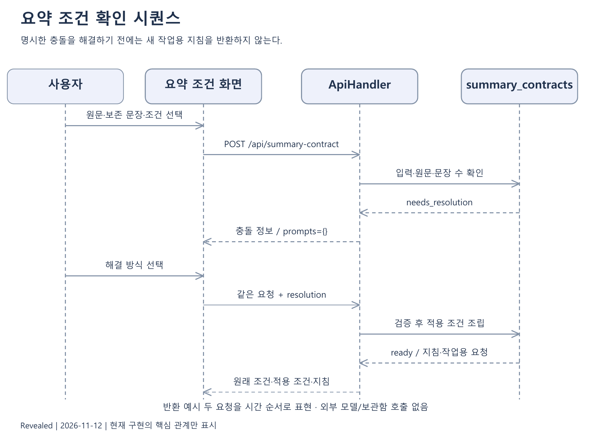
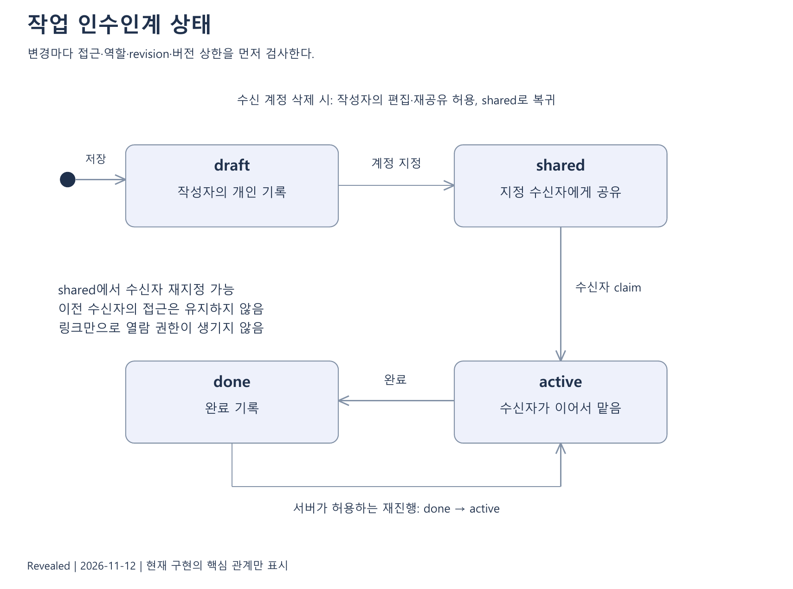
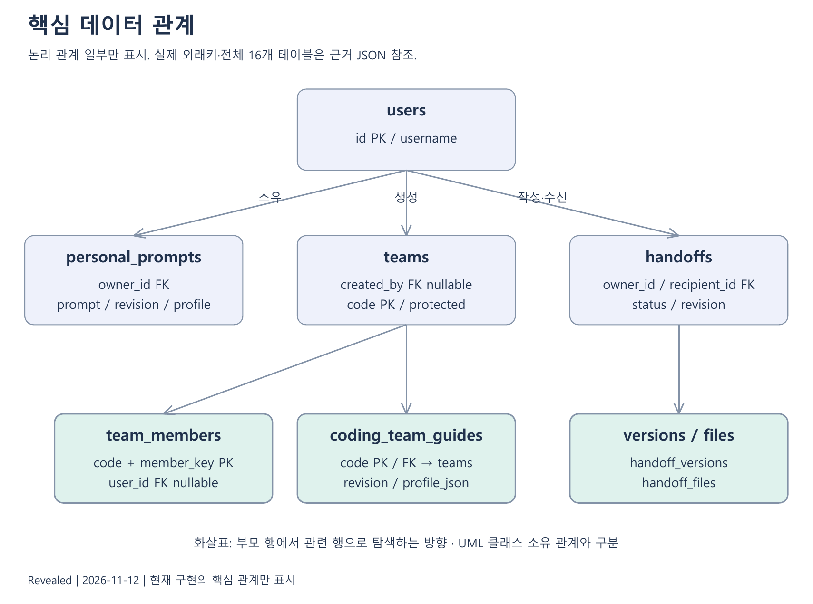
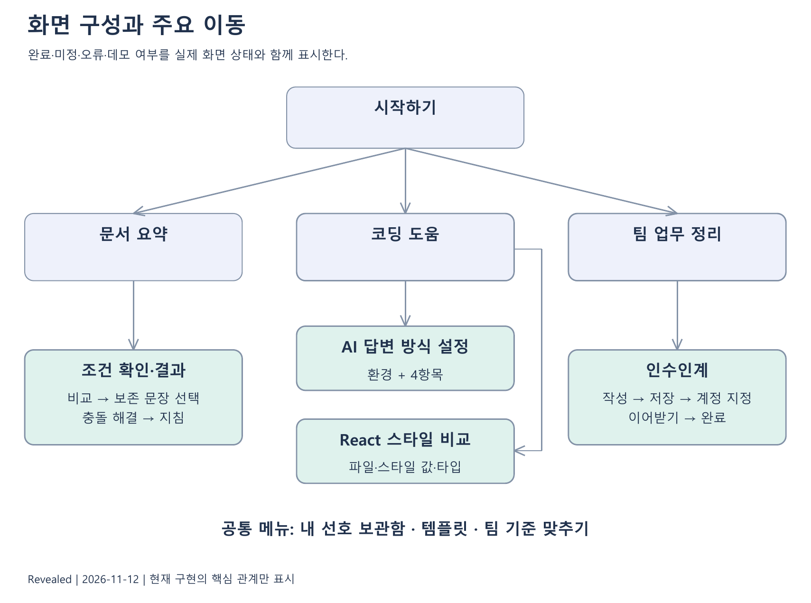

# 0. 시스템 전체도와 문서 안내

## 0.1 목적과 읽는 순서

Revealed는 사용자가 원하는 AI 결과 조건을 확인하고 재사용 가능한 지침으로 조립하는 웹 서비스다. 검증의 중심은 문서 요약의 조건 준수와 내용 보존이다. 코딩의 두 기능, 개인 보관함, 팀 기준, 작업 인수인계, 템플릿·업무 지침은 전체 제품의 구성 요소로 유지한다.

이 문서는 전체 분석·설계 기준서다. 1장은 문제·요구사항, 2장은 24개 유즈케이스, 3장은 18개 논리 화면, 4장은 처리·알고리즘, 5장은 실제 구성요소, 6장은 90개 API, 7장은 16개 테이블, 8장은 권한·운영·품질, 9장은 검증, 10장은 관리·주간보고 부록이다. 현재 구현, 확인된 검사, 보완할 부분을 구별한다.

아래 일곱 그림은 전체 구조를 읽는 입구다. 상세 절에는 추가 시퀀스·활동·배포·데이터 관계·논리 화면을 제공한다. 그림의 생략된 필드·오류·권한은 본문의 명세가 보완한다. 다른 프로젝트 보고서는 구성 참고에만 사용했다.

## 0.2 전체 유즈케이스

방문자·회원·팀 역할·인수인계 역할을 구분한다. 실선은 참여 관계이고 회원의 일반화는 방문자 기능도 사용할 수 있다는 의미다. 외부 모델은 실제 생성·개선 경로에만 참여한다. 로그인·소유권·초대는 각 유즈케이스의 사전조건으로 명세한다. 화면 순서를 곧 include/extend 관계로 그리지 않는다.

## 0.3 구성과 책임 경계

React 화면과 Python HTTP API, 비교 엔진, 별도 조건 조립, 저장 업무와 외부 모델 경로를 분리한다. 연구용 생성 코드 실행기는 운영 서버 밖의 별도 실험이다. Python 서버는 FastAPI가 아니라 표준 HTTP 핸들러 기반이다. 모델 없는 조립과 실제 모델 생성은 같은 비용 경로가 아니다.

## 0.4 핵심 클래스 관계

SessionState는 세션 자료를 보존하며 함수가 이력으로 Estimator·Selector를 다시 구성한다. 속성에 해당 객체를 영구 소유하는 것처럼 해석하지 않는다. ApiHandler는 요청을 분기하고 저장소와 AuthService는 Database를 사용한다. 실제 클래스가 없는 함수 모듈도 5장에서 독립 책임으로 설명한다.

## 0.5 요약 조건 확인 시퀀스

사용자 입력은 UI에서 API를 거쳐 조건 모듈로 전달된다. 해결 전 충돌이면 지침을 비워 반환하고 사용자의 명시적 선택 뒤 다시 검사한다. ready는 규칙상 조건 처리를 뜻하며 실제 요약의 내용 보존 완료가 아니다. 비동기 응답이 늦게 도착해도 이미 바뀐 입력의 결과로 반영하지 않는다.

## 0.6 인수인계 상태

기본 전이는 개인 저장, 지정 공유, 이어받기, 완료·재진행이다. 공유 중 수신자 재지정은 이전 수신자의 현재 접근을 회수한다. 수신 계정이 삭제돼 recipient_id가 NULL이면 active 상태라도 작성자가 편집·재공유할 수 있는 예외가 있으며 재공유하면 shared로 돌아간다. 모든 버전·파일은 현재 권한을 함께 확인한다.

## 0.7 핵심 데이터와 화면 이동

이 그림은 주요 부모 자료에서 관련 자료로 탐색하는 논리 개요다. 전체 16개 테이블의 물리 PK·FK·삭제 동작은 7장의 세 데이터 관계 그림과 데이터 사전을 기준으로 한다. JSON에 들어 있는 과거 출처는 SQL 외래키와 다르다.

시작 화면에서 요약·코딩·팀 업무로 이동하며 공통 메뉴에서 보관함·팀·템플릿을 연다. 코딩의 네 항목과 React 세 축은 별도 진입점이다. 로그인 왕복, 초안 복구, 결과 복사와 저장, 오류·미정 상태는 3장에서 다룬다.
