# 2. 유즈케이스 계층과 상세 명세

## 2.1 번호·범위·그림 읽는 법

상위 기능은 UC-01~UC-24, 하위 목표는 UC-01-01처럼 숫자만 사용한다. 하위 번호는 부모 안에서 다시 시작하며, UML이 지정한 번호 체계가 아니라 이 프로젝트의 추적 규칙이다. 같은 ID와 이름을 목록·그림·명세·WBS 대응표에서 사용한다. 기존 상위 24개 ID를 유지하므로 과거 요구사항과 검증 기록을 이어서 찾을 수 있다.

전체 색인에서 기능 영역을 고르고, 영역별 그림에서 상위 UC를 찾은 뒤, 해당 UC의 하위 그림·명세·기본 흐름을 읽는다. 하위 기능은 79개이며 버튼·검사 함수마다 별도 UC를 추가하지 않았다. 영역·상위 UC로 묶는 것은 문서의 상세화 관계다. UML include는 필수 공통 행동의 포함, extend는 조건부 확장일 때 쓰므로 여기서는 단순 하위 목록에 그 관계를 붙이지 않았다.

중간보고서의 기능별 그림과 명세표 구성을 참고하여 개요·액터·사전/사후조건·입력·기본/대안/예외 흐름·검사 기준을 함께 기술한다. 날짜는 문서 수정일, 상태는 현행 구현 기준 검토용이다. 우선순위나 실제 담당자·완료일을 임의 확정하지 않는다. 검사 기준은 앞으로 재확인할 수용 기준이며 새 실행 결과가 아니다.

## 2.2 유즈케이스 목록

| ID | 유즈케이스 이름 | 주 구현 WBS | 관련 WBS |
| --- | --- | --- | --- |
| UC-01 | 계정 생성·로그인·종료 | 3.3 | - |
| UC-02 | 문서 요약 비교 시작 | 3.1 | 3.3 (보완 예정) |
| UC-03 | 요약·React 비교 응답과 되돌리기 | 3.1 | 3.2 (공통), 3.3 (보완 예정) |
| UC-04 | 요약 원문에서 보존할 문장 지정 | 3.1 | - |
| UC-05 | 요약 조건 충돌 해결과 복사 | 3.1 | - |
| UC-06 | 코딩 답변 방식 직접 설정 | 3.2 | - |
| UC-07 | 코딩 준비 예시 비교 | 3.2 | - |
| UC-08 | React 코드 스타일 비교 | 3.2 | - |
| UC-09 | 개인 지침 저장·수정·삭제 | 3.3 | - |
| UC-10 | 저장 지침을 새 작업에 사용 | 3.3 | - |
| UC-11 | 팀 만들기·초대·참여 | 3.4 | - |
| UC-12 | 기존 요약·React 팀 기준 합치기 | 3.4 | - |
| UC-13 | 네 항목 코딩 팀 기준 생성·수정 | 3.4 | - |
| UC-14 | 개인·팀 기준으로 작업용 조합 | 3.4 | - |
| UC-15 | 재조합·일부 되돌림·이력 열람 | 3.4 | - |
| UC-16 | 인수인계 작성·개인 저장 | 3.4 | - |
| UC-17 | 인수인계 공유·이어받기·완료 | 3.4 | - |
| UC-18 | 인수인계 파일 첨부·제외·열기 | 3.4 | - |
| UC-19 | 선택적 코딩 개선 시작·조회 | 3.3 | - |
| UC-20 | 개선 결과 검토·직접 판단·채택 | 3.3 | - |
| UC-21 | AI 답변 직접 확인 | 3.3 | - |
| UC-22 | 지침 파일 내보내기 | 3.3 | - |
| UC-23 | 실제 작업 비교 기록 | 3.3 | - |
| UC-24 | 템플릿·요청문 점검·업무 지침 작업 공간 | 3.3 | - |

## 2.3 계정 관리 하위 구성

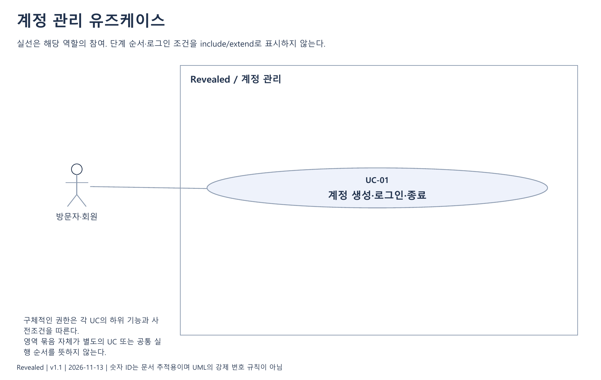

이 영역은 UC-01로 구성한다. 그림의 역할 묶음이 모든 하위 동작에 동일 권한을 부여한다는 뜻은 아니다. 개별 명세에서 실제 수행 주체와 권한을 구분한다.

## 2.4 문서 요약 하위 구성

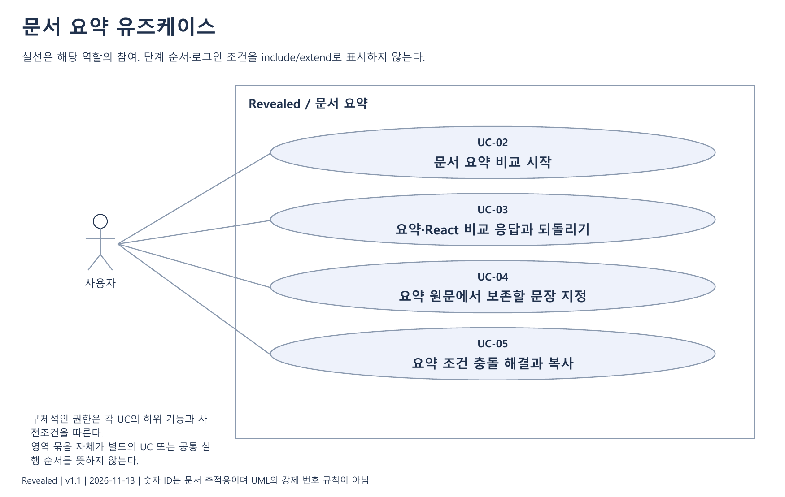

이 영역은 UC-02, UC-03, UC-04, UC-05로 구성한다. 각 기능의 참여 역할과 처리 결과는 이어지는 개별 명세를 따른다. 공통 UC-03은 요약과 React 비교에서 함께 사용하며 WBS에는 중복 작업으로 합산하지 않는다.

## 2.5 코딩 도움·React 비교 하위 구성

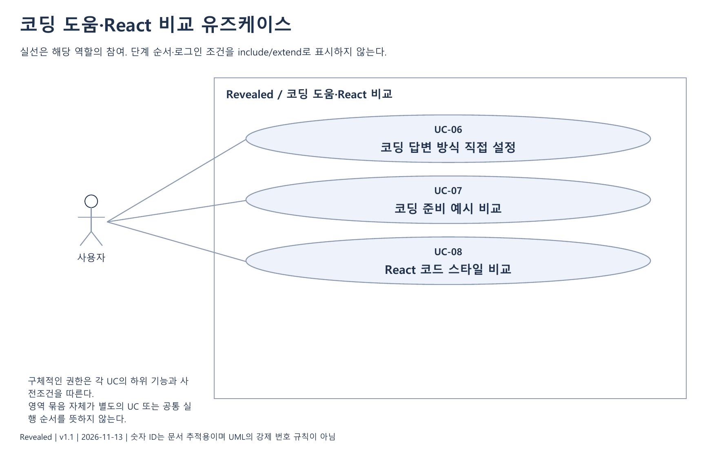

이 영역은 UC-06, UC-07, UC-08로 구성한다. 각 기능의 참여 역할과 처리 결과는 이어지는 개별 명세를 따른다. 공통 UC-03은 요약과 React 비교에서 함께 사용하며 WBS에는 중복 작업으로 합산하지 않는다.

## 2.6 개인 지침·재사용 하위 구성

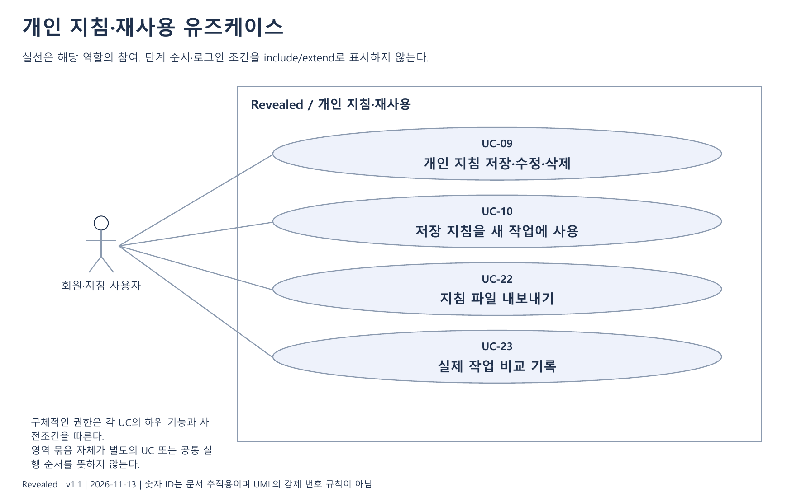

이 영역은 UC-09, UC-10, UC-22, UC-23로 구성한다. 그림의 역할 묶음이 모든 하위 동작에 동일 권한을 부여한다는 뜻은 아니다. 개별 명세에서 실제 수행 주체와 권한을 구분한다.

## 2.7 팀 기준·조합 하위 구성

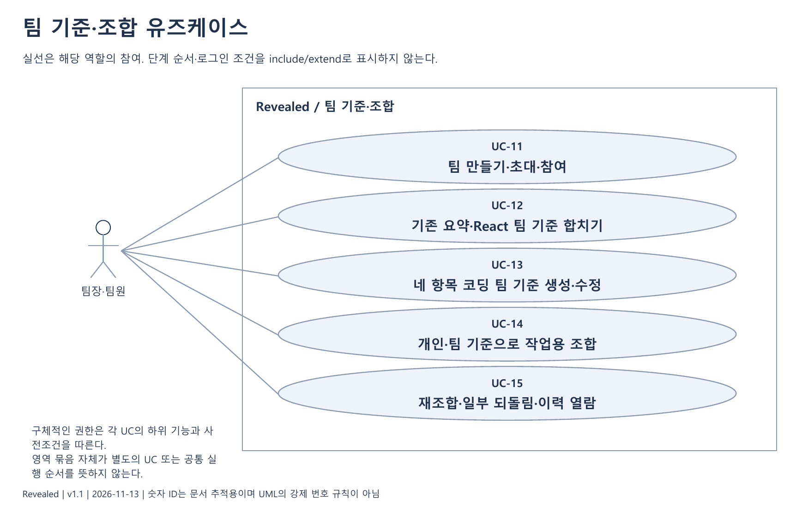

이 영역은 UC-11, UC-12, UC-13, UC-14, UC-15로 구성한다. 그림의 역할 묶음이 모든 하위 동작에 동일 권한을 부여한다는 뜻은 아니다. 개별 명세에서 실제 수행 주체와 권한을 구분한다.

## 2.8 작업 인수인계 하위 구성

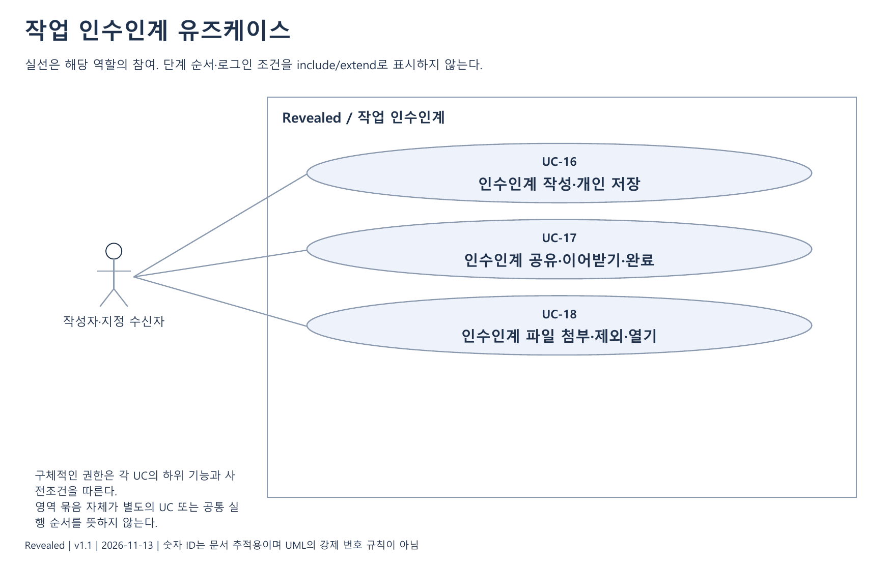

이 영역은 UC-16, UC-17, UC-18로 구성한다. 그림의 역할 묶음이 모든 하위 동작에 동일 권한을 부여한다는 뜻은 아니다. 개별 명세에서 실제 수행 주체와 권한을 구분한다.

## 2.9 개선·답변 검토 하위 구성

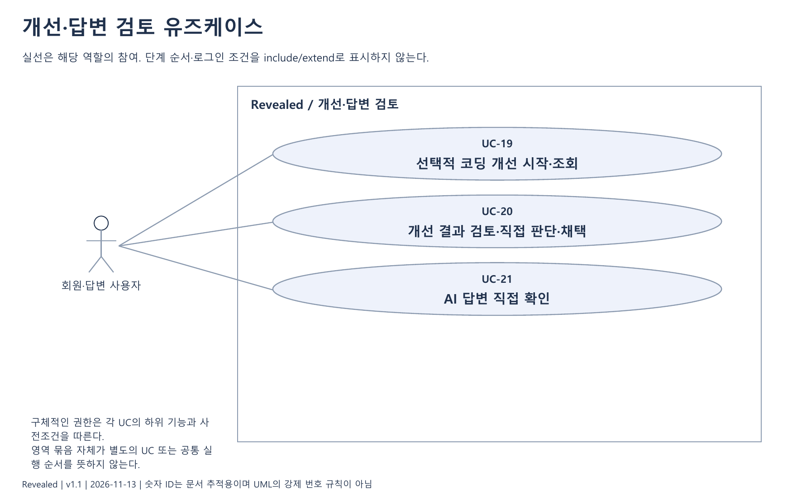

이 영역은 UC-19, UC-20, UC-21로 구성한다. 그림의 역할 묶음이 모든 하위 동작에 동일 권한을 부여한다는 뜻은 아니다. 개별 명세에서 실제 수행 주체와 권한을 구분한다.

## 2.10 템플릿·업무 작업 공간 하위 구성

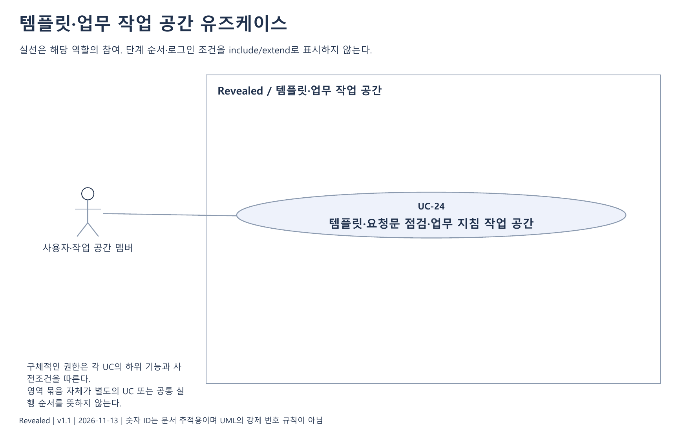

이 영역은 UC-24로 구성한다. 그림의 역할 묶음이 모든 하위 동작에 동일 권한을 부여한다는 뜻은 아니다. 개별 명세에서 실제 수행 주체와 권한을 구분한다.

<!-- pagebreak -->

## 2.11 WBS와 유즈케이스 연결 원칙

PMI는 WBS를 프로젝트 전체 범위를 조직하는 구조로 설명한다. OMG UML의 유즈케이스는 외부 액터와 상호작용하여 가치 있는 결과를 제공하는 시스템 행동을 설명한다. 이 정의에 비추어 두 산출물의 이름이나 개수가 항상 같아야 한다고 해석할 근거는 없다. WBS에는 설계·검증·문서화·운영처럼 사용자 기능 이외의 일도 들어간다. 이는 두 정의를 비교한 본 문서의 적용 판단이며 학교의 별도 양식 규칙을 확인했다는 뜻은 아니다.

이 프로젝트에서는 공통 기능명은 일치시키고, 기능 구현 WBS 3.1~3.4에 상위 UC를 연결한다. 주 구현과 공통 사용·보완 예정 관계를 구별한다. 하위 UC는 부모의 연결 범위를 상속하되, 관련 WBS의 보완 대상은 명시한 범위에만 적용한다. 분석 1.2, 설계 2.1~2.3, 회귀 4.2는 전체 UC를 다루는 공통 작업이다. WBS는 기존 5단계·16개 주요 작업을 유지한다.

| WBS | 주요 구현 범위 | 연결 UC |
| --- | --- | --- |
| 3.1 | 문서 요약 기능 구현 | UC-02~UC-05 |
| 3.2 | 코딩 도움·React 비교 구현 | UC-06~UC-08 (공통 UC-03 참조) |
| 3.3 | 계정·지침 저장·재사용 구현 | UC-01, UC-09~10, UC-19~24; 세션 정책 보완 대상 UC-02·03 |
| 3.4 | 팀 공유·인수인계 구현 | UC-11~UC-18 |

UC-02·03의 주 구현은 3.1이다. 3.3은 비교 세션 접근·소유권·만료 정책을 확정하고 구현할 보완 작업이며 현재 계정 격리 완료를 뜻하지 않는다. UC-03은 React 비교의 3.2에서도 공통 사용한다. 요약 v2의 길이 제한·충돌 처리 설명은 반영됐고, 2.1~2.3에는 세션 정책 확정 후 설계·화면·명세 반영이 남아 있다.

참고: [PMI WBS Practice Standard 소개](https://www.pmi.org/standards/work-breakdown-structures-third-edition), [OMG UML 2.5.1, 18장 Use Cases](https://www.omg.org/spec/UML/2.5.1). 일정·상태는 보고서형 WBS v3.3과 연결한다.

## UC-01 계정 생성·로그인·종료

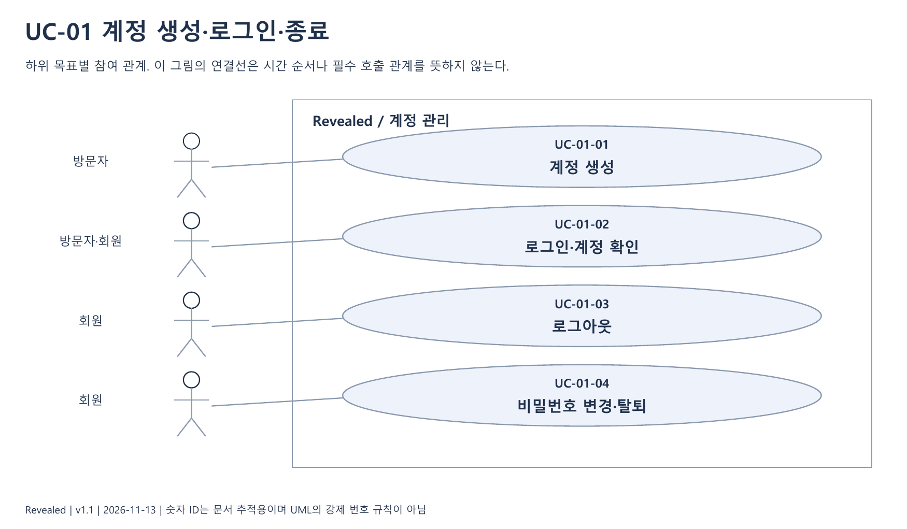

| 명세 항목 | 내용 |
| --- | --- |
| 시스템 / 서브시스템 | Revealed / 계정 관리 |
| UC-ID / 이름 | UC-01 / 계정 생성·로그인·종료 |
| 단계 / 작성일 / 버전 | 현행 구현 기준 검토용 / 2026-11-13 / v1.2 |
| 개요 | 계정으로 자료의 소유자를 구분하고 인증 상태를 관리한다. |
| 주요 액터 | 방문자 / 방문자·회원 / 회원 |
| 사전조건 | 서버 접근 가능. 가입·로그인에는 유효한 자격 정보, 계정 변경에는 본인 확인이 필요하다. |
| 사후조건 | 인증 세션이 발급·폐기되거나 본인의 계정 변경이 반영된다. |
| 추적 관계 | FR-01.1~3 / UI-02 / 주 구현 WBS 3.3 |

### 하위 기능 설명

| 하위 ID | 기능 이름 | 액터·처리 결과 |
| --- | --- | --- |
| UC-01-01 | 계정 생성 | 방문자 : 입력 형식과 중복을 확인하고 비밀번호를 해시로 저장한다. |
| UC-01-02 | 로그인·계정 확인 | 방문자·회원 : 인증 성공 시 세션을 발급하고 현재 계정 정보를 조회한다. |
| UC-01-03 | 로그아웃 | 회원 : 세션과 계정별 임시 초안을 제거한다. |
| UC-01-04 | 비밀번호 변경·탈퇴 | 회원 : 현재 비밀번호를 다시 확인한 뒤 허용된 계정 변경을 수행한다. |

### 기본·대안·예외 흐름

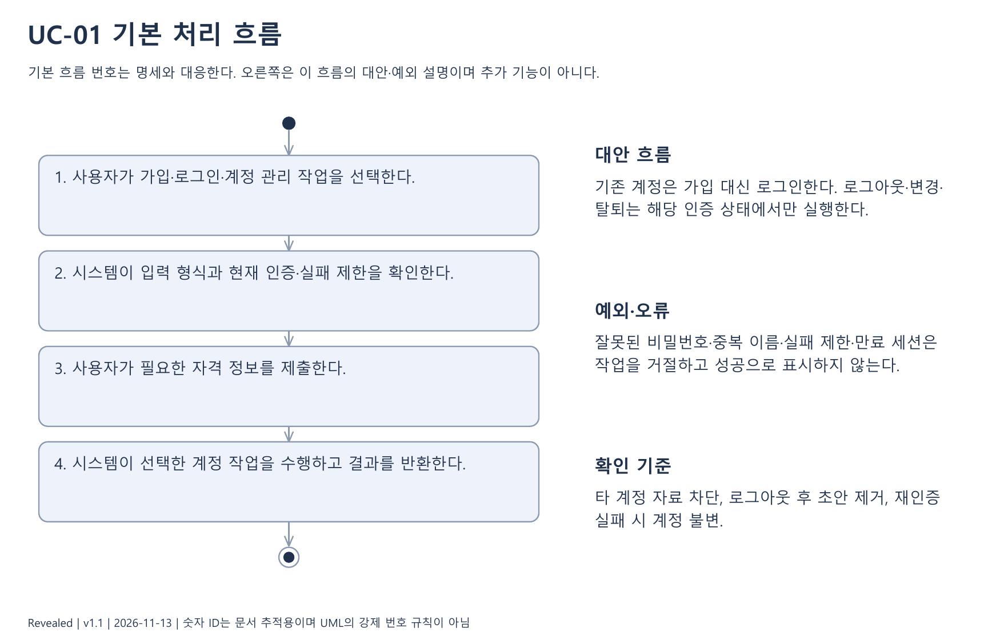

| 흐름 | 설명 |
| --- | --- |
| 1 | 사용자가 가입·로그인·계정 관리 작업을 선택한다. |
| 2 | 시스템이 입력 형식과 현재 인증·실패 제한을 확인한다. |
| 3 | 사용자가 필요한 자격 정보를 제출한다. |
| 4 | 시스템이 선택한 계정 작업을 수행하고 결과를 반환한다. |
| 대안 | 기존 계정은 가입 대신 로그인한다. 로그아웃·변경·탈퇴는 해당 인증 상태에서만 실행한다. |
| 예외 | 잘못된 비밀번호·중복 이름·실패 제한·만료 세션은 작업을 거절하고 성공으로 표시하지 않는다. |
| 검사 기준 | 타 계정 자료 차단, 로그아웃 후 초안 제거, 재인증 실패 시 계정 불변. |

### 입력·상태·업무 규칙 상세

입력은 사용자명·비밀번호이며 로그인 세션은 쿠키로 전달된다. 비밀번호 원문을 저장하지 않는다. 비밀번호 변경·계정 삭제는 현재 비밀번호를 다시 확인한다. 비교 세션 ID 경로의 별도 권한 경계는 6장·8장을 따른다.

## UC-02 문서 요약 비교 시작

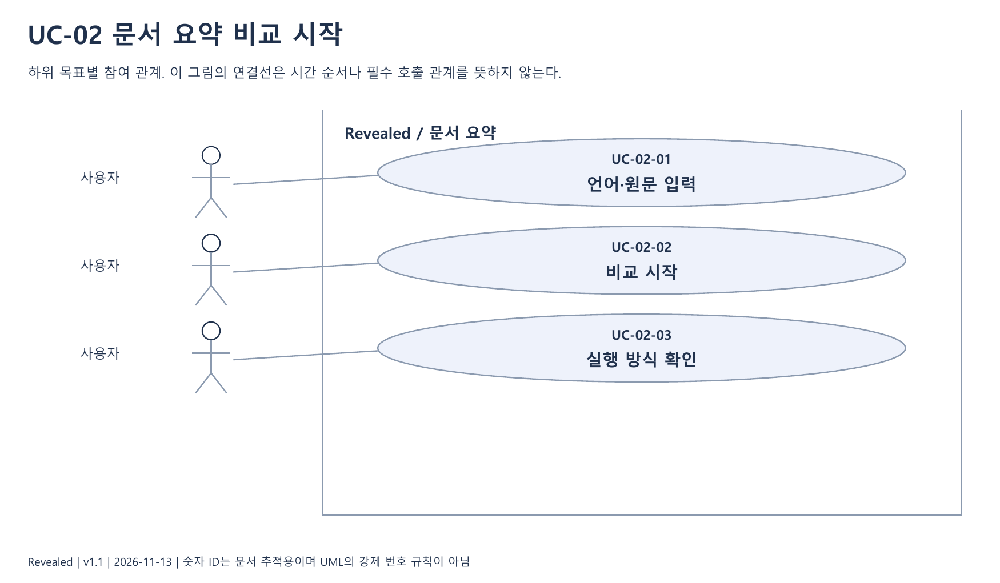

| 명세 항목 | 내용 |
| --- | --- |
| 시스템 / 서브시스템 | Revealed / 문서 요약 |
| UC-ID / 이름 | UC-02 / 문서 요약 비교 시작 |
| 단계 / 작성일 / 버전 | 현행 구현 기준 검토용 / 2026-11-13 / v1.2 |
| 개요 | 언어와 원문으로 요약 비교 세션을 시작한다. |
| 주요 액터 | 사용자 |
| 사전조건 | 지원 분류와 비어 있지 않은 원문. 공백 포함 최대 12,000 Unicode 코드 포인트. |
| 사후조건 | 현재 원문에 대한 비교 후보와 실행 방식이 화면에 표시된다. |
| 추적 관계 | FR-02.1 / UI-03 / 주 구현 WBS 3.1 / 관련 3.3 (보완 예정) |

### 하위 기능 설명

| 하위 ID | 기능 이름 | 액터·처리 결과 |
| --- | --- | --- |
| UC-02-01 | 언어·원문 입력 | 사용자 : 요약 분류를 선택하고 원문 길이를 확인한다. |
| UC-02-02 | 비교 시작 | 사용자 : 유효한 원문으로 세션과 첫 후보 쌍을 요청한다. |
| UC-02-03 | 실행 방식 확인 | 사용자 : 데모인지 실제 생성인지와 전환 이유를 확인한다. |

### 기본·대안·예외 흐름

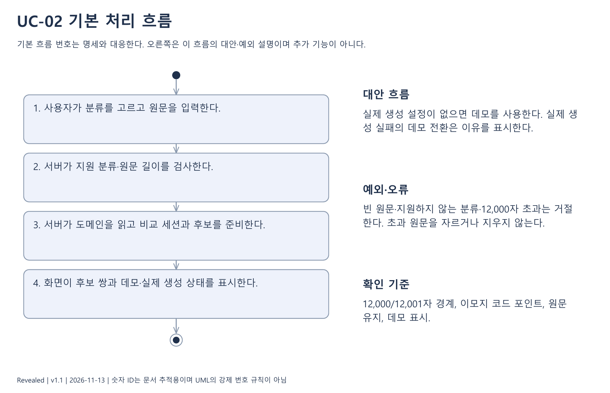

| 흐름 | 설명 |
| --- | --- |
| 1 | 사용자가 분류를 고르고 원문을 입력한다. |
| 2 | 서버가 지원 분류·원문 길이를 검사한다. |
| 3 | 서버가 도메인을 읽고 비교 세션과 후보를 준비한다. |
| 4 | 화면이 후보 쌍과 데모·실제 생성 상태를 표시한다. |
| 대안 | 실제 생성 설정이 없으면 데모를 사용한다. 실제 생성 실패의 데모 전환은 이유를 표시한다. |
| 예외 | 빈 원문·지원하지 않는 분류·12,000자 초과는 거절한다. 초과 원문을 자르거나 지우지 않는다. |
| 검사 기준 | 12,000/12,001자 경계, 이모지 코드 포인트, 원문 유지, 데모 표시. |

### 입력·상태·업무 규칙 상세

입력은 요약 언어·분류와 현재 원문이다. 실제 후보 생성은 모델 설정·키·한도·캐시가 필요하다. 생성 실패의 데모 전환은 demo_reason=generation_failed로 구별하며 요청 자체 오류와 혼동하지 않는다.

## UC-03 요약·React 비교 응답과 되돌리기

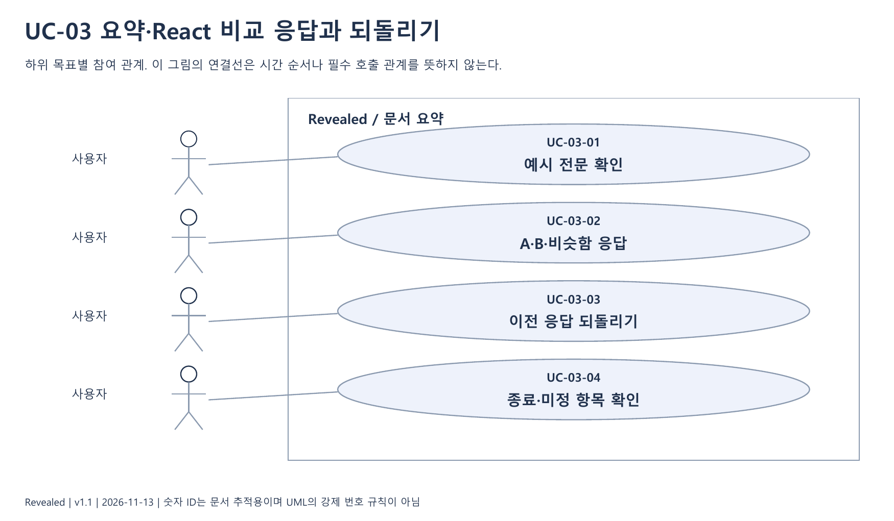

| 명세 항목 | 내용 |
| --- | --- |
| 시스템 / 서브시스템 | Revealed / 문서 요약 |
| UC-ID / 이름 | UC-03 / 요약·React 비교 응답과 되돌리기 |
| 단계 / 작성일 / 버전 | 현행 구현 기준 검토용 / 2026-11-13 / v1.2 |
| 개요 | 현재 예시를 비교하고 필요하면 마지막 선택을 되돌린다. |
| 주요 액터 | 사용자 |
| 사전조건 | 현재 비교 세션과 쌍 ID. 요약 또는 React 스타일 비교 경로. |
| 사후조건 | 이력·신호와 다음 질문 또는 종료 이유가 일관되게 갱신된다. |
| 추적 관계 | FR-02.2~4, FR-05.1 / UI-03, UI-08 / 주 구현 WBS 3.1 / 관련 3.2 (공통), 3.3 (보완 예정) |

### 하위 기능 설명

| 하위 ID | 기능 이름 | 액터·처리 결과 |
| --- | --- | --- |
| UC-03-01 | 예시 전문 확인 | 사용자 : 현재 A/B 예시와 비교 항목을 읽는다. |
| UC-03-02 | A·B·비슷함 응답 | 사용자 : 현재 쌍에 대한 응답만 반영한다. |
| UC-03-03 | 이전 응답 되돌리기 | 사용자 : 마지막 응답 제거 후 남은 이력으로 재계산한다. |
| UC-03-04 | 종료·미정 항목 확인 | 사용자 : 상한 또는 질문 소진 종료와 미정 항목을 구별한다. |

### 기본·대안·예외 흐름

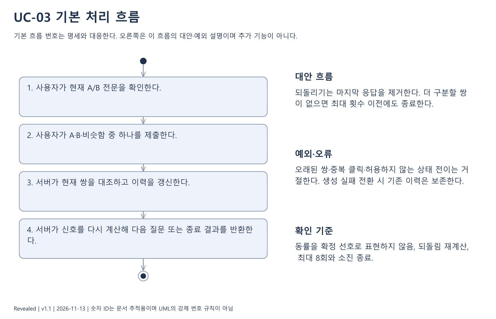

| 흐름 | 설명 |
| --- | --- |
| 1 | 사용자가 현재 A/B 전문을 확인한다. |
| 2 | 사용자가 A·B·비슷함 중 하나를 제출한다. |
| 3 | 서버가 현재 쌍을 대조하고 이력을 갱신한다. |
| 4 | 서버가 신호를 다시 계산해 다음 질문 또는 종료 결과를 반환한다. |
| 대안 | 되돌리기는 마지막 응답을 제거한다. 더 구분할 쌍이 없으면 최대 횟수 이전에도 종료한다. |
| 예외 | 오래된 쌍·중복 클릭·허용하지 않는 상태 전이는 거절한다. 생성 실패 전환 시 기존 이력은 보존한다. |
| 검사 기준 | 동률을 확정 선호로 표현하지 않음, 되돌림 재계산, 최대 8회와 소진 종료. |

### 입력·상태·업무 규칙 상세

입력은 세션·현재 쌍 ID·응답이다. 이력에는 A/B 조합과 실제 선택값·순서를 남긴다. 되돌리면 남은 이력으로 효용을 다시 계산한다. 최적화 진행 등 허용하지 않는 상태의 변경은 거절한다.

## UC-04 요약 원문에서 보존할 문장 지정

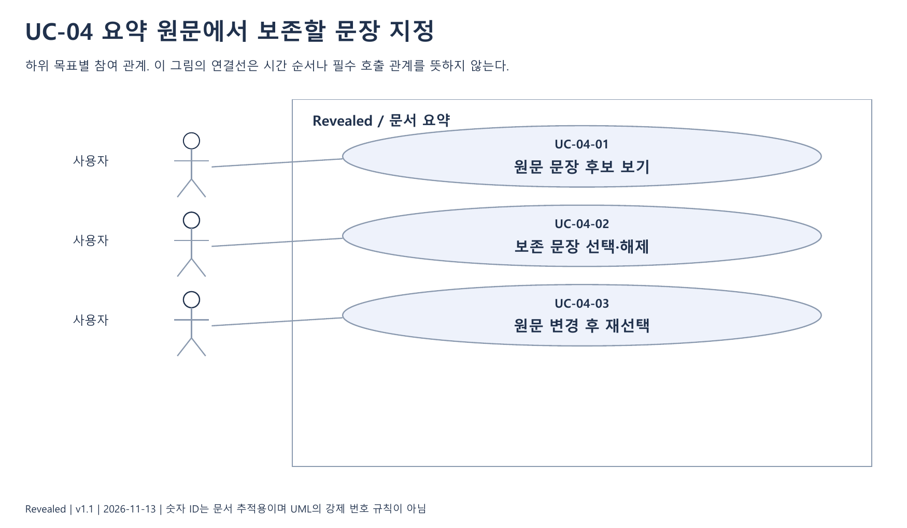

| 명세 항목 | 내용 |
| --- | --- |
| 시스템 / 서브시스템 | Revealed / 문서 요약 |
| UC-ID / 이름 | UC-04 / 요약 원문에서 보존할 문장 지정 |
| 단계 / 작성일 / 버전 | 현행 구현 기준 검토용 / 2026-11-13 / v1.2 |
| 개요 | 이번 요약에서 보존을 요청할 완전 문장을 명시한다. |
| 주요 액터 | 사용자 |
| 사전조건 | 요약 조건과 현재 원문. 서버가 만든 문장 후보 중 최대 8개 선택. |
| 사후조건 | 현재 원문과 일치하는 선택 문장이 원문 순서로 정규화된다. |
| 추적 관계 | FR-03.1,4 / UI-04 / 주 구현 WBS 3.1 |

### 하위 기능 설명

| 하위 ID | 기능 이름 | 액터·처리 결과 |
| --- | --- | --- |
| UC-04-01 | 원문 문장 후보 보기 | 사용자 : 문장 경계 규칙으로 추출된 완전 문장을 확인한다. |
| UC-04-02 | 보존 문장 선택·해제 | 사용자 : 최대 8개를 고르며 클릭 순서를 중요도 순위로 취급하지 않는다. |
| UC-04-03 | 원문 변경 후 재선택 | 사용자 : 이전 원문의 선택을 재사용하지 않고 현재 후보를 다시 확인한다. |

### 기본·대안·예외 흐름

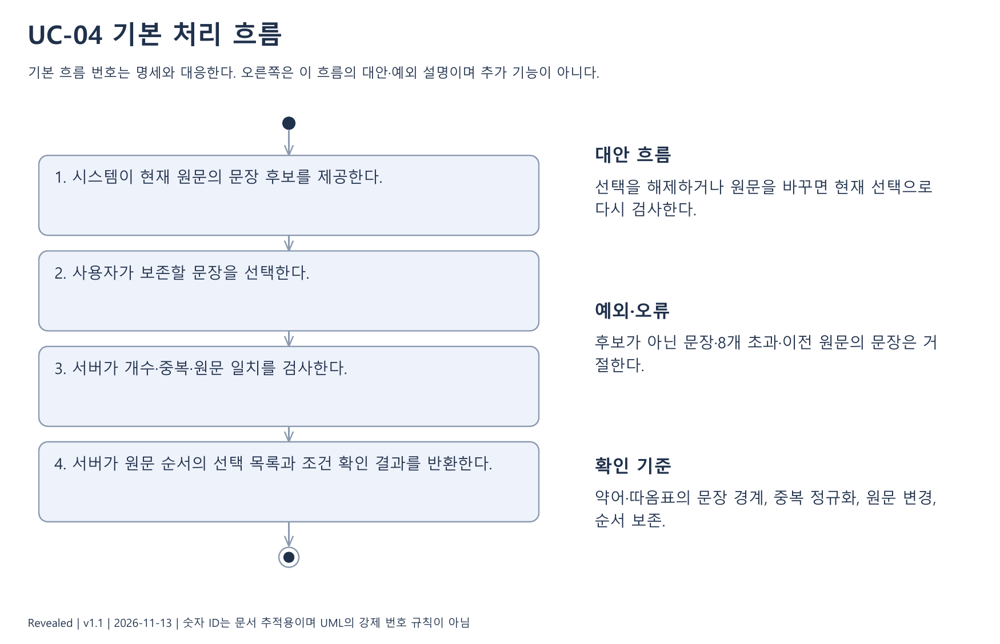

| 흐름 | 설명 |
| --- | --- |
| 1 | 시스템이 현재 원문의 문장 후보를 제공한다. |
| 2 | 사용자가 보존할 문장을 선택한다. |
| 3 | 서버가 개수·중복·원문 일치를 검사한다. |
| 4 | 서버가 원문 순서의 선택 목록과 조건 확인 결과를 반환한다. |
| 대안 | 선택을 해제하거나 원문을 바꾸면 현재 선택으로 다시 검사한다. |
| 예외 | 후보가 아닌 문장·8개 초과·이전 원문의 문장은 거절한다. |
| 검사 기준 | 약어·따옴표의 문장 경계, 중복 정규화, 원문 변경, 순서 보존. |

### 입력·상태·업무 규칙 상세

입력은 현재 원문과 후보에 포함된 선택 문장 목록이다. 임의 문자열을 문장 후보처럼 추가할 수 없다. 문장 경계 규칙의 결과를 완벽한 의미 판별로 표현하지 않으며 클릭 순서를 보존 우선순위로 바꾸지 않는다.

## UC-05 요약 조건 충돌 해결과 복사

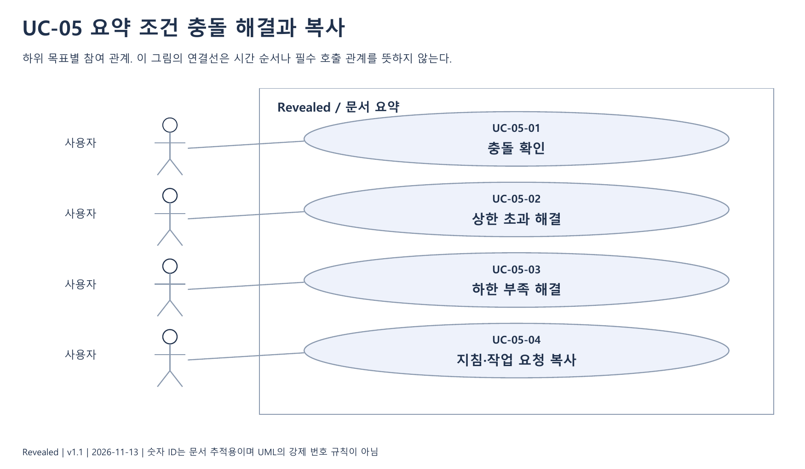

| 명세 항목 | 내용 |
| --- | --- |
| 시스템 / 서브시스템 | Revealed / 문서 요약 |
| UC-ID / 이름 | UC-05 / 요약 조건 충돌 해결과 복사 |
| 단계 / 작성일 / 버전 | 현행 구현 기준 검토용 / 2026-11-13 / v1.2 |
| 개요 | 명시적인 수량 충돌을 해결한 뒤 사용 범위에 맞게 지침을 복사한다. |
| 주요 액터 | 사용자 |
| 사전조건 | 검증된 요약 조건·현재 원문·선택 문장. 충돌 시 허용된 해결값을 사용자가 선택한다. |
| 사후조건 | 원래 조건과 적용 조건을 확인한 재사용 지침 또는 작업용 요청을 얻는다. |
| 추적 관계 | FR-03.2~4 / UI-04 / 주 구현 WBS 3.1 |

### 하위 기능 설명

| 하위 ID | 기능 이름 | 액터·처리 결과 |
| --- | --- | --- |
| UC-05-01 | 충돌 확인 | 사용자 : 완전 발췌의 상한 초과 또는 원문 문장 수의 하한 부족을 확인한다. |
| UC-05-02 | 상한 초과 해결 | 사용자 : 분량 확대·재서술·일부 생략 중 허용된 방법을 명시한다. |
| UC-05-03 | 하한 부족 해결 | 사용자 : 가능한 분량 축소 또는 재서술을 선택하며 문장 반복으로 채우지 않는다. |
| UC-05-04 | 지침·작업 요청 복사 | 사용자 : 원문 없는 재사용 지침과 원문 포함 작업 요청을 구분한다. |

### 기본·대안·예외 흐름

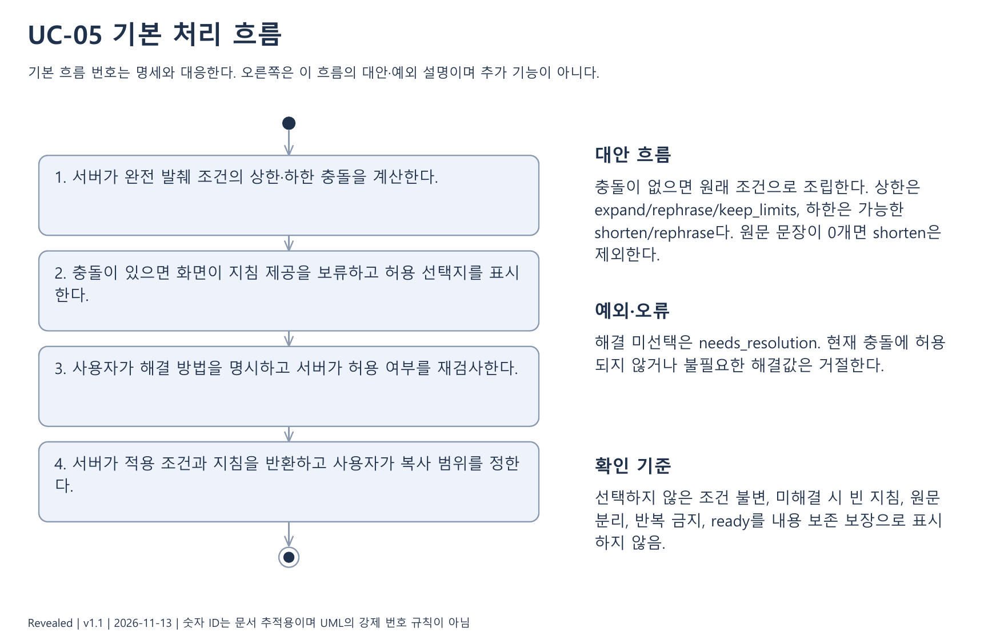

| 흐름 | 설명 |
| --- | --- |
| 1 | 서버가 완전 발췌 조건의 상한·하한 충돌을 계산한다. |
| 2 | 충돌이 있으면 화면이 지침 제공을 보류하고 허용 선택지를 표시한다. |
| 3 | 사용자가 해결 방법을 명시하고 서버가 허용 여부를 재검사한다. |
| 4 | 서버가 적용 조건과 지침을 반환하고 사용자가 복사 범위를 정한다. |
| 대안 | 충돌이 없으면 원래 조건으로 조립한다. 상한은 expand/rephrase/keep_limits, 하한은 가능한 shorten/rephrase다. 원문 문장이 0개면 shorten은 제외한다. |
| 예외 | 해결 미선택은 needs_resolution. 현재 충돌에 허용되지 않거나 불필요한 해결값은 거절한다. |
| 검사 기준 | 선택하지 않은 조건 불변, 미해결 시 빈 지침, 원문 분리, 반복 금지, ready를 내용 보존 보장으로 표시하지 않음. |

### 입력·상태·업무 규칙 상세

입력은 domainKey·profile·sourceText·requiredSentences·resolution이다. 현행 v2는 허용 해결값·원래/적용 조건·분량 경계를 함께 반환한다. 원문 문장이 0개면 축소를 제공하지 않는다. 실제 의미 보존·분량 충족은 새 출력에서 별도 확인한다.

## UC-06 코딩 답변 방식 직접 설정

| 명세 항목 | 내용 |
| --- | --- |
| 시스템 / 서브시스템 | Revealed / 코딩 도움·React 비교 |
| UC-ID / 이름 | UC-06 / 코딩 답변 방식 직접 설정 |
| 단계 / 작성일 / 버전 | 현행 구현 기준 검토용 / 2026-11-13 / v1.2 |
| 개요 | 개발자가 명시한 네 답변 조건을 지침으로 만든다. |
| 주요 액터 | 사용자 |
| 사전조건 | 개발 환경과 설명·주석·구성·출력의 네 선택을 확인한다. |
| 사후조건 | 모델 호출 없이 확인된 환경·조건을 반영한 지침을 얻는다. |
| 추적 관계 | FR-04.1~4 / UI-05, UI-07 / 주 구현 WBS 3.2 |

### 하위 기능 설명

| 하위 ID | 기능 이름 | 액터·처리 결과 |
| --- | --- | --- |
| UC-06-01 | 개발 환경 설정 | 사용자 : 언어와 프레임워크를 정한다. |
| UC-06-02 | 네 답변 조건 선택 | 사용자 : 설명·주석·구성·출력을 직접 선택한다. |
| UC-06-03 | 지침 확인·복사 | 사용자 : 조건 요약과 실제 지침 전문을 확인하고 복사한다. |

### 기본·대안·예외 흐름

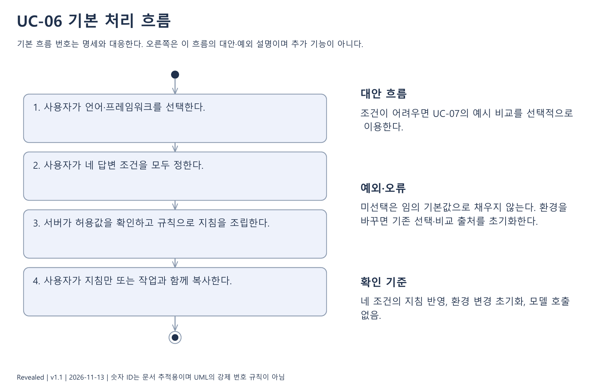

| 흐름 | 설명 |
| --- | --- |
| 1 | 사용자가 언어·프레임워크를 선택한다. |
| 2 | 사용자가 네 답변 조건을 모두 정한다. |
| 3 | 서버가 허용값을 확인하고 규칙으로 지침을 조립한다. |
| 4 | 사용자가 지침만 또는 작업과 함께 복사한다. |
| 대안 | 조건이 어려우면 UC-07의 예시 비교를 선택적으로 이용한다. |
| 예외 | 미선택은 임의 기본값으로 채우지 않는다. 환경을 바꾸면 기존 선택·비교 출처를 초기화한다. |
| 검사 기준 | 네 조건의 지침 반영, 환경 변경 초기화, 모델 호출 없음. |

### 입력·상태·업무 규칙 상세

입력은 language·framework와 explanation/comments/structure/output의 네 값이다. 선택 요약과 실제 지침 전문을 따로 보여 준다. 직접 입력 환경의 조립 지원과 준비 예시·실행 평가 지원은 다르다.

## UC-07 코딩 준비 예시 비교

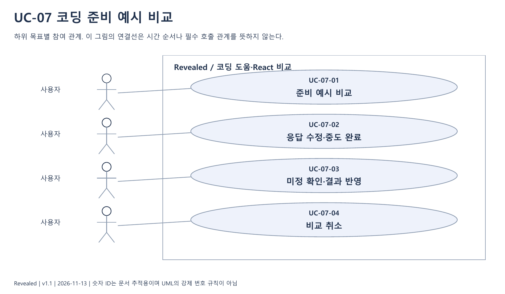

| 명세 항목 | 내용 |
| --- | --- |
| 시스템 / 서브시스템 | Revealed / 코딩 도움·React 비교 |
| UC-ID / 이름 | UC-07 / 코딩 준비 예시 비교 |
| 단계 / 작성일 / 버전 | 현행 구현 기준 검토용 / 2026-11-13 / v1.2 |
| 개요 | 준비된 예시로 네 코딩 답변 조건을 이해하고 확인한다. |
| 주요 액터 | 사용자 |
| 사전조건 | 준비 예시를 지원하는 개발 환경. 기존 직접 설정 상태를 보존한다. |
| 사후조건 | 확인한 예시 결과만 직접 설정에 반영되거나 취소 시 이전 상태로 돌아간다. |
| 추적 관계 | FR-06.1~4 / UI-06, UI-07 / 주 구현 WBS 3.2 |

### 하위 기능 설명

| 하위 ID | 기능 이름 | 액터·처리 결과 |
| --- | --- | --- |
| UC-07-01 | 준비 예시 비교 | 사용자 : 실제 요청 코드 생성과 구별한 A/B 전문을 확인한다. |
| UC-07-02 | 응답 수정·중도 완료 | 사용자 : 1회 이상 후 종료 가능하며 최대 8회. 이전 응답 변경 시 후속 기록을 지운다. |
| UC-07-03 | 미정 확인·결과 반영 | 사용자 : 엇갈림·미응답은 직접 확인한 후 완료한다. |
| UC-07-04 | 비교 취소 | 사용자 : 진입 전 선택과 생성문을 유지한다. |

### 기본·대안·예외 흐름

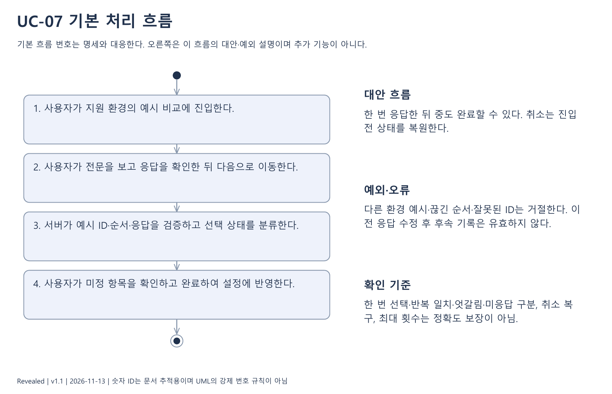

| 흐름 | 설명 |
| --- | --- |
| 1 | 사용자가 지원 환경의 예시 비교에 진입한다. |
| 2 | 사용자가 전문을 보고 응답을 확인한 뒤 다음으로 이동한다. |
| 3 | 서버가 예시 ID·순서·응답을 검증하고 선택 상태를 분류한다. |
| 4 | 사용자가 미정 항목을 확인하고 완료하여 설정에 반영한다. |
| 대안 | 한 번 응답한 뒤 중도 완료할 수 있다. 취소는 진입 전 상태를 복원한다. |
| 예외 | 다른 환경 예시·끊긴 순서·잘못된 ID는 거절한다. 이전 응답 수정 후 후속 기록은 유효하지 않다. |
| 검사 기준 | 한 번 선택·반복 일치·엇갈림·미응답 구분, 취소 복구, 최대 횟수는 정확도 보장이 아님. |

### 입력·상태·업무 규칙 상세

입력은 예시 ID·개발 환경·연속 응답 이력이다. 완료 전에는 기존 직접 설정을 덮어쓰지 않는다. 예시 비교의 신호 분류는 기존 비교 엔진의 통계적 신호와 별도이며 과거 기록은 원래 버전 규칙으로 읽는다.

## UC-08 React 코드 스타일 비교

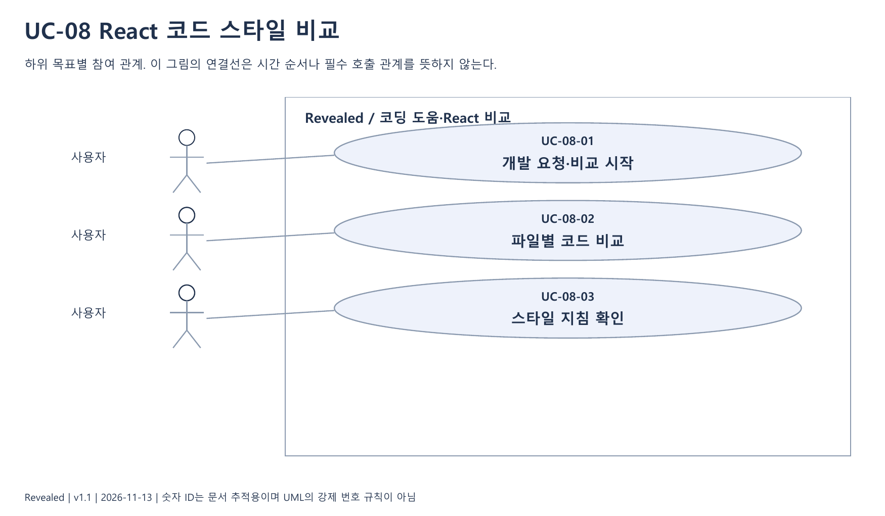

| 명세 항목 | 내용 |
| --- | --- |
| 시스템 / 서브시스템 | Revealed / 코딩 도움·React 비교 |
| UC-ID / 이름 | UC-08 / React 코드 스타일 비교 |
| 단계 / 작성일 / 버전 | 현행 구현 기준 검토용 / 2026-11-13 / v1.2 |
| 개요 | React 코드의 파일 구성·스타일 관리·타입 작성 조건을 비교한다. |
| 주요 액터 | 사용자 |
| 사전조건 | TypeScript/React 스타일 비교 도메인과 개발 요청. 네 답변 조건과 별도 경로. |
| 사후조건 | 세 스타일 축의 신호·이력과 최종 지침을 확인한다. |
| 추적 관계 | FR-05.1~3 / UI-08 / 주 구현 WBS 3.2 |

### 하위 기능 설명

| 하위 ID | 기능 이름 | 액터·처리 결과 |
| --- | --- | --- |
| UC-08-01 | 개발 요청·비교 시작 | 사용자 : 데모의 준비 과제와 입력 요청이 다를 수 있음을 확인한다. |
| UC-08-02 | 파일별 코드 비교 | 사용자 : 전체 파일과 A/B 차이를 읽고 응답한다. |
| UC-08-03 | 스타일 지침 확인 | 사용자 : 세 축의 결과와 미정 항목을 확인한다. |

### 기본·대안·예외 흐름

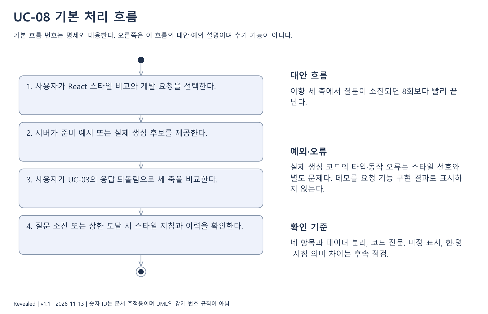

| 흐름 | 설명 |
| --- | --- |
| 1 | 사용자가 React 스타일 비교와 개발 요청을 선택한다. |
| 2 | 서버가 준비 예시 또는 실제 생성 후보를 제공한다. |
| 3 | 사용자가 UC-03의 응답·되돌림으로 세 축을 비교한다. |
| 4 | 질문 소진 또는 상한 도달 시 스타일 지침과 이력을 확인한다. |
| 대안 | 이항 세 축에서 질문이 소진되면 8회보다 빨리 끝난다. |
| 예외 | 실제 생성 코드의 타입·동작 오류는 스타일 선호와 별도 문제다. 데모를 요청 기능 구현 결과로 표시하지 않는다. |
| 검사 기준 | 네 항목과 데이터 분리, 코드 전문, 미정 표시, 한·영 지침 의미 차이는 후속 점검. |

### 입력·상태·업무 규칙 상세

입력은 TypeScript/React 개발 요청과 비교 응답이다. 파일 구성·스타일 관리·타입 작성 세 축의 지침과 이력을 반환한다. 실제 후보 코드의 실행 품질과 스타일 적합성은 따로 확인한다. 기존 새 과제 실험과 언어 차이의 한계는 9장에 기록한다.

## UC-09 개인 지침 저장·수정·삭제

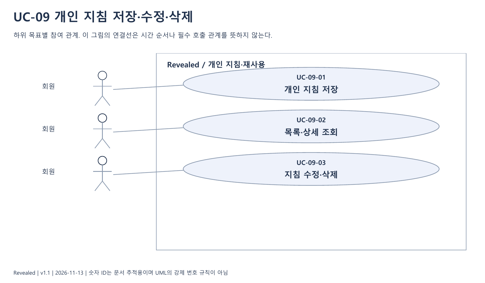

| 명세 항목 | 내용 |
| --- | --- |
| 시스템 / 서브시스템 | Revealed / 개인 지침·재사용 |
| UC-ID / 이름 | UC-09 / 개인 지침 저장·수정·삭제 |
| 단계 / 작성일 / 버전 | 현행 구현 기준 검토용 / 2026-11-13 / v1.2 |
| 개요 | 개인 지침을 계정 보관함에서 관리한다. |
| 주요 액터 | 회원 |
| 사전조건 | 로그인과 소유권. 수정·삭제에는 현재 revision. |
| 사후조건 | 목록·상세가 같은 저장 버전을 표시하며 타 계정은 접근하지 못한다. |
| 추적 관계 | FR-07.1~4 / UI-09 / 주 구현 WBS 3.3 |

### 하위 기능 설명

| 하위 ID | 기능 이름 | 액터·처리 결과 |
| --- | --- | --- |
| UC-09-01 | 개인 지침 저장 | 회원 : 제목·분류·본문·설정 스냅샷을 새 항목으로 저장한다. |
| UC-09-02 | 목록·상세 조회 | 회원 : 자신의 보관함과 출처를 확인한다. |
| UC-09-03 | 지침 수정·삭제 | 회원 : 현재 revision을 확인하고 변경한다. |

### 기본·대안·예외 흐름

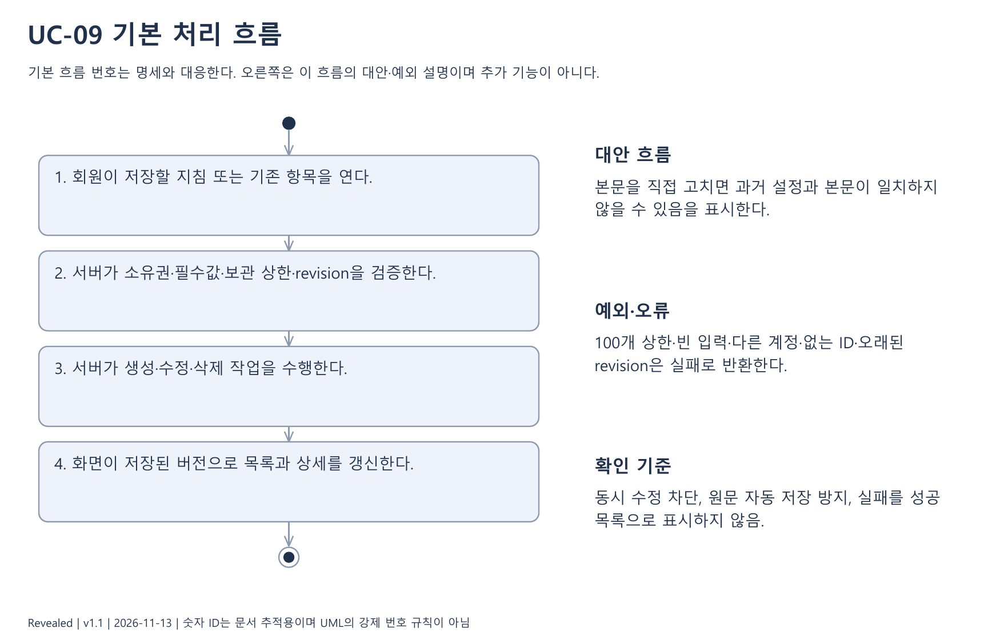

| 흐름 | 설명 |
| --- | --- |
| 1 | 회원이 저장할 지침 또는 기존 항목을 연다. |
| 2 | 서버가 소유권·필수값·보관 상한·revision을 검증한다. |
| 3 | 서버가 생성·수정·삭제 작업을 수행한다. |
| 4 | 화면이 저장된 버전으로 목록과 상세를 갱신한다. |
| 대안 | 본문을 직접 고치면 과거 설정과 본문이 일치하지 않을 수 있음을 표시한다. |
| 예외 | 100개 상한·빈 입력·다른 계정·없는 ID·오래된 revision은 실패로 반환한다. |
| 검사 기준 | 동시 수정 차단, 원문 자동 저장 방지, 실패를 성공 목록으로 표시하지 않음. |

### 입력·상태·업무 규칙 상세

입력은 제목·분류·본문·선택 메모/설정이다. 생성 시 revision 1, 수정 시 새 revision을 남긴다. 직접 편집한 본문을 과거 설정과 항상 동일하다고 표시하지 않는다. 보관 개수는 계정당 100개다.

## UC-10 저장 지침을 새 작업에 사용

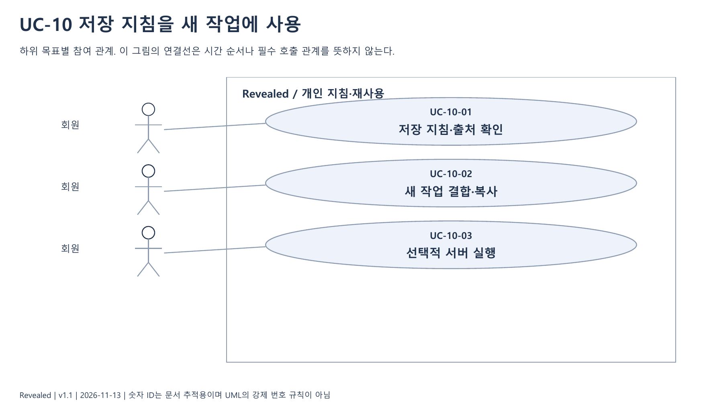

| 명세 항목 | 내용 |
| --- | --- |
| 시스템 / 서브시스템 | Revealed / 개인 지침·재사용 |
| UC-ID / 이름 | UC-10 / 저장 지침을 새 작업에 사용 |
| 단계 / 작성일 / 버전 | 현행 구현 기준 검토용 / 2026-11-13 / v1.2 |
| 개요 | 저장된 지침을 새 요청에 결합해 재사용한다. |
| 주요 액터 | 회원 |
| 사전조건 | 접근 가능한 저장 지침과 새 작업 입력. 서버 모델 실행은 별도 활성화·키·한도 필요. |
| 사후조건 | 원본을 바꾸지 않은 작업 요청 또는 명시적 서버 실행 응답을 얻는다. |
| 추적 관계 | FR-07.3, FR-15.1 / UI-09 / 주 구현 WBS 3.3 |

### 하위 기능 설명

| 하위 ID | 기능 이름 | 액터·처리 결과 |
| --- | --- | --- |
| UC-10-01 | 저장 지침·출처 확인 | 회원 : 원본 설정과 현재 본문을 확인한다. |
| UC-10-02 | 새 작업 결합·복사 | 회원 : 이번 입력과 지침을 조합하여 복사한다. |
| UC-10-03 | 선택적 서버 실행 | 회원 : 활성화된 모델 경로를 명시적으로 요청한다. 비용이 발생할 수 있다. |

### 기본·대안·예외 흐름

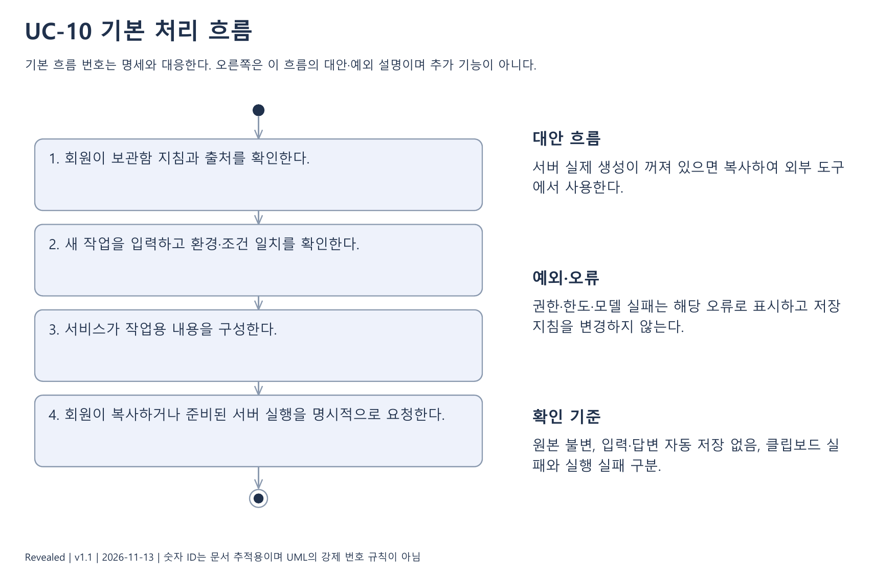

| 흐름 | 설명 |
| --- | --- |
| 1 | 회원이 보관함 지침과 출처를 확인한다. |
| 2 | 새 작업을 입력하고 환경·조건 일치를 확인한다. |
| 3 | 서비스가 작업용 내용을 구성한다. |
| 4 | 회원이 복사하거나 준비된 서버 실행을 명시적으로 요청한다. |
| 대안 | 서버 실제 생성이 꺼져 있으면 복사하여 외부 도구에서 사용한다. |
| 예외 | 권한·한도·모델 실패는 해당 오류로 표시하고 저장 지침을 변경하지 않는다. |
| 검사 기준 | 원본 불변, 입력·답변 자동 저장 없음, 클립보드 실패와 실행 실패 구분. |

### 입력·상태·업무 규칙 상세

복사는 지침과 새 입력의 결합이다. 선택적 /api/preferences/{id}/run은 LIVE·키·quota를 확인하는 별도 모델 실행이며 실패 시 502 등을 반환한다. 이 동작만으로 입력·답변이나 보관함 원본을 자동 저장하지 않는다.

## UC-11 팀 만들기·초대·참여

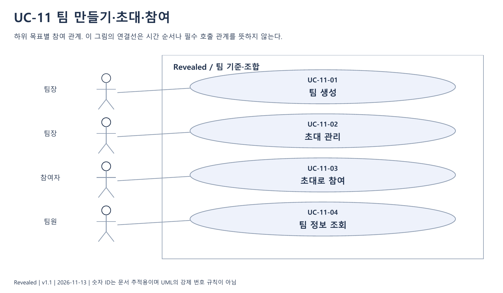

| 명세 항목 | 내용 |
| --- | --- |
| 시스템 / 서브시스템 | Revealed / 팀 기준·조합 |
| UC-ID / 이름 | UC-11 / 팀 만들기·초대·참여 |
| 단계 / 작성일 / 버전 | 현행 구현 기준 검토용 / 2026-11-13 / v1.2 |
| 개요 | 계정 팀을 만들고 유효한 초대로 참여한다. |
| 주요 액터 | 팀장 / 참여자 / 팀원 |
| 사전조건 | 계정 팀은 로그인. 익명 체험 팀은 별도 공개 체험 범위. |
| 사후조건 | 팀과 참여 관계가 생성되며 계정 팀의 비공개 범위가 유지된다. |
| 추적 관계 | FR-08.1~3 / UI-12 / 주 구현 WBS 3.4 |

### 하위 기능 설명

| 하위 ID | 기능 이름 | 액터·처리 결과 |
| --- | --- | --- |
| UC-11-01 | 팀 생성 | 팀장 : 이름과 종류·기준을 정하고 팀을 만든다. |
| UC-11-02 | 초대 관리 | 팀장 : 초대 링크를 전달하고 닫거나 같은 링크를 재개한다. |
| UC-11-03 | 초대로 참여 | 참여자 : 로그인과 열린 초대·7일 유효기간을 확인한다. |
| UC-11-04 | 팀 정보 조회 | 팀원 : 참여 권한 범위의 이름·기준을 조회한다. |

### 기본·대안·예외 흐름

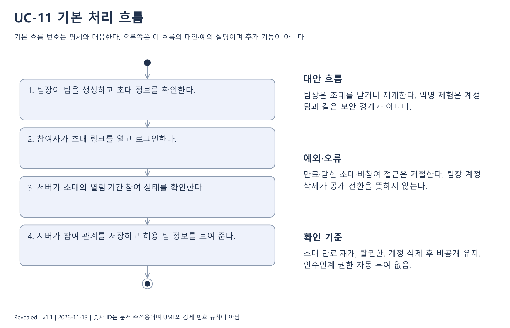

| 흐름 | 설명 |
| --- | --- |
| 1 | 팀장이 팀을 생성하고 초대 정보를 확인한다. |
| 2 | 참여자가 초대 링크를 열고 로그인한다. |
| 3 | 서버가 초대의 열림·기간·참여 상태를 확인한다. |
| 4 | 서버가 참여 관계를 저장하고 허용 팀 정보를 보여 준다. |
| 대안 | 팀장은 초대를 닫거나 재개한다. 익명 체험은 계정 팀과 같은 보안 경계가 아니다. |
| 예외 | 만료·닫힌 초대·비참여 접근은 거절한다. 팀장 계정 삭제가 공개 전환을 뜻하지 않는다. |
| 검사 기준 | 초대 만료·재개, 탈권한, 계정 삭제 후 비공개 유지, 인수인계 권한 자동 부여 없음. |

### 입력·상태·업무 규칙 상세

입력은 팀 이름·종류·기준과 초대 정보다. 닫힌 초대 재개는 같은 링크를 다시 여는 동작이다. 계정 팀은 생성자 삭제 뒤에도 비공개를 유지한다. 30일 미참여 자동 정리는 익명 체험 팀에만 적용한다.

## UC-12 기존 요약·React 팀 기준 합치기

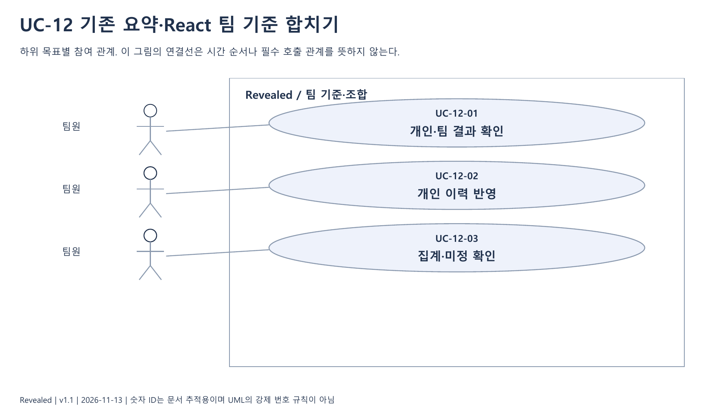

| 명세 항목 | 내용 |
| --- | --- |
| 시스템 / 서브시스템 | Revealed / 팀 기준·조합 |
| UC-ID / 이름 | UC-12 / 기존 요약·React 팀 기준 합치기 |
| 단계 / 작성일 / 버전 | 현행 구현 기준 검토용 / 2026-11-13 / v1.2 |
| 개요 | 동일 도메인의 개인 비교 이력을 팀 결과에 명시적으로 반영한다. |
| 주요 액터 | 팀원 |
| 사전조건 | 지원 요약·React 도메인의 팀, 참여 권한, 개인 비교 이력. |
| 사후조건 | 집계 신호와 팀 지침이 갱신되며 동률·신호 없음이 드러난다. |
| 추적 관계 | FR-08.1 / UI-12 / 주 구현 WBS 3.4 |

### 하위 기능 설명

| 하위 ID | 기능 이름 | 액터·처리 결과 |
| --- | --- | --- |
| UC-12-01 | 개인·팀 결과 확인 | 팀원 : 같은 도메인의 현재 결과를 확인한다. |
| UC-12-02 | 개인 이력 반영 | 팀원 : 자동 합산하지 않고 명시적으로 합치기를 요청한다. |
| UC-12-03 | 집계·미정 확인 | 팀원 : 집계 지침과 동률·신호 없음을 확인한다. |

### 기본·대안·예외 흐름

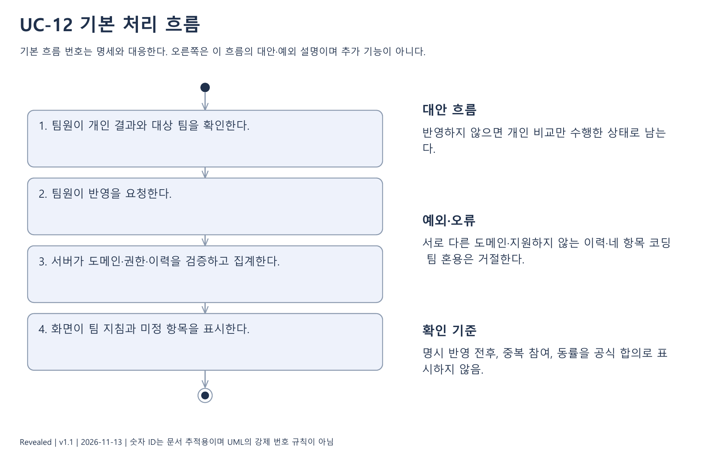

| 흐름 | 설명 |
| --- | --- |
| 1 | 팀원이 개인 결과와 대상 팀을 확인한다. |
| 2 | 팀원이 반영을 요청한다. |
| 3 | 서버가 도메인·권한·이력을 검증하고 집계한다. |
| 4 | 화면이 팀 지침과 미정 항목을 표시한다. |
| 대안 | 반영하지 않으면 개인 비교만 수행한 상태로 남는다. |
| 예외 | 서로 다른 도메인·지원하지 않는 이력·네 항목 코딩 팀 혼용은 거절한다. |
| 검사 기준 | 명시 반영 전후, 중복 참여, 동률을 공식 합의로 표시하지 않음. |

### 입력·상태·업무 규칙 상세

입력은 지원 도메인의 개인 비교 이력과 대상 팀이다. 집계는 이력의 효용을 합쳐 팀 지침을 계산하는 방식이며 조직의 공식 승인이나 강제 규칙이 아니다. 개인 비교만으로 자동 합산하지 않는다.

## UC-13 네 항목 코딩 팀 기준 생성·수정

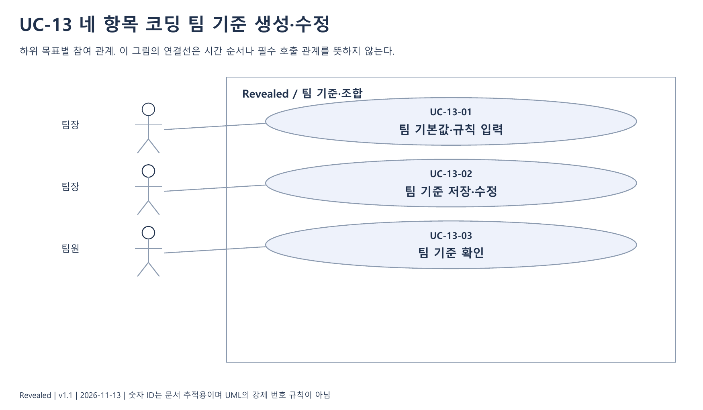

| 명세 항목 | 내용 |
| --- | --- |
| 시스템 / 서브시스템 | Revealed / 팀 기준·조합 |
| UC-ID / 이름 | UC-13 / 네 항목 코딩 팀 기준 생성·수정 |
| 단계 / 작성일 / 버전 | 현행 구현 기준 검토용 / 2026-11-13 / v1.2 |
| 개요 | 팀장이 네 코딩 답변 기본값과 필수 규칙을 정한다. |
| 주요 액터 | 팀장 / 팀원 |
| 사전조건 | coding_profile 계정 팀과 팀장 권한. 수정 시 현재 revision. |
| 사후조건 | 팀 기준의 새 버전이 저장되고 팀원이 허용 범위에서 조회한다. |
| 추적 관계 | FR-08.2,4 / UI-12 / 주 구현 WBS 3.4 |

### 하위 기능 설명

| 하위 ID | 기능 이름 | 액터·처리 결과 |
| --- | --- | --- |
| UC-13-01 | 팀 기본값·규칙 입력 | 팀장 : 환경·네 조건·필수 규칙을 명시한다. |
| UC-13-02 | 팀 기준 저장·수정 | 팀장 : 권한과 revision을 검증해 저장한다. |
| UC-13-03 | 팀 기준 확인 | 팀원 : 개인 메모나 예시 이력을 제외한 팀 기준을 확인한다. |

### 기본·대안·예외 흐름

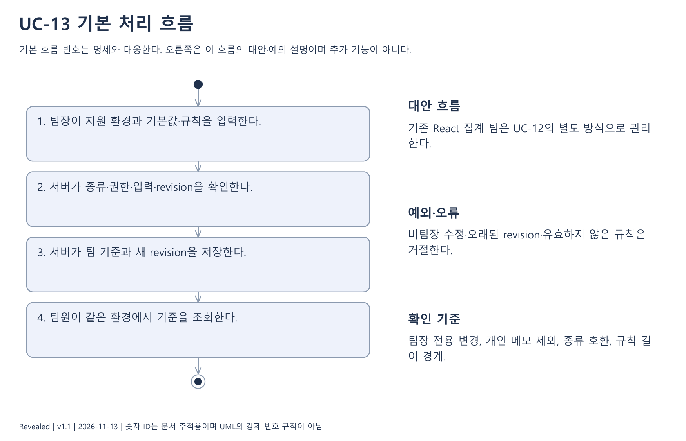

| 흐름 | 설명 |
| --- | --- |
| 1 | 팀장이 지원 환경과 기본값·규칙을 입력한다. |
| 2 | 서버가 종류·권한·입력·revision을 확인한다. |
| 3 | 서버가 팀 기준과 새 revision을 저장한다. |
| 4 | 팀원이 같은 환경에서 기준을 조회한다. |
| 대안 | 기존 React 집계 팀은 UC-12의 별도 방식으로 관리한다. |
| 예외 | 비팀장 수정·오래된 revision·유효하지 않은 규칙은 거절한다. |
| 검사 기준 | 팀장 전용 변경, 개인 메모 제외, 종류 호환, 규칙 길이 경계. |

### 입력·상태·업무 규칙 상세

입력은 팀 개발 환경·네 기본값·필수 규칙·revision이다. coding_profile 계정 팀만 이 경로로 관리한다. 개인 추가 메모와 예시 이력은 팀 기본값에 노출하지 않는다.

## UC-14 개인·팀 기준으로 작업용 조합

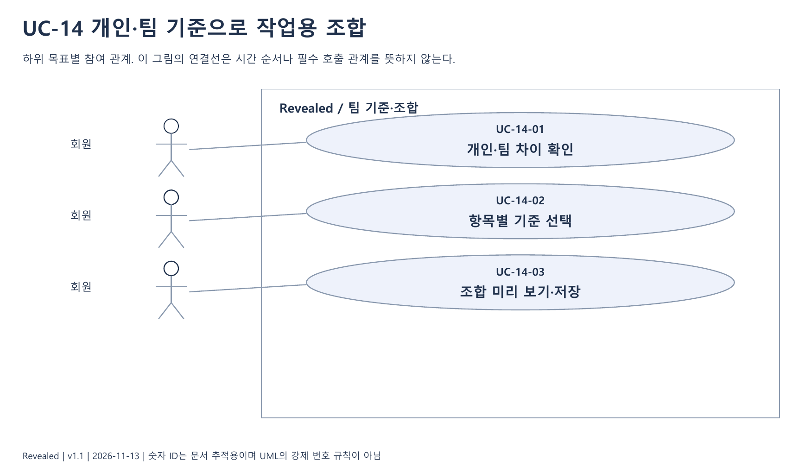

| 명세 항목 | 내용 |
| --- | --- |
| 시스템 / 서브시스템 | Revealed / 팀 기준·조합 |
| UC-ID / 이름 | UC-14 / 개인·팀 기준으로 작업용 조합 |
| 단계 / 작성일 / 버전 | 현행 구현 기준 검토용 / 2026-11-13 / v1.2 |
| 개요 | 개인과 팀 기준에서 이번 작업에 따를 값을 선택한다. |
| 주요 액터 | 회원 |
| 사전조건 | 접근 가능한 같은 분류·환경의 개인/팀 기준과 현재 버전. |
| 사후조건 | 원본을 보존한 작업용 지침과 출처 스냅샷을 얻는다. |
| 추적 관계 | FR-08.4~5 / UI-10 / 주 구현 WBS 3.4 |

### 하위 기능 설명

| 하위 ID | 기능 이름 | 액터·처리 결과 |
| --- | --- | --- |
| UC-14-01 | 개인·팀 차이 확인 | 회원 : 같은 항목과 다른 항목을 구분한다. |
| UC-14-02 | 항목별 기준 선택 | 회원 : 차이가 있는 항목의 개인·팀 값을 직접 고른다. |
| UC-14-03 | 조합 미리 보기·저장 | 회원 : 최신 기준으로 재조합한 뒤 복사하거나 새 항목으로 저장한다. |

### 기본·대안·예외 흐름

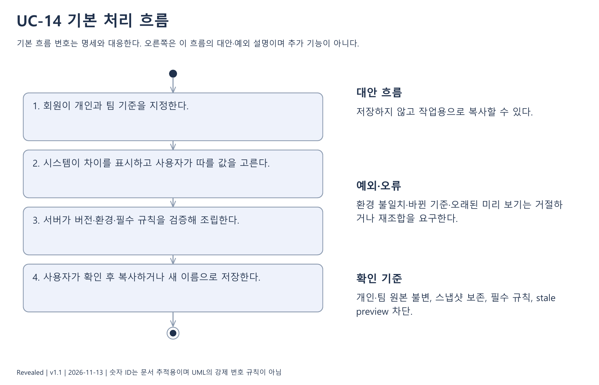

| 흐름 | 설명 |
| --- | --- |
| 1 | 회원이 개인과 팀 기준을 지정한다. |
| 2 | 시스템이 차이를 표시하고 사용자가 따를 값을 고른다. |
| 3 | 서버가 버전·환경·필수 규칙을 검증해 조립한다. |
| 4 | 사용자가 확인 후 복사하거나 새 이름으로 저장한다. |
| 대안 | 저장하지 않고 작업용으로 복사할 수 있다. |
| 예외 | 환경 불일치·바뀐 기준·오래된 미리 보기는 거절하거나 재조합을 요구한다. |
| 검사 기준 | 개인·팀 원본 불변, 스냅샷 보존, 필수 규칙, stale preview 차단. |

### 입력·상태·업무 규칙 상세

입력은 양쪽 기준 ID·버전과 항목별 선택이다. 미리 보기 이후 기준이나 선택이 바뀌면 재조합한다. 저장은 새 개인 항목이며 값·이름·출처·기준 버전을 당시 스냅샷으로 남긴다.

## UC-15 재조합·일부 되돌림·이력 열람

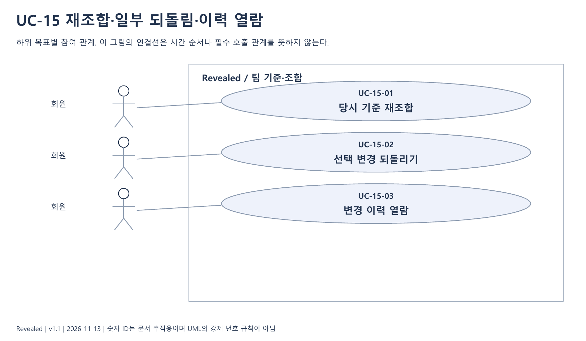

| 명세 항목 | 내용 |
| --- | --- |
| 시스템 / 서브시스템 | Revealed / 팀 기준·조합 |
| UC-ID / 이름 | UC-15 / 재조합·일부 되돌림·이력 열람 |
| 단계 / 작성일 / 버전 | 현행 구현 기준 검토용 / 2026-11-13 / v1.2 |
| 개요 | 저장 당시 출처를 바탕으로 재조합하거나 일부 변경을 되돌린다. |
| 주요 액터 | 회원 |
| 사전조건 | 접근 가능한 작업용 항목과 당시 값·출처 스냅샷. |
| 사후조건 | 기존 항목을 보존한 새 지침과 직전 항목 연결을 얻는다. |
| 추적 관계 | FR-09.1~3 / UI-11 / 주 구현 WBS 3.4 |

### 하위 기능 설명

| 하위 ID | 기능 이름 | 액터·처리 결과 |
| --- | --- | --- |
| UC-15-01 | 당시 기준 재조합 | 회원 : 저장 시점의 개인·팀 값으로 다시 고른다. |
| UC-15-02 | 선택 변경 되돌리기 | 회원 : 고른 항목만 이전 값·출처로 복원한다. |
| UC-15-03 | 변경 이력 열람 | 회원 : 직전 항목과 변경 비교를 권한 범위에서 확인한다. |

### 기본·대안·예외 흐름

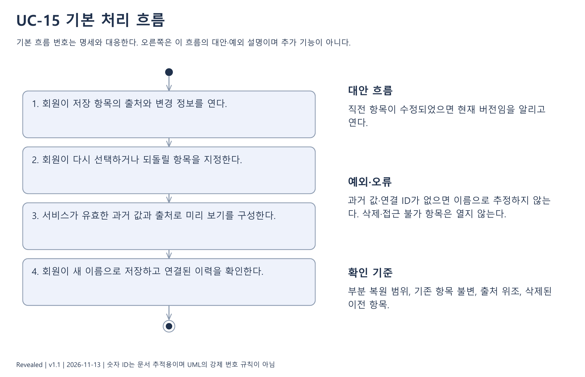

| 흐름 | 설명 |
| --- | --- |
| 1 | 회원이 저장 항목의 출처와 변경 정보를 연다. |
| 2 | 회원이 다시 선택하거나 되돌릴 항목을 지정한다. |
| 3 | 서비스가 유효한 과거 값과 출처로 미리 보기를 구성한다. |
| 4 | 회원이 새 이름으로 저장하고 연결된 이력을 확인한다. |
| 대안 | 직전 항목이 수정되었으면 현재 버전임을 알리고 연다. |
| 예외 | 과거 값·연결 ID가 없으면 이름으로 추정하지 않는다. 삭제·접근 불가 항목은 열지 않는다. |
| 검사 기준 | 부분 복원 범위, 기존 항목 불변, 출처 위조, 삭제된 이전 항목. |

### 입력·상태·업무 규칙 상세

입력은 저장 항목·당시 출처와 되돌릴 항목이다. 새 항목에 직전 ID와 변경 비교를 연결한다. 과거 값이 없는 기록은 추측으로 복원하지 않으며 삭제된 원본과 저장 당시 스냅샷을 구별한다.

## UC-16 인수인계 작성·개인 저장

| 명세 항목 | 내용 |
| --- | --- |
| 시스템 / 서브시스템 | Revealed / 작업 인수인계 |
| UC-ID / 이름 | UC-16 / 인수인계 작성·개인 저장 |
| 단계 / 작성일 / 버전 | 현행 구현 기준 검토용 / 2026-11-13 / v1.2 |
| 개요 | 진행 업무를 인수인계 초안으로 정리하고 개인 저장한다. |
| 주요 액터 | 작성자 |
| 사전조건 | 로그인과 필수 제목·작업 내용. 수정 시 현재 revision. |
| 사후조건 | 개인 draft와 revision이 저장된다. 저장만으로 공유되지 않는다. |
| 추적 관계 | FR-10.1, FR-12.1 / UI-13 / 주 구현 WBS 3.4 |

### 하위 기능 설명

| 하위 ID | 기능 이름 | 액터·처리 결과 |
| --- | --- | --- |
| UC-16-01 | 업무·지침 작성 | 작성자 : 목적·진행·남은 일·자료·지침 사본을 정리한다. |
| UC-16-02 | 개인 초안 저장 | 작성자 : 검증된 내용으로 draft를 생성·수정한다. |
| UC-16-03 | 임시 초안 복구 | 작성자 : 계정별 작성 중 내용을 복구하며 서버 저장과 구분한다. |

### 기본·대안·예외 흐름

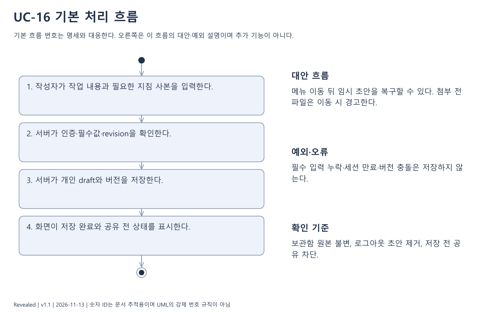

| 흐름 | 설명 |
| --- | --- |
| 1 | 작성자가 작업 내용과 필요한 지침 사본을 입력한다. |
| 2 | 서버가 인증·필수값·revision을 확인한다. |
| 3 | 서버가 개인 draft와 버전을 저장한다. |
| 4 | 화면이 저장 완료와 공유 전 상태를 표시한다. |
| 대안 | 메뉴 이동 뒤 임시 초안을 복구할 수 있다. 첨부 전 파일은 이동 시 경고한다. |
| 예외 | 필수 입력 누락·세션 만료·버전 충돌은 저장하지 않는다. |
| 검사 기준 | 보관함 원본 불변, 로그아웃 초안 제거, 저장 전 공유 차단. |

### 입력·상태·업무 규칙 상세

입력은 제목·목적·진행·남은 일·자료·사용 지침이다. 지침 연결은 현재 본문 사본이며 원본을 수정하지 않는다. 계정별 임시 초안과 서버 저장 draft를 구분하고 저장 전 파일은 복구된 첨부로 표시하지 않는다.

## UC-17 인수인계 공유·이어받기·완료

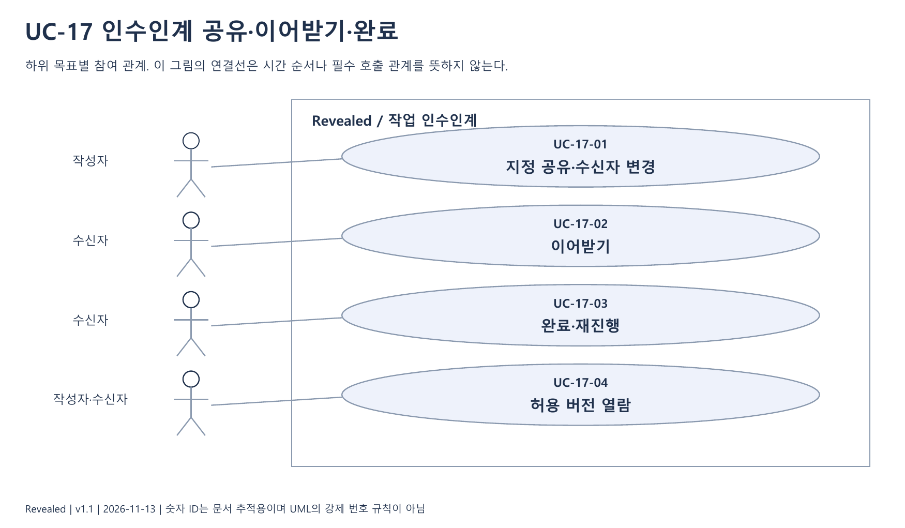

| 명세 항목 | 내용 |
| --- | --- |
| 시스템 / 서브시스템 | Revealed / 작업 인수인계 |
| UC-ID / 이름 | UC-17 / 인수인계 공유·이어받기·완료 |
| 단계 / 작성일 / 버전 | 현행 구현 기준 검토용 / 2026-11-13 / v1.2 |
| 개요 | 지정 계정에 업무를 공유하고 이어받기·완료 상태를 관리한다. |
| 주요 액터 | 작성자 / 수신자 / 작성자·수신자 |
| 사전조건 | 저장된 인수인계와 현재 역할·상태·revision. |
| 사후조건 | 허용된 상태 전이와 이력이 저장되고 현재 접근 권한이 맞게 바뀐다. |
| 추적 관계 | FR-10.2~4 / UI-13, UI-14 / 주 구현 WBS 3.4 |

### 하위 기능 설명

| 하위 ID | 기능 이름 | 액터·처리 결과 |
| --- | --- | --- |
| UC-17-01 | 지정 공유·수신자 변경 | 작성자 : draft를 shared로 만들거나 대기 중 수신자를 변경한다. |
| UC-17-02 | 이어받기 | 수신자 : 자신에게 공유된 작업을 active로 바꾼다. |
| UC-17-03 | 완료·재진행 | 수신자 : active→done 또는 done→active 전이를 수행한다. |
| UC-17-04 | 허용 버전 열람 | 작성자·수신자 : 현재 권한과 공유 시작점 이후의 버전을 확인한다. |

### 기본·대안·예외 흐름

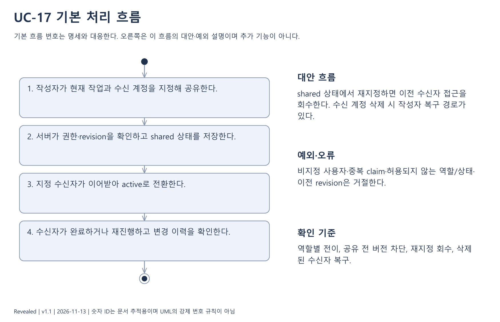

| 흐름 | 설명 |
| --- | --- |
| 1 | 작성자가 현재 작업과 수신 계정을 지정해 공유한다. |
| 2 | 서버가 권한·revision을 확인하고 shared 상태를 저장한다. |
| 3 | 지정 수신자가 이어받아 active로 전환한다. |
| 4 | 수신자가 완료하거나 재진행하고 변경 이력을 확인한다. |
| 대안 | shared 상태에서 재지정하면 이전 수신자 접근을 회수한다. 수신 계정 삭제 시 작성자 복구 경로가 있다. |
| 예외 | 비지정 사용자·중복 claim·허용되지 않는 역할/상태·이전 revision은 거절한다. |
| 검사 기준 | 역할별 전이, 공유 전 버전 차단, 재지정 회수, 삭제된 수신자 복구. |

### 입력·상태·업무 규칙 상세

전이는 작성자의 draft→shared, shared에서 재지정, 수신자의 shared→active→done 및 done→active다. 수신 계정이 삭제되어 recipient_id가 NULL이면 작성자가 복구·재공유할 수 있고 shared로 돌아간다. 버전 열람에는 현재 권한과 공유 시작 revision을 함께 적용한다.

## UC-18 인수인계 파일 첨부·제외·열기

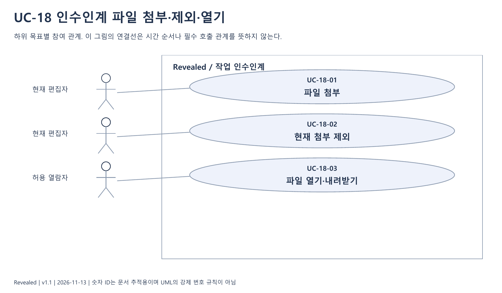

| 명세 항목 | 내용 |
| --- | --- |
| 시스템 / 서브시스템 | Revealed / 작업 인수인계 |
| UC-ID / 이름 | UC-18 / 인수인계 파일 첨부·제외·열기 |
| 단계 / 작성일 / 버전 | 현행 구현 기준 검토용 / 2026-11-13 / v1.2 |
| 개요 | 허용된 인수인계 파일을 첨부·제외·조회한다. |
| 주요 액터 | 현재 편집자 / 허용 열람자 |
| 사전조건 | 저장된 작업 ID·현재 편집 권한·revision. 조회에도 현재 권한 필요. |
| 사후조건 | 파일 변경 버전이 저장되거나 권한 범위의 파일이 제공된다. |
| 추적 관계 | FR-11.1~3 / UI-14 / 주 구현 WBS 3.4 |

### 하위 기능 설명

| 하위 ID | 기능 이름 | 액터·처리 결과 |
| --- | --- | --- |
| UC-18-01 | 파일 첨부 | 현재 편집자 : 5MiB/파일, 현재 10개, 과거 포함 20MiB/작업을 검사한다. |
| UC-18-02 | 현재 첨부 제외 | 현재 편집자 : 새 버전에서 제외하되 과거 보존 용량은 유지한다. |
| UC-18-03 | 파일 열기·내려받기 | 허용 열람자 : 요청 버전의 목록과 현재 권한을 모두 검사한다. |

### 기본·대안·예외 흐름

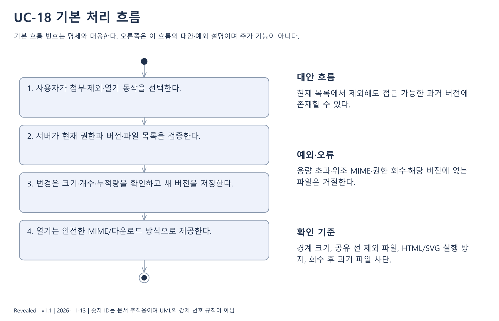

| 흐름 | 설명 |
| --- | --- |
| 1 | 사용자가 첨부·제외·열기 동작을 선택한다. |
| 2 | 서버가 현재 권한과 버전·파일 목록을 검증한다. |
| 3 | 변경은 크기·개수·누적량을 확인하고 새 버전을 저장한다. |
| 4 | 열기는 안전한 MIME/다운로드 방식으로 제공한다. |
| 대안 | 현재 목록에서 제외해도 접근 가능한 과거 버전에 존재할 수 있다. |
| 예외 | 용량 초과·위조 MIME·권한 회수·해당 버전에 없는 파일은 거절한다. |
| 검사 기준 | 경계 크기, 공유 전 제외 파일, HTML/SVG 실행 방지, 회수 후 과거 파일 차단. |

### 입력·상태·업무 규칙 상세

입력은 작업 ID·revision·파일명·바이트다. 파일 원본은 BLOB, 추가·제외는 새 버전으로 남긴다. 현재 제외한 파일도 과거 보존 용량에 포함되며 열기는 요청 버전의 파일 목록과 현재 계정 권한을 모두 확인한다.

## UC-19 선택적 코딩 개선 시작·조회

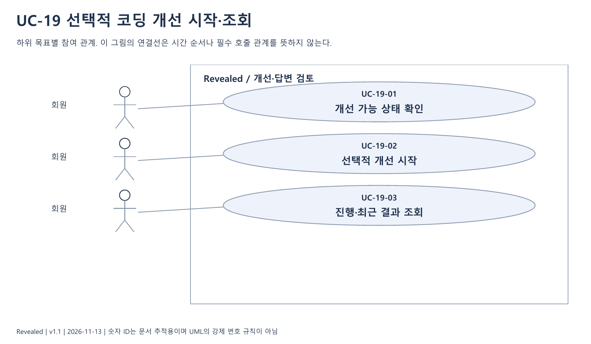

| 명세 항목 | 내용 |
| --- | --- |
| 시스템 / 서브시스템 | Revealed / 개선·답변 검토 |
| UC-ID / 이름 | UC-19 / 선택적 코딩 개선 시작·조회 |
| 단계 / 작성일 / 버전 | 현행 구현 기준 검토용 / 2026-11-13 / v1.2 |
| 개요 | 준비된 환경에서만 선택적 코딩 개선을 시작하고 진행을 조회한다. |
| 주요 액터 | 회원 |
| 사전조건 | 회원, 지원 프로필·도구·모델 설정·사용량. 실제 실행은 비용 발생 가능. |
| 사후조건 | 원본이 고정된 작업 ID와 진행·완료·실패 상태를 얻는다. |
| 추적 관계 | FR-13.1~2, FR-12.2 / UI-15 / 주 구현 WBS 3.3 |

### 하위 기능 설명

| 하위 ID | 기능 이름 | 액터·처리 결과 |
| --- | --- | --- |
| UC-19-01 | 개선 가능 상태 확인 | 회원 : 환경·도구·모델·사용량 준비를 확인한다. |
| UC-19-02 | 선택적 개선 시작 | 회원 : 명시적 요청으로 원본·설정을 고정한 작업을 생성한다. |
| UC-19-03 | 진행·최근 결과 조회 | 회원 : 자신의 작업 ID와 7일 범위 최근 기록을 조회한다. |

### 기본·대안·예외 흐름

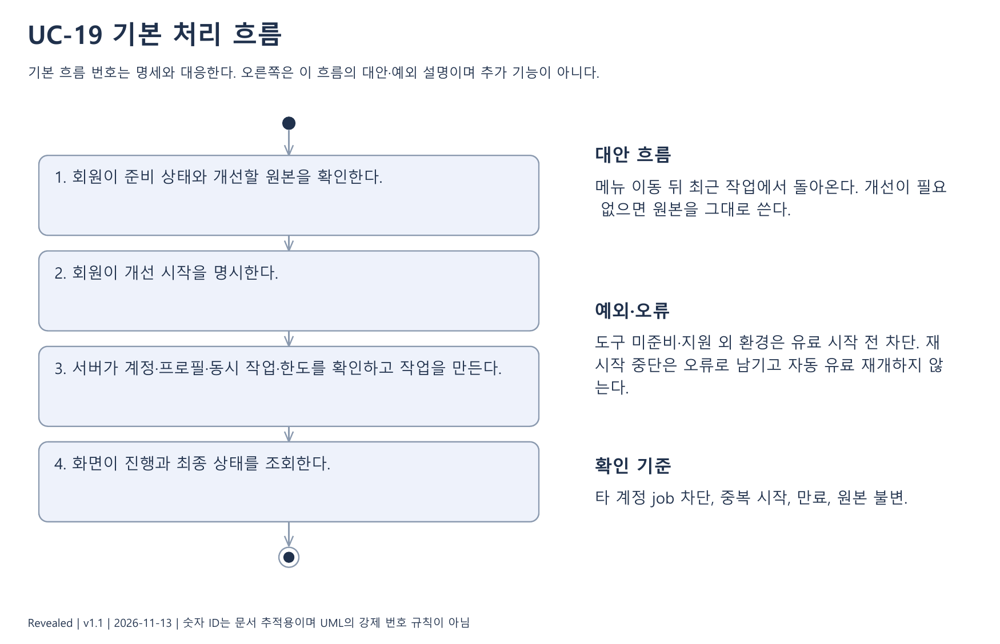

| 흐름 | 설명 |
| --- | --- |
| 1 | 회원이 준비 상태와 개선할 원본을 확인한다. |
| 2 | 회원이 개선 시작을 명시한다. |
| 3 | 서버가 계정·프로필·동시 작업·한도를 확인하고 작업을 만든다. |
| 4 | 화면이 진행과 최종 상태를 조회한다. |
| 대안 | 메뉴 이동 뒤 최근 작업에서 돌아온다. 개선이 필요 없으면 원본을 그대로 쓴다. |
| 예외 | 도구 미준비·지원 외 환경은 유료 시작 전 차단. 재시작 중단은 오류로 남기고 자동 유료 재개하지 않는다. |
| 검사 기준 | 타 계정 job 차단, 중복 시작, 만료, 원본 불변. |

### 입력·상태·업무 규칙 상세

입력은 profile·originalPrompt이며 작업 ID로 상태를 조회한다. 모델 개선은 실제 API 비용이 가능하다. 지원 환경·실행 도구가 준비되지 않으면 유료 시작 전에 차단한다. 보관 기록은 계정별 7일 범위다.

## UC-20 개선 결과 검토·직접 판단·채택

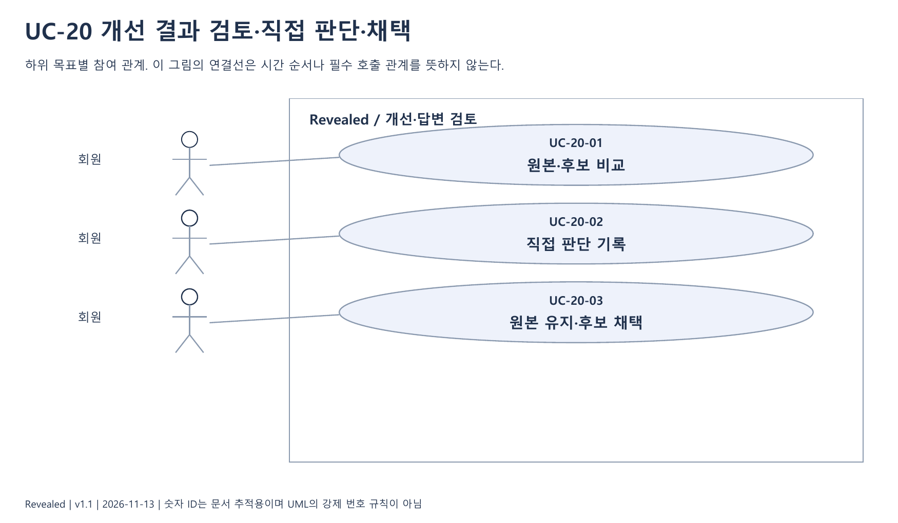

| 명세 항목 | 내용 |
| --- | --- |
| 시스템 / 서브시스템 | Revealed / 개선·답변 검토 |
| UC-ID / 이름 | UC-20 / 개선 결과 검토·직접 판단·채택 |
| 단계 / 작성일 / 버전 | 현행 구현 기준 검토용 / 2026-11-13 / v1.2 |
| 개요 | 개선 결과의 범위를 이해하고 채택 여부를 결정한다. |
| 주요 액터 | 회원 |
| 사전조건 | 본인의 완료된 개선 작업과 원본·후보 결과. |
| 사후조건 | 미채택 상태 유지 또는 명시적으로 새 개인 항목이 저장된다. |
| 추적 관계 | FR-13.3, FR-14.1~2 / UI-15 / 주 구현 WBS 3.3 |

### 하위 기능 설명

| 하위 ID | 기능 이름 | 액터·처리 결과 |
| --- | --- | --- |
| UC-20-01 | 원본·후보 비교 | 회원 : 지침과 별도 과제 답변·검사 범위를 비교한다. |
| UC-20-02 | 직접 판단 기록 | 회원 : 형식 조건과 기능을 따로 확인하며 미확인을 보존한다. |
| UC-20-03 | 원본 유지·후보 채택 | 회원 : 개선 없음이면 원본 유지, 채택 시 새 항목 저장. |

### 기본·대안·예외 흐름

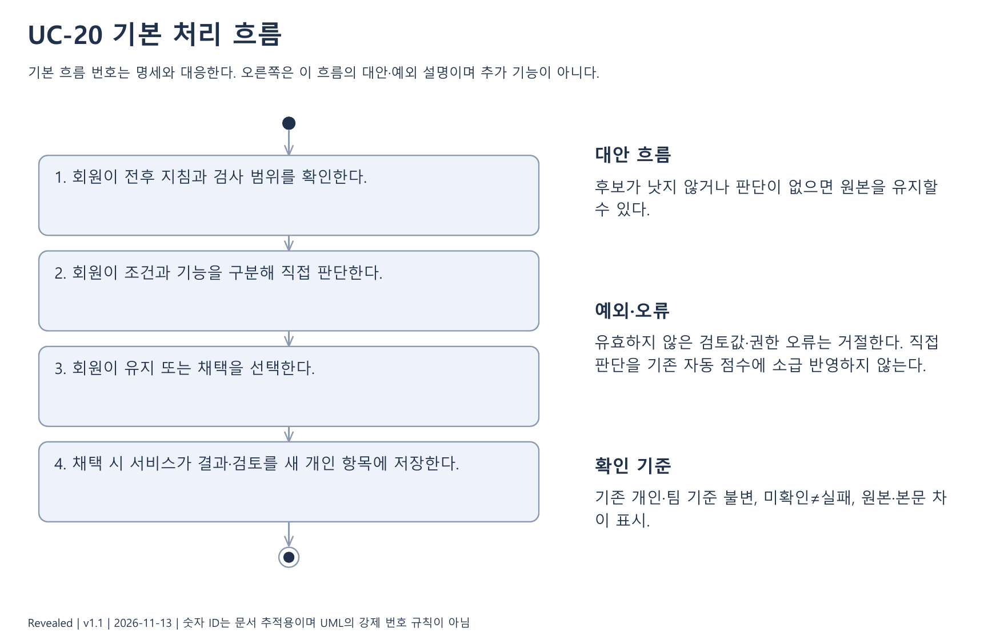

| 흐름 | 설명 |
| --- | --- |
| 1 | 회원이 전후 지침과 검사 범위를 확인한다. |
| 2 | 회원이 조건과 기능을 구분해 직접 판단한다. |
| 3 | 회원이 유지 또는 채택을 선택한다. |
| 4 | 채택 시 서비스가 결과·검토를 새 개인 항목에 저장한다. |
| 대안 | 후보가 낫지 않거나 판단이 없으면 원본을 유지할 수 있다. |
| 예외 | 유효하지 않은 검토값·권한 오류는 거절한다. 직접 판단을 기존 자동 점수에 소급 반영하지 않는다. |
| 검사 기준 | 기존 개인·팀 기준 불변, 미확인≠실패, 원본·본문 차이 표시. |

### 입력·상태·업무 규칙 상세

입력은 완료 작업·채택 여부·선택적 직접 판단이다. 직접 판단을 자동 점수나 후보 선정에 소급 적용하지 않는다. 과거 v1 점수를 v2로 재계산하여 같은 실험처럼 보고하지 않는다. 채택은 새 개인 항목 저장이다.

## UC-21 AI 답변 직접 확인

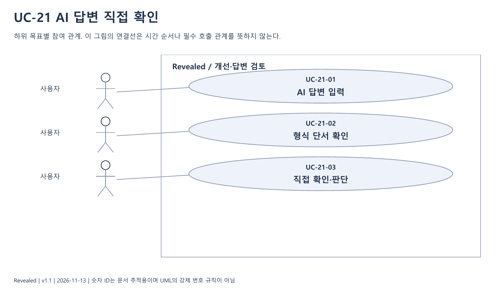

| 명세 항목 | 내용 |
| --- | --- |
| 시스템 / 서브시스템 | Revealed / 개선·답변 검토 |
| UC-ID / 이름 | UC-21 / AI 답변 직접 확인 |
| 단계 / 작성일 / 버전 | 현행 구현 기준 검토용 / 2026-11-13 / v1.2 |
| 개요 | 붙여 넣은 답변에서 확인할 조건과 형식 단서를 얻는다. |
| 주요 액터 | 사용자 |
| 사전조건 | 환경·프로필·답변 텍스트. 서버로 분석 입력이 전송됨. |
| 사후조건 | 단서와 직접 확인 질문이 표시되고 판단 범위가 구분된다. |
| 추적 관계 | FR-14.1~2 / UI-15 / 주 구현 WBS 3.3 |

### 하위 기능 설명

| 하위 ID | 기능 이름 | 액터·처리 결과 |
| --- | --- | --- |
| UC-21-01 | AI 답변 입력 | 사용자 : 외부 AI 답변을 붙여 넣는다. |
| UC-21-02 | 형식 단서 확인 | 사용자 : 주석·선언·파일 등 정적 단서를 확인한다. |
| UC-21-03 | 직접 확인·판단 | 사용자 : 의미와 기능은 별도 질문으로 확인한다. |

### 기본·대안·예외 흐름

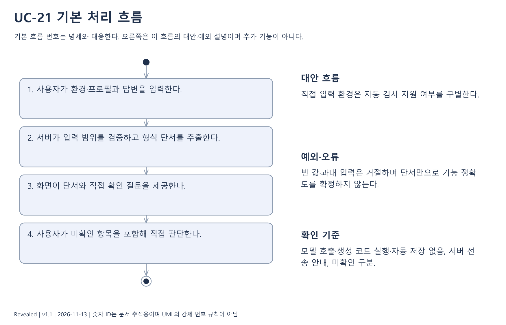

| 흐름 | 설명 |
| --- | --- |
| 1 | 사용자가 환경·프로필과 답변을 입력한다. |
| 2 | 서버가 입력 범위를 검증하고 형식 단서를 추출한다. |
| 3 | 화면이 단서와 직접 확인 질문을 제공한다. |
| 4 | 사용자가 미확인 항목을 포함해 직접 판단한다. |
| 대안 | 직접 입력 환경은 자동 검사 지원 여부를 구별한다. |
| 예외 | 빈 값·과대 입력은 거절하며 단서만으로 기능 정확도를 확정하지 않는다. |
| 검사 기준 | 모델 호출·생성 코드 실행·자동 저장 없음, 서버 전송 안내, 미확인 구분. |

### 입력·상태·업무 규칙 상세

입력은 개발 환경·지침 프로필·답변 텍스트다. 주석·선언·파일 등 형식 단서와 직접 확인 질문을 반환한다. 브라우저에서 서버로 전송되지만 모델 호출·외부 AI 전달·코드 실행·자동 저장은 하지 않는다.

## UC-22 지침 파일 내보내기

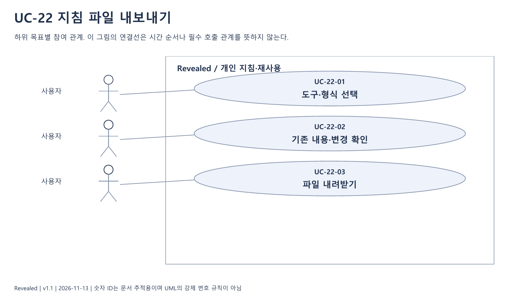

| 명세 항목 | 내용 |
| --- | --- |
| 시스템 / 서브시스템 | Revealed / 개인 지침·재사용 |
| UC-ID / 이름 | UC-22 / 지침 파일 내보내기 |
| 단계 / 작성일 / 버전 | 현행 구현 기준 검토용 / 2026-11-13 / v1.2 |
| 개요 | 지침을 개발 도구의 파일 형식으로 변환해 내려받는다. |
| 주요 액터 | 사용자 |
| 사전조건 | 현재 지침과 지원 대상 형식. 기존 내용은 선택적으로 제공한다. |
| 사후조건 | 미리 본 파일을 내려받는다. 로컬 적용은 사용자가 수행한다. |
| 추적 관계 | FR-15.1 / UI-16 / 주 구현 WBS 3.3 |

### 하위 기능 설명

| 하위 ID | 기능 이름 | 액터·처리 결과 |
| --- | --- | --- |
| UC-22-01 | 도구·형식 선택 | 사용자 : AGENTS.md·CLAUDE.md·Copilot·Cursor·Markdown 등을 선택한다. |
| UC-22-02 | 기존 내용·변경 확인 | 사용자 : 표시 구역 밖의 보존과 변환 차이를 확인한다. |
| UC-22-03 | 파일 내려받기 | 사용자 : 결과 파일을 받아 직접 저장소에 적용한다. |

### 기본·대안·예외 흐름

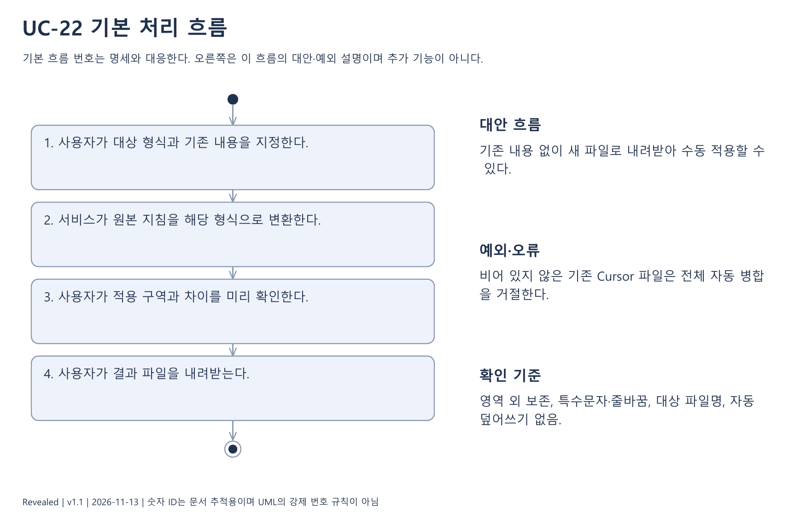

| 흐름 | 설명 |
| --- | --- |
| 1 | 사용자가 대상 형식과 기존 내용을 지정한다. |
| 2 | 서비스가 원본 지침을 해당 형식으로 변환한다. |
| 3 | 사용자가 적용 구역과 차이를 미리 확인한다. |
| 4 | 사용자가 결과 파일을 내려받는다. |
| 대안 | 기존 내용 없이 새 파일로 내려받아 수동 적용할 수 있다. |
| 예외 | 비어 있지 않은 기존 Cursor 파일은 전체 자동 병합을 거절한다. |
| 검사 기준 | 영역 외 보존, 특수문자·줄바꿈, 대상 파일명, 자동 덮어쓰기 없음. |

### 입력·상태·업무 규칙 상세

입력은 지침·대상 형식·선택적 기존 파일 내용이다. 표시 구역 밖의 보존과 변경 차이를 확인한다. 기존 내용이 있는 Cursor 파일은 전체 자동 병합을 거절하고 새 파일 내려받기·수동 적용을 사용한다.

## UC-23 실제 작업 비교 기록

| 명세 항목 | 내용 |
| --- | --- |
| 시스템 / 서브시스템 | Revealed / 개인 지침·재사용 |
| UC-ID / 이름 | UC-23 / 실제 작업 비교 기록 |
| 단계 / 작성일 / 버전 | 현행 구현 기준 검토용 / 2026-11-13 / v1.2 |
| 개요 | 동일 실제 과제의 준비·수정 시간과 결과를 구분해 기록한다. |
| 주요 액터 | 회원 |
| 사전조건 | 회원과 고정한 과제·도구·모델·맥락·지침 버전. 변경 시 현재 revision. |
| 사후조건 | 시간·기능 판단·조건 근거가 구분된 비교 기록이 저장된다. |
| 추적 관계 | FR-15.2~3 / UI-16 / 주 구현 WBS 3.3 |

### 하위 기능 설명

| 하위 ID | 기능 이름 | 액터·처리 결과 |
| --- | --- | --- |
| UC-23-01 | 비교 조건 고정 | 회원 : 과제와 모델·맥락·지침 버전을 기록한다. |
| UC-23-02 | 준비·수정 시간 기록 | 회원 : setup/edit 두 단계, 계정 전체에서 한 타이머만 실행한다. |
| UC-23-03 | 결과·근거 저장 | 회원 : 기능 결과와 조건 판단·근거를 각각 기록한다. |

### 기본·대안·예외 흐름

| 흐름 | 설명 |
| --- | --- |
| 1 | 회원이 같은 과제의 비교 기록을 만든다. |
| 2 | 회원이 준비 또는 수정 타이머를 시작·정지한다. |
| 3 | 서버가 계정 전체 동시 타이머와 revision을 확인한다. |
| 4 | 회원이 기능·조건 결과와 근거를 저장한다. |
| 대안 | 중단 타이머는 서버 시각을 기준으로 재개한다. 미측정은 비워 둔다. |
| 예외 | 동시 타이머·오래된 revision은 거절한다. 미측정 0초·미확인 실패로 바꾸지 않는다. |
| 검사 기준 | 타이머 재개, 결측, 과제 변경, 최초 선호 선택 비용 제외, 자동 채점 없음. |

### 입력·상태·업무 규칙 상세

입력은 고정 과제·도구·모델·맥락·지침 버전과 측정값이다. setup은 준비·요청·응답 대기, edit는 답변 수정·검사를 포함한다. 별도의 세 번째 검사 타이머는 없고 최초 선호 선택 비용도 포함하지 않는다. 실제 기록이 없으면 사람의 효과를 보고하지 않는다.

## UC-24 템플릿·요청문 점검·업무 지침 작업 공간

| 명세 항목 | 내용 |
| --- | --- |
| 시스템 / 서브시스템 | Revealed / 템플릿·업무 작업 공간 |
| UC-ID / 이름 | UC-24 / 템플릿·요청문 점검·업무 지침 작업 공간 |
| 단계 / 작성일 / 버전 | 현행 구현 기준 검토용 / 2026-11-13 / v1.2 |
| 개요 | 템플릿과 업무 요구를 확인해 지침·버전을 관리한다. |
| 주요 액터 | 사용자 / 작업 공간 사용자 |
| 사전조건 | 템플릿별 입력과 작업 공간의 소유·멤버 권한. 모델 경로는 별도 활성화·한도. |
| 사후조건 | 확인된 요구·지침·버전 또는 요청문 점검 결과를 얻는다. |
| 추적 관계 | FR-16.1~3 / UI-17, UI-18 / 주 구현 WBS 3.3 |

### 하위 기능 설명

| 하위 ID | 기능 이름 | 액터·처리 결과 |
| --- | --- | --- |
| UC-24-01 | 템플릿 선택 | 사용자 : 비교 지원 6개와 업무 초안 18개의 용도를 구별한다. |
| UC-24-02 | 요청문 점검 | 사용자 : 무료 체크리스트와 비용 가능한 모델 재작성을 구별한다. |
| UC-24-03 | 업무 요구 확인·조립 | 작업 공간 사용자 : 요구를 구조화하고 사용자가 확인한 뒤 지침을 만든다. |
| UC-24-04 | 시험·제안·버전 관리 | 작업 공간 사용자 : 시험과 제안을 검토·반영하고 저장 버전을 복원한다. |

### 기본·대안·예외 흐름

| 흐름 | 설명 |
| --- | --- |
| 1 | 사용자가 템플릿 또는 업무 입력을 선택한다. |
| 2 | 시스템이 요구·입력·권한을 검증하고 구조화 또는 점검한다. |
| 3 | 사용자가 현재 판단을 확인한 뒤 지침을 조립한다. |
| 4 | 사용자가 시험·제안을 검토하고 필요한 버전을 저장·복원한다. |
| 대안 | 템플릿 비교는 해당 비교 경로로 이동한다. 업무 초안은 복사·점검에 사용할 수 있다. |
| 예외 | 미확인 계약·권한 없음·유효하지 않은 제안 범위는 거절한다. 모델 경로는 한도·비용 조건을 적용한다. |
| 검사 기준 | 템플릿별 진입, 확인 전 완료 표시 금지, 제안 범위, 버전 복원, 공유 권한. |

### 입력·상태·업무 규칙 상세

입력은 템플릿별 요구 또는 작업 공간의 계약·시험 입력·제안이다. 비교 템플릿 6개와 업무 초안 18개의 역할이 다르다. 구조화·시험·제안의 모델 경로에는 비용·한도가 적용된다. 확인된 상태·지침·버전은 실제 업무 성과의 증명이 아니다.
