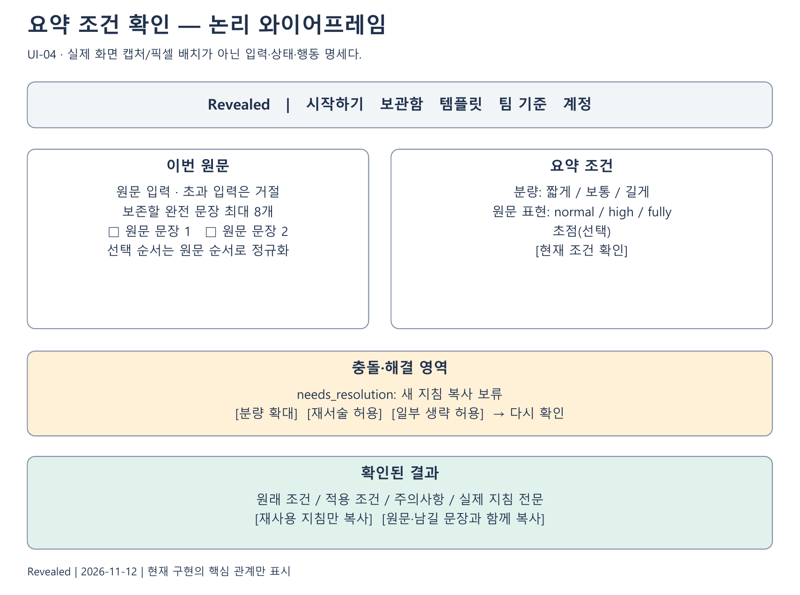
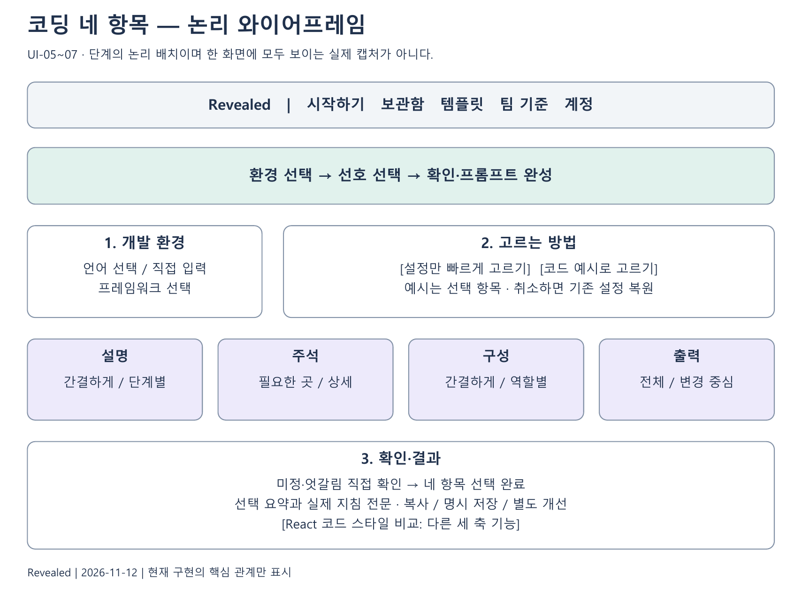
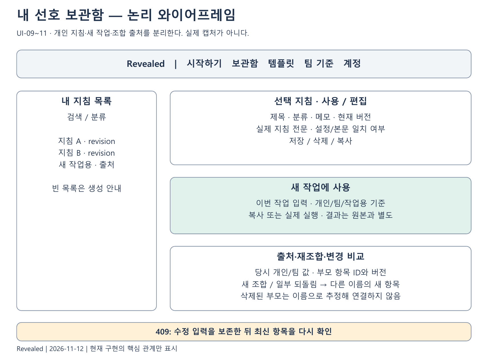
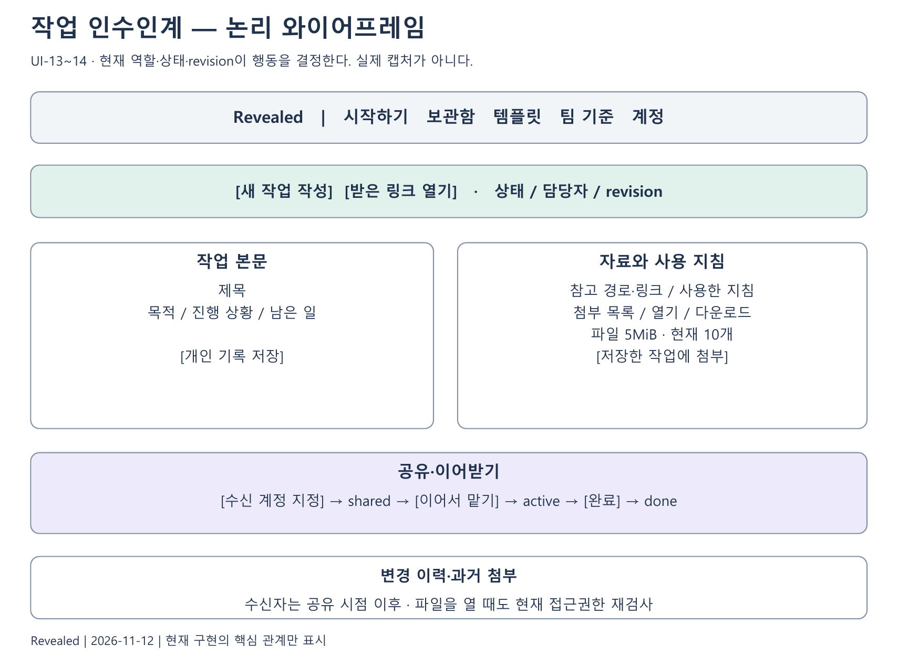

# 3. 화면과 상호작용 설계

## 3.1 화면 설계 기준

화면 ID는 구현 화면을 논리적인 업무 단계로 나눈 것이다. URL별 페이지 수를 뜻하지 않으며 `App.jsx`의 activeFlow와 각 기능 내부 stage가 화면을 전환한다. 로그인으로 잠시 이동했다가 돌아오는 흐름, 계정별 초안 복구, 비동기 응답의 뒤늦은 도착을 함께 설계한다.

다음 구성도는 주요 입력과 행동의 관계를 설명하는 논리 와이어프레임이다. 실제 픽셀·색상·반응형 배치를 복제한 캡처가 아니다. 화면 문구와 상태의 의미는 현행 컴포넌트를 기준으로 하며, 레이아웃 변경 시 이 명세의 기능과 오류 상태가 유지돼야 한다.

| 화면 ID | 업무 화면 | 주요 구현 |
|---|---|---|
| UI-01 | 시작·카테고리 | App, ScrollStory, CategoryDeck |
| UI-02 | 가입·로그인·계정 | AuthSection, AccountSection |
| UI-03 | 요약 입력·비교 | ComparisonSection |
| UI-04 | 요약 결과·충돌 확인 | SummaryContractPanel |
| UI-05 | 코딩 환경·직접 설정 | CodingInstructionsSection, CodingEnvironmentPicker |
| UI-06 | 코딩 준비 예시 비교 | CodingExampleComparison, CodingExampleCode |
| UI-07 | 코딩 확인·결과 | CodingSignalSummary, CodingPreferenceChoices |
| UI-08 | React 스타일 비교 | ComparisonSection의 coding 경로 |
| UI-09 | 보관함 목록·편집·새 작업 | PreferencesSection |
| UI-10 | 개인·팀 비교·작업용 조합 | TeamPreferenceComparison, TaskPreferenceMixer |
| UI-11 | 재조합·변경 비교·계보 | RemixSavedPreferencePanel, PreferenceLineage |
| UI-12 | 팀 생성·참여·기준 | TeamsSection, CodingTeamPanel |
| UI-13 | 인수인계 목록·작성·상세 | HandoffsSection, HandoffFields |
| UI-14 | 인수인계 첨부·이력 | HandoffAttachments와 상세 화면 |
| UI-15 | 개선 작업·답변 검토 | CodingOptimizationPanel, CodingAnswerReview |
| UI-16 | 내보내기·실제 작업 기록 | CodingExportPanel, CodingTrialPanel |
| UI-17 | 템플릿·요청문 점검 | TemplateLibrarySection, PromptPolishSection |
| UI-18 | 업무 지침 작업 공간 | PromptWorkspaceSection, ContractEditor |

## 3.2 공통 화면 규칙

현재 계정 상태는 조회 전 undefined, 비로그인 null, 로그인 사용자 객체로 구별한다. 조회 중에 다른 계정의 이전 목록이 나타나지 않아야 한다. 계정 기능에 진입할 때 로그인 필요 이유와 돌아갈 흐름을 보존한다. 작업 공간의 로그인은 진행 내용을 잃지 않도록 화면 안에서 요청한다.

비동기 요청은 요청 번호 또는 취소 신호로 오래된 응답의 반영을 막는다. 사용자가 원문·조건·선택을 바꿨다면 이전 성공 결과와 복사 완료 상태를 무효화한다. 로딩 표시를 해제할 때도 현재 요청인지 확인한다. 오류는 사용자가 입력한 내용을 무조건 지우지 않고 원인·재시도 가능 여부를 알린다.

버튼의 완료 메시지는 해당 행동에 한정한다. ‘복사 완료’는 외부 AI 실행 성공이 아니며 ‘조건 확인’은 사실 검증 성공이 아니다. ‘저장 완료’는 서버 저장 후 표시하고 브라우저 초안과 구별한다. 색상만으로 A/B 선택·오류·완료를 구분하지 않고 텍스트를 함께 둔다.

## 3.3 UI-01 시작과 UI-02 계정

시작 화면은 문서 요약, 코딩 도움, 팀 업무 정리를 업무 목적에 맞게 구별한다. 상단 메뉴는 시작하기, 내 선호 보관함, 템플릿, 팀 기준 맞추기로 연결한다. 요청문 점검과 업무 지침은 템플릿 안에서 연다. 코딩 도움 안에 네 항목과 React 세 축 경로를 각각 제시한다.

| 요소 | 입력·행동 | 상태·예외 |
|---|---|---|
| 카테고리 카드 | 목적 선택 후 이동 | 선택 중인 분류를 텍스트·시각 표시 |
| 팀 초대 링크 | query의 team 값을 받아 팀 흐름 진입 | 잘못된 코드·비공개 접근은 서버 확인 |
| 인수인계 링크 | query의 handoff 값을 받아 상세 진입 | 링크 자체는 접근 허가가 아님 |
| 로그인 | 사용자명·비밀번호 제출 | 전송 중 중복 제출 제한·오류 표시 |
| 로그아웃 | 임시 초안 제거 안내 후 종료 | 서버 세션이 이미 끊겨도 화면 계정 상태 정리 |
| 계정 변경 | 현재 비밀번호 재확인 | 실제 삭제·세션 정책은 서버 결과에 따름 |

로그인 실패 시 비밀번호가 로그·URL·알림에 나타나지 않아야 한다. 공개 문서와 캡처에는 실제 계정·비밀번호·초대 비밀·원문을 넣지 않는다. 모바일 메뉴는 열림/닫힘과 이동 후 닫힘을 별도로 확인한다.

## 3.4 UI-03 요약 입력·비교

원문 입력 화면에는 언어, 원문, 실행 방식과 시작 행동을 둔다. 비교 화면에는 원문 맥락, A/B 답변, 선택·비슷함·되돌리기, 진행/종료 정보를 둔다. 현재 질문의 비교 대상과 실제 입력 원문이 다르면 데모 범위를 명시한다.

| 상태 | 표시·허용 행동 | 금지할 해석 |
|---|---|---|
| 입력 전 | 예시 원문 또는 빈 입력·시작 안내 | 입력 없이 선호가 정해짐 |
| 생성 중 | 대기·중복 요청 방지·오류 영역 | 실제 모델 완료 전 결과로 표시 |
| 비교 중 | A/B 전문과 선택·비슷함 | 화면 일부만 보고 전체 답변 생성 성공 판단 |
| 질문 소진 | 종료 이유와 미정 축 | 최대 횟수를 채우지 않아 실패라는 표시 |
| 실제 생성 실패 후 전환 | 데모 전환 이유·준비 예시 표시, 기존 이력 유지 | 데모 답변을 실제 AI 생성 성공으로 표시 |
| 요청 자체 실패 | 오류·재시도 범위 | 실패한 요청을 완료 상태로 기록 |

긴 원문을 기존 시작 경로에서 자르는 정책은 새 충돌 확인의 명시적 초과 거절과 다르다. UI에서 길이·적용 원문을 사용자에게 일관되게 알리는 것은 후속 정리 항목이다. 기능 설명에서 두 정책을 같다고 쓰지 않는다.

## 3.5 UI-04 요약 조건 충돌 확인

| 입력·표시 | 값과 제약 | 변경 시 처리 |
|---|---|---|
| 이번 원문 | Unicode 문자 수 기준 1~12,000자 | 이전 후보·선택·해결·결과 초기화 |
| 분량 | short 1~2, normal 3~4, long 5문장 이상 | 현재 검사 결과 무효화 |
| 원문 표현 | normal·high·fully | 충돌과 해결값 초기화 |
| 요약 초점 | 선택, 최대 300자 | 현재 결과 무효화 |
| 보존 문장 | 서버 후보 중 최대 8개 | 초과 선택 비활성화, 기존 선택 해제 가능 |
| 해결 방법 | expand·rephrase·keep_limits | 충돌 메시지는 유지하고 재검사 필요 |
| 지침 언어 | 한국어·영어 | 선택 언어의 실제 본문과 복사 상태 갱신 |

첫 조건 확인은 문장 후보를 가져오고 사용자는 필요 시 보존 문장을 추가해 다시 확인한다. `needs_resolution`에서는 이유와 세 해결 방법을 보여 주고 새 지침 복사를 제공하지 않는다. `ready`에서는 처음 조건과 적용 조건을 함께 보여 준다. ‘재사용 지침만 복사’와 ‘원문·남길 문장과 함께 복사’는 서로 다른 내용을 복사한다.

12,000자 초과는 원문을 그대로 유지한 채 직접 줄이거나 나누도록 안내한다. 오래된 요청 응답은 무시한다. 클립보드 실패 시 지침을 직접 선택해 복사할 수 있게 안내한다. 원문의 문장을 고르는 UI는 중요 문장을 자동 추정했다는 표시가 아니다.

## 3.6 UI-05~07 코딩 환경·조건·완성

환경 → 선호 선택 → 확인·프롬프트 완성의 세 단계다. 직접 설정이 기본이며 준비 예시 비교는 이름이 낯설 때 선택할 수 있다. 언어·프레임워크·작성 선호는 선택 버튼으로 제시한다. 새 사용자의 선택을 초기 기본값으로 확정하지 않는다.

| 화면 요소 | 목적 | 상태 규칙 |
|---|---|---|
| 환경 선택 | 언어·프레임워크 확정 | 변경하면 네 선택·비교 출처·생성문 초기화 |
| 네 선호 카드 | 설명·주석·구성·출력 선택 | 선택한 값만 완료 개수에 포함 |
| 예시 비교 전환 | 실제 차이를 보고 선택 | 취소 시 진입 전 선택·생성문 복원 |
| 신호 요약 | 한 번·반복·엇갈림·미정 표시 | 불확정 항목은 직접 확인 |
| 최종 지침 | 실제 복사할 전체 문장 | ‘답변 방식 4가지 선택 완료’와 본문을 분리 |
| 작업 요청 입력 | 새 작업과 함께 복사 | 보관함에는 지침만 명시적으로 저장 |
| React 비교 진입 | 별도 세 축 기능 열기 | 네 항목과 같은 기능으로 묶지 않음 |

단계 이동 후 화면 제목에 포커스를 두고 필요한 영역으로 이동한다. 감소된 모션 설정을 존중하는 경로가 있다. 직접 입력 언어는 준비 예시 또는 GEPA가 모두 지원된다는 인상을 주지 않는다. 프레임워크 전용 예시와 언어 기본 문법 예시는 항상 구분한다.

## 3.7 UI-06 예시 코드 전문과 선택 상태

A/B 카드는 파일명·핵심 차이·예시 범위를 보여 준다. 코드 전문은 전체 파일을 읽을 수 있어야 한다. 선택 직후 자동으로 넘어가기보다 선택한 쪽을 확인한 뒤 다음으로 이동한다. 최대 8회 상한과 현재 응답 수를 표시하며 1회 이후 원하는 때 마칠 수 있다.

앞선 선택 수정은 이후 이력을 제거하는 영향과 함께 처리한다. ‘고르기 어려움’은 임의 값을 채우는 신호가 아니다. 서로 엇갈린 선택은 최종 확인에서 직접 정한다. 비교를 취소하면 기존 직접 선택 결과를 덮어쓰지 않는다.

코드 영역은 긴 줄·여러 파일·키보드 스크롤을 고려한다. 코드 일부가 보인다는 이유로 전체 파일을 생략해서는 안 된다. 전문 모달을 사용한다면 닫기·원래 위치로 복귀·키보드 이동을 별도로 점검해야 한다. 색상·레이아웃 변경은 기능 상태와 독립적으로 검토한다.

## 3.8 UI-08 React 스타일 비교

기존 coding 비교에는 입력, A/B 선택, 코드 전문, 결과 화면이 있다. 사용자 입력은 작업 요청으로 보존하되 무료 데모는 준비 과제의 스타일 비교라는 안내를 둔다. 세 축은 역할별 파일/간결한 한 파일, 직접 스타일 값/테마, 추론/타입 명시다.

결과 화면은 선택한 축·생성 방식·실제 지침 전문·언어 전환·복사·저장·선택적 개선을 보여 준다. 지침 생성 방식과 모델 호출 통계는 데모/실제 생성 구분에 필요한 범위로 표시한다. 내부 점수나 추정 상태를 ‘취향 정확도’로 제시하지 않는다.

이 화면의 파스텔 디자인과 새 네 항목 코딩 화면은 같은 제품 안의 다른 화면이다. 친구가 수정한 기존 React UI를 네 항목 기능으로 자동 대체하지 않는다. 기능·데이터·검증 ID를 유지하면서 공통 시각 스타일을 맞출 수 있다.

## 3.9 UI-09 보관함

목록은 검색·분류 필터와 함께 제공한다. 상세에서는 사용/편집 모드를 구별하고 지침·메모·설정·출처를 보여 준다. 새 작업 입력과 실행/복사 결과는 저장 지침 자체와 별도 상태다.

| 상황 | 화면 행동 | 서버 계약 |
|---|---|---|
| 목록 없음 | 새 지침 만들기·저장 안내 | 빈 배열을 오류로 취급하지 않음 |
| 상세 열기 | 최신 요청만 반영 | 계정 소유 범위의 ID 조회 |
| 수정 중 이동 | 미저장 수정·작업 입력 소실 안내 | 저장 없이 서버 원본 갱신 금지 |
| 수정본으로 사용 | 먼저 저장하도록 안내 | revision을 기준으로 현재 본문 확인 |
| 저장 충돌 | 최신 자료를 다시 확인하도록 안내 | 409, 이전 값 자동 덮어쓰기 금지 |
| 삭제된 선행 항목 | 열 수 없음 표시 | 이름으로 비슷한 항목 대체 금지 |

설정과 직접 수정 본문의 차이, 저장 당시 출처와 현재 팀 기준의 차이를 구별한다. 과거 기록이 없으면 ‘없음/미기록’으로 표시한다. 미리 보기와 저장 성공 알림은 현재 요청 버전에만 적용한다.

## 3.10 UI-10~12 팀 기준과 출처

개인·팀 비교 화면은 같은 항목과 다른 항목을 나누고, 다른 항목에는 따를 쪽을 선택하게 한다. 작업용 조합 미리 보기에는 선택한 출처와 실제 지침을 함께 둔다. 값이 바뀌면 저장 가능한 미리 보기를 무효화한다.

재조합과 일부 되돌림은 새 저장본 생성이라는 점을 화면에 드러낸다. 변경 비교는 직전 작업용과 현재 조합의 값·출처를 비교하며, 선행 항목으로 이동할 때 현재 버전을 열 수 있음을 알린다. 출처 스냅샷은 원본이 수정돼도 유지한다.

팀 시작 화면은 팀 생성과 초대 참여를 구분한다. 계정 팀에는 참여자·초대 열림·만료 상태를 표시한다. 네 항목 팀 기준은 팀장이 정한 기본값과 필수 규칙을 보여 주고 기존 React의 집계 결과와 혼합하지 않는다. 같은 팀 링크를 전달했다고 인수인계 파일을 볼 수 있는 것은 아니다.

## 3.11 UI-13~14 작업 인수인계

첫 화면은 새 작업 작성과 받은 링크 열기를 구별한다. 목록에는 상태·담당자·버전을 표시한다. 작성 화면은 목적·현재 진행·다음 행동과 자료·사용 지침 영역을 분리한다. 저장 → 첨부 → 계정 지정 → 이어받기 순서가 명확해야 한다.

| 영역 | 내용 | 상태·제약 |
|---|---|---|
| 작업 본문 | 제목·목적·진행·남은 일 | 허용 역할·현재 revision에서 편집 |
| 자료 | 경로·링크·사용 지침 | 외부 경로를 서버가 임의로 읽지 않음 |
| 첨부 | 파일 목록·열기·다운로드 | 실제 저장 완료 후 표시, 용량 상한 안내 |
| 수신자 | 같은 서버 계정 지정 | 링크 보유와 계정 권한 구분 |
| 상태 행동 | 공유·이어받기·완료·재진행 | 허용 역할·상태의 버튼만 제공 |
| 이력 | revision·행동·시점 | 수신자는 공유 시점 이후만 열람 |

첨부 전 선택 파일은 임시 초안으로 자동 복구된다고 약속하지 않는다. 이전 버전에서만 존재하는 파일을 열 때도 현재 권한을 다시 검사한다. 오류 시 선택한 파일의 전송 상태와 서버 목록을 구별한다. 계정 삭제·수신자 재지정 등으로 접근이 사라지면 과거 화면의 버튼을 계속 성공 처리하지 않는다.

## 3.12 UI-15 개선 작업과 답변 확인

개선 시작 화면은 지원 환경·실행 가능 여부·비용 발생 가능 경로를 구별한다. 시작한 작업은 상태와 최근 작업에서 조회한다. 로딩이 끝나도 개선이 없으면 원본 유지로 표시한다. API 오류·서버 재시작·만료를 동일한 ‘좋아짐’ 상태로 바꾸지 않는다.

결과는 원본 지침, 보충 안내/후보, 전후 별도 과제 답변, 자동 검사 범위, 직접 확인 항목으로 나눈다. 환경별 AST 검사는 실제 컴파일·서버 실행과 같지 않다. 사용자가 판단한 주석·역할 구성은 자동 형식 점수에 몰래 합산하지 않는다.

답변 직접 확인은 붙여 넣은 텍스트를 서버에서 분석해 단서와 질문을 반환한다. ‘미확인’ 상태를 명시하고 판정 근거 없이 통과율을 만들지 않는다. 저장 여부와 임시 판단 여부를 분리한다. 개선본 채택은 새 항목 저장이며 기존 지침·팀 기준은 갱신하지 않는다.

## 3.13 UI-16 내보내기와 실제 작업 기록

내보내기는 대상 도구, 파일 이름, 생성 내용, 기존 내용과 차이, 내려받기를 순서대로 제공한다. 사용자 저장소에 자동 설치한 것으로 표시하지 않는다. 지원 형식은 보호 구역 밖의 내용을 보존하지만 Cursor는 기존 내용이 있으면 frontmatter를 포함한 전체 자동 병합을 거절한다.

실제 작업 기록 화면은 과제·도구·모델·맥락을 고정하고 일반/선택 지침을 따로 보여 준다. setup은 준비·요청·응답 대기, edit는 답변 수정·검사의 두 타이머다. 검사만을 별도로 재는 세 번째 타이머는 없다. 기능 결과와 근거, 조건 판단은 시간과 구별한다. 타이머가 이미 실행 중이면 계정 내 하나 규칙을 설명한다. 미측정·미확인 값을 0초·실패로 채우지 않는다. 최초 설정 시간은 별도라는 경계를 표시한다.

## 3.14 UI-17~18 템플릿과 업무 지침

템플릿은 비교 지원 여부와 업무 초안 여부를 카드에서 구별한다. 비교 지원 템플릿만 예시 선택으로 연결한다. 요청문 점검은 체크리스트와 실제 재작성 버튼을 구분한다. 모델 재작성을 사용할 수 없더라도 무료 점검표는 가능한 경로를 유지한다.

작업 공간은 입력 요구를 구조화하고 사용자가 계약을 확인한 뒤 지침을 만든다. 시험 입력과 결과, 개선 제안과 적용, 전후 비교를 서로 다른 상태로 보존한다. 제안을 보여 줬다는 이유만으로 자동 반영하지 않는다. 프로젝트 저장·공유·버전 복원은 로그인과 권한을 확인한다.

## 3.15 화면 수용 검사

| 검사 묶음 | 확인할 행동 | 근거 |
|---|---|---|
| 입력 경계 | 빈 값·길이·Unicode·미선택 | 서버 검증과 화면 제한의 일치 |
| 비동기 경합 | 먼저 보낸 응답이 늦게 도착 | 최신 요청만 현재 상태에 반영 |
| 복사 | 언어·범위·작업 입력 변경 | 현재 본문과 클립보드 내용 일치 |
| 내비게이션 | 로그인 왕복·메뉴·뒤로가기 | 의도한 초안 유지 또는 소실 안내 |
| 계정 전환 | 로그아웃·다른 사용자 로그인 | 이전 계정 임시 상태 제거 |
| 권한·revision | 만료·공유 회수·동시 편집 | 서버 실패를 성공 화면으로 표시하지 않음 |
| 좁은 화면 | 긴 코드·표·모달·버튼 | 내용 접근과 조작 가능; 별도 실기기 확인 필요 |
| 접근성 | 레이블·포커스·키보드·상태 알림 | 실제 사용자 보조기기 평가는 미실시 |

현재 프론트의 순수 함수 테스트는 상태 변환과 일부 입력 계약을 확인한다. 이를 전체 브라우저 자동화·반응형·스크린리더 검증으로 보고하지 않는다. 문서의 논리 와이어프레임도 실제 화면 회귀 검사를 대신하지 않는다.
