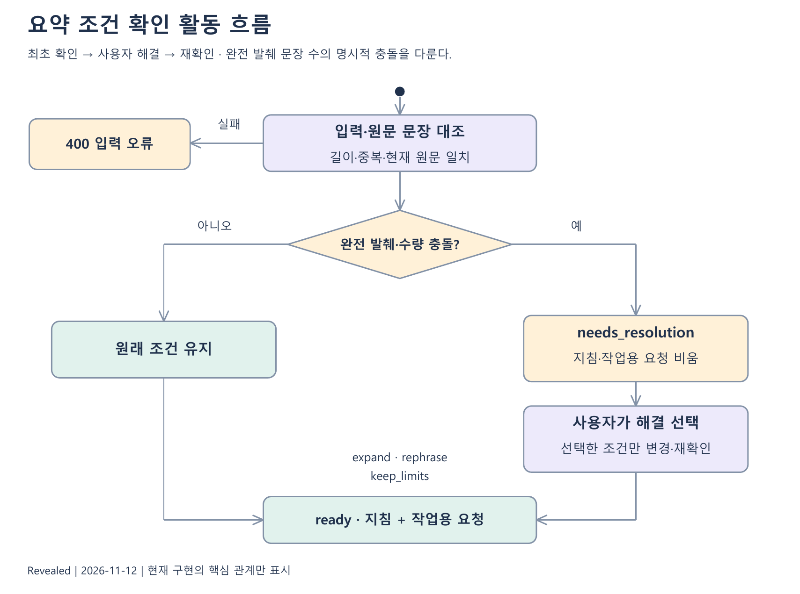
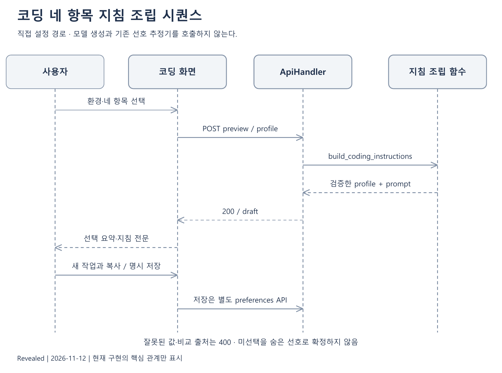
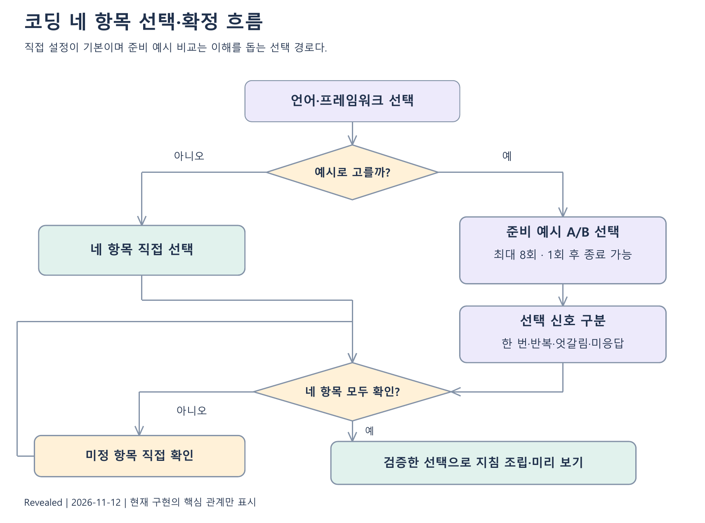
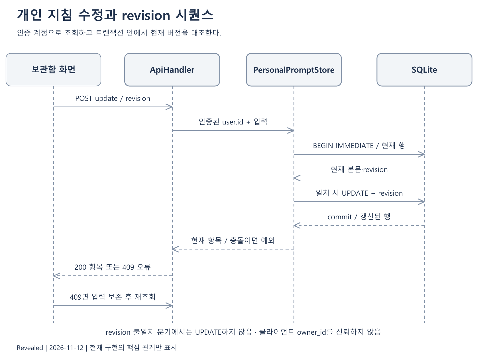
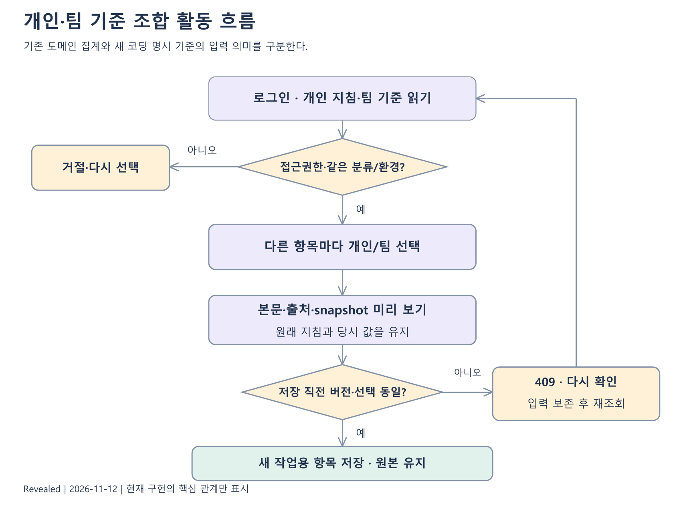
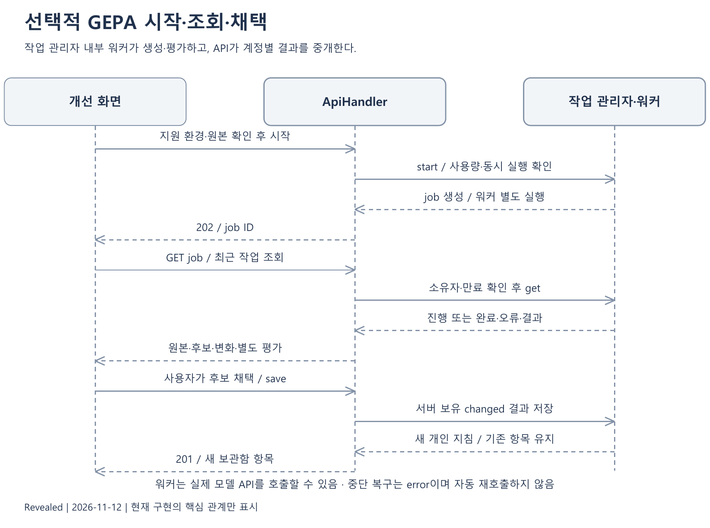

# 4. 처리 흐름과 알고리즘 설계

## 4.1 처리 계층과 데이터 경계

브라우저는 입력·선택·일시적 화면 상태를 관리한다. HTTP API는 요청 크기·형식·세션·경로를 확인하고 업무 모듈을 호출한다. 업무 모듈은 조건·상태·버전의 불변조건을 검사한다. 저장 모듈은 소유 관계와 변경의 원자성을 보장하도록 SQLite를 사용한다. 실제 후보 생성·최적화는 명시적 모델 경로와 응답 캐시를 거친다.

모든 처리가 하나의 선호 추정기로 들어가지는 않는다. 요약·기존 React 비교는 도메인 엔진을 사용하고, 네 항목 코딩은 규칙 조립과 별도 준비 예시 상태를 사용한다. 요약 조건 확인도 기존 추정 결과를 덮어쓰지 않는 별도 규칙 경로다. 업무 인수인계는 선호 도메인이 아니라 공유 상태와 자료를 다루는 업무 모듈이다.

## 4.2 도메인 정의와 프롬프트 조립

`domains/*.yaml`은 과제 설명, 축 이름과 값, 값별 지침, 검사 함수와 목표, 최종 지침의 언어별 틀을 가진다. `engine/domain_loader.py`가 이를 Domain·Axis 등의 객체로 읽는다. enum 축은 고정 값 집합을 가지며 freeform 축은 사용자의 자유 입력을 다룬다.

후보 생성용 설명과 사용자에게 내보내는 최종 지침은 구별한다. `task_description`이 후보 생성을 안내하고 `final_prompt`가 최종 지침의 역할·선호·규칙·출력을 구성한다. 번역된 최종 지침은 별도 정의이므로 한국어와 영어의 미세한 차이도 검증 대상이다. 최신 React 비교는 실제 기본 영어 지침을 그대로 평가한다.

엔진은 축의 일반 구조만 알아야 한다. 특정 도메인의 문장 수나 React 스타일을 engine 안의 분기로 추가하지 않는다. 새 도메인은 YAML과 검사 함수를 추가하고 도메인 의존 검사, 조립 결과 검사, 새 출력 과제 평가를 각각 수행해야 한다. YAML을 추가했다고 도메인 품질이 자동 검증되지는 않는다.

## 4.3 선택 이력과 상대 효용 갱신

Estimator는 enum 축별 각 값의 효용을 0으로 시작한다. 비교에서 A와 B가 다른 축만 갱신한다. 승자 A의 목표값은 1, B는 0, 비슷함은 0.5다. 현재 효용 차이를 logistic 함수에 넣은 예측값 p와 목표값 y의 차이로 A에 학습률×(y−p)를 더하고 B에서는 같은 값을 뺀다. 기본 학습률은 0.5다.

이 방식은 축별 효용의 온라인 갱신이다. 한 번의 선택으로 사용자의 안정적 선호를 알았다는 의미는 아니다. 같은 효용에서 비슷함을 고르면 변화가 없다. freeform 값은 이 효용 학습 대상이 아니다. 이력에는 A/B 조합과 실제 승자 값을 보존하므로 되돌림 때 남은 이력으로 재구성할 수 있다.

최대 효용 값은 내부의 대표값이지만 최대값이 여러 개면 확정 신호가 없다. `has_signal`은 1e-9 허용 오차 안의 공동 1위를 구별한다. 정의 순서상 첫 값이 반환되더라도 이를 사용자가 고른 값으로 설명하면 안 된다. confidence는 softmax 분포의 정규화 엔트로피를 뒤집은 상대 지표이며 보정된 선호 확률이 아니다.

## 4.4 다음 질문 선택과 조기 종료

UncertaintySelector는 상대 지표가 낮은 축에서 효용이 가까운 두 값을 우선 비교한다. 기대 정보 이득을 직접 계산하는 최적 질문 정책은 아니다. 화면용 옵션 contrast_first는 아직 비교하지 않은 축의 양끝 값을 먼저 보여 주고, avoid_repeats는 같은 축·같은 두 값의 반복을 피한다.

화면용 선택은 이미 물은 질문과 현재 최고값을 고려하며, 더 물을 유효한 쌍이 없으면 None을 반환한다. 서비스는 이때 종료한다. 질문 상한은 고정 값을 가진 축에서 가능한 값 쌍의 합이고, 제품의 최대 횟수와 함께 적용한다. 이항 세 축인 React 스타일은 비교 소진이 빠를 수 있다. 요약의 최대 8회는 질문 정책과 제품 상한이지 통계적 충분성의 보장이 아니다.

중요한 경계는 종료와 확정의 차이다. 질문이 끝나도 동률·비슷함만 선택한 축은 남을 수 있다. 화면과 최종 지침에서 미정 상태를 보존한다. 과거 연구의 반복 허용 기본 선택기 결과를 현재 화면의 반복 회피 동작과 같은 실험이라고 합치지 않는다.

## 4.5 요약 조건 충돌 처리

입력은 분류, 원래 분량/원문 표현/초점, 원문, 선택 문장, 선택적 해결값이다. profile의 허용 키와 값, 원문 길이, 선택 개수·문자열·중복·원문 일치를 먼저 검사한다. 선택 문장은 클릭 순서가 아니라 원문 순서로 정규화한다.

충돌 판정은 `extractiveness == fully`이고, 도메인 길이 검사에 문장 수 상한이 있으며, 서로 다른 선택 문장 수가 그 상한보다 큰 경우다. 이 경우 해결값이 없으면 `needs_resolution`, prompts와 task_requests는 빈 객체다. 이는 완전 발췌의 명시적 수량 충돌만 판별한다. 재서술의 의미상 압축 가능성은 판별하지 않는다.

| 조건 | 결과 상태 | 적용 변경 | 후속 확인 |
|---|---|---|---|
| 충돌 없음·해결값 없음 | ready | 원래 조건 유지 | 출력의 실제 내용·형식 |
| 충돌 있음·해결값 없음 | needs_resolution | 지침 제공 보류 | 사용자의 해결 선택 |
| 충돌 있음·expand | ready | 4문장 이하면 normal, 그 이상 long | 선택 내용 전체 보존 |
| 충돌 있음·rephrase | ready | extractiveness를 normal로 변경 | 원래 길이에서 의미 보존 가능성 |
| 충돌 있음·keep_limits | ready | 일부 생략 허용 정책 | 보존율과 실제 생략 내용 |
| 충돌 없음·해결값 있음 | 입력 오류 | 적용하지 않음 | 과거 해결값 초기화 |

task_data_block은 source·required_passages·coverage_policy를 데이터 블록으로 구분한다. 재사용 지침에는 source가 없고 작업용 요청에만 포함된다. 원문 속 명령문은 자료로 취급한다. 이 구조가 모든 모델의 프롬프트 주입을 방어한다는 보장은 아니다.

## 4.6 네 항목 코딩 조립과 예시 비교

직접 설정은 환경과 네 값의 완전성을 확인한 뒤 `build_coding_instructions`가 본문과 정규화된 프로필을 반환한다. 모델 후보 생성·기존 Estimator를 호출하지 않는다. 추가 메모와 팀 규칙은 각각 의미와 적용 범위가 다르므로 출처를 보존한다.

준비 예시 비교 v4는 언어·프레임워크에 묶인 예시 ID를 사용한다. 서버는 연속 이력과 응답을 검증해 항목별 상태를 재계산한다. 두 번 이상 같은 응답이면 반복 일치, 한 번이면 명시적 단일 선택, 엇갈림과 무응답은 직접 확인 대상이다. 최대 8회, 1회 이후 임의 완료가 가능하다.

환경 변경은 선택과 출처를 초기화한다. 직접 카드에서 특정 항목을 다시 고르면 그 항목의 출처만 직접 설정으로 바꾼다. 예시 비교를 취소하면 이전 값으로 돌아가고, 완료할 때만 결과를 반영한다. 구버전 v1~v3를 v4의 새 의미로 소급 해석하지 않는다.

## 4.7 저장·revision·요청 경합

서버는 클라이언트가 보낸 owner_id를 권한 근거로 사용하지 않고 인증된 계정 ID를 전달한다. 생성은 입력·상한·설정 검증 후 새 행을 저장한다. 수정과 삭제는 기대 revision을 확인하며 불일치하면 충돌을 반환한다. 작업 중 생긴 이력과 현재 상태는 같은 트랜잭션 안에서 처리한다.

클라이언트는 서버 revision과 별도로 요청 번호를 사용한다. 서버 revision은 동시 변경 충돌을 막고 요청 번호는 오래된 네트워크 응답이 현재 화면을 덮는 일을 막는다. 서로 대체할 수 없다. 사용자가 새 항목을 연 뒤 이전 조회가 늦게 끝나면 화면에 적용하지 않는다.

초안은 계정별 sessionStorage와 메모리에서 최대 24시간 복구한다. 저장 DB의 revision과 동일한 영속 기록이 아니며 로그아웃 시 제거한다. 파일 선택 객체처럼 복원할 수 없는 데이터에는 별도 이동 경고가 필요하다.

## 4.8 개인·팀 기준 조합

기존 비교 도메인의 팀 기준은 이력 집계로 만들고, 새 네 항목 코딩 팀은 팀장이 기본값·필수 규칙을 명시한다. 같은 ‘팀’이라는 이름으로 두 생성 의미를 혼동하지 않는다. 새 경로는 동일 개발 환경을 확인하고 개인 메모·비교 이력은 공유 기본값에서 제외한다.

조합은 양쪽 값과 현재 버전을 확인한 뒤 차이 항목에 대해 따를 출처를 받는다. 결과에는 지침 본문과 출처 스냅샷을 함께 둔다. 저장 전 원본/팀 버전이 바뀌면 과거 미리 보기를 그대로 채택하지 않고 다시 확인한다. 팀 필수 규칙과 개인 선호의 충돌은 사용자 선택과 규칙 정책에 따라 드러내야 한다.

재조합은 현재 원본을 몰래 가져와 덮는 과정이 아니라 저장 당시 스냅샷을 기준으로 새 항목을 만드는 과정이다. 일부 되돌림도 새 항목이며, 되돌리지 않은 값과 원본은 유지한다. 연결은 ID로 추적하고 이름으로 연결하지 않는다.

## 4.9 인수인계 상태와 파일 권한

인수인계의 상태는 draft, shared, active, done이다. 작성자가 개인 기록을 저장한 뒤 지정 계정에 공유한다. 대기 중에는 수신자 재지정이 가능하며 이전 수신자의 현재 접근을 회수한다. 지정 수신자가 이어받으면 active, 완료하면 done, 재진행하면 active다.

각 변경은 현재 권한·역할·상태·revision·버전 한도를 확인한다. 현재 행의 상태와 스냅샷 이력은 함께 기록한다. 수신자에게는 공유 시점 이후의 이력을 제공한다. 수신 계정 삭제로 recipient_id가 NULL이면 active 상태라도 작성자가 편집·재공유할 수 있고 재공유 후 shared로 바뀌는 복구 예외가 있다. 버전 목록을 안다는 이유로 공유 전에 존재했던 자료를 볼 수 없다.

파일 열기는 두 가지 조건을 모두 요구한다. 현재 계정이 작업에 접근 가능해야 하고, 요청 revision의 스냅샷에 파일이 포함돼야 한다. 공유 회수나 첨부 제외는 기존 파일 URL만으로 우회할 수 없다. 원본 BLOB는 파일 크기·누적량 정책과 함께 관리한다. PDF·일부 이미지·UTF-8 텍스트의 제한된 미리 보기와 다운로드를 제공하며 실행하지 않는다.

## 4.10 선택적 GEPA 작업 흐름

실행 가능 여부 조회와 실제 작업 시작은 분리한다. 시작에는 로그인, 프로필, 지원 환경, 필요한 로컬 검사 도구, 사용량·동시 작업 제한이 필요하다. 원본 지침은 고정하고 보충 안내 후보를 탐색한다. 준비/후보 선택/별도 평가 과제를 분리하고 환경별 캐시를 사용한다.

CodingOptimizationJobs는 소유자·만료·작업 JSON을 SQLite에 보관한다. 서버 재시작 시 이전 실행 중 작업을 오류로 복구하고 유료 요청을 자동 재개하지 않는다. 화면은 작업 ID와 최근 목록으로 복귀한다. 개선 여부가 없으면 기존 지침을 유지하고 그 상태를 명확히 표시한다.

후보 선택 점수는 운영 환경별 제한된 정적 검사와 형식을 조합한다. 사용자 직접 판단은 별도이며 최적화 점수에 소급 넣지 않는다. 채택은 새 개인 지침 저장으로만 반영한다. 실제 요약 연구용 GEPA와 운영 코딩 GEPA는 과제·평가·비용 경로가 달라 서로의 성능 보증으로 사용할 수 없다.

## 4.11 실제 작업 기록의 시간과 결측

작업 기록은 과제·모델·도구·맥락과 비교 조건을 고정한다. 타이머는 서버 시각으로 재개하며 계정 내 하나의 실행 중 타이머를 허용한다. setup(준비·요청·응답 대기)과 edit(답변 수정·검사) 두 시간을 기록하고 기능 결과의 근거와 조건 판단을 별도 보관한다. 수정과 검사를 각각 분리한 세 번째 시간값은 없다. revision 충돌은 임의 합산하지 않고 거절한다.

처음 선호를 설정하는 비용은 현재 기록 범위 밖이다. 미측정은 null에 해당하는 의미이고 0초가 아니다. 기능 미확인은 실패가 아니다. 보조 에이전트 처리 시간을 사람의 수정 시간으로 변환하지 않는다. 사람의 결과를 확보하지 못한 현재는 기록 기능의 구현과 출력 기술 검증만 보고한다.

## 4.12 캐시와 재현 자료의 구분

운영 응답 캐시는 같은 요청·조합을 다시 모델에 보내지 않기 위한 비용·일관성 장치다. 실험의 첫 응답 보존은 결과 선택 편향을 막기 위한 근거 관리다. 두 목적은 연결돼 있지만 같은 데이터 보존 정책은 아니다.

독립 비교에서는 과제·지침·검사 기준을 먼저 고정하고 조건별 독립 생성자의 첫 답변을 저장한다. 실행 전 코드를 읽고 허용 범위를 확인한다. 평가 후 실패를 고쳐 다시 통과한 답변을 최초 성능으로 보고하지 않는다. 해시 검사는 자료가 바뀌지 않았는지 확인하며 지침의 품질이나 인간의 편의성을 증명하지 않는다.
