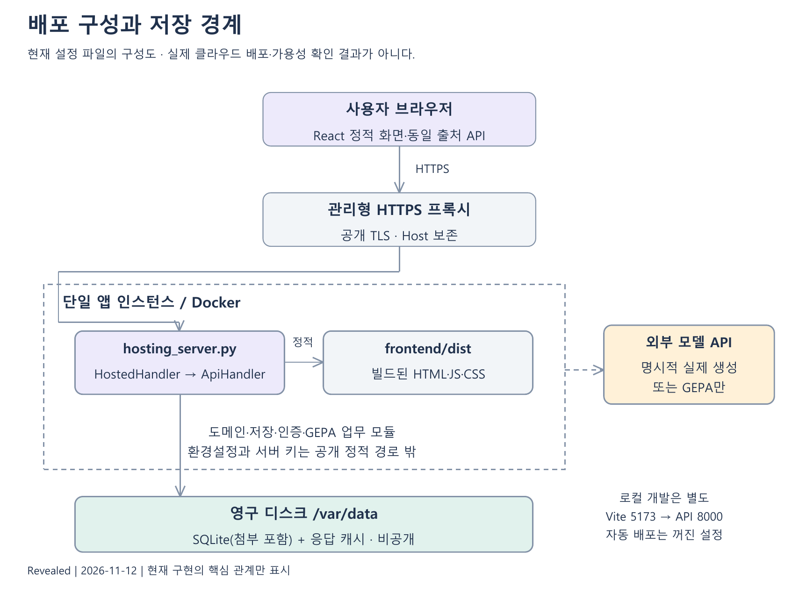

# 8. 권한·운영·품질과 변경 설계

## 8.1 신뢰 경계와 보호 대상

보호 대상은 계정 인증 정보, 개인 지침, 팀 기준, 업무 맥락, 첨부 원본, 모델 API 키, 호출 사용량과 실험 근거다. 브라우저 입력, 공유 링크, 원문·코드·첨부, 외부 모델 응답은 각각 검증할 입력이다. 화면이 버튼을 숨기는 것만으로 권한을 보장하지 않으며 서버에서 현재 계정과 자료 관계를 확인한다.

인증은 표준 라이브러리 기반 scrypt 비밀번호 해시와 세션 토큰을 사용한다. DB에는 원문 토큰 대신 SHA-256을 저장한다. 쿠키 설정, Origin/CORS와 HTTP 응답은 ApiHandler 책임이다. 운영 HTTPS와 Secure 쿠키 설정을 함께 확인해야 하며 로컬 개발 HTTP 예외를 공개 환경에 그대로 사용하지 않는다.

현재 비교용 메모리 세션은 ID로 접근하며 계정 소유권을 검사하는 개인 보관함과 다르다. 이 ID가 유출됐을 때의 접근 문제를 계정 격리 완료에 포함하지 않는다. 민감한 원문을 사용하는 운영 전에는 세션의 소유권/권한 정책, ID 유통 경로와 로그 보존을 우선 검토할 필요가 있다. 이번 문서 작성에서 해당 앱 코드를 변경하지 않았다.

## 8.2 권한 매트릭스

| 자료·행동 | 가능한 주체 | 서버 확인 | 주의점 |
|---|---|---|---|
| 개인 지침 읽기·수정·삭제 | 소유 회원 | owner_id와 현재 계정 | ID를 아는 것만으로 접근 불가 |
| 계정 팀 읽기 | 생성자·참여 회원 | protected와 참여 관계 | 생성자 삭제 시 공개 전환 금지 |
| 계정 팀 초대 관리 | 해당 팀장 | 생성자 권한·현재 팀 | 열린 초대·만료와 가입 권한 구분 |
| 새 코딩 팀 기준 수정 | 팀장 | code·계정·revision | 기존 React 집계와 다른 경로 |
| 프로젝트 보기 | 소유자·viewer·editor | 프로젝트 참여 | 팀 참여 권한과 별도 |
| 프로젝트 편집 | 소유자·editor | 역할 | viewer의 UI 조작 우회 검사 |
| 인수인계 초안 | 작성자 | owner_id | 저장은 공유가 아님 |
| 공유 작업 읽기 | 작성자·현재 지정 수신자 | 현재 관계·공유 시작 버전 | 링크 소유권으로 허가하지 않음 |
| 작업 이어받기·완료 | 지정 수신자 | 현재 상태·revision | 대기·진행 상태 전이 제한 |
| 첨부 열기 | 현재 접근자 | 현재 권한+요청 버전 목록 | 과거 파일 URL 재사용 우회 방지 |
| 개선 작업 조회·채택 | 시작한 회원 | job owner·만료 | 다른 사람 job ID 접근 거절 |
| 실제 작업 기록 | 소유 회원 | owner_id·revision | 계정 내 하나의 실행 타이머 |
| 비교 메모리 세션 | 세션 ID 보유자 경로 | 현재 세션·쌍 상태 | 개인 자료와 같은 계정 격리는 미구현 |

권한 실패를 상세 자료와 함께 반환해서는 안 된다. 실제 상태 코드는 API 장에서 각 분기의 현행 응답을 확인한다. 보안 설계와 테스트 존재는 전체 침투 시험이나 보안 인증을 의미하지 않는다.

## 8.3 주요 위협과 대응 현황

| 위험 시나리오 | 현재 대응 | 남는 확인 |
|---|---|---|
| 타인 저장 ID 추측 | 소유/참여/수신 관계 검사 | 모든 새 경로 추가 시 권한 회귀 |
| 공유 전 파일·회수된 링크 사용 | 현재 권한과 버전 파일 목록 대조 | 실제 다운로드 응답·브라우저 캐시 정책 |
| 비밀번호 무차별 대입 | 사용자명·주소별 실패 제한, 느린 해시 | 메모리 제한은 재시작 시 초기화; 운영 감시 |
| 쿠키·교차 사이트 요청 | 쿠키·Origin 및 요청 검증 | 역방향 프록시 구성과 신뢰 헤더 점검 |
| 첨부를 HTML로 실행 | 제한 MIME·텍스트 처리·실행 금지 | 업로드 변종·브라우저 다운로드 행태 |
| 원문 속 명령문 | 작업 데이터를 지침과 구별 | 모든 모델의 주입 저항을 보장하지 않음 |
| 유료 요청 반복 | 명시적 시작·캐시·사용량 상한 | 금액 예산·제공자 청구와 대조 |
| 미완료 요청 자동 재실행 | 개선 중단을 오류로 복구 | 사용자 재시작 의사와 비용 안내 |
| 자료를 GitHub에 잘못 게시 | 문서·합성 실험 경로만 게시 | 개인 DB·.env·첨부 원본 제외 확인 |
| 비교 세션 ID 유출 | TTL·용량 제한 | 계정 소유권·민감 원문 정책 추가 검토 |

비밀 값은 코드·문서·캡처·프론트 환경변수에 넣지 않는다. API 키는 운영 비공개 설정으로 관리한다. 이번 문서의 코드 확인은 .env나 사용자 DB를 읽지 않았고 데이터 사전은 빈 메모리 DB의 DDL에서 생성했다.

## 8.4 배포 구성

개발은 React 개발 서버와 Python API를 분리하고 개발 프록시로 연결한다. 운영용 hosting_server는 빌드된 React 정적 파일과 API를 같은 출처에서 제공한다. Dockerfile은 프론트 빌드와 Python·필요한 Node 검사 런타임을 준비한다. 실행 인스턴스와 SQLite/첨부/캐시가 놓인 영속 저장소의 수명을 분리한다.

현재 배포 파일이 있다는 사실과 실제 클라우드 서버가 개설·운영 중이라는 사실은 다르다. 이 문서 작업은 서버 생성·도메인 구매·배포를 하지 않는다. docs/DEPLOYMENT.md의 과거 비용·상품 설명을 현재 가격표로 재검증해 인용하지 않으며, 실제 유료 생성 전에 제공자의 최신 견적을 확인해야 한다.

실제 AI는 배포 기본 설정에서 꺼 두고 필요한 환경을 명시적으로 켜는 방식이다. 지침 조립·보관·팀·인수인계의 모델 없는 경로와 실제 생성·GEPA를 구별한다. 공개 서버는 빈 DB로 시작하고 로컬 예시 계정·자료를 자동 업로드하지 않는다.

## 8.5 설정과 실행 책임

| 설정 영역 | 담당·의미 | 점검 기준 |
|---|---|---|
| 모델 활성화 | PPT_LIVE와 환경별 GEPA 스위치 | 전체 스위치 하나로 모든 환경 활성화라 가정하지 않음 |
| 모델 선택 | 생성·반성 모델 환경 설정 | 설정 이름·실제 사용 모델·캐시 버전 기록 |
| 호출 상한 | 서버·계정·익명 주체별 quota | 재시작 후 유지와 금액 한도 차이 |
| 데이터 경로 | SQLite·캐시·첨부 보존 위치 | 재배포 시 소실되지 않는 저장소 |
| 쿠키·출처 | HTTPS·Secure·허용 Origin | 개발 예외와 운영 값 분리 |
| 정적 빌드 | frontend 빌드 산출물 | 소스·숨김 파일·경로 탈출 제공 방지 |
| 비밀 | 서버 비공개 환경 | Git·이미지·클라이언트에 포함하지 않음 |

운영 절차는 코드 버전, 환경, DB migration, 백업 시점과 함께 기록한다. 서버가 실행되더라도 실제 모델 키·검사 도구·디스크가 없으면 특정 기능이 비활성화될 수 있다. 정상 health 응답만으로 전체 업무를 검증했다고 보고하지 않는다.

## 8.6 실패 모드와 복구 설계

| 실패 | 자료 영향 | 사용자에게 보여 줄 상태 | 복구·확인 |
|---|---|---|---|
| 입력 형식·길이 오류 | 저장 전 중단 | 필드 오류·입력 유지 | 조건 수정 후 제출 |
| 로그인 만료 | 계정 저장 불가 | 로그인 필요·돌아갈 흐름 | 재인증 후 최신 자료 조회 |
| revision 불일치 | 이전 값 덮어쓰기 금지 | 충돌 | 최신값 조회 후 명시적 재적용 |
| 모델 타임아웃·실패 | 완료 결과 없음 | 오류·호출 상태 | 캐시·사용량 확인 후 선택적 재시도 |
| quota 초과 | 새 유료 호출 거절 | 상한 안내 | 다음 허용 시점·관리 설정 확인 |
| 개선 중 서버 재시작 | 실행 연결 끊김 | 중단 오류 | 자동 재과금 없이 사용자 판단 |
| 저장 디스크 소실 | 계정·첨부·버전 유실 가능 | 운영 장애 | 비공개 백업 복원·권한 검사 |
| SQLite 잠금 | 변경 실패 가능 | 저장 실패 | 짧은 작업·경합 확인·재조회 |
| 브라우저 저장 차단 | 초안 복구 제한 | 기본 안전 상태 | 서버 저장과 별개로 안내 |
| 늦은 응답 도착 | 화면 오염 위험 | 현재 상태 유지 | 요청 번호·취소로 오래된 응답 무시 |
| 공유 회수·대상 변경 | 이전 접근 소멸 | 접근 불가 | 현재 지정 계정 확인 |
| 파일 크기·누적량 초과 | 첨부 생성 거절 | 제한값 안내 | 자료 분리·보관 정책 검토 |
| 검사 도구 없음 | 일부 개선 시작 불가 | 실행 가능 여부 비활성 | 기존 의존성 설치 상태 확인 |

실패는 결과 평가와 구별한다. 인프라 오류로 실행하지 못한 답변을 기능 실패 또는 미준수로 자동 합산하지 않는다. 사용자가 반복해서 누른 요청과 서버에서 이미 진행 중인 요청을 구별해 중복 작업을 통제한다.

## 8.7 로그·관측·개인정보

운영에서 필요한 관측은 경로별 성공/실패 수, 처리 시간, 모델 호출 수·캐시 적중, quota 거절, 작업 상태, 저장 용량·백업 성공이다. 실제 사용자 원문·지침·첨부·비밀번호·API 키를 무조건 로그로 남기는 방식은 피한다. 현재 운영 관측 시스템을 완성했다고 주장하지 않으며 필요한 수집 항목과 비식별화·보존 기간을 별도 합의한다.

실험 근거는 과제·프롬프트·첫 응답·검사 버전·해시·평가를 보존한다. 합성 코딩 과제와 공개 가능한 점수만 문서 공간에 포함한다. 연구 데이터셋 원문과 다른 프로젝트의 첨부 PDF는 재배포하지 않는다. 내부 로컬 경로·실행 시간은 재현 메타데이터이며 사람의 사용 시간과 구별한다.

## 8.8 검사 계층과 실행 경계

| 계층 | 검증하는 것 | 검증하지 않는 것 |
|---|---|---|
| 단위 검사 | 검증 함수·상태 변환·경계값 | 브라우저 전체 업무 |
| API/저장 검사 | 입력·권한·revision·트랜잭션 | 실제 클라우드 네트워크·부하 |
| 프론트 함수 검사 | 조건 변환·복사 내용·초안 상태 | 화면의 모든 픽셀·키보드·보조기기 |
| 프론트 빌드 | 모듈 연결·번들 생성 | 사용자가 겪는 모든 동작 |
| 생성 코드 타입 | 고정 strict TypeScript 환경 | 실제 DOM 기능·보안 |
| 생성 코드 동작 | ReactDOM/JSDOM 기대 상호작용 | 실브라우저 레이아웃·스크린리더 |
| 조건 검토 | 원문 지침에 맞는 스타일·형식 | 사람의 취향·생산성 |
| 내용 검토 | 고정 핵심 명제·사실 문제 | 전체 문서 모든 의미·일반 성능 |

CI의 일반 범위는 API 미사용 pytest, 프론트 빌드, node --test다. 유료 모델 호출을 포함한 마커는 자동으로 실행하지 않는다. Docker/hosting 검사는 격리된 데이터로 수행해야 한다. 이 문서 작업에서 제품 전체 검사 묶음을 다시 실행한 것으로 표시하지 않는다.

## 8.9 요구사항 추적과 회귀 기준

| 요구 묶음 | 연결 UC/UI | 구현·검사 근거 | 대표 회귀 사례 |
|---|---|---|---|
| FR-01 | UC-01/UI-02 | auth.py, tests/test_auth.py | 실패 제한·계정 간 접근·로그아웃 |
| FR-02 | UC-02~03/UI-03 | service.py, engine/selector.py | 반복 회피·동률·종료·되돌림 |
| FR-03 | UC-04~05/UI-04 | summary_contracts_v2.py, summary_input_policy.py, docs/verification/2026-11-12-summary-policy | 약어·중복·원문변경·상한/하한 충돌·허용 해결값 |
| FR-04 | UC-06/UI-05~07 | coding_instructions.py, tests/test_coding_instructions.py | 미선택·환경 변경·조립 일치 |
| FR-05 | UC-08/UI-08 | domains/coding.yaml, benchmarks/react_style_current | 세 축·기본 영어·새 실행 과제 |
| FR-06 | UC-07/UI-06 | coding_elicitation.py, tests/test_coding_elicitation.py | 취소·엇갈림·ID·이력 버전 |
| FR-07 | UC-09~10/UI-09 | personal_prompts.py, tests/test_personal_prompts.py | 100개·revision·본문 해시 |
| FR-08 | UC-11~14/UI-10·12 | team.py, coding_team_guides.py | 비공개·초대·필수 규칙·환경 |
| FR-09 | UC-15/UI-11 | saved_preference_remix.py, saved_preference_restore.py | 부분 복원·삭제된 연결·스냅샷 |
| FR-10 | UC-16~17/UI-13 | handoffs.py, tests/test_handoffs.py | 상태별 역할·공유 시작 버전 |
| FR-11 | UC-18/UI-14 | handoff_files.py, tests/test_handoff_files.py | 크기·MIME·과거 파일·회수 |
| FR-12 | UC-16·19/UI-13·15 | draftCache.js, coding_optimization_jobs.py | 24시간·로그아웃·7일·중단 |
| FR-13 | UC-19~20/UI-15 | coding_gepa.py, coding_optimization_jobs.py | 환경·원본 고정·미개선·새 저장 |
| FR-14 | UC-20~21/UI-15 | coding_answer_review.py | 단서·미확인·직접 판단 범위 |
| FR-15 | UC-22~23/UI-16 | coding_work_exports.py, coding_work_trials.py | 보호 구역·2단계 시간·결측 |
| FR-16 | UC-24/UI-17~18 | template_library.py, prompt_workspace/ | 6/18 구분·확인 전 조립·버전 |

표의 구현·검사 경로는 소스 위치를 가리키며 각 요구의 모든 테스트를 열거한 것은 아니다. 신규 회귀가 생기면 실패 재현 입력과 기대 상태를 먼저 고정하고 해당 파일·요구 ID에 연결한다. 기존 실험 답변을 수정해 회귀 검사를 통과시키지 않는다.

## 8.10 설계 결정 기록

| 결정 | 채택 이유 | 비용·한계 |
|---|---|---|
| 확인한 조건을 목표로 삼기 | 사람 결과 없이도 전달·준수의 기술 검증 가능 | 실제 취향 발견·편의성은 별도 연구 |
| 요약·두 코딩 경로 분리 | 서로 다른 질문·지침 의미 유지 | 화면 안내와 기록 버전 관리 필요 |
| SQLite 유지 | 프로젝트 제약·작은 운영 구성 | 수평 확장·동시 쓰기 한계 |
| 도메인 YAML 분리 | 엔진에 업무 단어·규칙 넣지 않음 | 도메인별 검사 품질이 별도 필요 |
| 새 조합·개선은 새 항목 | 원본과 출처 보존 | 항목 증가·정리 UX 필요 |
| GEPA 선택적 | 현재 실험에서 일관된 개선 근거 미확보 | 사용자가 실행·채택을 판단 |
| 타입/동작/조건 분리 | 지시를 지켜도 코드가 틀릴 수 있음 | 검증 자료와 보고가 길어짐 |
| 강한 수동 기준선 | 좋은 수동 지침 대비 추가 가치 확인 | 제품 우위가 안 나와도 그대로 보고 |

## 8.11 남은 설계 보완 항목

우선 검토할 항목은 비교 세션의 계정/접근 정책, 기존 비교의 긴 입력 절단 안내, React 한국어·영어 지침 의미 정렬이다. 이는 코드와 실험 대조에서 드러난 구체 항목이며 사람에게 도움 된다는 주장과 별개다. 문서에서 한계를 확인했다고 제품 수정이 완료된 것으로 표시하지 않는다.

후속 결과 검증은 더 복잡한 새 과제와 다른 조합·오류 경계를 포함할 수 있다. 반복 횟수만 늘리기보다 평가가 지침의 실제 의미를 측정하는지 먼저 확인한다. UI 이해도, 지침 작성 시간, 수정 시간, 팀 채택은 실제 사용자 평가를 할 수 있을 때 별도 계획과 표본을 정한다.

## 8.12 변경·공개·릴리스 절차

변경은 요구 ID와 원인을 연결하고, 구현 파일·화면 상태·API·DB 영향·회귀 범위를 검토한다. 변경 후 필요한 검사를 실행하고 실제 실행 결과와 미실행 검사를 구별한다. 문서 변경은 코드 기준 SHA와 함께 관리한다. 문서 전용 브랜치는 앱의 로컬 미커밋 변경이나 계정 자료를 포함하지 않는다.

릴리스는 확인한 코드 커밋, 프론트 빌드, DB migration/백업, 환경·비밀 설정, 모델 기본 비활성 상태를 점검한다. 시작·로그인·저장·팀·첨부·재시작 후 보존을 격리된 예시 자료로 확인한 뒤 공개한다. 현재 작업은 문서 공간 게시와 실험 결과 정리이며 실제 서비스 릴리스가 아니다.
