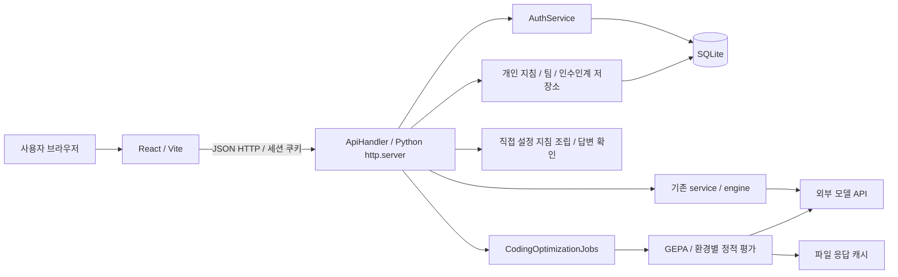
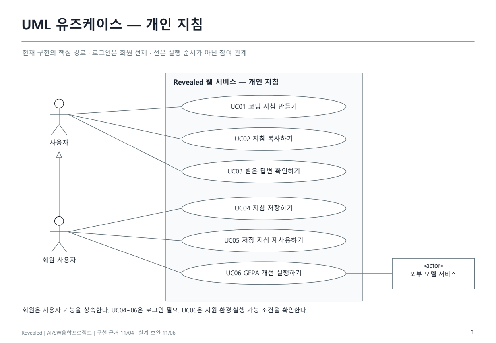
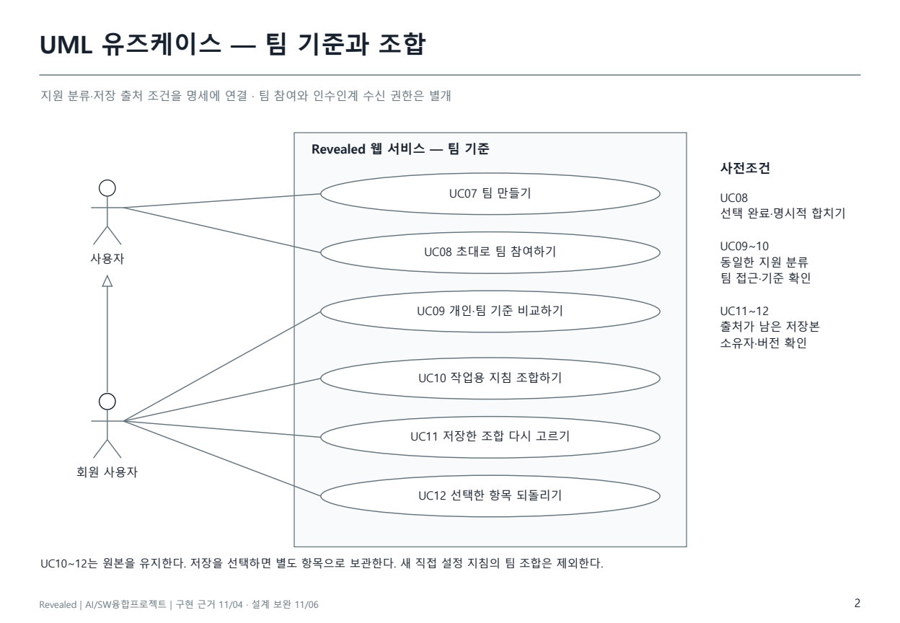
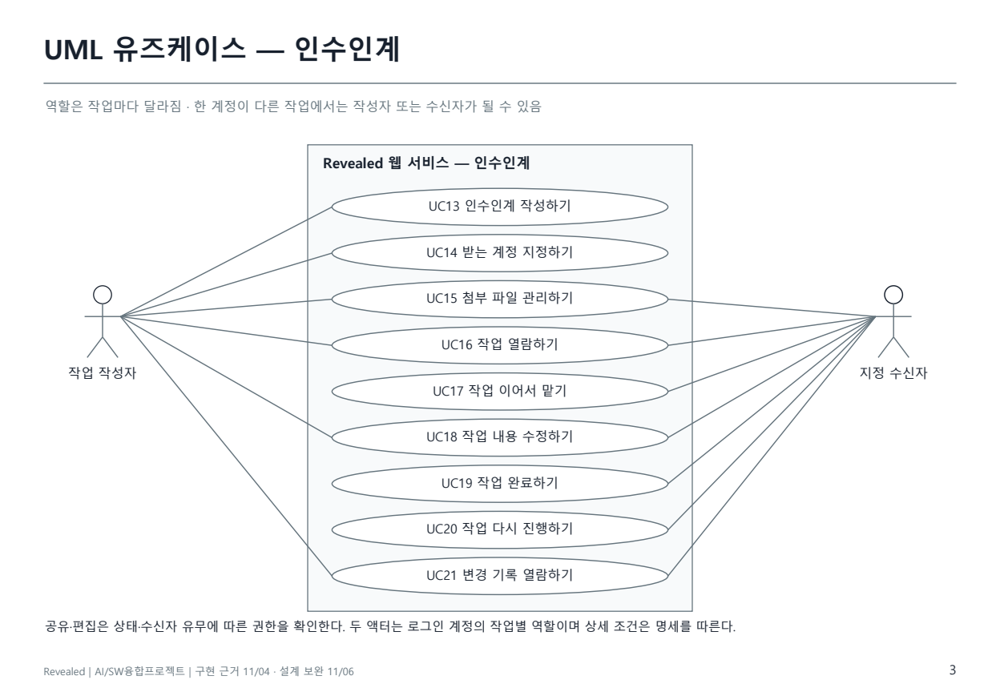
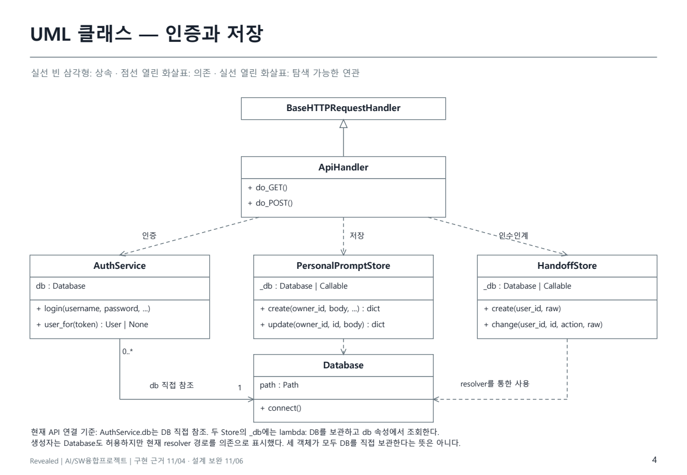
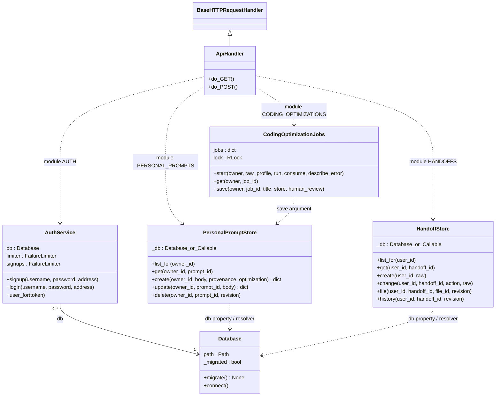
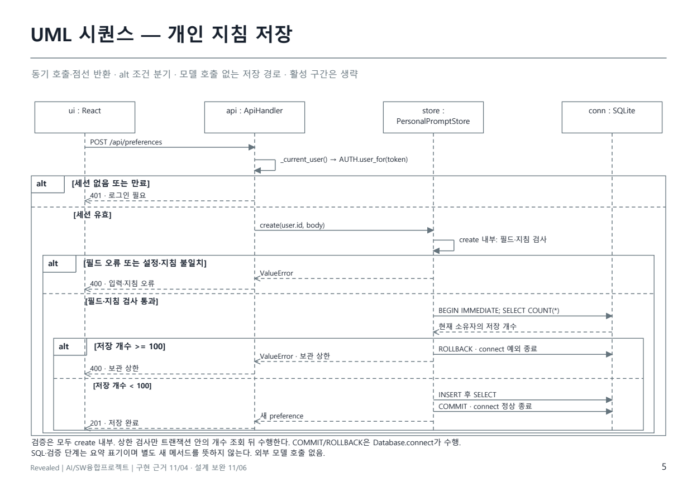
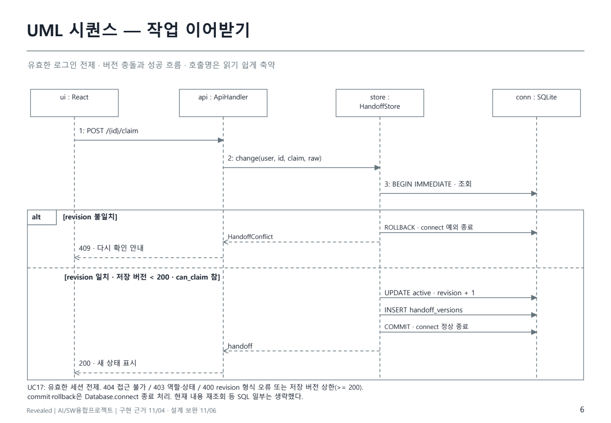
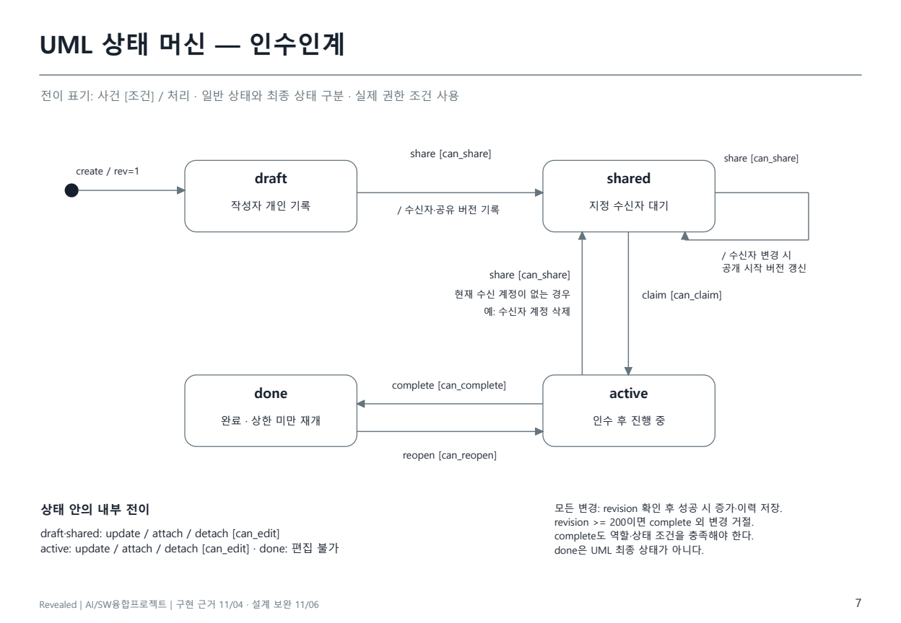
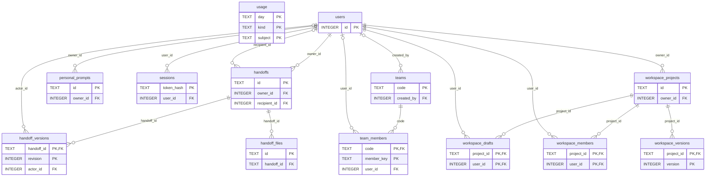

# Revealed 설계문서 · AI/SW융합프로젝트

작성일: 2026-11-05 · 팀원: 윤정우, 고차원

## 1. 목적과 설계 기준

사용자가 고른 선호로 프롬프트를 만들고, 저장한 지침을 새 작업에 다시 사용하는 웹 서비스다.
문서 요약과 코딩을 유지하며, 팀 기준 비교·작업용 조합·인수인계는 지침의 공유와 재사용을 돕는다.
AWS 기능은 이번 수업 범위에서 제외한다. 이번 기능 개발과 고차원의 별도 React 실험은 근거를 구분한다.

이 문서는 11/03~04에 구현한 내용을 11/05에 설계 산출물로 정리한 것이다. 구현 이전에 모든 설계문서가
완성되어 있었다는 뜻은 아니다. 현행 코드는 `a2f1292`, 연구 기록은 `fee9d1c`를 기준으로 한다.
새 코딩 4항목의 직접 선택과 기존 React 3축의 선호 추정은 다른 경로다.
보고서·문서 작성은 기능 수정, 신규 모델 실험, 원격 배포 또는 연구 브랜치 통합을 의미하지 않는다.

## 2. WBS와 역할

금주: 10/30~11/05 · 차주: 11/06~11/12. 실제 구현 날짜는 11/03~04, 설계 문서화는 11/05다.
막대형 WBS는 주간보고서 2쪽에 있다. ●는 해당 주의 확인 실적, ○는 앞으로의 작업 창이다.
담당은 수업에서 정리한 수행 영역과 다음 작업 제안이며, 모든 커밋의 단독 저작자 판정을 뜻하지 않는다.
후속 일정은 수업 피드백에 따라 조정한다. 전체 완료율은 산정하지 않는다.

| ID | 단계 | 작업·산출물 | 담당 | 기준 | 10/30~11/05 | 11/06~12 | 11/13~19 | 11/20~26 | 11/27~12/03 | 12/04~11 |
|---|---|---|---|---|---|---|---|---|---|---|
| 1.1 | 분석 | 기존 연구·서비스 범위 정리 | 공동 | 11/05 대조 | ● |  |  |  |  |  |
| 2.1 | 설계 | 기능·비기능 요구사항 / WBS | 윤정우 | 11/05 문서화 | ● | ○ |  |  |  |  |
| 2.2 | 설계 | UML·ERD·테이블·API 명세 | 윤정우 | 11/05 문서화 | ● | ○ |  |  |  |  |
| 2.3 | 설계 | 화면 정의·와이어프레임·스토리보드 | 윤정우 | 11/05 문서화 | ● | ○ |  |  |  |  |
| 3.1 | 구현 | 환경·예시 선택 / 지침 생성 | 윤정우 | 11/03~04 구현 | ● | ○ |  |  |  |  |
| 3.2 | 구현 | 보관·재사용·팀 조합·출처 이력 | 윤정우 | 11/03 구현 | ● | ○ | ○ |  |  |  |
| 3.3 | 구현 | 인수인계·첨부·접근 권한 | 윤정우 | 11/03~04 구현 | ● |  | ○ |  |  |  |
| 3.4 | 구현 | 업무 템플릿·요청 점검·GEPA 연결 | 윤정우 | 11/03~04 구현 | ● |  | ○ |  |  |  |
| 3.5 | 연구 | React 비교 실험 / 평가 도구 | 고차원 | 11/04 결과 | ● | ○ | ○ |  |  |  |
| 4.1 | 통합 | 연구 변경 선별 / 오류 수정 | 공동 | 미통합 |  | ○ | ○ |  |  |  |
| 4.2 | 검증 | 초안·작업 복귀 / 회귀 검사 | 윤정우 | 문제 재현 | ● | ○ | ○ |  |  |  |
| 4.3 | 검증 | 독립 과제의 스타일·기능 평가 | 고차원 | 후속 계획 |  | ○ | ○ | ○ |  |  |
| 5.1 | 이행 | 웹 호스팅 준비 / 운영 확인 | 윤정우 | 11/04 로컬 준비 | ● |  |  | ○ | ○ |  |
| 5.2 | 안정화 | 최종 시연·문서·결과 정리 | 공동 | 후속 계획 |  |  |  |  | ○ | ○ |

## 3. 기능 요구사항

| ID | 기능 | 요구사항 | 상태 | 근거 |
|---|---|---|---|---|
| FR01 | 계정·권한 | 로그인 계정별 보관함·작업을 구분한다. | 구현 | auth.py / api_server.py |
| FR02 | 기존 선택 비교 | 요약·React 결과를 비교해 지침을 만든다. | 기존 유지 | service.py / engine/ |
| FR03 | 코딩 선호 | 환경과 설명·주석·구성·출력 4항목을 직접 정한다. | 구현 | coding_instructions.py / coding_examples.py |
| FR04 | 저장·재사용 | 지침·선택 설정을 저장하고 새 작업에 재사용한다. | 구현 | personal_prompts.py |
| FR05 | 개인·팀 조합 | 지원 분류의 기준을 비교해 항목별 출처를 고른다. | 구현·범위 제한 | preference_comparison.py |
| FR06 | 조합 변경 이력 | 재조합·선택 되돌림을 별도 항목으로 저장한다. | 구현 | saved_preference_remix.py / saved_preference_restore.py |
| FR07 | 인수인계·첨부 | 목적·진행·남은 일·파일·지침을 공유하고 이어받는다. | 구현 | handoffs.py / handoff_files.py |
| FR08 | 업무 지침 | 24개 템플릿과 요청 구조 점검·작업 공간을 제공한다. | 구현 | template_library.py / prompt_workspace/ |
| FR09 | 선택적 GEPA | 지원 환경에서 원본 고정·보충 안내 탐색·새 저장을 한다. | 연결 구현 | coding_gepa.py / coding_optimization_jobs.py |
| FR10 | 답변 확인 | 형식 단서와 직접 확인 질문을 제공한다. | 구현 | coding_answer_review.py |
| FR11 | 초안·작업 복귀 | 상단 메뉴 이동 뒤 초안과 진행 작업을 복구한다. | 미완료 | docs/history/2026-11-04_project_review.md |

FR05는 같은 분류의 기존 비교 지침에 적용한다. 새 언어별 직접 설정 지침을 기존 React 팀 기준에 자동 조합하지 않는다.
FR08의 템플릿은 기존 선택 비교 6개와 확인·복사·점검용 새 초안 18개로 나뉜다.
FR09는 13개 언어/프레임워크 조합에 실행 경로가 있다는 뜻이며 전체 환경의 개선 효과를 입증한 것은 아니다.

## 4. 비기능 요구사항

| ID | 항목 | 요구사항 | 현재 확인 상태 |
|---|---|---|---|
| NFR01 | 접근 통제 | 소유자·지정 수신자와 요청 버전을 확인한다. | 구현 / 권한 검사 기록 |
| NFR02 | 데이터 일관성 | revision 충돌을 거절하고 조합 원본을 보존한다. | 구현 / 회귀 확인 |
| NFR03 | 지속성 | SQLite 저장 자료를 재시작 후에도 유지한다. | 로컬 확인 / 운영 미확인 |
| NFR04 | 비용 제한 | GEPA 작업당 요청 32회·성찰 4회, 동시 2개/계정 1개. | 구현 / 실비·지연 미측정 |
| NFR05 | 첨부 제한 | 파일 5MiB·현재 10개·이전 포함 작업당 20MiB. | 구현 / 경계·권한 검사 |
| NFR06 | 평가 추적성 | 평가 버전·별도 과제·실패·미확인을 구분한다. | 기록 구현 / 효과 후속 검증 |
| NFR07 | 사용 흐름 | 선택→생성→저장→재사용과 이동 복귀를 보장한다. | 일부 확인 / 복귀 보완 필요 |
| NFR08 | 운영 품질 | HTTPS·백업 복구·실제 접속·응답 시간을 확인한다. | 계획 / SLA 미설정 |

NFR07의 합격 기준은 상단 이동 전후 입력 유지 또는 이탈 경고, 계정별 진행 작업 재열람이다. 현재 미완료다.
NFR08의 응답시간·동시 사용자·가용성 수치를 측정 없이 정하지 않는다. 운영 확인 시 조건과 관측치를 기록한다.

## 5. 시스템 구성



`FastAPI`는 생성 코드의 대상 환경 중 하나다. 현재 앱 API 서버 프레임워크는 FastAPI가 아니라 Python 표준 `http.server`다.
직접 설정 지침 조립과 붙여 넣은 답변 확인은 모델 호출·생성 코드 실행을 하지 않는다.
호스팅용 `hosting_server.py`는 React 빌드와 API를 같은 주소에서 제공한다. Docker·영구 저장 설정은 준비했고 공개 운영은 미확인이다.

## 6. UML과 상세 동작 명세

11/05 보완: 보고서 11~13쪽의 관계 표기를 수정하고, 읽을 수 있는 크기의 [UML 상세 PDF](../../../output/pdf/Revealed_UML_상세설계_2026-11-05.pdf)를 추가했다. 아래 그림은 같은 PDF에서 생성한 이미지다. 기능 구현이나 새 실험을 추가한 결과는 아니다.

11/06 추가 검토: 클래스 관계의 주입 방식, 저장소 내부 검증과 트랜잭션 순서, 이어받기의 버전 상한·오류 조건을 코드와 다시 대조했다. 보고서와 UML 별첨의 공통 그림 및 명세를 함께 수정했다.

### 6.1 기존 그림의 검토 결과와 표기 원칙

기존 유즈케이스 그림은 여러 목적을 한 타원에 묶었고, 외부 모델 액터의 표기가 불완전했다. 클래스 그림은 상속을 문장으로만 적고 의존·연관선을 합쳐 연결 대상을 읽기 어려웠다. 기존 Mermaid `flowchart` 대응도는 사용자와 기능의 대응을 설명하는 보조 그림이었으며 정식 UML 유즈케이스 도식으로 제출하기에는 부족했다.

단순한 그림 자체가 UML 위반은 아니다. 이 문서에서는 **표기의 적합성**, **현재 코드와의 일치**, **상세 설계에 충분한 설명**을 따로 확인했다. 클래스의 일부 속성·메서드 생략은 허용하되 그림의 범위를 표시한다. 모든 사용 목적을 한 장에 넣지 않고 개인 지침·팀 기준·인수인계의 세 관점으로 나눴다.

표기 기준은 [OMG UML 2.5.1](https://www.omg.org/spec/UML/2.5.1) 18장(Use Cases), 9·11장(Classifiers/Structured Classifiers), 17장(Interactions), 14장(State Machines)이다. 일반화의 빈 삼각형은 상위 역할·클래스 쪽을 가리키며, 의존은 사용하는 쪽에서 대상 쪽으로 점선 화살표를 그린다. 액터와 유즈케이스의 실선은 참여 관계이고 클릭 순서가 아니다.

`include`는 포함 행동을 수행하는 관계, `extend`는 확장 지점에서 추가 행동을 삽입하는 관계다. 단순히 다음 버튼이거나 선택 기능이라는 이유만으로 붙이지 않았다. 이 모델은 독립적으로 시작할 수 있는 사용 목적과 사전조건을 중심으로 작성하여 두 관계를 사용하지 않았다. 로그인은 저장 등 회원 기능의 사전조건이며 매번 로그인 유즈케이스를 실행한다는 의미가 아니다.

시스템 구성도는 논리적 구성 설명, ERD는 관계형 데이터 모델, 와이어프레임은 화면 설계다. 세 자료를 UML 다이어그램으로 부르지 않는다. 기존 보고서 16쪽의 간단한 화면 그림은 배치·이동을 설명하는 요약 와이어프레임이며, 실제 화면과 필드·상태 명세는 9절 및 보고서 17~18쪽으로 보완한다.

### 6.2 Use Case 관점별 그림



회원 사용자는 일반 사용자 역할을 특수화한다. 따라서 지침 생성·복사·답변 확인을 이용할 수 있고 저장·저장본 재사용·GEPA 실행에는 로그인 조건이 더해진다. 외부 모델 서비스는 GEPA 실행에 참여하는 외부 시스템 액터다. 사용자가 복사한 지침을 다른 AI에 붙여 넣는 작업은 이 서비스 밖에서 일어나므로 API 연결 관계로 그리지 않았다.



팀 참여, 개인·팀 비교, 조합, 재조합, 선택 되돌림은 서로 구분했다. 현재 API에서 팀 생성·선택 이력 합치기는 비로그인 사용자 경로도 허용한다. UC08은 초대 코드로 연결한 뒤 선택을 마치고 명시적으로 팀에 합치는 단계까지를 뜻한다. UC09~12는 로그인한 개인 보관함 경로다. UC10~12의 저장은 각 흐름에서 사용자가 선택하는 대안 단계다. 보관한 원본은 유지하고 새로운 항목을 만든다. 직접 설정한 새 코딩 지침을 기존 React 팀 기준에 조합하는 기능은 현재 범위에 없다.



작성자·수신자는 특정 작업에 대한 역할이다. 한 사람이 모든 작업에서 같은 역할인 것은 아니다. 두 액터의 연결선은 권한이 항상 허용된다는 뜻이 아니다. 상태·버전·현재 수신 계정 조건은 아래 명세를 적용한다. 링크를 아는 것만으로 열람할 수 없다.

### 6.3 유즈케이스 목록과 요구사항 추적

아래는 이번 주 변경의 핵심 범위다. 기존 비교 서비스와 작업 공간의 모든 내부 동작을 전수 모델링했다는 뜻은 아니다. UC22~25는 기존 유지·다른 화면의 기능으로 목록에 남기고 위 세 그림에서는 생략했다.

| ID | 사용자 목적 | 요구사항 | 조건·주요 결과 | 코드 근거 |
|---|---|---|---|---|
| UC01 | 코딩 지침 만들기 | FR03 | 환경·4항목 완성, 준비 예시 또는 직접 설정, 모델 호출 없이 조립 | coding_instructions.py / coding_examples.py |
| UC02 | 지침 복사하기 | FR03·04 | 지침 또는 이번 작업을 포함한 요청을 복사 | frontend/src/features/coding-instructions/ |
| UC03 | 받은 답변 확인하기 | FR10 | 형식 단서와 직접 확인 질문; 코드 실행·자동 저장 없음 | coding_answer_review.py |
| UC04 | 지침 저장하기 | FR04 | 로그인, 본문·설정 일치 확인, 새 개인 항목 생성 | personal_prompts.py |
| UC05 | 저장 지침 재사용하기 | FR04 | 소유자 접근, 설정·본문 불일치 안내 | personal_prompts.py / frontend/src/features/preferences/ |
| UC06 | GEPA 개선 실행하기 | FR09 | 지원 환경·실행 준비·한도 확인, 개선 후보 비교 후 새 저장 선택 | coding_optimization_jobs.py / coding_gepa.py |
| UC07 | 팀 만들기 | FR05 | 팀 이름·분류 설정, 비로그인 경로도 허용 | team.py / api_server.py |
| UC08 | 초대로 팀 참여하기 | FR05 | 유효한 초대 코드, 선택 완료 후 명시적 합치기 | team.py / api_server.py |
| UC09 | 개인·팀 기준 비교하기 | FR05 | 지원 분류와 접근 조건 확인, 차이 표시 | preference_comparison.py |
| UC10 | 작업용 지침 조합하기 | FR05 | 항목별 기준 선택, 현재 기준·버전 확인, 별도 저장 선택 | preference_comparison.py / api_server.py |
| UC11 | 저장한 조합 다시 고르기 | FR06 | 저장 출처에서 재선택, 새 저장본·부모 연결 | saved_preference_remix.py |
| UC12 | 선택한 항목 되돌리기 | FR06 | 변경 전 기록이 있는 항목만 선택 복원, 새 저장 선택 | saved_preference_restore.py |
| UC13 | 인수인계 작성하기 | FR07 | 로그인, 목적·진행·남은 일 저장, draft / revision=1 | handoffs.py:create |
| UC14 | 받는 계정 지정하기 | FR07 | can_share, 같은 서버의 다른 계정, shared 전환 | handoffs.py:change |
| UC15 | 첨부 파일 관리하기 | FR07 | can_edit, 파일 크기·개수·누적 한도, 추가·제외 이력 | handoffs.py / handoff_files.py |
| UC16 | 작업 열람하기 | FR07 | 현재 소유자·수신자; 파일은 요청 버전의 목록도 확인 | handoffs.py:get / file |
| UC17 | 작업 이어서 맡기 | FR07 | 현재 지정 수신자·shared·저장 revision < 200, active 전환 | handoffs.py:change |
| UC18 | 작업 내용 수정하기 | FR07 | can_edit와 revision 확인, 변경 기록 추가 | handoffs.py:change |
| UC19 | 작업 완료하기 | FR07 | 현재 수신자·active, done 전환 | handoffs.py:change |
| UC20 | 작업 다시 진행하기 | FR07 | 현재 수신자·done, active 전환 | handoffs.py:change |
| UC21 | 변경 기록 열람하기 | FR07 | 수신자는 본인 공유 시작 버전 이후만 접근 | handoffs.py:history |
| UC22 | 계정 가입·로그인 | FR01 | 세션 발급, 인증·실패 제한 | auth.py |
| UC23 | 기존 결과 비교로 지침 만들기 | FR02 | 기존 요약·React 선호 추정 경로 유지 | service.py / engine/ |
| UC24 | 템플릿으로 업무 지침 만들기 | FR08 | 기존 비교 6개, 새 업무 초안 18개 | template_library.py / prompt_workspace/ |
| UC25 | 요청 구조 점검하기 | FR08 | 템플릿 내부 진입, 점검 결과 확인 | api_server.py / prompt_workspace/ |

FR11의 화면 이동 후 초안·작업 복귀는 **미완료 요구사항**이며 완료한 유즈케이스로 추가하지 않았다. UML 정리는 연구의 개선 효과나 사용자 만족도를 입증하지 않는다.

### 6.4 핵심 유즈케이스 상세 명세

#### UC04 지침 저장하기

- 주 액터: 회원 사용자. 시작: 완성한 지침에 이름을 입력하고 저장 요청.
- 사전조건: 유효한 로그인, 제목·분류·지침 등 필수 입력. 직접 설정 지침이면 선택 설정이 완성되어야 한다.
- 기본 흐름: POST `/api/preferences` → API의 `_current_user()`로 세션 확인 → `PersonalPromptStore.create()` → Store 내부 필드 검사 → `codingProfile`이 있으면 다시 조립하여 본문과 대조 → `Database.connect()` 안에서 `BEGIN IMMEDIATE` → 소유자별 `SELECT COUNT(*)`로 보관 한도 100개 검사 → 새 행 저장·조회 → 연결 컨텍스트 정상 종료 시 commit → 201 응답.
- 대안: 일반 저장 지침처럼 `codingProfile`이 없는 경우 환경 설정 대조 단계는 적용하지 않는다. 개선본 저장은 UC06의 서버 작업 결과에서 별도로 수행한다.
- 실패: 세션 없음·만료 401. create 내부의 입력·본문 불일치·보관 상한은 `ValueError`이고 API가 400으로 변환한다. 입력·본문 검사 실패는 트랜잭션 시작 전, 상한 실패는 트랜잭션 시작 후이며 후자는 컨텍스트 예외 종료 시 rollback된다. 새 항목을 생성하지 않는다.
- 사후조건: 소유자, 지침, 설정이 있는 경우 그 스냅샷, revision=1을 기록한다. 이번 작업 원문과 답변은 자동 저장하지 않는다.
- 연결: FR04, NFR01·02·03. SQLite `personal_prompts`. 아래 저장 시퀀스 참조.

#### UC06 GEPA 개선 실행하기

- 주 액터: 회원 사용자. 보조 액터: 외부 모델 서비스.
- 사전조건: 지원하는 환경과 완성한 원본 지침, 실제 실행 준비, 로그인·사용량·동시 작업 조건 충족.
- 기본 흐름: 사용자 실행 요청 → 서버 조건 확인 → 작업 생성 → 후보 탐색과 별도 과제 검사 → 결과 조회 → 전후 지침·답변과 검사 범위 확인.
- 대안: 같은 계정의 동일 설정 작업이 진행 중이면 해당 작업을 반환한다. 더 나은 후보가 없으면 원본을 유지한다. 개선 후보를 채택하고 직접 판단을 입력하면 서버 작업 결과를 이용해 **새 항목**으로 저장한다.
- 실패: 미지원 환경, 한도 초과, 모델 오류, 소유자가 다른 작업 조회 등을 각 API 계약에 따라 거절·실패 처리한다. 실패를 개선 성공으로 집계하지 않는다.
- 사후조건: 실행 결과는 서버 메모리 작업에 남는다. 채택 저장본만 SQLite에 지속된다. 서버 재시작 시 진행 작업을 영구 복구한다는 보장은 없다.
- 연결: FR09, NFR04·06. 실행 경로와 자동 검사는 구현되어 있으나 모든 환경의 효과가 입증된 것은 아니다.

#### UC14 받는 계정 지정하기

- 주 액터: 작업 작성자. 사전조건: 로그인, 작업 접근 가능, `can_share=true`, 최신 revision, 같은 서비스의 다른 계정.
- 기본 흐름: username·revision 요청 → 접근·버전·권한 검사 → 수신 계정 확인 → 수신자가 바뀌면 공개 시작 버전을 다음 revision으로 설정 → shared 및 이력 저장.
- 대안: shared에서 다른 수신자로 재지정할 수 있다. 현재 수신자가 제거되어 NULL이고 작업이 done이 아니면 작성자의 재지정이 가능하다.
- 실패: 접근 불가 404, 버전 충돌 409, 역할·상태 불일치 403, 존재하지 않는 계정·자기 자신 지정·revision 형식 오류·저장 버전 상한 400.
- 사후조건: 현재 지정 계정만 수신자 권한을 갖는다. 재지정된 이전 수신자의 접근은 유지되지 않는다. 링크 생성은 권한 부여의 근거가 아니다.

#### UC17 작업 이어서 맡기

- 주 액터: 지정 수신자. 사전조건: 유효한 로그인, 현재 작업의 recipient, shared 상태, 최신 revision, 현재 저장 revision < 200.
- 기본 흐름: POST `/api/handoffs/{id}/claim` → `BEGIN IMMEDIATE` → 접근 가능한 현재 작업 조회 → 요청 revision의 형식·현재 값 일치 확인 → 저장 revision 상한 확인 → `can_claim` 확인 → active와 revision+1 저장 → 같은 트랜잭션으로 이력 기록 → `Database.connect()` 컨텍스트 정상 종료 시 commit → Store 반환 → 200 응답.
- 실패: 세션 없음 401, 접근 불가 404, 버전 충돌 409, 역할·상태 불일치 403. **400은 저장 revision >= 200인 경우와 요청 revision의 누락·형식 오류·1 미만인 경우 모두 발생**한다. `expected_revision()`은 정수가 아닌 값(문자열·bool 포함)도 거절한다. 실패 시 변경을 확정하지 않는다. API 검사의 실제 순서상 여러 조건에 동시에 걸리면 먼저 검사한 오류가 반환된다.
- 사후조건: 지정 수신자가 편집할 수 있다. 변경 전후 상태·버전이 추적 가능하다. 화면은 서버 응답을 반영한다.
- 연결: FR07, NFR01·02. `handoffs`와 `handoff_versions`를 함께 사용한다.

### 6.5 Class Diagram



그림의 `ApiHandler`는 `BaseHTTPRequestHandler`를 실제 상속한다. 인증·개인 보관함·인수인계 객체는 API 모듈 전역으로 사용하므로 핸들러의 소유 속성이나 합성(composition)으로 만들지 않았다. **그림은 현재 `api_server.py`의 객체 연결을 기준으로 한다.** `AUTH = AuthService(DB)`는 Database 객체를 직접 참조하지만 `PERSONAL_PROMPTS = PersonalPromptStore(lambda: DB)`와 `HANDOFFS = HandoffStore(lambda: DB)`는 `_db`에 Callable을 보관한다. 두 Store의 `db` 속성이 그 함수를 호출해 현재 Database를 조회하므로 이 경로를 의존으로 표시했다. 이유와 현재 주입 방식을 PDF 하단에도 명시했다.

두 Store의 생성자 자체는 Database 객체의 직접 주입도 허용한다. 그런 사용례를 모델링한다면 연관 관계로 표현할 수 있으며, 세 클래스를 추상적인 DB 접근 서비스로 묶은 개요도에서 관계를 통일하는 것도 별도의 모델링 선택이다. 현재 그림을 세 객체 모두 DB를 직접 보관한다는 모델로 읽지 않도록 구분했다. `0..*`와 `1`은 AuthService 인스턴스와 Database 참조의 관계이며 행 개수가 아니다.

속성·메서드는 핵심만 표시한다. `...`는 선택 인수 생략, `id`는 prompt_id 또는 handoff_id의 축약이다. Python 내부 속성 `_db`를 언어가 강제하는 private로 재해석하지 않았다. 아래는 편집용 상세 클래스 모델이다.



`Database_or_Callable`은 Python union을 읽기 쉽게 쓴 표기 별칭이지 새 클래스가 아니다. 선택 인수와 키워드 전용 인수의 기본값은 실제 시그니처를 따른다. 지침 조립·재조합은 함수 모듈이므로 존재하지 않는 클래스를 추가하지 않았다.

### 6.6 Sequence Diagram



이 그림은 UC04의 인증 실패·입력 불일치·보관 상한·정상 저장을 중첩 alt로 구분한다. 바깥 alt는 세션 유효성만 다루며, 로그인 성공 뒤 create를 호출한다. 필드·지침 대조는 Store 내부에서 수행하고, 통과해야 BEGIN IMMEDIATE와 소유자별 개수 조회로 진행한다. 그 뒤 저장 개수 상한을 판단한다. 따라서 입력 불일치 때도 DB 개수를 먼저 센다고 읽히지 않도록 상한 분기를 한 단계 더 나눴다.

인증은 API의 실제 자기 호출 `_current_user()`로 그렸다. 그 안에서 `AUTH.user_for(token)`에 위임하며, 같은 요청에 `_user_cache`가 이미 있으면 재사용한다. 라이프라인은 참여 객체, 실선 채운 화살표는 동기 호출, 점선은 반환이다. 활성 구간은 생략했다. `conn : SQLite`는 연결 컨텍스트가 관리하는 DB 연결을 나타낸다. COMMIT/ROLLBACK 화살표는 `Database.connect()` 컨텍스트 종료의 효과를 DB 연결 쪽에 표현한 것이며, Store 코드가 직접 commit 메서드를 호출한다는 뜻은 아니다. SQL 저장·조회와 내부 검증 단계는 읽기 위한 요약 표기다.



UC17의 버전 충돌과 정상 전환을 비교한다. 상태 업데이트와 버전 기록은 같은 트랜잭션이며 정상 컨텍스트 종료의 COMMIT 이후 Store가 반환한다. 충돌은 예외 종료의 ROLLBACK 이후 API가 409로 변환한다. 그림에는 유효한 로그인 전제를 두었으며 400·403·404는 하단과 UC17 명세로 분리했다. 400의 구체적 원인은 요청 revision 형식과 저장 버전 상한이다. 정상 분기에도 저장 revision < 200 조건을 표시했다. 이 다이어그램은 새로 수행한 실행 로그가 아니라 현재 코드에서 정리한 설계 설명이다.

### 6.7 State Machine과 권한



상태 이름 draft/shared/active/done은 실제 저장값이다. done은 reopen으로 active로 돌아갈 수 있는 일반 상태이며 UML 최종 상태 기호를 사용하지 않는다. 내부 전이인 내용 수정·첨부 변경은 상태를 유지하면서 revision과 이력을 갱신한다.

| 조건 | 코드와 대응하는 의미 |
|---|---|
| waiting | status가 draft/shared이거나 recipient_id가 NULL |
| can_edit | done이 아니며 (작성자이고 waiting) 또는 (현재 수신자이고 active) |
| can_share | 작성자이고 waiting이며 done이 아님 |
| can_claim | 현재 수신자이고 shared |
| can_complete | 현재 수신자이고 active |
| can_reopen | 현재 수신자이고 done |

모든 변경은 먼저 요청 revision의 형식과 현재 값 일치를 검사한다. 변경 성공 시 revision을 늘리고 이력을 기록한다. 일반 경로 외에도 **수신 계정 삭제 시 recipient_id 외래키의 ON DELETE SET NULL**로 대상이 없는 active 작업이 생길 수 있으며 이때 작성자가 다시 공유할 수 있다. shared 자기 전이의 효과는 `/ 수신자 변경 시 공개 시작 버전 갱신`으로 통일했다. 같은 수신자를 지정하면 공유 시작 버전을 새로 잡지 않는다.

**현재 저장 revision >= 200이면 complete를 제외한 변경을 거절한다.** complete에도 기존 `can_complete` 권한·상태 검사와 요청 revision 검사가 적용된다. 따라서 done에서 active로 돌아가는 reopen은 상한 미만에서만 가능하다. 그림 하단의 공통 제약은 모든 상태 전이·내부 변경에 적용한다.

### 6.8 설계 검토와 다음 확인

- 문서 보완 완료: 유즈케이스 3개 관점·핵심 목적 21개, 보조 기능 목록, 핵심 UC 4개 상세 명세, 클래스 관계 수정, 시퀀스 2개, 상태·권한 명세, 기존 전체 13개 ERD·테이블/API와 연결.
- 아직 전수 상세 명세는 아님: 모든 메뉴·계정 관리·작업 공간 동작의 상세 UC는 필요 시 확장한다. 보고서는 대표 그림이며 상세 설계문서와 함께 공유한다.
- 후속 검증 제안: 2개 계정으로 공유→수신→버전 충돌→재개를 확인하고, 초안 보존·진행 작업 재열람 요구사항을 점검한다. 이번 도식 수정 중 이를 새로 실행했다고 보고하지 않는다.

### 6.9 11/06 UML 동료 검토 판정

| 지적 | 코드 대조 판정 | 반영 |
|---|---|---|
| 세 DB 관계선 통일 | 현재 API 주입 방식은 서로 다름. 무조건 같은 선이어야 하는 것은 아님 | 점선 의존의 Callable 근거를 PDF 4쪽에도 명시 |
| 저장 검증 위치 | 맞음. 필드·지침과 상한 검증 모두 create 내부이며 상한은 트랜잭션 안 | 5쪽 중첩 alt와 DB 조회·검증 순서 수정 |
| 인증 호출·commit 표시 | 맞음. API 자기 호출과 컨텍스트 종료 효과를 더 명확히 표시해야 함 | 5쪽 자기 호출, 5·6쪽 DB 연결로 향하는 commit·rollback 메시지 |
| 이어받기 400은 상한 | 상한 누락 지적은 맞음. 상한만이 유일한 원인은 아님 | 6·8쪽 및 UC17에 revision 형식 오류와 200 상한 병기 |
| 상태도 상한·효과·계정 삭제 예 | 맞음 | 7쪽 공통 제약·효과 표기·삭제 예시 보완 |
| 중복된 사용자 표기 | 혼동 가능성이 있음 | 1쪽 상속선 옆의 별도 문구 삭제, 회원 사용자 이름 유지 |

대조 위치: `api_server.py` 124~125·344·590·936행, `personal_prompts.py` 34·41·91행, `handoffs.py` 14·118행, `app_db.py` 141·203행. 이 검토는 코드 읽기와 문서 수정이며 애플리케이션을 새로 실행한 검증은 아니다.


## 7. ERD와 테이블 정의

아래 정의는 `app_db.py`의 migration 1~10을 메모리 SQLite에 적용해 추출한 현행 스키마다.
사용자 DB를 읽거나 변경하지 않는다. JSON 속의 출처 연결은 DB 외래키가 아니며 별도 검증한다.



### `handoff_files` — 첨부 원본

| 컬럼 | SQLite 타입 | 키 순서 | NULL 선언 | 기본값 | FK / 삭제 정책 |
|---|---|---|---|---|---|
| id | TEXT | PK 1 | 명시 없음 | — | — |
| handoff_id | TEXT |  | NOT NULL | — | handoffs.id / ON DELETE CASCADE |
| name | TEXT |  | NOT NULL | — | — |
| content_type | TEXT |  | NOT NULL | — | — |
| size | INTEGER |  | NOT NULL | — | — |
| data | BLOB |  | NOT NULL | — | — |
| created_at | TEXT |  | NOT NULL | — | — |

```sql
CREATE TABLE handoff_files (
        id TEXT PRIMARY KEY,
        handoff_id TEXT NOT NULL REFERENCES handoffs(id) ON DELETE CASCADE,
        name TEXT NOT NULL,
        content_type TEXT NOT NULL,
        size INTEGER NOT NULL,
        data BLOB NOT NULL,
        created_at TEXT NOT NULL
    );
```

### `handoff_versions` — 인수인계 변경 기록

| 컬럼 | SQLite 타입 | 키 순서 | NULL 선언 | 기본값 | FK / 삭제 정책 |
|---|---|---|---|---|---|
| handoff_id | TEXT | PK 1 | NOT NULL | — | handoffs.id / ON DELETE CASCADE |
| revision | INTEGER | PK 2 | NOT NULL | — | — |
| actor_id | INTEGER |  | 명시 없음 | — | users.id / ON DELETE SET NULL |
| event | TEXT |  | NOT NULL | — | — |
| snapshot_json | TEXT |  | NOT NULL | — | — |
| saved_at | TEXT |  | NOT NULL | — | — |

```sql
CREATE TABLE handoff_versions (
        handoff_id TEXT NOT NULL REFERENCES handoffs(id) ON DELETE CASCADE,
        revision INTEGER NOT NULL,
        actor_id INTEGER REFERENCES users(id) ON DELETE SET NULL,
        event TEXT NOT NULL,
        snapshot_json TEXT NOT NULL,
        saved_at TEXT NOT NULL,
        PRIMARY KEY (handoff_id, revision)
    );
```

### `handoffs` — 인수인계 현재 상태

| 컬럼 | SQLite 타입 | 키 순서 | NULL 선언 | 기본값 | FK / 삭제 정책 |
|---|---|---|---|---|---|
| id | TEXT | PK 1 | 명시 없음 | — | — |
| owner_id | INTEGER |  | NOT NULL | — | users.id / ON DELETE CASCADE |
| recipient_id | INTEGER |  | 명시 없음 | — | users.id / ON DELETE SET NULL |
| recipient_from_revision | INTEGER |  | NOT NULL | 0 | — |
| title | TEXT |  | NOT NULL | — | — |
| body_json | TEXT |  | NOT NULL | — | — |
| status | TEXT |  | NOT NULL | 'draft' | — |
| revision | INTEGER |  | NOT NULL | 1 | — |
| created_at | TEXT |  | NOT NULL | — | — |
| updated_at | TEXT |  | NOT NULL | — | — |

```sql
CREATE TABLE handoffs (
        id TEXT PRIMARY KEY,
        owner_id INTEGER NOT NULL REFERENCES users(id) ON DELETE CASCADE,
        recipient_id INTEGER REFERENCES users(id) ON DELETE SET NULL,
        recipient_from_revision INTEGER NOT NULL DEFAULT 0,
        title TEXT NOT NULL,
        body_json TEXT NOT NULL,
        status TEXT NOT NULL DEFAULT 'draft' CHECK(status IN ('draft','shared','active','done')),
        revision INTEGER NOT NULL DEFAULT 1,
        created_at TEXT NOT NULL,
        updated_at TEXT NOT NULL
    );
```

### `personal_prompts` — 개인 지침·설정·출처

| 컬럼 | SQLite 타입 | 키 순서 | NULL 선언 | 기본값 | FK / 삭제 정책 |
|---|---|---|---|---|---|
| id | TEXT | PK 1 | 명시 없음 | — | — |
| owner_id | INTEGER |  | NOT NULL | — | users.id / ON DELETE CASCADE |
| title | TEXT |  | NOT NULL | — | — |
| domain_key | TEXT |  | NOT NULL | — | — |
| prompt | TEXT |  | NOT NULL | — | — |
| note | TEXT |  | NOT NULL | '' | — |
| revision | INTEGER |  | NOT NULL | 1 | — |
| created_at | TEXT |  | NOT NULL | — | — |
| updated_at | TEXT |  | NOT NULL | — | — |
| provenance_json | TEXT |  | 명시 없음 | — | — |
| coding_profile_json | TEXT |  | 명시 없음 | — | — |

```sql
CREATE TABLE personal_prompts (
        id TEXT PRIMARY KEY,
        owner_id INTEGER NOT NULL REFERENCES users(id) ON DELETE CASCADE,
        title TEXT NOT NULL,
        domain_key TEXT NOT NULL,
        prompt TEXT NOT NULL,
        note TEXT NOT NULL DEFAULT '',
        revision INTEGER NOT NULL DEFAULT 1,
        created_at TEXT NOT NULL,
        updated_at TEXT NOT NULL
    , provenance_json TEXT, coding_profile_json TEXT);
```

### `sessions` — 로그인 세션

| 컬럼 | SQLite 타입 | 키 순서 | NULL 선언 | 기본값 | FK / 삭제 정책 |
|---|---|---|---|---|---|
| token_hash | TEXT | PK 1 | 명시 없음 | — | — |
| user_id | INTEGER |  | NOT NULL | — | users.id / ON DELETE CASCADE |
| created_at | TEXT |  | NOT NULL | — | — |
| expires_at | TEXT |  | NOT NULL | — | — |

```sql
CREATE TABLE sessions (
        token_hash TEXT PRIMARY KEY,
        user_id INTEGER NOT NULL REFERENCES users(id) ON DELETE CASCADE,
        created_at TEXT NOT NULL,
        expires_at TEXT NOT NULL
    );
```

### `team_members` — 팀원별 선택 이력

| 컬럼 | SQLite 타입 | 키 순서 | NULL 선언 | 기본값 | FK / 삭제 정책 |
|---|---|---|---|---|---|
| code | TEXT | PK 1 | NOT NULL | — | teams.code / ON DELETE CASCADE |
| member_key | TEXT | PK 2 | NOT NULL | — | — |
| name | TEXT |  | NOT NULL | — | — |
| user_id | INTEGER |  | 명시 없음 | — | users.id / ON DELETE CASCADE |
| history_json | TEXT |  | NOT NULL | — | — |
| joined_at | TEXT |  | NOT NULL | — | — |

```sql
CREATE TABLE team_members (
        code TEXT NOT NULL REFERENCES teams(code) ON DELETE CASCADE,
        member_key TEXT NOT NULL,
        name TEXT NOT NULL,
        user_id INTEGER REFERENCES users(id) ON DELETE CASCADE,
        history_json TEXT NOT NULL,
        joined_at TEXT NOT NULL,
        PRIMARY KEY (code, member_key)
    );
```

### `teams` — 팀 기준 그룹

| 컬럼 | SQLite 타입 | 키 순서 | NULL 선언 | 기본값 | FK / 삭제 정책 |
|---|---|---|---|---|---|
| code | TEXT | PK 1 | 명시 없음 | — | — |
| domain_key | TEXT |  | NOT NULL | — | — |
| created_by | INTEGER |  | 명시 없음 | — | users.id / ON DELETE SET NULL |
| created_at | TEXT |  | NOT NULL | — | — |
| name | TEXT |  | NOT NULL | '' | — |

```sql
CREATE TABLE teams (
        code TEXT PRIMARY KEY,
        domain_key TEXT NOT NULL,
        created_by INTEGER REFERENCES users(id) ON DELETE SET NULL,
        created_at TEXT NOT NULL
    , name TEXT NOT NULL DEFAULT '');
```

### `usage` — 하루 사용량

| 컬럼 | SQLite 타입 | 키 순서 | NULL 선언 | 기본값 | FK / 삭제 정책 |
|---|---|---|---|---|---|
| day | TEXT | PK 1 | NOT NULL | — | — |
| kind | TEXT | PK 2 | NOT NULL | — | — |
| subject | TEXT | PK 3 | NOT NULL | — | — |
| count | INTEGER |  | NOT NULL | — | — |

```sql
CREATE TABLE usage (
        day TEXT NOT NULL,
        kind TEXT NOT NULL,
        subject TEXT NOT NULL,
        count INTEGER NOT NULL,
        PRIMARY KEY (day, kind, subject)
    );
```

### `users` — 계정

| 컬럼 | SQLite 타입 | 키 순서 | NULL 선언 | 기본값 | FK / 삭제 정책 |
|---|---|---|---|---|---|
| id | INTEGER | PK 1 | 명시 없음 | — | — |
| username | TEXT |  | NOT NULL | — | — |
| password_hash | TEXT |  | NOT NULL | — | — |
| created_at | TEXT |  | NOT NULL | — | — |

```sql
CREATE TABLE users (
        id INTEGER PRIMARY KEY AUTOINCREMENT,
        username TEXT NOT NULL UNIQUE COLLATE NOCASE,
        password_hash TEXT NOT NULL,
        created_at TEXT NOT NULL
    );
```

### `workspace_drafts` — 사용자별 작업 사본

| 컬럼 | SQLite 타입 | 키 순서 | NULL 선언 | 기본값 | FK / 삭제 정책 |
|---|---|---|---|---|---|
| project_id | TEXT | PK 1 | NOT NULL | — | workspace_projects.id / ON DELETE CASCADE |
| user_id | INTEGER | PK 2 | NOT NULL | — | users.id / ON DELETE CASCADE |
| saved_at | TEXT |  | NOT NULL | — | — |
| base_version | INTEGER |  | NOT NULL | — | — |
| project_json | TEXT |  | NOT NULL | — | — |

```sql
CREATE TABLE workspace_drafts (
        project_id TEXT NOT NULL REFERENCES workspace_projects(id) ON DELETE CASCADE,
        user_id INTEGER NOT NULL REFERENCES users(id) ON DELETE CASCADE,
        saved_at TEXT NOT NULL,
        base_version INTEGER NOT NULL,
        project_json TEXT NOT NULL,
        PRIMARY KEY (project_id, user_id)
    );
```

### `workspace_members` — 프로젝트 공유 권한

| 컬럼 | SQLite 타입 | 키 순서 | NULL 선언 | 기본값 | FK / 삭제 정책 |
|---|---|---|---|---|---|
| project_id | TEXT | PK 1 | NOT NULL | — | workspace_projects.id / ON DELETE CASCADE |
| user_id | INTEGER | PK 2 | NOT NULL | — | users.id / ON DELETE CASCADE |
| role | TEXT |  | NOT NULL | — | — |
| added_at | TEXT |  | NOT NULL | — | — |

```sql
CREATE TABLE workspace_members (
        project_id TEXT NOT NULL REFERENCES workspace_projects(id) ON DELETE CASCADE,
        user_id INTEGER NOT NULL REFERENCES users(id) ON DELETE CASCADE,
        role TEXT NOT NULL CHECK (role IN ('viewer', 'editor')),
        added_at TEXT NOT NULL,
        PRIMARY KEY (project_id, user_id)
    );
```

### `workspace_projects` — 업무 지침 프로젝트

| 컬럼 | SQLite 타입 | 키 순서 | NULL 선언 | 기본값 | FK / 삭제 정책 |
|---|---|---|---|---|---|
| id | TEXT | PK 1 | 명시 없음 | — | — |
| owner_id | INTEGER |  | NOT NULL | — | users.id / ON DELETE CASCADE |
| title | TEXT |  | NOT NULL | — | — |
| created_at | TEXT |  | NOT NULL | — | — |
| updated_at | TEXT |  | NOT NULL | — | — |

```sql
CREATE TABLE workspace_projects (
        id TEXT PRIMARY KEY,
        owner_id INTEGER NOT NULL REFERENCES users(id) ON DELETE CASCADE,
        title TEXT NOT NULL,
        created_at TEXT NOT NULL,
        updated_at TEXT NOT NULL
    );
```

### `workspace_versions` — 저장 버전

| 컬럼 | SQLite 타입 | 키 순서 | NULL 선언 | 기본값 | FK / 삭제 정책 |
|---|---|---|---|---|---|
| project_id | TEXT | PK 1 | NOT NULL | — | workspace_projects.id / ON DELETE CASCADE |
| version | INTEGER | PK 2 | NOT NULL | — | — |
| saved_at | TEXT |  | NOT NULL | — | — |
| label | TEXT |  | NOT NULL | — | — |
| project_json | TEXT |  | NOT NULL | — | — |

```sql
CREATE TABLE workspace_versions (
        project_id TEXT NOT NULL REFERENCES workspace_projects(id) ON DELETE CASCADE,
        version INTEGER NOT NULL,
        saved_at TEXT NOT NULL,
        label TEXT NOT NULL,
        project_json TEXT NOT NULL,
        PRIMARY KEY (project_id, version)
    );
```

`NULL 선언`은 PRAGMA에 나타난 명시적 선언이다. SQLite rowid/PRIMARY KEY 동작은 원문 DDL을 함께 확인한다.
`personal_prompts.provenance_json`은 조합 출처·직전 저장 ID·스냅샷, `coding_profile_json`은 환경·선호·지침 해시·선택적 GEPA 평가 기록이다.
`handoffs.body_json`은 목적·진행·남은 일·자료 경로·지침·첨부 메타데이터이며 파일 바이트는 `handoff_files.data`에 저장한다.
`usage.subject`와 `team_members.member_key`는 문자열 식별자이며 `users.id`의 외래키로 그리지 않는다.

## 8. 내부·외부 인터페이스 / API 명세

### 8.1 공통 규약

- 서버: `api_server.py` / `ApiHandler`. 개발 프록시와 배포용 동일 출처 경로는 `/api/...`를 사용한다.
- JSON: UTF-8 `application/json`. 일반 본문은 256,000바이트 상한, 로그인한 첨부 경로만 별도 상한이다.
- 인증: `ppt_session` 쿠키. HttpOnly·SameSite=Lax이며 Secure는 서버 설정에 따른다.
- 오류: `{"error":"설명"}`. 400 입력 오류, 401 로그인 필요, 403 권한/출처 거부, 404 없음·접근 불가,
  409 버전 충돌. 경로별 한도·상위 모델 실패는 해당 핸들러 정책을 따른다.
- 아래 명세는 이번 주 핵심 변경 범위다. 기존 전체 workspace/session API의 전수 명세는 별도 확장 범위다.

### 8.2 코딩·보관함 API

| 메서드·경로 | 인증 | 요청 | 응답·상태 |
|---|---|---|---|
| POST /api/coding-instructions/preview | 없음 | profile | 200 {draft:{profile,prompt}} |
| POST /api/coding-instructions/examples | 없음 | profile | 200 {examples} |
| POST /api/coding-instructions/review | 없음 | profile, answer, isPatch(선택) | 200 {inspection} |
| GET /api/preferences | 필수 | 없음 | 200 {preferences:[...]} |
| GET /api/preferences/{id} | 소유자 | 없음 | 200 {preference} |
| POST /api/preferences | 필수 | title, domainKey, prompt, note(선택), codingProfile(선택) | 201 {preference} |
| POST /api/preferences/{id}/update | 소유자 | title, domainKey, prompt, note(선택), revision | 200 {preference} / 409 |
| POST /api/preferences/{id}/delete | 소유자 | revision | 200 {ok:true} / 409 |
| POST /api/preferences/{id}/compare-team | 소유자 | revision, teamCode, language(선택) | 200 {comparison} |
| POST /api/preferences/{id}/compose-task | 소유자 | revision, teamCode, teamSnapshot, choices | 200 {draft} |
| POST /api/preferences/{id}/save-task | 소유자 | compose-task 입력 + taskSnapshot, title, note(선택) | 201 {preference} |
| POST /api/preferences/{id}/remix-preview | 소유자 | revision, choices | 200 {draft} |
| POST /api/preferences/{id}/restore-preview | 소유자 | revision, restoreAxes | 200 {draft} |
| POST /api/preferences/{id}/remix-save 또는 restore-save | 소유자 | 각 preview 입력 + draftSnapshot, 다른 title, note(선택) | 201 {preference} |
| POST /api/preferences/{id}/run | 소유자·실제 AI 모드 | revision, task, basis; team/custom은 팀·조합 snapshot 추가 | 200 {output,model,revision,...}; 상위 실패 502 |

### 8.3 Profile 계약과 요청 예시

`profile.language`는 필수 문자열(60자), `framework`는 100자 이하, `extra`는 1,000자 이하이다.
`preferences`에는 아래 네 키를 정확히 넣는다. 각 값은 선택지 중 하나다.

```json
{
  "profile": {
    "language": "TypeScript",
    "framework": "React",
    "preferences": {
      "explanation": "brief",
      "comments": "essential",
      "structure": "compact",
      "output": "complete"
    },
    "extra": ""
  }
}
```

허용값: explanation=brief/steps, comments=essential/detailed, structure=compact/modular,
output=complete/changes. 선택적 `comparison`은 버전·선택 이력·프레임워크 예시 출처를 검증한다.
직접 설정 저장 시 `codingProfile`을 보내면 지침 전문이 서버 조립 결과와 일치해야 한다.
보관함 이름 100자, 본문 20,000자, 설명 1,000자, 계정당 100개 상한이다.
요청 예시는 명세용 입력이며 새 모델 실행 결과가 아니다.

### 8.4 인수인계 API

| 메서드·경로 | 요청 | 응답·주요 조건 |
|---|---|---|
| GET /api/handoffs | 없음 | 200 {handoffs}; 로그인 / 소유·수신 목록 |
| GET /api/handoffs/{id} | 없음 | 200 {handoff}; 소유자 또는 지정 수신자 |
| POST /api/handoffs | title,purpose,progress,remaining,prompt(선택),references(선택) | 201 {handoff}; 로그인 |
| POST /api/handoffs/{id}/update | 생성 필드 + revision | 200 {handoff}; 현재 편집 담당자 |
| POST /api/handoffs/{id}/share | revision, username | 200 {handoff}; 작성자 / 같은 서비스의 다른 계정 |
| POST /api/handoffs/{id}/claim, complete, reopen | revision | 200 {handoff}; 지정 수신자 / 유효한 현재 상태 |
| POST /api/handoffs/{id}/attach | revision, name, data(Base64) | 200 {handoff}; 첨부와 버전 함께 저장 |
| POST /api/handoffs/{id}/detach | revision, fileId | 200 {handoff}; 현재 목록 제외 / 이전 원본 보존 |
| GET /api/handoffs/{id}/files/{fileId}?revision={n}&view=1 | revision 필수; view=1은 선택 | 200 바이너리; 현재 권한 + 해당 버전 첨부 목록 |
| GET /api/handoffs/{id}/history[/{revision}] | 없음 | 200 {history} 또는 {snapshot}; 공유 시점 이전 수신자 차단 |

### 8.5 선택적 GEPA API

| 메서드·경로 | 요청 | 응답·상태 |
|---|---|---|
| GET /api/coding-instructions/optimizations | 없음·비로그인 허용 | 200 {environments,call_limit,retention_seconds,...} |
| POST /api/coding-instructions/optimizations | profile, originalPrompt / 로그인 | 202 {job}; 환경 활성·원본 일치 확인 |
| GET /api/coding-instructions/optimizations/{jobId} | 소유 계정 | 200 {job}; running / done / error |
| POST /api/coding-instructions/optimizations/{jobId}/save | title, humanReview(선택) / 소유 계정 | 201 {preference}; 서버 보유의 변경된 완료 후보만 저장 |

작업은 메모리에 약 7,200초 보관하며 서버 재시작 후 복구되지 않는다. 영구 작업 큐를 구현했다고 설명하지 않는다.
시작 전 확인과 폴링은 모델 실행 자체가 아니며, POST 시작은 실제 모델 호출을 일으킬 수 있다.
클라이언트가 임의로 전송한 후보 본문·평가 점수·owner 값은 저장 근거로 사용하지 않는다.

### 8.6 외부 인터페이스

| 연계 | 방향·자료 | 실행 조건 | 상태 |
|---|---|---|---|
| 외부 언어 모델 | 서버 → 제공자: 지침·과제 / 제공자 → 서버: 응답 | 실제 AI 모드와 사용자 실행, 환경별 한도·캐시 | 코드 연동; 이번 문서화에서 신규 호출 없음 |
| 사용자가 쓰는 AI 도구 | 사용자가 지침·작업 요청을 복사해 전달 | 명시적 복사 후 사용자가 붙여 넣음 | 자동 전송 API 아님 |
| 첨부 파일 | 브라우저 → 서버: Base64 원본 / 서버 → 권한 있는 사용자: 바이너리 | 저장·버전·권한 검사 | 구현; 첨부 내용은 AI에 자동 전송 안 함 |
| 웹 호스팅 | React 정적 파일 + API / SQLite·캐시 볼륨 | 별도 배포 설정 | 로컬 준비; 공개 서버·HTTPS·백업 확인 남음 |

## 9. 화면 정의·와이어프레임·스토리보드

웹 앱 기준이다. 주간보고서 16쪽은 코딩 핵심 흐름의 와이어프레임, 17~18쪽은 실제 구현 화면이다.

| 화면 ID | 화면 | 입력·주요 행동 | 다음 화면·검증 |
|---|---|---|---|
| UI01 | 시작하기 | 문서 요약 / 코딩 도움 / 팀 업무 정리 | 선택한 흐름 진입 |
| UI02 | 코딩 환경 | 언어·프레임워크 버튼 또는 직접 입력 | 미선택 상태로 시작, 변경 시 선택 출처 초기화 |
| UI03 | 선호 선택 | 4항목 준비 예시 A/B 또는 직접 설정 | 보류는 자동 채우지 않음; 확인 화면에서 결정 |
| UI04 | 지침 확인 | 선택 요약·전문·새 작업 입력·복사·저장 | 설정과 본문 분리; 저장 시 로그인 |
| UI05 | 내 선호 보관함 | 목록·편집·재사용·지원 분류 팀 비교 | revision 확인, 수정 후 설정 불일치 안내 |
| UI06 | 팀 기준 맞추기 | 팀 만들기·초대·선호 반영 | 사용자 명시적 합치기; 자동 합의 아님 |
| UI07 | 작업용 조합 | 개인/팀 항목 선택·미리 보기·새 저장 | 원본 유지; 출처·직전 연결·선택 되돌림 |
| UI08 | 팀 업무 정리 | 목적·진행·남은 일·자료·지침·첨부 | 저장→첨부→수신자 지정→이어받기 |
| UI09 | 템플릿·업무 지침 | 초안 확인·복사·요청 점검·작업 공간 | 지원하는 6개만 선택 비교; 새 18개는 초안 |
| UI10 | 개선·답변 확인 | GEPA 전후 확인 또는 답변 붙여 넣기 | 유료 시작과 단순 확인 구분; 직접 판단 기록 |

### 코딩 스토리보드

1. UI01에서 코딩을 고른다. UI02에서 개발 환경을 정한다.
2. UI03에서 항목별 예시를 읽고 선택한다. 직접 설정으로 전환할 수 있다.
3. UI04에서 네 선택과 지침 전문을 확인한다. 보류한 항목은 직접 결정해야 생성할 수 있다.
4. 로그인 후 이름을 붙여 UI05에 저장한다. 저장된 설정과 지침을 다시 열어 새 작업과 함께 복사한다.
5. 선택적으로 UI10에서 받은 답변을 점검한다. GEPA는 지원 환경과 실제 호출 설정이 준비됐을 때만 별도로 시작한다.
6. 현재 알려진 예외: 상단 메뉴 이동 시 초안 소실, GEPA 작업 재열기 누락. 이 두 흐름은 다음 주 보완 대상이다.

### 인수인계 스토리보드

작성자는 UI08에서 작업을 저장하고 파일을 첨부한 뒤 같은 서비스의 계정을 지정한다.
수신자는 권한 확인 후 자료를 열고 이어서 맡아 진행을 갱신한다. 완료·다시 진행을 할 수 있다.
동시에 수정한 경우 409 충돌을 안내하고 최신 버전을 확인한다. 파일 링크만 아는 제3자는 열 수 없다.

## 10. 완료한 검증과 다음 주 계획

| 구분 | 근거 | 해석 |
|---|---|---|
| 11/04 전체 회귀 | 프론트 86 통과·빌드 통과 / Python 1,083 통과·1 실패·API 16 제외 | 실패 항목만 UTF-8 단독 실행 통과; 전체 재실행 통과로 합산 안 함 |
| 11/04 호스팅 준비 | 관련 서버 68 통과·1 건너뜀 / 프로세스 재시작 후 저장 자료 유지 | 전체 회귀와 중복될 수 있어 개수 합산 안 함; 공개 배포 입증 아님 |
| 11/04 화면 | 격리된 예시 계정의 실제 화면 19장 | 규칙 기반 데모·준비 답변 포함; 신규 유료 AI 성능 실험 아님 |
| 고차원 React 연구 | 1·2·3차 B-A: 스타일 축 +28.89 / +27.78 / +23.33%p, 기능 -1.67 / -16.67 / -6.67%p | 기능 1·2차는 재채점값. 1차 구간은 0 포함, 2·3차 저하 관찰·원인 미분리. 실제 사용자 만족도 아님 |
| 후속 검증 | React의 새 과제·스타일·기능·미확인 기록, 두 계정 권한 시나리오 | 사용자 모집 없이 기술적 적합성과 동작 확인; 만족도·시간 절감 주장 제외 |

다음 주 완료 조건: 문서와 코드 대응 검토, 대표 저장·재사용 시연, 초안·작업 복귀 보완, 연구 변경별 선별 통합과
회귀 결과, 독립 과제 평가표다. 유료 실험은 범위·호출 상한을 정한 뒤 실행한 조건만 보고한다.
4차 코딩 확증 실험·전체 환경 개선 효과·사용자 만족도·공개 배포는 완료 항목에 넣지 않는다.

### React 결과를 읽는 기준과 11/06 동료 검토 반영

실험 **A는 지침 없음(`none`), B는 선택으로 조립한 지침(`rule_based`)**이다. 두 조건 모두 개발 요청은 받으며 추가 시스템 지침이 다르다. 화면에서 사용자가 선택하는 코드 **예시 A/B와는 다른 표기**다. 아래는 B-A의 차이이며 단위는 퍼센트포인트(%p), 괄호는 저장된 95% 부트스트랩 구간이다.

| 차수 | 스타일 축 통과율 B-A (%p) | 기능 통과율 B-A (%p) | 기능 지표 근거 |
|---|---|---|---|
| 1차 | +28.89 [ +22.22, +36.11 ] | -1.67 [ -13.33, +10.00 ] | 실행 검사 수정 후 재채점. 구간이 0 포함, 차이 확인 못함 |
| 2차 | +27.78 [ +22.22, +33.33 ] | -16.67 [ -30.00, -3.33 ] | 실행 검사 수정 후 재채점. 기능 저하 관찰 |
| 3차 | +23.33 [ +16.67, +30.00 ] | -6.67 [ -13.33, -1.67 ] | 새 보류 과제의 기능 저하 관찰 |

기능은 TypeScript 검사·빌드·과제별 고정 시나리오 기준이다. 1차의 구간이 0을 포함하는 것은 **차이가 정확히 0 또는 두 조건이 동등함을 입증했다는 뜻이 아니다.** 기능 저하 원인은 아직 분리하지 못했다. 각 차수는 모의 프로필 4 × 과제 5 × 반복 3 = 60단위이며, 실제 사용자 60명이 아니다. 과제 세트가 달라 차수별 수치를 시간에 따른 개선 추세로 해석하지 않는다.

보고한 기능 미확인 건수(A/B)는 1차 4/0, 2차 4/1, 3차 0/0이다. 따라서 이 수치를 모든 입력의 기능 동일성이나 실제 사용자의 만족도로 일반화하지 않는다. 표는 `summary.paired.rule_based-none`의 기록을 %p로 변환한 값이다. 원본 응답을 새로 생성하거나 평가기를 새로 실행하지 않았다.

1차 재채점 파일은 **A/B의 기능 지표**를 확인하는 데 사용한다. 연구 이력에 따르면 그 파일의 AI 재서술 조건 C는 변경된 검증 문맥으로 캐시를 이용하지 못해 B로 대체되었다. 따라서 1차 AI 재서술 효과(C-B)를 이 재채점 파일에서 새로 판정하지 않는다.

대조 기준은 현재 서비스 README의 이전 요약이 아니라 **연구 커밋 `fee9d1c`의 README와 결과 JSON**이다.

- [연구 README](https://github.com/a77315829-byte/preference-prompt-tool/blob/fee9d1c67ae448dfab88cced704463ecaf9e499e/README.md)
- [1차 재채점 결과](https://github.com/a77315829-byte/preference-prompt-tool/blob/fee9d1c67ae448dfab88cced704463ecaf9e499e/experiments/results/ppc_holdout_behavior_rescored.json)
- [2차 재채점 결과](https://github.com/a77315829-byte/preference-prompt-tool/blob/fee9d1c67ae448dfab88cced704463ecaf9e499e/experiments/results/ppc2_holdout_behavior_rescored.json)
- [3차 결과](https://github.com/a77315829-byte/preference-prompt-tool/blob/fee9d1c67ae448dfab88cced704463ecaf9e499e/experiments/results/rc_holdout_behavior.json)

11/06 동료 검토 반영: 6쪽의 누락된 기능 수치·조건 정의를 보완했다. 20쪽은 커밋 고정 링크에 연구 브랜치 안내를 더했다. 표지의 `2026년 2학기`는 이미 반영된 것을 확인했다. 주간보고 기준일은 11/05를 유지한다.

## 11. 공유와 근거

이 폴더의 보고서·대본·설계문서는 수업 공유용 산출물이다. 새 문서는 로컬에 작성되었으며 원격 업로드는 별도다.
GitHub에 올린 뒤에는 이 Markdown의 상대 링크와 Mermaid 다이어그램으로 공유할 수 있다.
기존 멘토링 계획의 다른 팀원 명단과 사용자 모집 목표는 이번 수업의 2인 R&R에 적용하지 않는다.

- [현재 구현 코드](https://github.com/a77315829-byte/preference-prompt-tool/tree/a2f12928717c11555c7376d0efdd27e0b0703b51)
- [고차원 연구 브랜치 기준](https://github.com/a77315829-byte/preference-prompt-tool/tree/fee9d1c67ae448dfab88cced704463ecaf9e499e)
- [DB 스키마](../../../app_db.py), [API](../../../api_server.py), [보관함](../../../personal_prompts.py), [인수인계](../../../handoffs.py)
- [전체 점검 기록](../../history/2026-11-04_project_review.md), [호스팅 준비](../../history/2026-11-04_hosting_preparation.md)
- [화면 출처](../../screenshots/current/capture-info.json), [제품 방향](../../product_direction_small_teams.md)

기능 요구사항과 NFR의 상태는 코드·해당 기록을 기준으로 한다. 이번 문서 작성 중 애플리케이션 전체 검사를 새로 실행한 것은 아니다.
