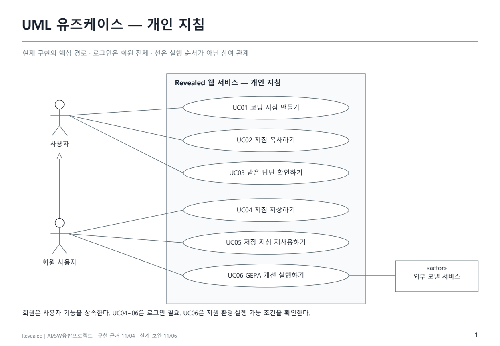
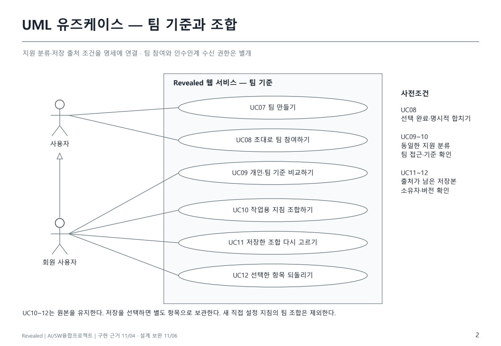
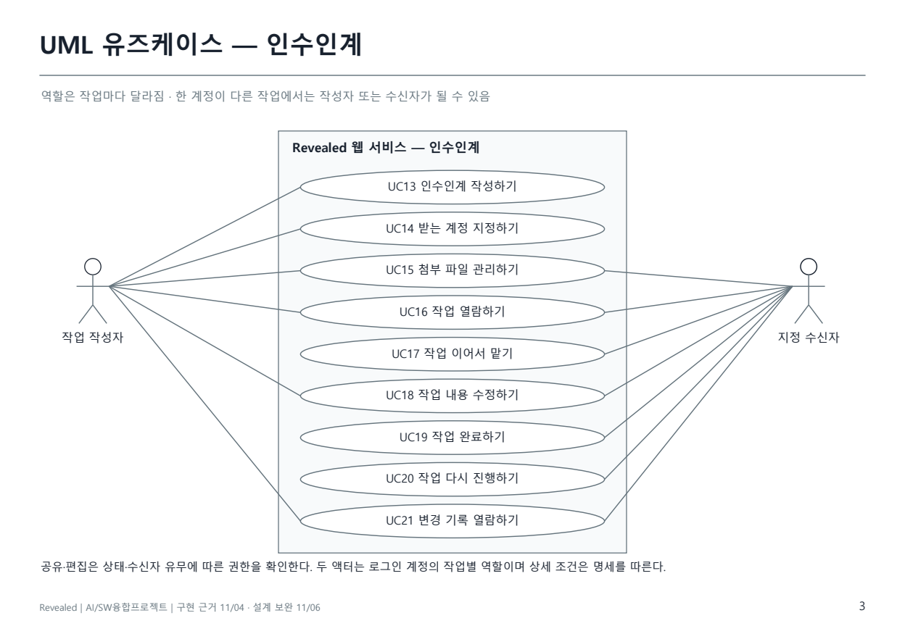
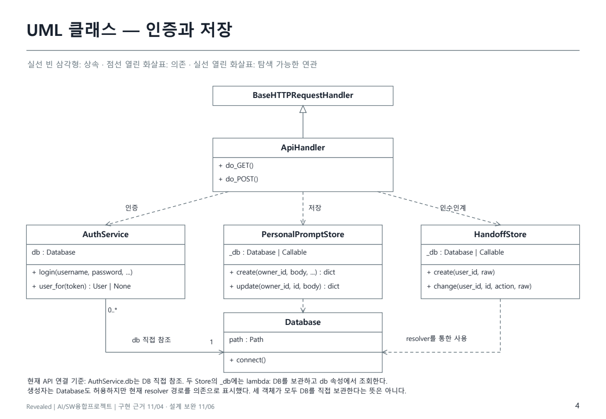
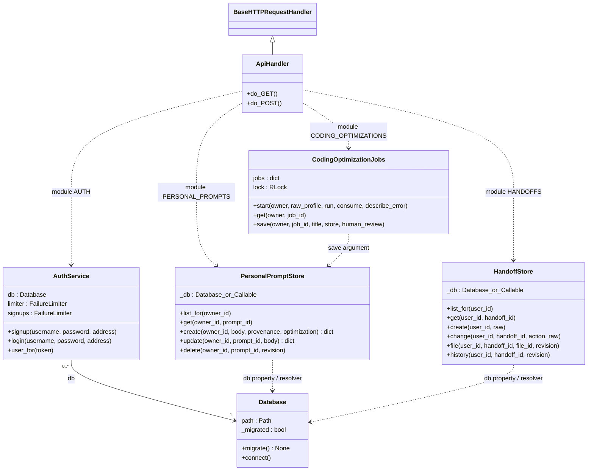
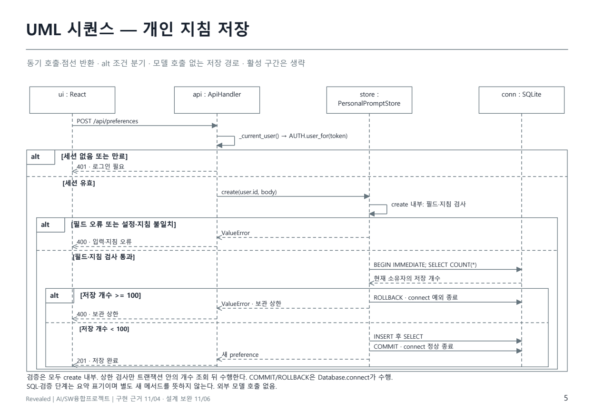
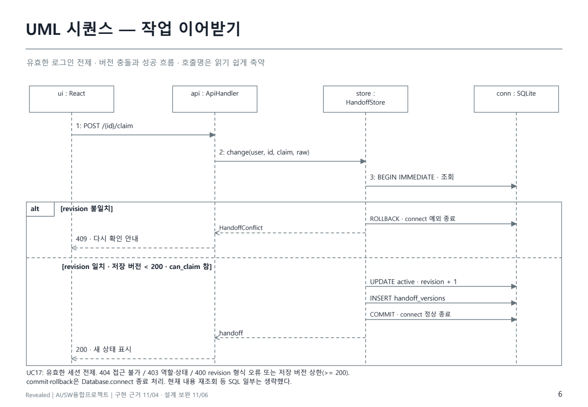
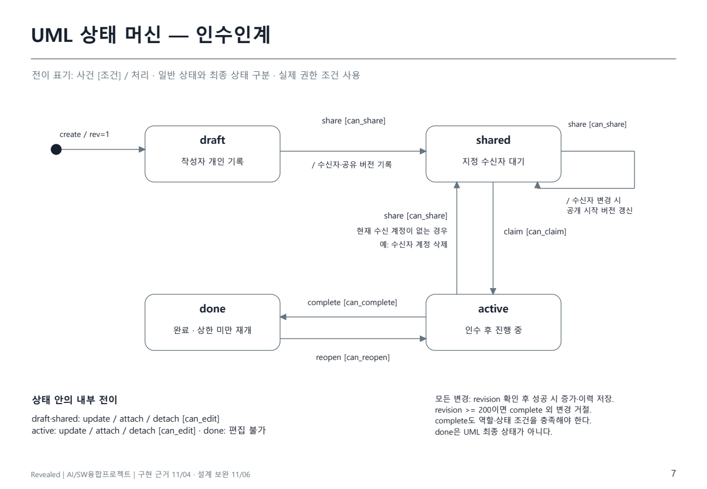

## 6. UML과 상세 동작 명세

11/05 보완: 보고서 11~13쪽의 관계 표기를 수정하고, 읽을 수 있는 크기의 [UML 상세 PDF](../../../output/pdf/Revealed_UML_상세설계_2026-11-05.pdf)를 추가했다. 아래 그림은 같은 PDF에서 생성한 이미지다. 기능 구현이나 새 실험을 추가한 결과는 아니다.

11/06 추가 검토: 클래스 관계의 주입 방식, 저장소 내부 검증과 트랜잭션 순서, 이어받기의 버전 상한·오류 조건을 코드와 다시 대조했다. 보고서와 UML 별첨의 공통 그림 및 명세를 함께 수정했다.

### 6.1 기존 그림의 검토 결과와 표기 원칙

기존 유즈케이스 그림은 여러 목적을 한 타원에 묶었고, 외부 모델 액터의 표기가 불완전했다. 클래스 그림은 상속을 문장으로만 적고 의존·연관선을 합쳐 연결 대상을 읽기 어려웠다. 기존 Mermaid `flowchart` 대응도는 사용자와 기능의 대응을 설명하는 보조 그림이었으며 정식 UML 유즈케이스 도식으로 제출하기에는 부족했다.

단순한 그림 자체가 UML 위반은 아니다. 이 문서에서는 **표기의 적합성**, **현재 코드와의 일치**, **상세 설계에 충분한 설명**을 따로 확인했다. 클래스의 일부 속성·메서드 생략은 허용하되 그림의 범위를 표시한다. 모든 사용 목적을 한 장에 넣지 않고 개인 지침·팀 기준·인수인계의 세 관점으로 나눴다.

표기 기준은 [OMG UML 2.5.1](https://www.omg.org/spec/UML/2.5.1) 18장(Use Cases), 9·11장(Classifiers/Structured Classifiers), 17장(Interactions), 14장(State Machines)이다. 일반화의 빈 삼각형은 상위 역할·클래스 쪽을 가리키며, 의존은 사용하는 쪽에서 대상 쪽으로 점선 화살표를 그린다. 액터와 유즈케이스의 실선은 참여 관계이고 클릭 순서가 아니다.

`include`는 포함 행동을 수행하는 관계, `extend`는 확장 지점에서 추가 행동을 삽입하는 관계다. 단순히 다음 버튼이거나 선택 기능이라는 이유만으로 붙이지 않았다. 이 모델은 독립적으로 시작할 수 있는 사용 목적과 사전조건을 중심으로 작성하여 두 관계를 사용하지 않았다. 로그인은 저장 등 회원 기능의 사전조건이며 매번 로그인 유즈케이스를 실행한다는 의미가 아니다.

시스템 구성도는 논리적 구성 설명, ERD는 관계형 데이터 모델, 와이어프레임은 화면 설계다. 세 자료를 UML 다이어그램으로 부르지 않는다. 기존 보고서 16쪽의 간단한 화면 그림은 배치·이동을 설명하는 요약 와이어프레임이며, 실제 화면과 필드·상태 명세는 9절 및 보고서 17~18쪽으로 보완한다.

### 6.2 Use Case 관점별 그림

회원 사용자는 일반 사용자 역할을 특수화한다. 따라서 지침 생성·복사·답변 확인을 이용할 수 있고 저장·저장본 재사용·GEPA 실행에는 로그인 조건이 더해진다. 외부 모델 서비스는 GEPA 실행에 참여하는 외부 시스템 액터다. 사용자가 복사한 지침을 다른 AI에 붙여 넣는 작업은 이 서비스 밖에서 일어나므로 API 연결 관계로 그리지 않았다.

팀 참여, 개인·팀 비교, 조합, 재조합, 선택 되돌림은 서로 구분했다. 현재 API에서 팀 생성·선택 이력 합치기는 비로그인 사용자 경로도 허용한다. UC08은 초대 코드로 연결한 뒤 선택을 마치고 명시적으로 팀에 합치는 단계까지를 뜻한다. UC09~12는 로그인한 개인 보관함 경로다. UC10~12의 저장은 각 흐름에서 사용자가 선택하는 대안 단계다. 보관한 원본은 유지하고 새로운 항목을 만든다. 직접 설정한 새 코딩 지침을 기존 React 팀 기준에 조합하는 기능은 현재 범위에 없다.

작성자·수신자는 특정 작업에 대한 역할이다. 한 사람이 모든 작업에서 같은 역할인 것은 아니다. 두 액터의 연결선은 권한이 항상 허용된다는 뜻이 아니다. 상태·버전·현재 수신 계정 조건은 아래 명세를 적용한다. 링크를 아는 것만으로 열람할 수 없다.

### 6.3 유즈케이스 목록과 요구사항 추적

아래는 이번 주 변경의 핵심 범위다. 기존 비교 서비스와 작업 공간의 모든 내부 동작을 전수 모델링했다는 뜻은 아니다. UC22~25는 기존 유지·다른 화면의 기능으로 목록에 남기고 위 세 그림에서는 생략했다.

| ID | 사용자 목적 | 요구사항 | 조건·주요 결과 | 코드 근거 |
|---|---|---|---|---|
| UC01 | 코딩 지침 만들기 | FR03 | 환경·4항목 완성, 준비 예시 또는 직접 설정, 모델 호출 없이 조립 | coding_instructions.py / coding_examples.py |
| UC02 | 지침 복사하기 | FR03·04 | 지침 또는 이번 작업을 포함한 요청을 복사 | frontend/src/features/coding-instructions/ |
| UC03 | 받은 답변 확인하기 | FR10 | 형식 단서와 직접 확인 질문; 코드 실행·자동 저장 없음 | coding_answer_review.py |
| UC04 | 지침 저장하기 | FR04 | 로그인, 본문·설정 일치 확인, 새 개인 항목 생성 | personal_prompts.py |
| UC05 | 저장 지침 재사용하기 | FR04 | 소유자 접근, 설정·본문 불일치 안내 | personal_prompts.py / frontend/src/features/preferences/ |
| UC06 | GEPA 개선 실행하기 | FR09 | 지원 환경·실행 준비·한도 확인, 개선 후보 비교 후 새 저장 선택 | coding_optimization_jobs.py / coding_gepa.py |
| UC07 | 팀 만들기 | FR05 | 팀 이름·분류 설정, 비로그인 경로도 허용 | team.py / api_server.py |
| UC08 | 초대로 팀 참여하기 | FR05 | 유효한 초대 코드, 선택 완료 후 명시적 합치기 | team.py / api_server.py |
| UC09 | 개인·팀 기준 비교하기 | FR05 | 지원 분류와 접근 조건 확인, 차이 표시 | preference_comparison.py |
| UC10 | 작업용 지침 조합하기 | FR05 | 항목별 기준 선택, 현재 기준·버전 확인, 별도 저장 선택 | preference_comparison.py / api_server.py |
| UC11 | 저장한 조합 다시 고르기 | FR06 | 저장 출처에서 재선택, 새 저장본·부모 연결 | saved_preference_remix.py |
| UC12 | 선택한 항목 되돌리기 | FR06 | 변경 전 기록이 있는 항목만 선택 복원, 새 저장 선택 | saved_preference_restore.py |
| UC13 | 인수인계 작성하기 | FR07 | 로그인, 목적·진행·남은 일 저장, draft / revision=1 | handoffs.py:create |
| UC14 | 받는 계정 지정하기 | FR07 | can_share, 같은 서버의 다른 계정, shared 전환 | handoffs.py:change |
| UC15 | 첨부 파일 관리하기 | FR07 | can_edit, 파일 크기·개수·누적 한도, 추가·제외 이력 | handoffs.py / handoff_files.py |
| UC16 | 작업 열람하기 | FR07 | 현재 소유자·수신자; 파일은 요청 버전의 목록도 확인 | handoffs.py:get / file |
| UC17 | 작업 이어서 맡기 | FR07 | 현재 지정 수신자·shared·저장 revision < 200, active 전환 | handoffs.py:change |
| UC18 | 작업 내용 수정하기 | FR07 | can_edit와 revision 확인, 변경 기록 추가 | handoffs.py:change |
| UC19 | 작업 완료하기 | FR07 | 현재 수신자·active, done 전환 | handoffs.py:change |
| UC20 | 작업 다시 진행하기 | FR07 | 현재 수신자·done, active 전환 | handoffs.py:change |
| UC21 | 변경 기록 열람하기 | FR07 | 수신자는 본인 공유 시작 버전 이후만 접근 | handoffs.py:history |
| UC22 | 계정 가입·로그인 | FR01 | 세션 발급, 인증·실패 제한 | auth.py |
| UC23 | 기존 결과 비교로 지침 만들기 | FR02 | 기존 요약·React 선호 추정 경로 유지 | service.py / engine/ |
| UC24 | 템플릿으로 업무 지침 만들기 | FR08 | 기존 비교 6개, 새 업무 초안 18개 | template_library.py / prompt_workspace/ |
| UC25 | 요청 구조 점검하기 | FR08 | 템플릿 내부 진입, 점검 결과 확인 | api_server.py / prompt_workspace/ |

FR11의 화면 이동 후 초안·작업 복귀는 **미완료 요구사항**이며 완료한 유즈케이스로 추가하지 않았다. UML 정리는 연구의 개선 효과나 사용자 만족도를 입증하지 않는다.

### 6.4 핵심 유즈케이스 상세 명세

#### UC04 지침 저장하기

- 주 액터: 회원 사용자. 시작: 완성한 지침에 이름을 입력하고 저장 요청.
- 사전조건: 유효한 로그인, 제목·분류·지침 등 필수 입력. 직접 설정 지침이면 선택 설정이 완성되어야 한다.
- 기본 흐름: POST `/api/preferences` → API의 `_current_user()`로 세션 확인 → `PersonalPromptStore.create()` → Store 내부 필드 검사 → `codingProfile`이 있으면 다시 조립하여 본문과 대조 → `Database.connect()` 안에서 `BEGIN IMMEDIATE` → 소유자별 `SELECT COUNT(*)`로 보관 한도 100개 검사 → 새 행 저장·조회 → 연결 컨텍스트 정상 종료 시 commit → 201 응답.
- 대안: 일반 저장 지침처럼 `codingProfile`이 없는 경우 환경 설정 대조 단계는 적용하지 않는다. 개선본 저장은 UC06의 서버 작업 결과에서 별도로 수행한다.
- 실패: 세션 없음·만료 401. create 내부의 입력·본문 불일치·보관 상한은 `ValueError`이고 API가 400으로 변환한다. 입력·본문 검사 실패는 트랜잭션 시작 전, 상한 실패는 트랜잭션 시작 후이며 후자는 컨텍스트 예외 종료 시 rollback된다. 새 항목을 생성하지 않는다.
- 사후조건: 소유자, 지침, 설정이 있는 경우 그 스냅샷, revision=1을 기록한다. 이번 작업 원문과 답변은 자동 저장하지 않는다.
- 연결: FR04, NFR01·02·03. SQLite `personal_prompts`. 아래 저장 시퀀스 참조.

#### UC06 GEPA 개선 실행하기

- 주 액터: 회원 사용자. 보조 액터: 외부 모델 서비스.
- 사전조건: 지원하는 환경과 완성한 원본 지침, 실제 실행 준비, 로그인·사용량·동시 작업 조건 충족.
- 기본 흐름: 사용자 실행 요청 → 서버 조건 확인 → 작업 생성 → 후보 탐색과 별도 과제 검사 → 결과 조회 → 전후 지침·답변과 검사 범위 확인.
- 대안: 같은 계정의 동일 설정 작업이 진행 중이면 해당 작업을 반환한다. 더 나은 후보가 없으면 원본을 유지한다. 개선 후보를 채택하고 직접 판단을 입력하면 서버 작업 결과를 이용해 **새 항목**으로 저장한다.
- 실패: 미지원 환경, 한도 초과, 모델 오류, 소유자가 다른 작업 조회 등을 각 API 계약에 따라 거절·실패 처리한다. 실패를 개선 성공으로 집계하지 않는다.
- 사후조건: 실행 결과는 서버 메모리 작업에 남는다. 채택 저장본만 SQLite에 지속된다. 서버 재시작 시 진행 작업을 영구 복구한다는 보장은 없다.
- 연결: FR09, NFR04·06. 실행 경로와 자동 검사는 구현되어 있으나 모든 환경의 효과가 입증된 것은 아니다.

#### UC14 받는 계정 지정하기

- 주 액터: 작업 작성자. 사전조건: 로그인, 작업 접근 가능, `can_share=true`, 최신 revision, 같은 서비스의 다른 계정.
- 기본 흐름: username·revision 요청 → 접근·버전·권한 검사 → 수신 계정 확인 → 수신자가 바뀌면 공개 시작 버전을 다음 revision으로 설정 → shared 및 이력 저장.
- 대안: shared에서 다른 수신자로 재지정할 수 있다. 현재 수신자가 제거되어 NULL이고 작업이 done이 아니면 작성자의 재지정이 가능하다.
- 실패: 접근 불가 404, 버전 충돌 409, 역할·상태 불일치 403, 존재하지 않는 계정·자기 자신 지정·revision 형식 오류·저장 버전 상한 400.
- 사후조건: 현재 지정 계정만 수신자 권한을 갖는다. 재지정된 이전 수신자의 접근은 유지되지 않는다. 링크 생성은 권한 부여의 근거가 아니다.

#### UC17 작업 이어서 맡기

- 주 액터: 지정 수신자. 사전조건: 유효한 로그인, 현재 작업의 recipient, shared 상태, 최신 revision, 현재 저장 revision < 200.
- 기본 흐름: POST `/api/handoffs/{id}/claim` → `BEGIN IMMEDIATE` → 접근 가능한 현재 작업 조회 → 요청 revision의 형식·현재 값 일치 확인 → 저장 revision 상한 확인 → `can_claim` 확인 → active와 revision+1 저장 → 같은 트랜잭션으로 이력 기록 → `Database.connect()` 컨텍스트 정상 종료 시 commit → Store 반환 → 200 응답.
- 실패: 세션 없음 401, 접근 불가 404, 버전 충돌 409, 역할·상태 불일치 403. **400은 저장 revision >= 200인 경우와 요청 revision의 누락·형식 오류·1 미만인 경우 모두 발생**한다. `expected_revision()`은 정수가 아닌 값(문자열·bool 포함)도 거절한다. 실패 시 변경을 확정하지 않는다. API 검사의 실제 순서상 여러 조건에 동시에 걸리면 먼저 검사한 오류가 반환된다.
- 사후조건: 지정 수신자가 편집할 수 있다. 변경 전후 상태·버전이 추적 가능하다. 화면은 서버 응답을 반영한다.
- 연결: FR07, NFR01·02. `handoffs`와 `handoff_versions`를 함께 사용한다.

### 6.5 Class Diagram

그림의 `ApiHandler`는 `BaseHTTPRequestHandler`를 실제 상속한다. 인증·개인 보관함·인수인계 객체는 API 모듈 전역으로 사용하므로 핸들러의 소유 속성이나 합성(composition)으로 만들지 않았다. **그림은 현재 `api_server.py`의 객체 연결을 기준으로 한다.** `AUTH = AuthService(DB)`는 Database 객체를 직접 참조하지만 `PERSONAL_PROMPTS = PersonalPromptStore(lambda: DB)`와 `HANDOFFS = HandoffStore(lambda: DB)`는 `_db`에 Callable을 보관한다. 두 Store의 `db` 속성이 그 함수를 호출해 현재 Database를 조회하므로 이 경로를 의존으로 표시했다. 이유와 현재 주입 방식을 PDF 하단에도 명시했다.

두 Store의 생성자 자체는 Database 객체의 직접 주입도 허용한다. 그런 사용례를 모델링한다면 연관 관계로 표현할 수 있으며, 세 클래스를 추상적인 DB 접근 서비스로 묶은 개요도에서 관계를 통일하는 것도 별도의 모델링 선택이다. 현재 그림을 세 객체 모두 DB를 직접 보관한다는 모델로 읽지 않도록 구분했다. `0..*`와 `1`은 AuthService 인스턴스와 Database 참조의 관계이며 행 개수가 아니다.

속성·메서드는 핵심만 표시한다. `...`는 선택 인수 생략, `id`는 prompt_id 또는 handoff_id의 축약이다. Python 내부 속성 `_db`를 언어가 강제하는 private로 재해석하지 않았다. 아래는 편집용 상세 클래스 모델이다.

`Database_or_Callable`은 Python union을 읽기 쉽게 쓴 표기 별칭이지 새 클래스가 아니다. 선택 인수와 키워드 전용 인수의 기본값은 실제 시그니처를 따른다. 지침 조립·재조합은 함수 모듈이므로 존재하지 않는 클래스를 추가하지 않았다.

### 6.6 Sequence Diagram

이 그림은 UC04의 인증 실패·입력 불일치·보관 상한·정상 저장을 중첩 alt로 구분한다. 바깥 alt는 세션 유효성만 다루며, 로그인 성공 뒤 create를 호출한다. 필드·지침 대조는 Store 내부에서 수행하고, 통과해야 BEGIN IMMEDIATE와 소유자별 개수 조회로 진행한다. 그 뒤 저장 개수 상한을 판단한다. 따라서 입력 불일치 때도 DB 개수를 먼저 센다고 읽히지 않도록 상한 분기를 한 단계 더 나눴다.

인증은 API의 실제 자기 호출 `_current_user()`로 그렸다. 그 안에서 `AUTH.user_for(token)`에 위임하며, 같은 요청에 `_user_cache`가 이미 있으면 재사용한다. 라이프라인은 참여 객체, 실선 채운 화살표는 동기 호출, 점선은 반환이다. 활성 구간은 생략했다. `conn : SQLite`는 연결 컨텍스트가 관리하는 DB 연결을 나타낸다. COMMIT/ROLLBACK 화살표는 `Database.connect()` 컨텍스트 종료의 효과를 DB 연결 쪽에 표현한 것이며, Store 코드가 직접 commit 메서드를 호출한다는 뜻은 아니다. SQL 저장·조회와 내부 검증 단계는 읽기 위한 요약 표기다.

UC17의 버전 충돌과 정상 전환을 비교한다. 상태 업데이트와 버전 기록은 같은 트랜잭션이며 정상 컨텍스트 종료의 COMMIT 이후 Store가 반환한다. 충돌은 예외 종료의 ROLLBACK 이후 API가 409로 변환한다. 그림에는 유효한 로그인 전제를 두었으며 400·403·404는 하단과 UC17 명세로 분리했다. 400의 구체적 원인은 요청 revision 형식과 저장 버전 상한이다. 정상 분기에도 저장 revision < 200 조건을 표시했다. 이 다이어그램은 새로 수행한 실행 로그가 아니라 현재 코드에서 정리한 설계 설명이다.

### 6.7 State Machine과 권한

상태 이름 draft/shared/active/done은 실제 저장값이다. done은 reopen으로 active로 돌아갈 수 있는 일반 상태이며 UML 최종 상태 기호를 사용하지 않는다. 내부 전이인 내용 수정·첨부 변경은 상태를 유지하면서 revision과 이력을 갱신한다.

| 조건 | 코드와 대응하는 의미 |
|---|---|
| waiting | status가 draft/shared이거나 recipient_id가 NULL |
| can_edit | done이 아니며 (작성자이고 waiting) 또는 (현재 수신자이고 active) |
| can_share | 작성자이고 waiting이며 done이 아님 |
| can_claim | 현재 수신자이고 shared |
| can_complete | 현재 수신자이고 active |
| can_reopen | 현재 수신자이고 done |

모든 변경은 먼저 요청 revision의 형식과 현재 값 일치를 검사한다. 변경 성공 시 revision을 늘리고 이력을 기록한다. 일반 경로 외에도 **수신 계정 삭제 시 recipient_id 외래키의 ON DELETE SET NULL**로 대상이 없는 active 작업이 생길 수 있으며 이때 작성자가 다시 공유할 수 있다. shared 자기 전이의 효과는 `/ 수신자 변경 시 공개 시작 버전 갱신`으로 통일했다. 같은 수신자를 지정하면 공유 시작 버전을 새로 잡지 않는다.

**현재 저장 revision >= 200이면 complete를 제외한 변경을 거절한다.** complete에도 기존 `can_complete` 권한·상태 검사와 요청 revision 검사가 적용된다. 따라서 done에서 active로 돌아가는 reopen은 상한 미만에서만 가능하다. 그림 하단의 공통 제약은 모든 상태 전이·내부 변경에 적용한다.

### 6.8 설계 검토와 다음 확인

- 문서 보완 완료: 유즈케이스 3개 관점·핵심 목적 21개, 보조 기능 목록, 핵심 UC 4개 상세 명세, 클래스 관계 수정, 시퀀스 2개, 상태·권한 명세, 기존 전체 13개 ERD·테이블/API와 연결.
- 아직 전수 상세 명세는 아님: 모든 메뉴·계정 관리·작업 공간 동작의 상세 UC는 필요 시 확장한다. 보고서는 대표 그림이며 상세 설계문서와 함께 공유한다.
- 후속 검증 제안: 2개 계정으로 공유→수신→버전 충돌→재개를 확인하고, 초안 보존·진행 작업 재열람 요구사항을 점검한다. 이번 도식 수정 중 이를 새로 실행했다고 보고하지 않는다.

### 6.9 11/06 UML 동료 검토 판정

| 지적 | 코드 대조 판정 | 반영 |
|---|---|---|
| 세 DB 관계선 통일 | 현재 API 주입 방식은 서로 다름. 무조건 같은 선이어야 하는 것은 아님 | 점선 의존의 Callable 근거를 PDF 4쪽에도 명시 |
| 저장 검증 위치 | 맞음. 필드·지침과 상한 검증 모두 create 내부이며 상한은 트랜잭션 안 | 5쪽 중첩 alt와 DB 조회·검증 순서 수정 |
| 인증 호출·commit 표시 | 맞음. API 자기 호출과 컨텍스트 종료 효과를 더 명확히 표시해야 함 | 5쪽 자기 호출, 5·6쪽 DB 연결로 향하는 commit·rollback 메시지 |
| 이어받기 400은 상한 | 상한 누락 지적은 맞음. 상한만이 유일한 원인은 아님 | 6·8쪽 및 UC17에 revision 형식 오류와 200 상한 병기 |
| 상태도 상한·효과·계정 삭제 예 | 맞음 | 7쪽 공통 제약·효과 표기·삭제 예시 보완 |
| 중복된 사용자 표기 | 혼동 가능성이 있음 | 1쪽 상속선 옆의 별도 문구 삭제, 회원 사용자 이름 유지 |

대조 위치: `api_server.py` 124~125·344·590·936행, `personal_prompts.py` 34·41·91행, `handoffs.py` 14·118행, `app_db.py` 141·203행. 이 검토는 코드 읽기와 문서 수정이며 애플리케이션을 새로 실행한 검증은 아니다.

